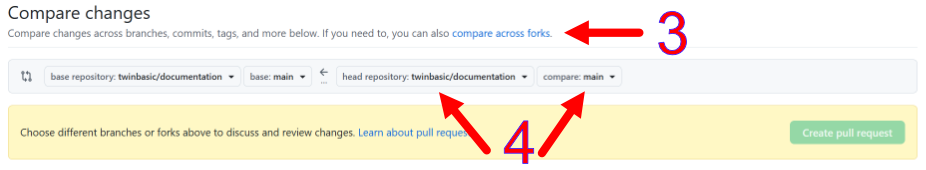
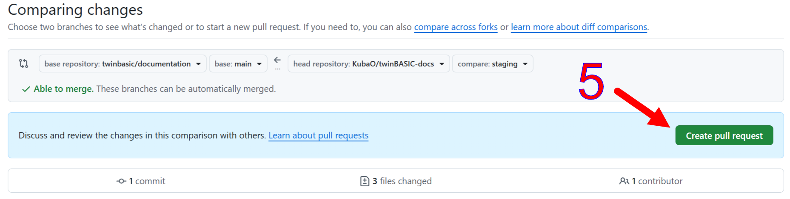
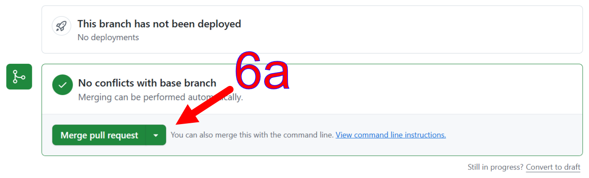
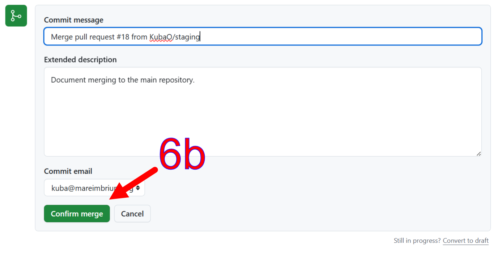
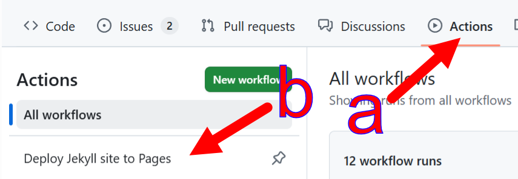
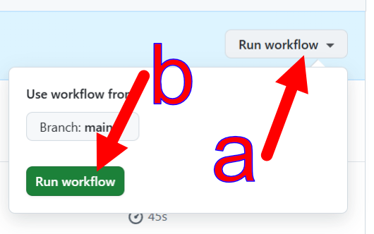

# Building and Deployment
{: .no_toc }

The day-to-day workflow for editing documentation: requirements, building, serving locally, link checking, Graphviz diagrams, screenshots, and the deployment to [docs.twinbasic.com](https://docs.twinbasic.com). Aimed at content contributors --- to modify the build pipeline itself, see [tbdocs Internals](Builder).

* TOC goes here
{:toc}

## Development environment

The documentation is rendered to HTML by `tbdocs`, a Node.js static site generator under [`builder/`](https://github.com/twinbasic/documentation/tree/main/builder). The day-to-day commands below are Windows batch files that wrap it. There are no shell-script counterparts, so [On macOS and Linux](#posix-equivalents) gives the command each one runs.

1. Ensure the [requirements](#requirements) below are met.

2. Fork [https://github.com/twinbasic/documentation][docs-repo] to your own GitHub account.

3. Clone your fork.

   Cloning [the documentation repository][docs-repo] itself builds fine, but it is the wrong starting point for a change: the [deployment steps](#deploying-to-docstwinbasiccom) open with *push your changes to your GitHub fork*, and a clone of upstream has no remote you can push to. The first sign is a permission error on `git push`, once the work is done.

   To recover, fork the repository on GitHub, add the fork as a second remote and push the branch there:

       git remote add fork https://github.com/<your-account>/documentation.git
       git push -u fork <your-branch>

   Only the fork needs write access. `origin` can keep pointing at upstream.

### Requirements

- **Node.js 22+** for `tbdocs`.
- **`npm ci`** at the repository root installs everything: the site generator's dependencies and the PDF renderer's. `build.bat` and `serve.bat` assume it has run.
- **Chromium** is required for four things: rendering the PDF book (`book.bat`), two of `check.bat`'s steps --- the diagram-fit check (`scripts/check_dot_fit.mjs`) and the accessibility scan (`scripts/check_a11y.mjs`) --- and one of `test.bat`'s, the axe source-patch equivalence check (`scripts/check_axe_patch_equiv.mjs`). `npm install` normally fetches it with `puppeteer`'s postinstall; if that step was skipped, run `npx puppeteer browsers install chrome`. Add `--install-deps` only on Linux: it installs system packages and needs root. `build.bat` and `serve.bat` do not need Chromium.
- **Windows and a twinBASIC IDE install**, for [`scripts/tbbuild.mjs`](Tools-Compiler#tbbuild) alone. It compiles a `.twinproj` unattended by driving a real IDE, which is how a claim about the *language* is checked against the compiler. Skip it unless you are writing or verifying a probe project.

### On macOS and Linux
{: #posix-equivalents }

`tbdocs` and all the gates are Node programs, and CI runs all but one of them on `ubuntu-latest` (see [What CI deliberately does not run](#what-ci-deliberately-does-not-run)). Only the five wrappers are Windows-specific. This section gives what each one runs.

**Run these commands from the repository root.** The `.bat` files work from any directory; the commands do not, because `--src docs` and the other paths resolve against the working directory.

| Wrapper | Runs |
|---|---|
| `build.bat [flags]` | `node builder/tbdocs.mjs --src docs --check-audit-index [flags]` |
| `serve.bat [flags]` | `node builder/tbdocs.mjs --src docs --serve [flags]` |
| `check.bat` | the scripts below, in a fixed order |
| `test.bat` | the scripts below, in a fixed order |
| `book.bat` | a `mkdir`, then one `render-book.mjs` invocation, below |
| `examples.bat [flags]` | `node scripts/check_examples.mjs [flags]` --- not part of the build; see below |

`examples.bat` compiles the documentation's own twinBASIC code samples. It needs a twinBASIC install and Windows, so it is outside every gate and outside CI. [Tools and Scripts](Tools#examplesbat) has it, and [Authoring Pages](Authoring#checking-that-a-sample-compiles) says how a sample asks to be compiled.

Do not drop `--check-audit-index` when typing the underlying build command: without it the link check silently does not run (see [Building](#building)).

`check.bat` runs separate scripts, each stopping the run if it fails. [`check_tree_fresh`](Tools-Site-Checks#check-tree-fresh) runs first, so a stale tree fails cheaply. [`check_a11y`](Tools-Site-Checks#check-a11y) is second although slowest, so CI can start it first alongside the book render:

    node scripts/check_tree_fresh.mjs \
      && node scripts/check_a11y.mjs \
      && node scripts/check_dot_fit.mjs \
      && node scripts/pick_a11y_sample.mjs --check

`test.bat` has the same shape, cheapest first:

    node scripts/check_publish_policy.mjs \
      && node scripts/check_gate_lists.mjs \
      && node scripts/check_ci_workflows.mjs \
      && node scripts/check_lint.mjs \
      && node --test test/search.test.mjs \
      && node --test test/render.test.mjs \
      && node --test test/strftime.test.mjs \
      && node --test test/png.test.mjs \
      && node --test test/compact-image.test.mjs \
      && node --test test/svgshot.test.mjs \
      && node --test test/example-batches.test.mjs \
      && node --test test/ports.test.mjs \
      && node --test test/addin-project.test.mjs \
      && node scripts/check_regex_safety.mjs \
      && node scripts/check_code_regions.mjs \
      && node scripts/check_page_baseline.mjs \
      && node scripts/check_book_coverage.mjs \
      && node scripts/check_symbol_index.mjs \
      && node scripts/check_twin_parsers.mjs \
      && node scripts/check_attribute_sweep.mjs \
      && node scripts/check_cli.mjs \
      && node scripts/check_pdf_shims_equiv.mjs \
      && node scripts/check_impexp_parity.mjs \
      && node scripts/check_axe_patch_equiv.mjs

`book.bat` creates `docs/_pdf/` first, because `render-book.mjs` never creates the directory above its output and otherwise fails with `ENOENT` after the whole page-breaking pass. The deploy workflow does the same:

    mkdir -p docs/_pdf
    node book/render-book.mjs docs/_site-pdf/book.html \
      -o "docs/_pdf/twinBASIC Book.pdf" \
      --outline-tags h1,h2,h3,h4 \
      --additional-script perf/detach-pages.js

`book.bat` also runs `scripts/check_tree_fresh.mjs` over `docs\_site-pdf\`, which refuses a stale or absent tree (see [`book.bat`](Tools#bookbat)). It runs `npm install` itself when `node_modules\puppeteer` is absent; run `npm ci` first if the renderer cannot find puppeteer.

**A local accessibility pass is weaker than CI's, on every platform.** A machine whose `system-ui` font is larger than CI's passes controls that the runner then fails. See [`fonts-liberation`, installed on purpose](#fonts-liberation-installed-on-purpose).

## Building

To render the documentation from `.md` files into `_site/` (online), `_site-offline/` (offline mirror) and `_site-pdf/` (sparse PDF source):

    build.bat

or directly, from the repository root:

    node builder/tbdocs.mjs --src docs --check-audit-index

`--check-audit-index` implies `--check`. Without it the build produces the same three trees but runs no [link check](#checking-link-integrity).

The `also_build_offline` and `also_build_pdf` keys in `_config.yml` toggle the sibling outputs; so do the `--no-offline` and `--no-pdf` flags, if you only want `_site/`.

Every build writes `add-in/Resources/HELP/site.zip`, an archive of the offline tree that the IDE help add-in embeds, and prints one line for it. The file is not committed. `--no-help-archive` turns the step off. [Build and Generation Tools](Tools-Build#the-help-archive) describes the archive.

Every build also packs the help add-in's source folder, `add-in/`, into `tB/IDE/AddIns/downloads/tbDocsHelp.twinproj` in the online tree, which [Help Add-In](../../tB/IDE/AddIns/Help) offers as a download, and prints one line for it. Only files git tracks are packed. The offline tree holds no copy; its links to the file open the website's. [Build and Generation Tools](Tools-Build#the-help-add-ins-project-file) describes the file.

Every `tbdocs` flag is described on the [Build and Generation Tools](Tools-Build#tbdocs) page.

**A build that stops with `Nav-parent orphan detected` or `Nav-parent ambiguity detected`** has pages whose `parent:` names no page, or a title two pages share --- most often after a page's `title:` changed. [Authoring Pages](Authoring#nav-parent-orphan) has the fix for each message.

### What a healthy run looks like
{: #a-healthy-run }

The rest of this page is about failure. This is the shape of a clean run.

`build.bat` ends with a summary, a per-tree link report and its timings:

    Done in 4685ms: 908 pages, 247 static files
      _site           871099 occurrences -- 0 broken, 0 integrity
      _site-offline   869285 occurrences -- 0 broken, 0 forbidden, 0 integrity
      _site-pdf        13703 occurrences -- 0 broken, 18 out of book, 0 integrity  (informational)

**The third line looks like a failure and is not.** The book is a subset of the site, so some of its links name pages it does not carry. Each opens the page on the website instead, and the report lists it above the summary as `OUT OF BOOK`. This pass is *informational* and does not affect the exit code. All three lines must read `0 broken`.

A few seconds is normal: about 2--3 seconds of work plus the link check. A run still going after a minute is a [stall](#when-a-build-stops).

A healthy run prints no `book:` line under its `pdf:` summary. That line warns about a page `docs/_book.yml` mentions neither in the book nor in its `left_out:` list; see [Book Configuration](Book-Configuration#pages-left-out-of-the-book).

`check.bat` runs its four gates in order and ends on the scan's tally:

    14 pages x 2 theme(s) x 2 viewport(s) + 8 state audit(s) checked: 0 violation(s), 46 incomplete check(s)

**Incomplete is not a violation.** Those are checks axe declined to decide, most often a colour-contrast node whose background it could not resolve. They are printed for a human and not gated. `0 violation(s)` is the pass condition. `test.bat` prints each gate's probes and a line per gate; every probe passes on a clean tree.

Three more things are normal:

- A page-count **rise** rewrites `builder/page-baseline.json` and says so in the log. Commit the file.
- A new heading on a reference page does the same to `builder/symbol-baseline.json`, for the [symbol index](#the-symbol-index), and to the help add-in's copy of the index.
- `git status` can show a regenerated diagram `.svg` or `gantt.svg`. Both are committed artifacts.

### When a build stops instead of failing
{: #when-a-build-stops }

A build that *fails* says so and sets an exit code. A build that **stops** prints its last progress line and sits there, because a worker is inside a handler that never returns: an unbounded loop, a promise that never settles, or a [regex backtracking exponentially](#tests-of-the-toolchain).

A watchdog catches this. When no task has completed for two minutes, it abandons the run, prints what was outstanding, and exits 2:

    BUILD STALLED -- no task completed for 121s.
    13 of 335 tasks outstanding.

    Claimed by a worker that never returned -- start here:
      render:19
        Features/Project-Configuration/Compiler-Options.md
        Features/Compiler-IDE/Compiler-Warnings.md
        Reference/Default/VBA/Compilation/CompilerVersion.md
        Reference/Core/Concat.md
        Reference/Core/Const.md
        Reference/Built-In/CustomControls/Constants.md

    Blocked on a predecessor (consequence, not cause):
      renderJoin  <- render:19
      flushJoin  <- flush:19
      searchData  <- renderJoin
      flush:19  <- render:19
      ... and 8 more

**Read the first list and ignore the rest.** A task is *claimed* while a worker is inside its handler, so that list is the cause. Everything under *Blocked on a predecessor* is the consequence. A third list, *Runnable, but nothing picked it up*, appears when a task is ready and no lane took it.

For a `render:` or `flush:` chunk the report prints the source pages the chunk covers. Act on those: the fault is nearly always one page's content meeting a pattern in the build. Bisect by moving pages out of `docs/` and rebuilding.

If **nothing** is claimed, the task graph itself is wedged: a task's `expected` list names a predecessor that never submits. That is a builder change; [Extending the Builder](Extending#adding-a-pipeline-task) covers the declaration.

`--stall-timeout <seconds>` moves the limit; `--stall-timeout 0` disables the watchdog. Raise the limit rather than disabling it. Two minutes is generous, since the longest single task in a normal build is worker startup, under two seconds.

Under `serve.bat` a stall also replaces the whole worker pool before the next rebuild, so a wedged worker does not fail every later build.

## Building and local serving

To *look* at a change --- a styling change, a new page's layout, a diagram in context --- use `serve.bat`, which serves over HTTP:

    serve.bat

This runs `tbdocs --serve`. After an initial build, an HTTP server binds to port 4000 (`--port <N>` changes it). A recursive source-tree watcher starts a debounced rebuild on each file change, and any browser tab open on the page reloads after each successful rebuild. Only failures (4xx, 5xx, server exceptions) are logged. Ctrl+C exits.

Serve writes to `docs/_serve/`, separate from `build.bat`'s `_site/` family. A one-off `build.bat` (to refresh `_site-pdf/` for `book.bat`, say) never touches the tree the preview is serving.

The watcher is on `docs/`, and the worker pool outlives a rebuild, so a change under `builder/` needs Ctrl+C and a re-run before the preview shows it --- see [why `serve.bat` does not show a builder change](Extending#serve-does-not-reload). Page content and `docs/_sass/` are watched as normal.

### Why not just open the built files
{: #why-not-file-urls }

Opening a page straight out of `_site/` by double-clicking it is obvious, and wrong. The online tree references its stylesheets, fonts and scripts with root-absolute URLs (`/assets/css/...`). Under `file://` those find nothing and the page renders as unstyled markup, with no error. Any conclusion drawn from it about colour, spacing, layout or contrast is worthless.

`_site-offline/` renders correctly over `file://`, because its build rewrites every root-absolute asset URL to a page-relative one. That is why the [accessibility scan](#checking-accessibility) points headless Chromium at `_site-offline/`.

In short, **puppeteer for measuring, `serve.bat` for looking.** To see a change, use the localhost server, which serves the tree a reader gets, with search and the theme toggle live.

## Checking link integrity

The link check is part of the build. `build.bat` passes `--check-audit-index`, and the check reads the HTML the build already holds in memory:

    build.bat

It covers all three trees:

- `_site/`, the online tree.
- `_site-offline/`, the `file://`-browsable mirror. It also carries `--forbid 'https://docs.twinbasic.com'`, so a live-site link is flagged, except the links the rewrite writes to the few files only the website holds, such as the help add-in's download.
- `_site-pdf/book.html`, informational, listing as `OUT OF BOOK` every link that leaves the book for the website.

Every tree is also checked for HTML well-formedness, duplicate `id`s, anchor resolution, accessibility hints and remote ``. The online tree adds sitemap, search-index and canonical-URL integrity. The same check runs in CI on every pull request and every push to `staging`.

A failing check does not abort the build, since a broken link still produces a site worth looking at. It sets exit code 1 instead, for link failures, integrity failures or both. The summary lines say which.

[`scripts/check_links.mjs`](Tools-Site-Checks#check-links) is the tool for a tree this build did not produce: a release zip, a bisect, someone else's artifact.

## What the build refuses to publish

Every file under `docs/` that is not a page is copied into the published site unchanged. The build refuses any type not on an allowlist, [`builder/publish-policy.mjs`](Builder#module-map), so a stray `.bak`, `.pem`, `secrets.json` or frontmatter-less `.md` cannot reach the site. It checks at two points, and `--no-check` does not skip them:

- the source inventory, before anything is written, naming the file on disk;
- the inventory each output tree will receive, which covers redirect stubs, vendored theme assets, and the generated `sitemap.xml` and `search-data.json`.

Unlike the link check, **a finding here aborts the build**. A broken link leaves a tree worth inspecting; a tree with a private key in it does not.

When the first check refuses a file of yours, the message names three ways forward, in the order to consider them:

1. Remove the file from `docs/`, or add an `exclude:` pattern for it in `_config.yml`.
2. Declare that one file in `_config.yml` under `bundle_extra:`.
3. Add its extension to `SOURCE_EXTENSIONS`. Do this only when the site is gaining a whole asset type, because every file of that type is then published.

[What may live in docs/](Authoring#what-may-live-in-docs) gives the `bundle_extra` syntax. A refusal from the second check means nothing in `docs/` produced that file, and the message names `BUILD_EXTENSIONS` instead.

`test.bat` runs [`scripts/check_publish_policy.mjs`](Tools-Toolchain-Tests#check-publish-policy) first. It asserts against named probes that a `.bak`, a `.pem`, a `.docx` and a frontmatter-less `.md` are refused and that a `.png`, a `.woff2` and `CNAME` still publish. A clean build alone cannot show this, since an allowlist widened until it refuses nothing also builds clean.

## The page-count drift guard
{: #the-page-count-drift-guard }

The build counts the pages it discovered and the static files it copied, and compares both against `builder/page-baseline.json`, the same two numbers from the last committed build. Fewer than last time is an error:

    ERROR: fewer than the last committed build -- pages 871, was 908 (-37)
           Something stopped being discovered, or content was removed on purpose.
           If the removal is intended, record it in the same commit:
             build.bat --update-page-baseline
             node builder/tbdocs.mjs --src docs --check-audit-index --update-page-baseline

A **rise** needs nothing: an ordinary local build rewrites the file and says so, and you commit it with the pages. Only a **fall** needs the flag. Both printed forms are a full build with the [link and integrity check](#checking-link-integrity), so nothing needs rebuilding afterwards.

### Why a committed number and not a constant

The guard used to be a constant, `if (pages.length < 836)`, written when the site had 836 pages. The site has {{tbdocs:pages}} today, so the constant left a margin of more than seventy pages. The loss it was meant to catch was 37 pages: a blanket `**/_*/**` rule in `_config.yml`'s `exclude:` once matched the `_App/` folder of the AppGlobalClassObject package, and nothing reported it. Repeat that today and the count reaches 871, still above 836. A floor is not a drift check.

A tight constant would fail on every legitimate removal, and a gate that fails on ordinary work gets switched off. So the number is a committed artifact that moves with the tree, like `builder/inter-metrics.json`, which [Graphviz/DOT diagrams](#graphvizdot-diagrams) below reads for its font metrics.

### Where it compares but does not write

- **CI**, recognised by the `CI` environment variable. A run there that rewrote the baseline would accept the drop it was asked to catch. A missing `page-baseline.json` is an error in CI, not a first run.
- **`serve.bat`.** Its watcher rebuilds on every save, so a half-deleted page would lower the baseline. The comparison still runs and the console says what happened.
- **`--dry-run`**, which writes no tree.

[`scripts/check_tree_fresh.mjs`](Tools-Site-Checks#check-tree-fresh) skips this file, or the build writing a raised baseline would make the tree it just produced report as stale.

## The symbol index and its drift guard
{: #the-symbol-index }

The build also writes `tB/symbols.json`: every name the reference documents --- statements, operators, attributes, and each package's modules, classes, members and enumeration values --- with the URL of the page or heading that documents it. The IDE help add-in looks up the name under the cursor in it. [Permanent Links](Permanent-Links#the-symbol-index) describes the file.

The entries come from the pages: a page's `permalink:`, and the id the build gave a heading. What the pages cannot say --- the kind of a member, the values of an enumeration --- comes from `builder/package-api.json`, a committed snapshot of what the shipped packages declare. The build never regenerates it, because that needs a twinBASIC install; [`build_package_api.mjs`](Tools-Build#build-package-api) does, when the reference is re-indexed against a newer build. The summary line gives the number of entries and of public symbols no page documents.

An installed add-in keeps its copy of the index, so a URL the index has given out must keep resolving. A page URL is protected by `redirect_from:`, but an anchor is not: rewording `### Add` to `### Add method` moves `#add` to `#add-method`, and the link check does not notice. So `builder/symbol-baseline.json` lists every URL the index has published, and a build that loses one fails:

    ERROR: 1 URL(s) the symbol index has published are no longer in it:
             /tB/Packages/tbIDE/ToolWindows#add
           An installed IDE help add-in keeps these. A reworded heading moves its anchor:
           pin the old one on it, as `{: #add }`. If the symbol is retired, follow
           Permanent Links and record the removal in the same commit:
             build.bat --update-symbol-baseline
             node builder/tbdocs.mjs --src docs --check-audit-index --update-symbol-baseline

The usual fix is the first: keep the new wording and pin the old id on the heading. New URLs need nothing --- a local build adds them to the list and says so, and you commit the file with the pages. The file is written under the same three restrictions as the page-count guard, and `check_tree_fresh.mjs` skips it.

The help add-in in `add-in/` embeds a committed copy of the index, `add-in/Resources/SYMBOLS/symbols.json`. A local build rewrites that copy whenever its own index differs and says so:

    add-in index updated: add-in/Resources/SYMBOLS/symbols.json (commit it)

Commit it with the pages that changed it. CI and `--serve` only report that it differs. A copy one build behind is not a failure. The published project file is packed with the index that build wrote, so the download is current regardless.

A page in a package folder that gives no entry at all is reported by name after the summary. Its title names nothing the package declares, most often because the page's subject has an internal name, as the (Default) module's is `_HiddenModule`. [`symbols:` in its frontmatter](Authoring#symbols) says what it documents.

## Checking accessibility

    check.bat

[`scripts/check_a11y.mjs`](Tools-Site-Checks#check-a11y) drives `axe-core` inside headless Chromium (via `puppeteer`) over fourteen sample pages against WCAG 2.0/2.1/2.2 at Level A + AA (plus the `heading-order` best-practice rule), and exits non-zero on any violation. It runs last, after the cheaper gates: a freshness check that refuses a stale tree, the [DOT diagram fit check](#diagram-fonts-and-why-checkbat-measures-them), and the sample-coverage check that says whether the fourteen pages still cover every markup construct the site uses. [Tools and Scripts](Tools#checkbat) has the list in order.

Each page is scanned in **both the light and dark themes**, because dark mode is a separate palette. The scan runs against `_site-offline/`, because the online tree's root-absolute asset URLs do not resolve under `file://` and every page would be unstyled. It needs the Chromium install from the [requirements](#requirements).

A clean `build.bat && check.bat` is the bar for "ready to commit". **Add `test.bat` when the change touched anything outside `docs/`, or added an unusual code construct inside it** --- see [Tests of the toolchain](#tests-of-the-toolchain) for which constructs.

## Tests of the toolchain
{: #tests-of-the-toolchain }

    test.bat

These gates test the build system rather than the site, and take about eight seconds. [`test.bat`](Tools#testbat) names them and their order.

**Most of them cannot be affected by an edit confined to `docs/`.** Run `test.bat` when the change touches `builder/`, `scripts/`, `lib/`, `book/`, `eval/` or `wisdom/`.

**Two of them do read `docs/`.** [`check_gate_lists.mjs`](Tools-Toolchain-Tests#check-gate-lists) reads this page, `README.md` and every other page under `docs/Documentation/`, and fails on any gate count stated in prose that the wrappers do not run. An edit to a developer page can fail it.

[`check_code_regions.mjs`](Tools-Toolchain-Tests#check-code-regions) is the other. It tokenises every markdown file under `docs/`, applies the build's real pre-render rewrite chain, tokenises again, and compares the code regions on either side. A page that introduces a code construct the corpus has not had before can change what it reports. **Run `test.bat` for a docs-only edit that adds one**: an indented four-space code block, an admonition wrapping a fenced block, or a fence whose body contains a fence marker.

Nothing else sees that class of fault. The rewrites run over raw markdown before anything has parsed it, so none of them knows what is code. Four shipped without a guard: one ate the indentation of an `If` / `ElseIf` / `Else` block in a language reference, and another deleted a YAML sample's closing `---`. The link check, the integrity check, the publish allowlist, the regex-safety gate and the accessibility scan all reported a clean tree, because none of them looks inside `<code>`. The indented block is the one to watch: the rewrite mask does not protect one, because telling it from a list-item continuation needs block context a pre-render pass lacks.

A fence marker fails the other way, and the comparison cannot see it. A rewrite that mistakes prose for code corrupts nothing, but it never fires. That is how [Attributes](../../tB/Core/Attributes) published all six of its admonitions as the literal text `[!NOTE]`: a twinBASIC string literal holding a fence marker closed the fence around it, and every pairing for the rest of the page was off by one. The gate keeps fixed probes for this, so a green line says the rewrites still find the code the parser finds --- not that your page came out right. Read the page in [`serve.bat`](#building-and-local-serving) as well.

Skipping `test.bat` locally cannot let anything through: **both CI workflows run every one of its gates.**

Before you write a regex, know [`check_regex_safety.mjs`](Tools-Toolchain-Tests#check-regex-safety). It refuses a pattern that can backtrack exponentially, because that fault stops a build instead of failing it. The corpus passes until a page contains the trigger, and then a worker sits inside `String.replace` and never returns. This has happened: the regex that normalised ` ` and `` tags was exponential, and the alt strings `Line/Column` and `/Packages/WinDevLib` set it off. The regex was the mistake, not the slash. The watchdog now ends such a build (see [When a build stops instead of failing](#when-a-build-stops)) and names the wedged task, but does not repair it.

### A link failure cancels whatever was chained after `&&`
{: #the-double-ampersand-trap }

`build.bat` sets a non-zero exit code when the link or integrity check finds something, and still writes all three trees. `&&` reads only the exit code, so the next command does not run.

For `check.bat` that is usually what you want. **`build.bat && book.bat` fails quietly**: a broken link has no bearing on whether the book renders, yet the render is cancelled. The terminal ends on the link findings with no PDF, which looks like a render that failed. Run the two as separate commands when you want the second regardless of the first.

## Graphviz/DOT diagrams

Diagrams live as `.dot` source files and are referenced from markdown as `.svg`. A `.dot` anywhere under `docs/` is picked up, so a diagram can sit beside the page that uses it:

          <!-- shared -->
                      <!-- beside its page -->

The brackets hold real alt text, not the word *Diagram* --- see [Diagrams](Authoring#diagrams) for a worked one. Nothing in the build checks it: axe's `image-alt` asks only whether an accessible name exists.

`tbdocs` regenerates each `.svg` from its `.dot` sibling when the SVG is missing or older than its source. Both files belong in git; the `.dot` is the source, the `.svg` the build artifact.

A markdown image reference to a build-local `.svg` that stands alone in its paragraph is replaced with the SVG inlined in the HTML. Like every image that stands alone, it is shown as a figure, with a bar of buttons to download it, copy it as SVG or PNG, and zoom it; a click on the figure zooms it too. The bar is hidden in print output. See the [Figures](Builder#figures) section of the Builder page.

Diagrams render with `@hpcc-js/wasm-graphviz`: one WASM module load (~50 ms) covers the whole batch. No headless browser or Chromium is needed. Two failure modes are handled differently:

- **Setup failures** (`@hpcc-js/wasm-graphviz` not installed, WASM load fails) emit a one-line warning, keep the existing on-disk SVGs, and let the build exit 0. A fresh checkout without `npm install` still builds against the committed SVGs.
- **Content failures** (broken DOT syntax, render throws) emit the error verbatim, keep that diagram's previous SVG, render the rest of the batch, and set exit code 1 so CI catches the bad diagram.

In serve mode the watcher ignores any `.svg` that has a `.dot` sibling. Otherwise each `.dot` edit would fire two rebuilds, one on the edit and one on the SVG write.

### Diagram fonts, and why `check.bat` measures them

The WASM Graphviz has width tables for the core PostScript families only and falls back to Times for anything else, so `fontname="Inter"` would be measured as Times, about 11% too narrow. [`builder/dot-metrics.mjs`](Builder#diagram-geometry) installs Inter's real advance widths into the module's memory first.

Two rules follow for anyone editing a diagram:

- **Never hand-edit a `.svg`, and never set `font-family` anywhere but the `.dot`.** The next build overwrites the SVG, and Graphviz sizes every box to the text *it* measured --- a face the layout never saw leaves labels hanging outside their boxes.
- **`check.bat` runs [`scripts/check_dot_fit.mjs`](Tools-Site-Checks#check-dot-fit)**, which re-renders every committed diagram with the real webfont and fails if a label sits outside the box Graphviz drew for it. Nothing else compares the two, and axe does not evaluate SVG `<text>` geometry, so without this gate a mismatch ships on a green build.

### When the diagram-fit check fails
{: #dot-fit-remediation }

A failure names the diagram and every label that outran its box, in user units past the edge:

    OVERFLOW   docs/assets/images/dot/<name>.svg: 3 of 20 label(s) past the box edge
                 +15.7  "the label text, truncated to 44 characters"
                  +8.5  "the next worst one"

A label may sit up to 1.0 unit past the edge before it counts, which covers rounding around kerning. The numbers separate two problems:

- **Several diagrams at once, overflowing by tens of units.** The labels are fine; Graphviz measured with Times because [`builder/dot-metrics.mjs`](Builder#diagram-geometry) did not get Inter's widths installed. The usual cause is a `@hpcc-js/wasm-graphviz` bump that moved the width table. The other is a font subset regenerated without rerunning `node scripts/build_dot_metrics.mjs`; `node scripts/build_dot_metrics.mjs --check` tests for it by failing when `builder/inter-metrics.json` is stale against the committed `.woff2` files. Editing labels here only fixes the symptom.
- **One diagram, one or two labels, a few units over, right after you edited that `.dot`.** The label outgrew its box; fix it in the `.dot`.

`ERROR ... no text runs -- did the SVG render?` means the diagram produced no text. Look for a DOT syntax error, rebuild, and confirm the `.svg` was rewritten. The check reads the committed `.svg`, not the `.dot`.

Four changes move a label back inside its box, in order of preference. The numbers are one real three-word label, starting from a 150pt box:

1. **Break the label across lines.** Use ` ` in an HTML-like label (`label=<one two>`), or `\n` in a quoted one; every diagram here uses the HTML-like form. Each line is measured separately and the box is sized to the widest, so one break took the box from 150pt to 98pt.
2. **Shorten the text.** Usually right when the label repeats the surrounding prose --- a diagram label is a name, not a sentence.
3. **Widen the box without touching the text.** Raising the x component of the node's `margin` to `0.30` took the same box from 150pt to 176pt. The three shared diagrams under `assets/images/dot/` set `0.12,0.06` and both tutorial diagrams set `0.16,0.09`. `width=<inches>` is a *minimum*: the box still grows past it when the label needs more room.
4. **Reduce `fontsize`.** It always works, because Graphviz and the browser both shrink, which is why it is last. A diagram at natural size paints 12pt labels, the same as the site's 16px body size, so shrinking a whole diagram's type makes it read smaller than the prose around it. Use it per line instead, as `scheduler-dag.dot` does with `` for its `[M]` and `[W]` annotations.

**Do not use `fixedsize=true`.** It makes `width` and `height` exact instead of minimum, so the label no longer sizes the box: `width=1 fixedsize=true` produces a 72pt box for a label needing about 150pt. No diagram here uses it.

Whichever you choose, edit the `.dot`, run `build.bat` to regenerate the `.svg`, and commit both.

## What CI runs that a local build does not

**Pull requests target `staging`.** It is the repository's default branch and the one the deploy workflow publishes from; documentation changes do not land on `main`.

Two workflows cover the repository:

- `.github/workflows/checks.yml` runs on every pull request into `staging` or `main`. It builds and checks, with no deploy rights. It has no `paths:` filter, so a pull request touching only `builder/` or `scripts/` is checked too.
- `.github/workflows/tbdocs-gh-pages.yml` runs on every push to `staging` and on manual dispatch. It runs the same gates, renders the PDF book and publishes `docs/_site/` to Pages. A manual dispatch also cuts a GitHub release with the offline site copy and the book attached.

Both run every local gate but one, in the same relative order: all of `test.bat`'s, and all of `check.bat`'s except its freshness check. The rest of this section is where a clean local run can still come back red.

### A missing image is an error there and a download here

Both workflows add `--no-fetch-assets` to the build. Locally, a build that meets a video marker or a `github.com/user-attachments/...` URL with no vendored copy downloads the file into `docs/assets/` and carries on; the only trace is a new untracked file you may not notice. CI refuses to download anything and fails, naming the file to commit.

Build locally once after adding a video or pasting a screenshot, and `git status` names what to add --- see [Authoring Pages](Authoring#committing-downloaded-assets).

Neither workflow adds `--no-help-archive`, and `check_ci_workflows.mjs` fails when one does: without the archive, an add-in built from the published download shows pages from the website only.

### The deployment tells the build where it is

The deploy workflow passes `--url` and `--baseurl` from the `configure-pages` outputs, overriding `_config.yml`. Canonical links, `og:url` and every sitemap entry then name the origin the tree is served from. On a fork deploying to `<user>.github.io/<repo>/`, which moves both the origin and the path prefix, a canonical tag still naming `docs.twinbasic.com` would point search engines at somebody else's site.

### The link-checker parity fixtures

[`scripts/check_links_diff.mjs`](Tools-Site-Checks#check-links-diff) compares the check's two front ends: the standalone [`scripts/check_links.mjs`](Tools-Site-Checks#check-links) and the pass fused into the build. They run the same functions and differ only in how they read the tree, which is enough to hide a fault, because **a checker that silently checks less reports a clean pass.** `check.bat` runs neither invocation; CI runs one or both.

| Invocation | Where | What it holds to the comparison |
|---|---|---|
| `--case fixture --a script --b index` | both workflows | The standalone checker against itself with the index oracle substituted, over a nine-file synthetic tree. ~0.3 s. |
| `--case fixture-built --case fixture-built-offline --a script --b fused` | pull requests only | The standalone checker against the *build's own* pass, over a three-page tree the build produces from `test/fixtures/check-src`. One extra build, ~1 s. |

Neither touches the real site. On a healthy tree almost every findings category compares empty against empty, which asserts nothing, so the fixtures provoke one fault of each kind. The fused side needs two cases because the online tree has the sitemap, search and canonical checks and only the offline tree has a forbidden prefix.

The second row runs on pull requests to catch a fault before a merge. The full script-against-fused comparison over the *real* trees stays manual, because in CI it would check every page twice.

### `fonts-liberation`, installed on purpose

Both workflows install `fonts-liberation` before anything runs. axe's `target-size` rule measures rendered boxes, and an inline element's height is its font's content area, so whether a control clears the 24px floor depends on what `system-ui` resolves to. At the mobile h3 size: Segoe UI 19px, Verdana and Tahoma 17px, Arial 16px, Liberation Sans / DejaVu Sans / Roboto 15px. The site's padding is calibrated against Liberation Sans, the smallest. A rule that passes on a Windows box and fails on the runner is a real defect, not a CI quirk.

Self-hosting the body face fixes the *text* at 17px everywhere but does not retire the band: `font-display: swap` spends the first frames of every load on the fallback, and a reader whose font request fails stays there. Give a font-dependent measurement margin against 15px, not against what your own machine renders.

### What CI deliberately does not run

`scripts/check_tree_fresh.mjs`, `check.bat`'s first gate, is in neither workflow. It refuses a built tree older than the sources that produced it --- the local mistake of editing a page, running `check.bat` without rebuilding, and auditing the previous build. CI builds and checks inside one job, so the tree is current.

## Deploying to docs.twinbasic.com

1. Push your changes to your GitHub fork of the [documentation repository][docs-repo].

2. [Open a new pull request in the documentation repository][docs-pr].

3. Click **compare across forks**.

4. Select your repository and branch to merge from, and set the base branch to **`staging`**, the branch the deploy workflow publishes from and the pull-request checks run against.

   {:width="926" height="170"}

5. Create the pull request. If it adds or changes a twinBASIC code sample, paste the `examples.bat` summary line into the description, as [Checking that a sample compiles](Authoring#checking-that-a-sample-compiles) describes --- no CI workflow compiles the samples.

   {:width="1857" height="470"}

   A maintainer will merge the pull request. You may mention an outstanding request on the [#docs][hash-docs] channel; the [#github-docs][hash-github-docs] channel posts automated notifications of pull requests. A maintainer normally gets a Discord notification of a new pull request, and merges it or comments with a request for changes.

   **The steps below are done by maintainers.**

6. Review, then merge the pull request or comment with required changes.

   {:width="1371" height="416"}

   {:width="1374" height="704"}

7. Select the **Build & deploy docs** action.

   {:width="552" height="191"}

8. Manually run the build and deployment workflow if a release snapshot is needed. Pushes to `staging` deploy to Pages automatically; only the manual run also cuts a GitHub release. See [Cutting a release](#cutting-a-release).

   {:width="368" height="231"}

### Cutting a release
{: #cutting-a-release }

A release is a downloadable snapshot of the documentation. **Only a manual dispatch cuts one**, so the newest release can lag the live site by any amount; the welcome page tells readers to check the date.

Go to Actions → **Build & deploy docs** → **Run workflow**. It takes one input:

| input | effect |
|---|---|
| `release_tag` | Used verbatim as both the tag and the release name. Leave it blank for `docs-YYYY-MM-DD-HHMM` in UTC. |

The release job runs only after a green deploy, on the dispatched commit. It attaches two assets, and a missing one fails the job rather than publishing half a release:

| asset | what it is |
|---|---|
| `twinbasic-docs-offline.zip` | `_site-offline/` zipped from the inside, so `index.html` sits at the archive root. Extract anywhere and open it --- no server, and search, navigation and dark mode all work. |
| `twinBASIC Book.pdf` | The PDF book, A4, about 2,250 pages, bookmarked to `h1`--`h4`. |

> [!IMPORTANT]
> The release is marked *latest*, and the site's two download buttons are
> `releases/latest/download/` URLs. A custom `release_tag` that is not the latest release
> therefore breaks both buttons silently. GitHub also replaces the space in the PDF's
> filename with a dot in those URLs, which is why `_config.yml` spells it
> `twinBASIC.Book.pdf` --- that is correct and must not be "fixed".

Afterwards, check the live site:

    node scripts/crawl_check.mjs https://docs.twinbasic.com

## Editing screenshots

The documentation's pictures of the IDE are not edited by hand. [`scripts/shoot_docs.mjs`](Tools-IDE#shoot-docs) takes them from an IDE it starts on a private desktop, so nothing appears on your screen. It draws the arrows, rings and numbered badges in one style and writes a picture only when the IDE draws something different, so one run brings every picture up to date after a new BETA. It also takes the windows of running programs and the few web pages the documentation shows.

Each picture is a *shot* in the tool's table: the file it writes, the IDE it is taken in, and the steps that bring that IDE to the state the picture shows. To change a picture, change its shot and run the tool for that picture alone:

    node scripts/shoot_docs.mjs --only <part of the picture's path>

A new picture of the IDE is a new shot. `node scripts/shoot_docs.mjs --help` lists the options, and [shoot_docs.mjs](Tools-IDE#shoot-docs) describes how the tool keeps pictures the same from one run to the next and keeps your own settings and name out of them.

A picture the tool does not take, such as the GitHub pages under [Deploying to docs.twinbasic.com](#deploying-to-docstwinbasiccom), is a PNG file in the `Images` folder beside its page. The file an image editor saved it from, if you keep one, goes in the `_Images` folder beside that, which is not published.

[docs-pr]: https://github.com/twinbasic/documentation/compare
[docs-repo]: https://github.com/twinbasic/documentation
[hash-docs]: https://discord.com/channels/927638153546829845/1021635324809596988
[hash-github-docs]: https://discord.com/channels/927638153546829845/1111554338221989908
