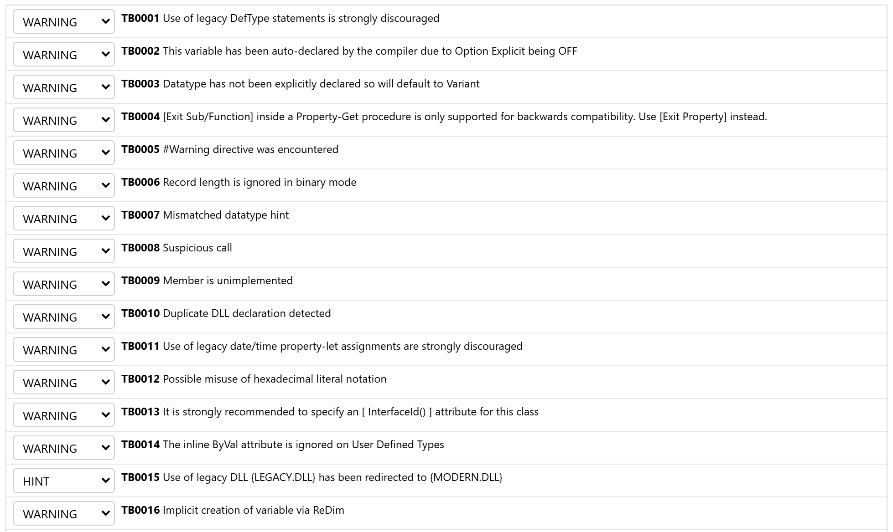

# Compiler Warnings

twinBASIC reports a warning, as the code is written, for a common bad practice or a likely oversight: code that compiles, but probably does not do what was meant, or uses a feature kept only for compatibility with VBA and VB6. Each warning has a code from TB0001 to TB0033, and the [Diagnostics](../../tB/IDE/Code/Diagnostics) panel lists them with the line they are on.

## Adjusting Warnings

Each warning has a level: **WARNING**, **HINT**, **INFO**, **IGNORE** or **ERROR**. A warning at **IGNORE** is not reported, and one at **ERROR** is reported as an error, so the project does not build. In a new project the Compiler Warnings list of Project Settings shows TB0015 and TB0030 at **HINT**, TB0018 to TB0021, TB0024, TB0025 and TB0029 at **IGNORE**, and every other warning at **WARNING**.

The levels for the whole project are in the **Compiler Warnings** group of [Project Settings](../../tB/IDE/Project-Settings#compiler-warnings). Each row of its list has a drop-down for the level, then the code and the text of the warning. The **Filter warnings...** box above the list narrows it to the rows whose code or text holds the words typed:

{:width="979" height="584"}

Three attributes change the level in one class, module or procedure: [**IgnoreWarnings**](../../tB/Core/Attributes#ignorewarnings) turns the named warnings off, [**EnforceWarnings**](../../tB/Core/Attributes#enforcewarnings) reports them as warnings, also one that is at **IGNORE** in the project, and [**EnforceErrors**](../../tB/Core/Attributes#enforceerrors) reports them as errors. Each takes one or more codes, written in full with the leading zeroes and not quoted:

```tb check_build
[IgnoreWarnings(TB0001)]
Module LegacyMath
    DefLng A-Z
End Module
```

## Strict Mode

Four warnings report implicit conversions that VBA makes silently, in the way .NET's **Option Strict** does: [TB0018](#tb0018-implicit-narrowing-conversion), [TB0019](#tb0019-implicit-enumeration-conversion), [TB0020](#tb0020-suspicious-interface-conversion) and [TB0021](#tb0021-implicit-enumeration-conversion-tofrom-numeric). They are at **IGNORE** by default. Set them to **WARNING** or **ERROR** in Project Settings, or name them in an **EnforceWarnings** or **EnforceErrors** attribute, to have the compiler insist that each such conversion is written out. Each can be turned on or off on its own.

## The Warnings

### TB0001: Use of Legacy DefType

A [**Def**_type_](../../tB/Core/Deftype) statement, such as **DefLng**, sets the type of every variable whose name starts with one of its letters. The type of a variable then depends on its name rather than on its declaration, which makes the code hard to read and its errors hard to find.

```tb check_build slot=module
DefLng A-Z

Function Twice(n)
    Twice = n * 2
End Function
```

### TB0002: Compiler-Generated Variable

In a file with [**Option Explicit Off**](../../tB/Core/Option), a name that has not been declared is declared by the compiler, as a **Variant**. Each such variable draws TB0002, *This variable has been auto-declared by the compiler due to Option Explicit being OFF*, so a misspelt name does not go unnoticed.

```tb check_build slot=file
Option Explicit Off

Module Tally
    Sub Count()
        hits = hits + 1
        Debug.Print hits
    End Sub
End Module
```

### TB0003: Implicit Variant Data Type

A variable, parameter or function declared without **As** _type_ is a **Variant**. TB0003, *Datatype has not been explicitly declared so will default to Variant*, says so. Write `As Variant` where a **Variant** is meant.

```tb check_build
Dim total
total = 1
Debug.Print total
```

### TB0004: Wrong Exit Statement

**Exit Function** or **Exit Sub** inside a **Property Get** procedure leaves the property, as VBA allows, but the statement that belongs there is [**Exit Property**](../../tB/Core/Exit).

```tb check_build slot=module
Private m_Count As Long

Public Property Get Count() As Long
    If m_Count < 0 Then Exit Function
    Count = m_Count
End Property
```

### TB0005: Warning Directive

A `#Warning` directive reports its text as warning TB0005, as a reminder in the code.

```tb check_build
#Warning "Remove this before the release build"
Debug.Print "testing"
```

### TB0006: Record Length Is Ignored in Binary Mode

A file opened **For Binary** is read and written byte by byte, so the **Len** clause of its [**Open**](../../tB/Core/Open) statement has no effect.

```tb check_build
Dim f As Integer
f = FreeFile
Open "data.bin" For Binary As #f Len = 512
Close #f
```

### TB0007: Mismatched Data Type Hint

A type-declaration character on a name that is declared as a different type, such as `count$` for a **Long**.

```tb check_build
Dim count As Long
count = 5
Debug.Print count$
```

### TB0008: Suspicious Call

A call to a class's own **Class_Initialize** event procedure, *Suspicious call to event Class_Initialize*. The class's initialization runs again on an object that already exists. Move the code into a procedure that **Class_Initialize** and the other caller both call.

```tb check_build slot=class
Private m_Items As Collection

Private Sub Class_Initialize()
    Set m_Items = New Collection
End Sub

Public Sub Clear()
    Class_Initialize
End Sub
```

### TB0009: Unimplemented

A call to a procedure marked [**Unimplemented**](../../tB/Core/Attributes#unimplemented), *[ExportToPdf] has not yet been implemented*. The warning is at the call, not at the procedure. Some members of the built-in packages that twinBASIC does not implement yet are marked this way.

```tb check_build slot=module
[Unimplemented]
Public Sub ExportToPdf()
End Sub

Public Sub SaveReport()
    ExportToPdf
End Sub
```

### TB0010: Duplicate DLL Declaration

Reports a DLL entry point that is declared more than once: *Duplicate declaration of DLL entry point*.

### TB0011: Use of Legacy Date/Time Property Let

Reports an assignment to the legacy date and time properties, such as the [**Date**](../../tB/Modules/DateTime/Date) statement, which sets the system date: *Use of legacy date/time property-let assignments are strongly discouraged*.

### TB0012: Possible Hex Literal Misuse

A hexadecimal literal without a type character takes the smallest type it fits in. So `&H8000` is the **Integer** -32,768, and stored in a **Long** it stays -32,768 rather than becoming the positive 32,768 that was most likely meant, which needs `&H8000&`. TB0012 reports a literal from `&H8000` to `&HFFFF` converted to a **Long** or **LongLong**, and one from `&H80000000` to `&HFFFFFFFF`, a **Long**, converted to a **LongLong**. Its message names the literal to write instead: `&H8000&` for a **Long**, `&H80000000^` for a **LongLong**.

```tb check_build check_run
Dim mask As Long
mask = &H8000
Debug.Print mask        ' -32768
mask = &H8000&
Debug.Print mask        ' 32768
```

### TB0013: Missing InterfaceId Attribute

A class marked [**COMControl**](../../tB/Core/Attributes#comcontrol) without an [**InterfaceId**](../../tB/Core/Attributes#interfaceid) attribute, and again without an [**EventInterfaceId**](../../tB/Core/Attributes#eventinterfaceid) attribute. A host may cache the identifiers of a control's interfaces, so they should be fixed in the source rather than made anew by each build.

```tb check_build slot=file
[COMControl]
Class Gauge
End Class
```

### TB0014: Inline ByVal on a UDT

**ByVal** written in front of a user-defined type in a call to a [**Declare**](../../tB/Core/Declare) procedure has no effect. The structure is passed by reference all the same, and its strings are not converted to ANSI, as in VBA and VB6.

```tb check_build slot=module
Private Type CursorPoint
    X As Long
    Y As Long
End Type

Private Declare PtrSafe Function GetCursorPos Lib "user32" (ByRef lpPoint As Any) As Long

Public Sub ShowCursor()
    Dim pt As CursorPoint
    GetCursorPos ByVal pt
    Debug.Print pt.X, pt.Y
End Sub
```

### TB0015: DLL Redirection

A **Declare** of a function from a legacy system DLL that twinBASIC calls in its modern replacement instead: *use of legacy OLEPRO32.DLL has been redirected to OLEAUT32.DLL*. It is at **HINT** by default.

> [!NOTE] BETA 1010
> In a project whose `project.warnings` setting names no level for TB0015, as in a new project, TB0015 is reported as a warning, although the Compiler Warnings list shows it at **HINT**.

```tb check_build slot=module
Private Declare PtrSafe Function OleCreatePictureIndirect Lib "olepro32" ( _
    ByRef PicDesc As Any, ByRef RefIID As Any, _
    ByVal fPictureOwnsHandle As Long, ByRef IPic As Any) As Long
```

### TB0016: Implicit ReDim Variable

[**ReDim**](../../tB/Core/ReDim) of a name that has not been declared declares the array, as VBA allows. Declare it first, with **Dim** and empty parentheses.

```tb check_build
ReDim scores(1 To 10) As Long
scores(1) = 95
```

### TB0017: Inexact Array Alias Argument

Reports an array passed to an array parameter whose element type is a different alias of the same type, which twinBASIC accepts for compatibility with VBA and VB6: *array argument does not precisely match the expected type as the alias subtypes are different, but this is allowed for VBx compatibility*.

### TB0018: Implicit Narrowing Conversion

A value converted to a smaller type without a conversion function, such as a **Long** assigned to an **Integer**. The conversion raises an overflow error when the value does not fit. The message names the function to use, here [**CInt**](../../tB/Modules/Conversion/CInt). An enumeration value assigned to an **Integer** or a **Byte** draws it too. It is at **IGNORE** by default.

```tb check_build slot=module
[EnforceWarnings(TB0018)]
Public Sub Narrow()
    Dim i As Integer, l As Long
    l = 1000
    i = l             ' TB0018
    i = CInt(l)       ' no warning
End Sub
```

### TB0019: Implicit Enumeration Conversion

A value of one enumeration assigned to a variable of another, or a **Double**, **Single**, **Currency** or **Variant** assigned to a variable of an enumeration. [**CType(Of** _type_**)**](../../tB/Modules/Conversion/CType) makes the conversion explicit. It is at **IGNORE** by default.

```tb check_build slot=module
[EnforceWarnings(TB0019)]
Public Sub Convert()
    Dim answer As VbMsgBoxResult, day As VbDayOfWeek
    answer = vbYes
    day = answer                             ' TB0019
    day = CType(Of VbDayOfWeek)(answer)      ' no warning
End Sub
```

> [!NOTE] BETA 1010
> A member of another enumeration, written as a constant (`day = vbOK`), converts without a warning.

### TB0020: Suspicious Interface Conversion

An object assigned to a variable of an interface or class that its type is not declared to support, *suspicious conversion from type StdPicture to type Font*. The assignment asks the object for that interface at run time, and fails if it does not have it. **CType(Of** _type_**)** makes the conversion explicit. It is at **IGNORE** by default.

```tb check_build slot=module
[EnforceWarnings(TB0020)]
Public Sub Assign()
    Dim myPic As StdPicture
    Dim myFont As StdFont
    Set myFont = myPic                       ' TB0020
    Set myFont = CType(Of StdFont)(myPic)    ' no warning
End Sub
```

### TB0021: Implicit Enumeration Conversion to/from Numeric

Reports an implicit conversion between an enumeration and a numeric type. It is at **IGNORE** by default.

> [!NOTE] BETA 1010
> None of these conversions draws TB0021. A whole number assigned to a variable of an enumeration, or an enumeration value assigned to a **Long**, converts without a warning. A **Double**, **Single**, **Currency** or **Variant** assigned to a variable of an enumeration draws [TB0019](#tb0019-implicit-enumeration-conversion), and an enumeration value assigned to an **Integer**, **Byte** or **Single** draws [TB0018](#tb0018-implicit-narrowing-conversion).

### TB0022: Suspicious Assignment

An array assigned to an array of another element type, *suspicious array assignment; subtypes do not match*.

```tb check_build
Dim counts() As Long
Dim small() As Integer
ReDim small(3)
counts = small
```

### TB0023: Unusual Use of an Implicit Implements Field

In a class, [**Implements**](../../tB/Core/Implements) _name_ also declares a field called _name_, which is **Nothing**. Code that uses the field draws TB0023, *Unusual use of implicit field generated from an Implements statement*. To refer to the object as that interface, use **Me**.

```tb check_build slot=file
Interface IPrintable
    Sub PrintOut()
End Interface

Class Invoice
    Implements IPrintable

    Private Sub IPrintable_PrintOut() Implements IPrintable.PrintOut
    End Sub

    Public Function AsPrintable() As IPrintable
        Set AsPrintable = IPrintable     ' TB0023: the field is Nothing
    End Function
End Class
```

### TB0024: Unused Variable

A local variable that is declared but never used, *Unused local variable 'unused'*. It is at **IGNORE** by default.

```tb check_build slot=module
[EnforceWarnings(TB0024)]
Public Sub Report()
    Dim total As Long
    Dim unused As String
    total = 1
    Debug.Print total
End Sub
```

### TB0025: Unused Parameter

A parameter that the procedure never uses, *Unused procedure parameter 'title'*. It is at **IGNORE** by default.

```tb check_build slot=module
[EnforceWarnings(TB0025)]
Public Sub Greet(name As String, title As String)
    Debug.Print "Hello, " & name
End Sub
```

### TB0026: Mismatched Delegate Types

[**AddressOf**](../../tB/Core/AddressOf) of a procedure whose parameters or return type do not match the [**Delegate**](../../tB/Core/Delegate) type it is assigned or passed to. The program still builds, and the procedure then receives its arguments in a form it does not expect. **CType(Of** _type_**)** makes the conversion explicit, and `[EnforceErrors(TB0026)]` makes the mismatch an error. See [Delegates](../Language/Delegates).

```tb check_build slot=module
Private Delegate Function LongTransform(ByVal x As Long) As Long

Private Function Half(ByVal x As Integer) As Long
    Return x \ 2
End Function

Public Sub UseIt()
    Dim t As LongTransform = AddressOf Half     ' TB0026
    Debug.Print t(10)
End Sub
```

### TB0027: Return Without GoSub

Reports a [**Return**](../../tB/Core/GoSub-Return) that is not preceded by a **GoSub**.

### TB0028: Control Overshadowed

Reports a control on a form that has the name of a method or property of the form: *control [name] is overshadowed by base form method or property of the same name*.

### TB0029: Missing PtrSafe

A **Declare** statement without **PtrSafe**, which 64-bit VBA 7 requires, *Declare needs PtrSafe attribute on this build configuration for VBA7 compatibility*. It is reported only in a 64-bit build, and is at **IGNORE** by default.

```tb check_build slot=file
[EnforceWarnings(TB0029)]
Module Win32Calls
    Private Declare Function GetTickCount Lib "kernel32" () As Long
End Module
```

### TB0030: Declare Alias Not Needed

An **Alias** clause on a **Declare** statement that names the same entry point as the procedure's own name. It is at **HINT** by default.

```tb check_build slot=module
Private Declare PtrSafe Function GetTickCount Lib "kernel32" Alias "GetTickCount" () As Long
```

### TB0031: Suspicious Use of Erase

[**Erase**](../../tB/Core/Erase) of the array a function returns. The function returns a copy of its array, which is freed on its own, so the statement erases nothing that remains.

```tb check_build slot=module
Private Function Squares() As Long()
    Dim r(3) As Long
    Return r
End Function

Public Sub Clear()
    Erase Squares()
End Sub
```

### TB0032: Unused Line Label

A line label that no **GoTo**, **GoSub**, **On Error** or **Resume** statement names, *Line label is not used*.

```tb check_build
Dim i As Long
Retry:
i = i + 1
Debug.Print i
```

### TB0033: Duplicate Definition

Reports a duplicate definition as a warning: *Duplicate definition, consider changing the name to be unique*. A name declared twice in one module, procedure, **Enum** or **Type** is error TB5134 instead.

> [!NOTE] BETA 1033
> The Compiler Warnings list of Project Settings shows this warning with the code TB0032, the code of [Unused Line Label](#tb0032-unused-line-label).

<!-- BETA 1007 (tbbuild, every warning set to WARNING in project.warnings): none of
     these drew TB0010, TB0011, TB0017, TB0021, TB0027, TB0028 or TB0033.
     BETA 1010 (tbbuild, [EnforceWarnings] in a project with no project.warnings):
     the four NOTEs hold: TB0015 is a WARNING; `day = vbOK` draws nothing and
     `day = answer` TB0019; TB0021 is not drawn by Integer, Byte, Long or a literal
     to an Enum, an Enum to Long, ByRef Long or Enum arguments; Double, Single,
     Currency and Variant to an Enum draw TB0019 and TB0018, an Enum to Integer,
     Byte or Single TB0018; ide/main.js lists the Duplicate definition row as TB0032.
     TB0010: two Declares of one entry point under two names in one module (same and
       different signatures, Declare and DeclareWide, "kernel32" and "kernel32.dll"),
       one name in two modules, a Declare in a Class and a Module.
     TB0011: Date = , Time = , Date$ = , Time$ = , VBA.Date = , DateTime.Time = ,
       with a Date and with a String.
     TB0017: an array of one Alias type, or of an Enum, passed to a Long() parameter
       and the reverse; two Alias types of Long; Collection() to Object(); LongPtr()
       to Long() (win64: TB5001).
     TB0021: Integer, Byte, Long and a literal to an Enum variable; an Enum to Long;
       ByRef Long and Enum arguments. Double, Single, Currency, Variant give TB0019.
     TB0027: Return in a Sub with no GoSub, before a GoSub, after a label.
     TB0028: TextBoxes named Caption, Refresh, Hide, Width, Left, Controls, Font,
       Visible, hWnd and Name on a form, used and unused in its code.
     TB0033: a code-behind field named as a control; members of a derived class
       named as its base's; module/procedure duplicates give TB5134.
     TB0015 is a WARNING, TB0030 a HINT, in a project whose project.warnings lists
     are empty (the console template, as in a new IDE project).
     The compiler's message texts quoted above are from twinBASIC_win32.dll and
     twinBASIC_win64.dll; TB0029's message is in the win64 one only. The IDE's list
     (ide/main.js) gives TB0033's row the id TB0032. -->
