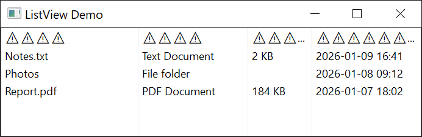

# Debugging Features

twinBASIC adds three debugging features to those of VB6: a trace logger that also works in a compiled executable, the **Debug.Cls** statement, and detection of stale pointers. Breakpoints, stepping, the panel that opens at a run-time error and the Variables, Watches, Call Stack and Debug Console panels are described in [Running and debugging](../../tB/IDE/Debugging/).

## Debug Trace Logger

A trace logger creates detailed logs, to the debug console or to a file. Messages can be output with [**Debug.TracePrint**](../../tB/Modules/Debug#traceprint). The logger works both when running from the IDE and in compiled executables. [The trace logger](../../tB/IDE/Debugging/Debug-Console#the-trace-logger) explains the trace settings and shows an example.

## Clearing the Debug Console

[**Debug.Cls**](../../tB/Modules/Debug#cls) empties the [Debug Console](../../tB/IDE/Debugging/Debug-Console) from code, the same as its *Clear Debug Console* button. Calling it as a run begins [separates that run's output from the previous one](../../tB/IDE/Debugging/Debug-Console#separate-one-run-from-the-next).

## Stale/Dangling Pointer Detection

Bugs result from using Strings and Variants after they have been freed. It may not be noticed immediately if the memory has not been overwritten, but it's sometimes hard to detect and can cause issues like a String displaying it's previous value or garbage. This debugging option detects use-after-free, and replaces the data with a special symbol indicating the problem.

Below shows an example where the ListView ColumnHeader text had been set by previously-freed string and detected by this feature:

{:width="461" height="151"}
