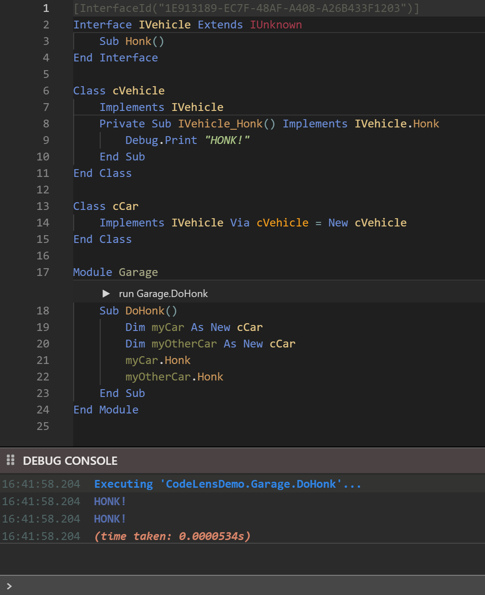

# Inheritance

twinBASIC provides several mechanisms for inheritance to support both simple and complete object-oriented programming patterns: **Implements**, **Implements Via** and **Inherits**.

## Enhancements to **Implements**

`Implements` in twinBASIC has several enhancements:

### Inherited Interfaces

`Implements` in twinBASIC is allowed on inherited interfaces -- for instance, if you have `Interface IFoo2 Extends IFoo`, you then use `Implements IFoo2` in a class, where in VBx this would not be allowed. You'll need to provide methods for all inherited interfaces (besides `IDispatch` and `IUnknown`). The class will mark all interfaces as available-- you don't need a separate statement for `IFoo`, it will be passed through `Set` statements (and their underlying `QueryInterface` calls) automatically.

### Multiple Implementations

If you have an interface that multiple others extend from, you can write multiple implementations, or specify one implementation for all. For example:

```tb inert=external
IOleWindow_GetWindow() As LongPtr _
    Implements IOleWindow.GetWindow, IShellBrowser.GetWindow, IShellView2.GetWindow
```

### 'As Any' Parameters in Interfaces

`Implements` is allowed on interfaces with 'As Any' parameters: In VBx, you'd get an error if you attempted to use any interface containing a member with an `As Any` argument. With twinBASIC, this is allowed if you substitute `As LongPtr` for `As Any`, for example:

```tb check_build
Interface IFoo Extends IUnknown
    Sub Bar(ppv As Any)
End Interface

Class MyClass
    Implements IFoo

    Private Sub IFoo_Bar(ppv As LongPtr) Implements IFoo.Bar

    End Sub
End Class
```

## **Implements Via** for Basic Inheritance

tB allows simple inheritance among classes. For example, if you have class cVehicle which implements IVehicle containing method Honk, you could create child classes like cCar or cTruck, which inherit the methods of the original, so you could call cCar.Honk without writing a separate implementation.

{:width="530" height="649"}

You can see that the Honk method is only implemented by the parent class, then called from the child class when you click the CodeLens button to run the sub in place from the IDE.

## **Inherits** for Complete OOP

This option supports full inheritance and OOP: `Protected` methods and variables accessible to derived classes (but not outside callers), `Overridable` and `Overrides` syntax, multiple inheritance, and explicit base class constructors.

### Example: Animal Class Hierarchy

> [!IMPORTANT]
> Every class in this example is declared `Private Class`, because each one has a `Sub New` that takes arguments. A class that is not `Private` is exposed to COM, and COM creates objects without arguments. So a public class --- base or derived --- whose `Sub New` has required arguments fails to compile with TB5135, unless it also has a constructor that takes none. There are three fixes: declare the class `Private`, add the `[COMCreatable(False)]` attribute, or add a constructor without arguments, such as `Class_Initialize`. Only the third lets the class be declared `As New`; without it, `As New` fails with TB5121. See [Parameterized Class Constructors](../Advanced/Classes-and-Modules#parameterized-class-constructors).

Starting with a base class:

```tb check_build projname=inheritance-animals
Private Class Animal
    Protected _name As String
    Protected _dob As Date  ' date of birth

    Public Event Spoke(ByVal sound As String)

    Public Sub New(name As String, dob As Date)
        _name = name
        _dob = dob
    End Sub

    Public Property Get Name() As String
        Name = _name
    End Property

    Public Property Get DOB() As Date
        DOB = _dob
    End Property

    ' Age in whole years based on DOB and today's date
    Public Function AgeYears() As Long
        Dim y As Long
        y = DateDiff("yyyy", _dob, Date)
        If DateSerial(Year(Date), Month(_dob), Day(_dob)) > Date Then y = y - 1
        AgeYears = y
    End Function

    Public Sub Speak()
        Dim s As String
        s = GetSound()
        RaiseEvent Spoke(s)
        Debug.Print _name & " says: " & s
    End Sub

    ' --- Overridable hook for derived classes ---
    Protected Overridable Function GetSound() As String
        GetSound = ""
    End Function
End Class
```

Others can inherit. Constructors are not inherited, so each derived class declares its own `Sub New`. Without one, a `Cat` cannot be created with arguments: `New Cat("Misty", #20-Nov-2022#)` fails with TB5030, *Unexpected call arguments*.

When the base class's `Sub New` takes arguments, the derived class's `Sub New` must call it --- `Dog` calls `Animal.New` below, and `GuardDog` calls `Dog.New`. Nothing else calls it. If the call is left out --- or the derived class has no `Sub New` and is created without arguments --- the code still compiles and runs. The base constructor never runs, and the fields it sets keep their default values. No error or warning reports it. A base `Sub New` that takes no arguments is different: it runs automatically, before the derived class's `Sub New`. [Constructors in Derived Classes](#constructors-in-derived-classes) covers every combination of base and derived constructors.

```tb check_build projname=inheritance-animals
' ===== Derived: Dog =====
Private Class Dog
    Inherits Animal

    Protected _breed As String

    Public Sub New(name As String, dob As Date, breed As String)
        Animal.New(name, dob)               ' required: nothing else runs Animal's constructor
        _breed = breed
    End Sub

    Public Property Get Breed() As String
        Breed = _breed
    End Property

    ' Override:
    Protected Overridable Function GetSound() As String Overrides Animal.GetSound
        GetSound = "woof"
    End Function
End Class

' ===== Further derived: GuardDog (Dog → GuardDog) =====
Private Class GuardDog
    Inherits Dog

    Protected _onDuty As Boolean

    Public Sub New(name As String, dob As Date, breed As String)
        Dog.New(name, dob, breed)           ' required: runs Dog's constructor, which runs Animal's
        _onDuty = True
    End Sub

    Public Property Get OnDuty() As Boolean
        OnDuty = _onDuty
    End Property
    Public Property Let OnDuty(ByVal v As Boolean)
        _onDuty = v
    End Property

    ' Multi-level override (overriding Dog's override):
    Protected Function GetSound() As String Overrides Dog.GetSound
        If _onDuty Then
            GetSound = "WOOF!"
        Else
            GetSound = "woof"
        End If
    End Function
End Class

' ===== Derived: Cat =====
Private Class Cat
    Inherits Animal

    Public Sub New(name As String, dob As Date)
        Animal.New(name, dob)               ' required, although Cat adds no fields of its own
    End Sub

    Protected Function GetSound() As String Overrides Animal.GetSound
        GetSound = "meow"
    End Function
End Class
```

`Dog`'s `GetSound` is marked `Overridable` as well as `Overrides`, and that is what lets `GuardDog` override it again. `Cat`'s is not, so a class that inherits `Cat` cannot override `GetSound`: the compiler reports TB5068, *procedure is not marked as Overridable*.

Code that uses the classes goes in a `Module`. A procedure written at the top level of a `.twin` file, outside any `Module` or `Class`, does not compile: every line of it fails with TB5182, *Syntax error. No handler for this symbol*. This routine holds each animal in an `Animal` variable, and each call to `Speak` still uses the `GetSound` of the object's own class:

```tb check_build projname=inheritance-animals
Module AnimalsDemoMod
    Public Sub DemoAnimals()
        Dim pets(2) As Animal
        Set pets(0) = New Dog("Rex", #10-Feb-2019#, "Labrador")
        Set pets(1) = New GuardDog("Rover", #01-Jun-2018#, "German Shepherd")
        Set pets(2) = New Cat("Misty", #20-Nov-2022#)

        Dim i As Long
        For i = 0 To UBound(pets)
            pets(i).Speak
        Next i
    End Sub
End Module
```

Running `DemoAnimals` --- for example from its [CodeLens](../../tB/IDE/Code/IntelliSense#codelens) bar --- prints this to the Debug Console:

```text
Rex says: woof
Rover says: WOOF!
Misty says: meow
```

The classes come from Sample 23, which also has an `AnimalWatcher` class that handles the `Spoke` event, and a longer demonstration routine. To open it, choose **File → New Project**, then the **Samples** tab, and pick **Sample 23. OOP Inheritance Example (Animals)**. The [New Project](../../tB/IDE/Project/New#samples) page lists every sample.

## Constructors in Derived Classes

A class has two kinds of constructor: `Class_Initialize`, which takes no arguments, and `Sub New`, which can take arguments. [`Class_Initialize` or `Sub New`?](../Advanced/Classes-and-Modules#class_initialize-or-sub-new) compares them. When a derived class is created, the base class's constructor runs as well as the derived class's own, and it runs first. Which of the base's constructors runs depends on whether the derived class's constructor calls one:

- **No call:** the base's constructor without arguments --- its `Class_Initialize`, or its `Sub New` with no parameters --- runs automatically, before the derived class's constructor. This holds whichever kind of constructor the derived class has, and when it has none. It holds at every level, too: when `C` inherits `B`, which inherits `A`, creating a `C` runs `A`'s constructor, then `B`'s, then `C`'s.
- **A call, `Base.New(...)`:** that constructor runs, where the call is written, and the automatic call is skipped. A derived `Class_Initialize` can make the call too.

What the derived class's author does depends on the base class:

1. **The base has only a `Class_Initialize`** --- typical of code that comes from VB6. Nothing: it runs on its own.
2. **The base has a `Sub New` with no parameters.** Nothing, as for `Class_Initialize`. Calling it, `Base.New()`, is allowed, and it still runs once.
3. **The base has only a `Sub New` with arguments.** Every constructor of the derived class must call it, its `Class_Initialize` included. If one does not, the base's constructor never runs, its fields keep their default values, and no error or warning reports it.
4. **The base has a constructor without arguments and a `Sub New` with arguments.** Each derived constructor chooses: leave out the call to have the one without arguments run, or call `Base.New(...)` to have that one run instead.

Where a derived constructor calls `Base.New`, make the call its first statement, and make it on every path through the constructor:

- Statements before the call run while the base is not yet set up.
- A call inside an `If` turns off the automatic call even when the `If` does not run it. On that path, *no* constructor of the base runs --- not even its `Class_Initialize`. The compiler decides by whether the call is in the code, not by whether it runs.

Constructors are not inherited. A derived class whose only constructor is a `Sub New` with arguments cannot be created with a plain `New`, even when the base has a `Class_Initialize`: the call fails with TB5103, *Too few arguments*. To keep a plain `New`, and [`As New`](../../tB/Core/New), give the derived class a constructor without arguments as well. A derived class with no constructor at all can be created with a plain `New`, or declared `As New`, and either runs the base's constructor without arguments. As in any class, a derived class cannot have both a `Class_Initialize` and a `Sub New` without parameters: a plain `New` matches both, and fails with TB5073.

The field initializers of every class in the chain --- `Private _name As String = "nobody"` --- run before any of the constructors, the base's included. So a base constructor that calls an `Overridable` method sees the derived class's fields at their initial values when the derived class overrides that method.

A COM client that creates a public derived class, with `CreateObject` for example, gets the same constructors as a plain `New` in twinBASIC: the derived class's constructor without arguments, and before it the base's, unless the derived constructor calls `Base.New(...)` itself.

When the object is destroyed, the `Class_Terminate` of each class runs, the base class's first. That is the opposite of the order the constructors run in, so a derived class's `Class_Terminate` must not use anything the base's `Class_Terminate` releases.

### Example: Base Constructors

`Shape` has both kinds of constructor. `Circle` does not call either, so `Shape`'s `Class_Initialize` runs. `Square` calls `Shape.New`, so `Shape`'s `Class_Initialize` does not run:

```tb check_build projname=inheritance-ctors slot=file
Private Class Shape
    Private Sub Class_Initialize()
        Debug.Print "Shape.Class_Initialize"
    End Sub
    Public Sub New(ByVal Kind As String)
        Debug.Print "Shape.New(" & Kind & ")"
    End Sub
    Private Sub Class_Terminate()
        Debug.Print "Shape.Class_Terminate"
    End Sub
End Class

Private Class Circle
    Inherits Shape
    Public Sub New(ByVal Radius As Double)
        Debug.Print "Circle.New(" & Radius & ")"
    End Sub
    Private Sub Class_Terminate()
        Debug.Print "Circle.Class_Terminate"
    End Sub
End Class

Private Class Square
    Inherits Shape
    Public Sub New(ByVal Side As Double)
        Shape.New("square")
        Debug.Print "Square.New(" & Side & ")"
    End Sub
End Class
```

```tb check_run projname=inheritance-ctors
Dim c As Circle = New Circle(2)
Set c = Nothing
Dim s As Square = New Square(3)
Set s = Nothing
' Output:
' Shape.Class_Initialize
' Circle.New(2)
' Shape.Class_Terminate
' Circle.Class_Terminate
' Shape.New(square)
' Square.New(3)
' Shape.Class_Terminate
```
