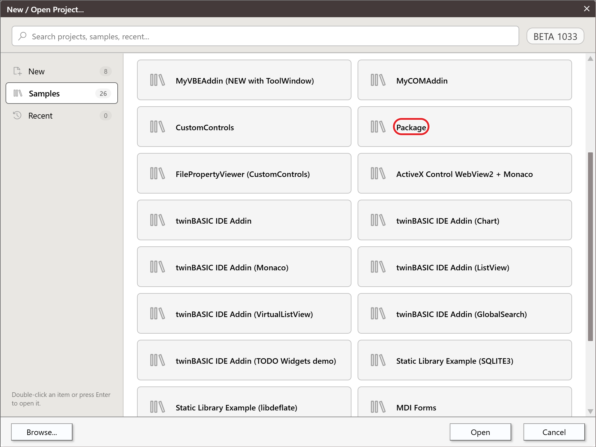
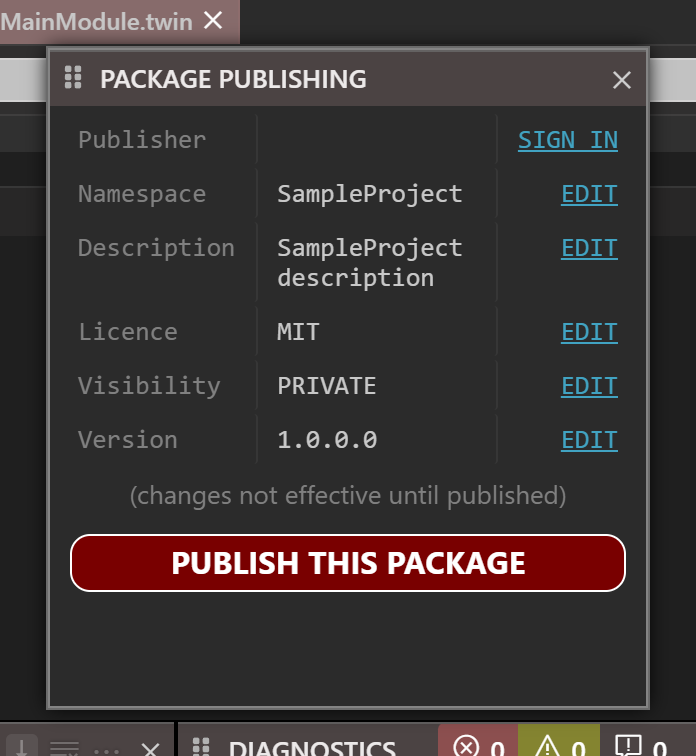
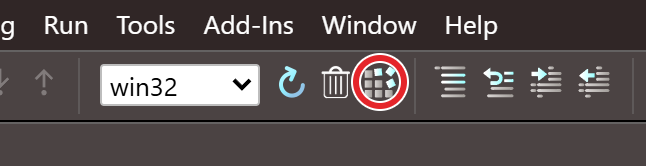
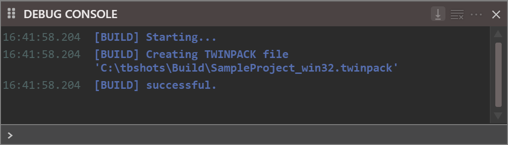
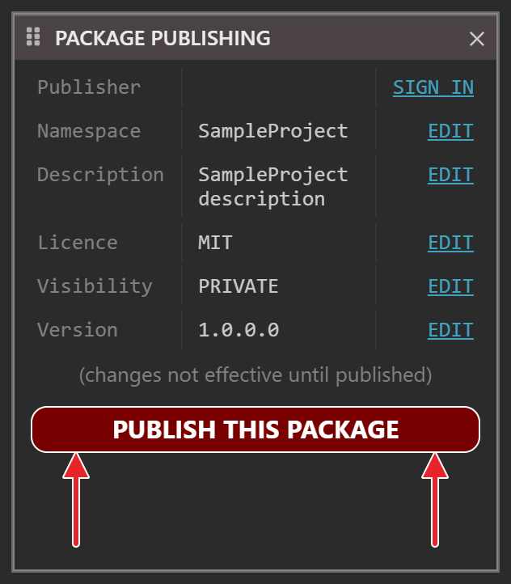
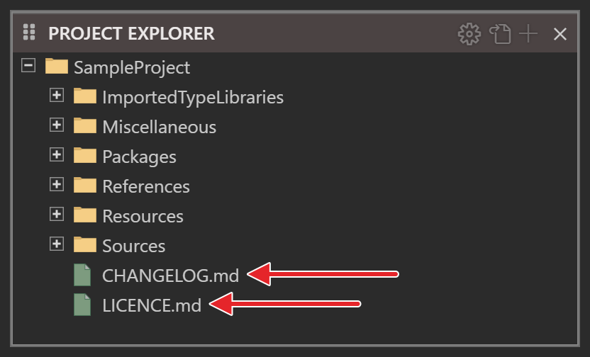

# Creating a TWINPACK package

To create a new TWINPACK package, navigate to the twinBASIC New Project dialog, and in its **Samples** section, choose the card labelled **Package**:

{:width="970" height="728"}

Once you've created the project, you should find the extra 'PACKAGE PUBLISHING' panel as a popup:

{:width="348" height="378"}

You should now edit the Namespace, Description, Licence, Visibility and Version properties appropriately by using the package manager 'EDIT' links, which open Project Settings with the setting's id in the filter box, so that the dialog lists only that setting (for Version, the settings of the version).   Once you've edited a value, press **Apply Changes** in order for your change to be reflected in the package manager panel. [Package Publishing](../../tB/IDE/Building/Package-Publishing) describes the panel.

- **Namespace:** this is the symbol that will be used to group your components in projects that reference your package.  For example, a package that provides a series of different dialog classes might use the namespace `Dialogs`.
- **Description:** this is the descriptive text that will appear in the Library References list of Project Settings.  If you plan to share this package, think carefully about the description so that others can discover your package through TWINSERV.
- **Licence:** this short text appears in the Library References list of Project Settings, alongside the Description.  If you plan to share this package, it is important that you enter this field, and the value you enter here should appropriately match the content of the LICENCE.md file (e.g. 'MIT', 'LGPL' etc).
- **Visibility:** determines whether the package is visible to only you (PRIVATE) or everyone (PUBLIC).  The value set here only takes effect when you use the 'PUBLISH THIS PACKAGE' button to publish your package in the package manager service, TWINSERV.
- **Version:** the package's version number, in four parts: the **(VERSION) Major**, **(VERSION) Minor**, **(VERSION) Build** and **(VERSION) Revision** settings. A build copies them unchanged into the TWINPACK file, and a project that references the package shows them in the **Version** column of its **Library References** list. TWINSERV refuses to publish a version it already has: the IDE then reports *Package already uploaded with this exact version number.* For a package from a TWINPACK file the IDE does not compare versions at all. It accepts a lower version as well as a higher one, and it refuses to import a package that the project already contains, whatever the version. So raising the Version does not update the projects that use the package; see [Updating a package you built yourself](Updating#updating-a-package-you-built-yourself).

*If you don't plan to publish your package on TWINSERV, then you don't need to fill in the **Licence** or **Visibility** fields.*

You can now create components (Class, Module, Interface) in your project as normal, and when you are finished, it's time to finalize the package.   You have two options;

## OPTION 1 - Finalize the package into a TWINPACK file

Use this option if you want to just create a local TWINPACK file that you can use in other projects.  For this, the build process is the same as any ordinary twinBASIC build... just hit the Build button in the TWINBASIC toolbar:

{:width="323" height="83"}

{:width="560" height="160"}

You'll see the build output notification in the `DEBUG CONSOLE`, as seen above.

Job done.  See [Importing a package from a TWINPACK file](Importing-TWINPACK) for referencing and using the TWINPACK file in other twinBASIC projects. To get a later build of the package into projects that already use it, see [Updating a package you built yourself](Updating#updating-a-package-you-built-yourself).

## OPTION 2 - Publish the package directly to the package manager service (TWINSERV)

If you're publishing your package onto TWINSERV, you don't need to create the TWINPACK file manually.  Just use the 'PUBLISH THIS PACKAGE' button:

{:width="316" height="361"}

***Publishing packages onto TWINSERV requires you to first create a publisher account.  If you haven't done so, you'll be prompted to do so at this stage.***

You will then be prompted to confirm the package details, in a box that lists the publisher, package namespace, description, version and licence, and asks whether to proceed. After pressing **Continue**, the package will be uploaded to TWINSERV.   The `DEBUG CONSOLE` shows that the upload has started, and a box with **OK** shows the result. [Package Publishing](../../tB/IDE/Building/Package-Publishing#publishing) shows the box and lists the results.

If the package got uploaded successfully, it should be available via TWINSERV within a few moments.   If you've created a `PUBLIC` package, others will be able to see and download it at this point.

See [Importing a package from TWINSERV](Importing-TWINSERV) for referencing and using the uploaded packages.

## Special files LICENCE.md and CHANGELOG.md

When you create a new package project, you'll see two additional files created for you in the project filesystem:

{:width="416" height="252"}

If you're publishing a `PUBLIC` package to the package manager service, it is important that you edit these two files before publishing.  These are both markdown files, and will in future become more accessible to users that are considering using your package from TWINSERV. 