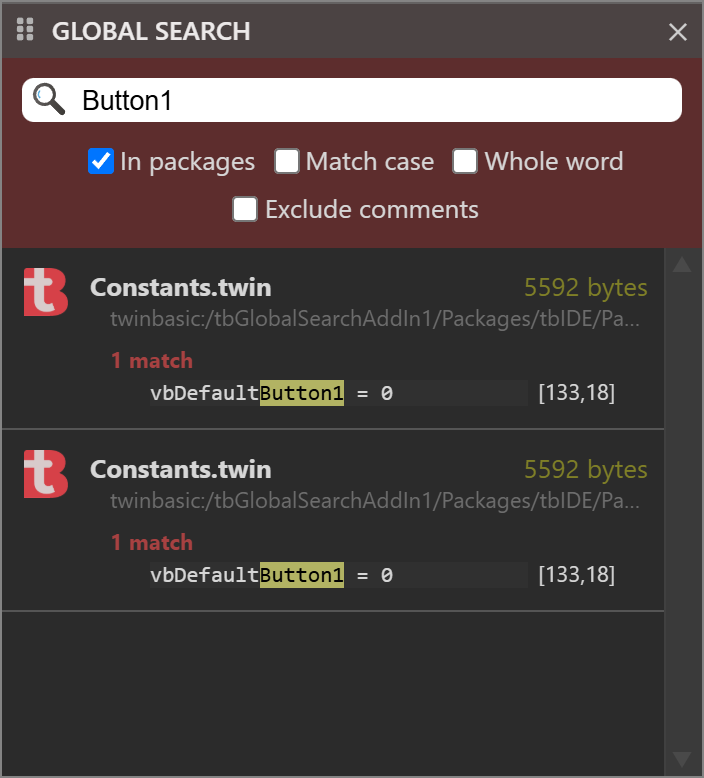

# Global Search

Searches a project's files from a tool window of its own. The add-in ships with the IDE, in the install's `addins\win32` and `addins\win64` folders, so there is nothing to install.

The add-in adds one button to the [toolbar](../Reference/Toolbar), which opens the window.

{:width="102" height="35"}

Type a search term, such as `Button1`, into the text box, and the add-in lists the matches. The four boxes under it set what it searches and how:

{:width="352" height="124"}

**In packages**
: Searches the project's packages as well.

**Match case**
: Takes upper and lower case as different.

**Whole word**
: Matches whole words only.

**Exclude comments**
: Leaves out matches inside comments.

Each result is a card that gives the file's name, its size in bytes and its path, the number of matches in it, and each matching line with its line and column.

{:width="352" height="389"}
