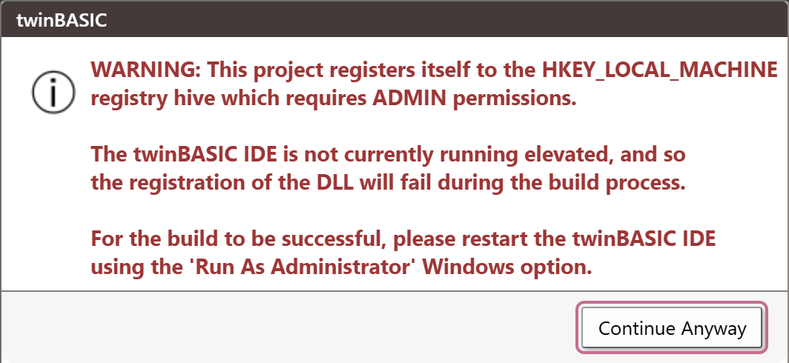
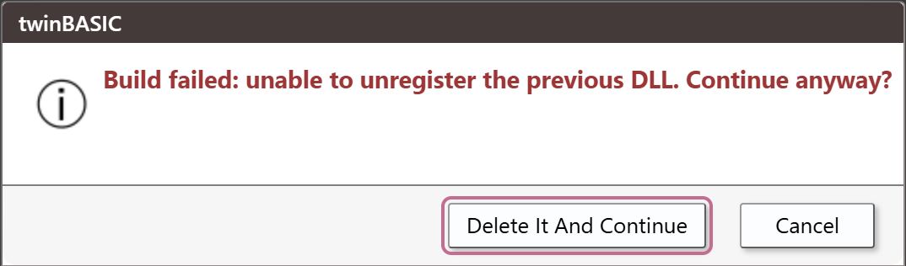

# ActiveX registration

A build of an ActiveX DLL or an ActiveX control registers the new file, so that other programs can create its classes. **Clean** takes the registration away again. This page describes what is registered, where, what the console says, and the questions the IDE asks when registration goes wrong.

The settings and the two registry hives are described in [Project Settings](../Project-Settings#register-dlls-to-hklm) and in [ActiveX Registration Options](../../../Features/Project-Configuration/ActiveX-Registration). A Standard DLL, an EXE and a package are not registered.

## Registering after a build

Two settings decide it:

- [*Register DLL after build*](../Project-Settings#register-dll-after-build) is **Yes** by default. With **No**, the build writes the file and registers nothing.
- [*Register DLLs to HKLM*](../Project-Settings#register-dlls-to-hklm) is **No** by default, and the templates keep it so. The registration then goes to `HKEY_CURRENT_USER`, which needs no special rights.

The compiler does the registration, as the Windows user that runs the IDE, and the console reports it:

```
[LINKER] SUCCESS created output file '<path>'
[LINKER]    Open Folder
[REGISTER] type-library registration completed. DllRegisterServer() returned OK
```

A 32-bit build writes its keys under `Software\Classes\WOW6432Node` in `HKEY_CURRENT_USER`: `CLSID`, `Interface` and the program ID. Its type library is under `TypeLib`, in the `win32` branch. A 64-bit build writes the same keys without `WOW6432Node`, and its type library is in the `win64` branch.

A project made from the **ActiveX DLL** template leaves [*Use Project ID for type library ID*](../Project-Settings#use-project-id-for-type-library-id) at **No**, so each build gives the type library a new GUID. The **ActiveX Control** template sets it to **Yes**.

## Clean

**Clean** runs the registration in reverse, then deletes the file:

```
[BUILD] Starting...
[UNREGISTER] previous type-library deregistration completed. DllUnregisterServer() returned OK
[BUILD-CLEAN] build cleanup completed.
```

Every key that the build wrote is gone after it. There is no separate command to register or deregister a file by hand: registration is the build's, and deregistration is **Clean**'s. A **Build** that replaces a registered file deregisters the old one first; [a failure there](#when-the-old-dll-cannot-be-deregistered) is described below.

To keep a DLL from being registered, set *Register DLL after build* to **No**.

## The warning at the machine-wide registry

A project with *Register DLLs to HKLM* at **Yes** registers its DLL under `HKEY_LOCAL_MACHINE`, and Windows lets only an administrator write there. When you open such a project in an IDE that does not run as an administrator, a box opens before the project loads:

**WARNING: This project registers itself to the HKEY_LOCAL_MACHINE registry hive which requires ADMIN permissions. The twinBASIC IDE is not currently running elevated, and so the registration of the DLL will fail during the build process. For the build to be successful, please restart the twinBASIC IDE using the 'Run As Administrator' Windows option.**

Its one button is **Continue Anyway**. The box does not appear when *Register DLL after build* is **No**. An IDE that runs as an administrator shows **ADMIN** in its title area and does not open it.

{:width="532" height="245"}

> [!NOTE] BETA 1010
> The warning opens twice each time you open the project, and also for a Standard EXE project that has *Register DLLs to HKLM* at **Yes**, although an EXE registers nothing. Choose **Continue Anyway** each time. To stop the box, set *Register DLLs to HKLM* or *Register DLL after build* to **No**.

If you build anyway, the DLL is written and its registration fails:

```
[LINKER] SUCCESS created output file '<path>'
[REGISTER] type-library registration FAILED.   DllRegisterServer() returned -2147220992
[BUILD] failed
```

## When the old DLL cannot be deregistered

A build first deregisters the DLL of the previous build. When that fails, the console prints `[UNREGISTER] type-library deregistration FAILED.   DllUnregisterServer() returned <code>`. What the IDE does next depends on the code.

For a DLL registered under `HKEY_LOCAL_MACHINE`, in an IDE that is not elevated, the failure code is `-2147220991`. The build stops with `[BUILD] failed`, and a box opens:

**Build failed: unable to unregister the previous DLL.   Continue anyway?**

{:width="537" height="158"}

### Delete It And Continue
{: #delete-it-and-continue }

**Delete It And Continue** builds again and ignores the old build. The console prints `[BUILD] Starting...` again. **Cancel** stops there.

> [!NOTE] BETA 1010
> The box that opens at **Clean** has the same buttons, but **Delete It And Continue** there builds a new DLL instead of deleting the old one: the console prints `[LINKER] SUCCESS` and a failed `[REGISTER]` line. Choose **Cancel** at **Clean**: the box does not clean.

If the previous file is not a DLL any more, for example because something else replaced it, the deregistration fails with `-2147467259`, the IDE asks nothing and the build goes on. The new DLL is registered normally.

## See Also

- [Project Settings](../Project-Settings#register-dlls-to-hklm) -- *Register DLLs to HKLM* and *Register DLL after build*
- [ActiveX Registration Options](../../../Features/Project-Configuration/ActiveX-Registration) -- the two settings in the language documentation
- [Build and Clean](Build-and-Clean) -- the commands and their log
- [What a build writes](Build-Output#what-each-project-type-produces) -- the file of each project type
