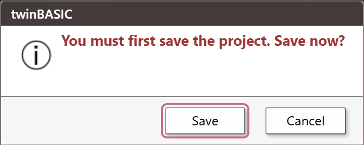
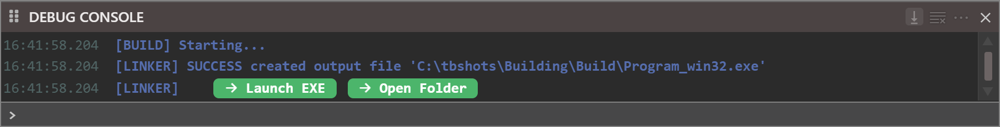
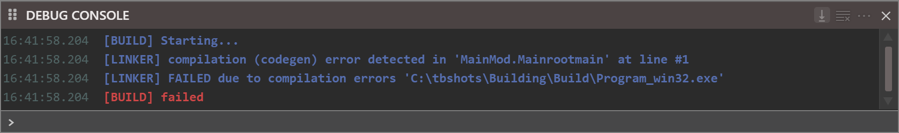
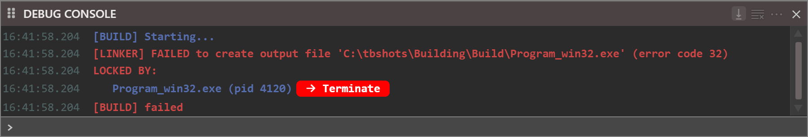
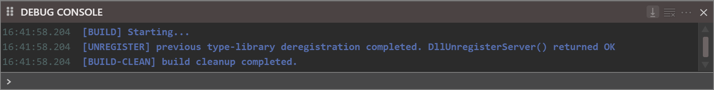

# Build and Clean

**Build** compiles the project into a file. **Clean** deletes the file the last build made, and takes its registration out of the registry. This page describes both commands, what the **DEBUG CONSOLE** shows while they run, and what to do when they do not do what you expect.

**File → Build** and the toolbar button **Build** are one command. So are **File → Clean** and the toolbar button **Clean (deregister & delete build)**. Both need a project that is open, and are greyed out until one is. Neither has a key.

{:width="190" height="337"}

The IDE only sends the request. The compiler compiles, links, writes the file, registers a DLL and prints the log. The IDE shows the log in the **DEBUG CONSOLE**, shows the [progress box](LLVM-in-the-IDE#the-progress-box) when the compiler reports progress, and asks the two questions described below.

## Build

A build does these steps:

1. **The licence check.** The compiler tells the IDE what licence it found when it starts. A **Build** pressed before that answer waits for it up to 5 seconds. If the answer does not come, the console prints **[BUILD] failed due to licence error.  Please try again.** and nothing is built. Press **Build** again.
2. **The question for a project with no file.** See [A project with no file](#a-project-with-no-file).
3. **The build.** The compiler compiles the project and writes the file that [*Build Output Path*](../Project-Settings#build-output-path) names. [What a build writes](Build-Output) describes the file, and [Build configuration](Build-Configuration) says what the box on the toolbar chooses.
4. **The log.** Every step writes its lines to the console. [What the console shows](#what-the-console-shows) lists them.

When the build is finished, the IDE does nothing more. It does not run the new file, open its folder or select it anywhere. The console's links are the way to do those.

### Unsaved changes
{: #unsaved-changes }

A build does not save the project and does not ask you to. The compiler builds the project as the IDE holds it, so the file contains the edit you typed a second ago, saved or not. The `.twinproj` file is not touched. Press <kbd>Ctrl</kbd>+<kbd>S</kbd> to save as well.

### A project with no file
{: #a-project-with-no-file }

A project made from a template, a sample or a folder, or imported from a VB6 project, has no `.twinproj` file until it is saved. **Build** and **Clean** both open a box titled **twinBASIC** for such a project, with the question **You must first save the project.  Save now?** and the buttons **Save** and **Cancel**.

{:width="362" height="144"}

**Cancel** closes the box. Nothing is written, and the console prints nothing. **Save** opens the Windows **Save As** dialog, with the name of the project's folder proposed, such as `NewProject`.

The build does not go on after the dialog. Press **Build** again. The folder you chose is now `${SourcePath}`, so the default build path puts the file in a `Build` folder in it.

> [!NOTE] BETA 1010
> **Save** in this box makes the file you choose the project's file, but writes no `.twinproj` there, and nothing is built. The project stays changed, and **File → Close Project** still asks **You've made changes to this project.  Save now?** Press <kbd>Ctrl</kbd>+<kbd>S</kbd> after the dialog to write the file.

A project that you opened from a `.twinproj` file has its file, and builds with no question. [Saving and exporting](../Projects/Saving-and-Exporting#a-project-with-no-file) describes the project with no file.

## What the console shows
{: #what-the-console-shows }

The **DEBUG CONSOLE** is the only log of a build. The IDE does not clear it when a build starts, so the lines follow whatever is there. It does not bring the console to the front either: if the panel is closed or hidden in your [panel layout](../Customising/Panel-Layouts), open it from the **View** menu first. With **Show Timestamps** on, each line starts with its time; see [Debug Console](../Debugging/Debug-Console#what-the-console-shows).

A build that succeeds writes these lines:

| Project | Lines |
|---|---|
| Standard EXE | `[BUILD] Starting...`, then `[LINKER] SUCCESS created output file '<path>'`, then a line with the links **Launch EXE** and **Open Folder**. |
| ActiveX DLL | The same, with only **Open Folder**, and then `[REGISTER] type-library registration completed. DllRegisterServer() returned OK`. |
| ActiveX Control | As an ActiveX DLL. If the type library's *Auto-Increment* is on, `[BUILD] Auto-incremented type-library version number to: <n>` comes first. |
| Standard DLL | As an ActiveX DLL, with no `[REGISTER]` line. |
| Package TWINPACK | `[BUILD] Creating TWINPACK file '<path>'`, then `[BUILD] successful.` There are no links. |

{:width="900" height="115"}

The log has no summary line. A clean build ends with the line for the file, or with the links beneath it. A build with errors ends differently, as [When a build fails](#when-a-build-fails) shows.

### The links

The console turns some words in a build's lines into links.

**Launch EXE**
: Starts the built executable. The compiler starts it, and the console prints `[SHELL] process <pid> started.` and, when it ends, `[SHELL] process <pid> exited with code <n>`.

**Open Folder**
: Opens the folder of the built file in Windows Explorer. A build of a DLL or a control has this link only.

**Terminate**
: Is red, and follows **LOCKED BY:** after a build that could not replace a file in use. It ends that program. See [The old file is in use](#the-old-file-is-in-use).

## When a build fails
{: #when-a-build-fails }

### The compiler is not ready

When the box on the toolbar is changed, a box that says **Please wait...** covers the IDE until the new compiler has the project. A press of **Build** in that time reaches nothing. Wait until the box closes.

In [safe mode](Build-Configuration#safe-mode), **Build** and **Clean** look available and do nothing: the console prints no line and no box opens.

### A program is running or paused

While a program is running in the IDE, or paused at a breakpoint, the **Build** button stays available. A press prints `ERROR: main thread is busy.` in the console and builds nothing. The program is not affected. End the program first, then build.

### An error in the code

An error in a procedure that nothing calls does not stop the build, although the DIAGNOSTICS panel lists it: the file is written. An error in a procedure that **Sub Main** reaches stops the build:

```
[BUILD] Starting...
[LINKER] compilation (codegen) error detected in 'MainMod.Mainrootmain' at line #1
[LINKER] FAILED due to compilation errors '<path>'
[BUILD] failed
```

{:width="900" height="134"}

No box opens. The [DIAGNOSTICS](../Code/Diagnostics) panel is unchanged: it already listed the error. The failed build deletes the file the previous build made.

Other failures write their own `[LINKER] FAILED ...` or `[BUILD] failed ...` line that names the file or the setting at fault. A *Build Output Path* that ends in a backslash fails with `[LINKER] FAILED to create output file '<path>' (error code 3)`, and so does one with forward slashes when its `Build` folder does not exist yet. A path with a variable that is not one of the listed ones, such as `${Nope}`, prints `[COMPILER] build path contains unrecognized variable.` and builds nothing. [What a build writes](Build-Output#the-build-output-path) lists the variables.

### The old file is in use
{: #the-old-file-is-in-use }

A build cannot replace a file that a running program holds open. The console says so, and names the program:

```
[LINKER] FAILED to create output file '<path>' (error code 32)
LOCKED BY:
   Program_win32.exe (pid 4120) Terminate
[BUILD] failed
```

The old file is kept. The red link **Terminate** ends the program, with no question, and the next **Build** succeeds. The same program stops **Clean** from deleting the file. The line is `[BUILD-CLEAN] failed to delete the previous build file.  Check the file is not in use or currently executing.`

{:width="900" height="153"}

When the file is a DLL that is registered, a failed deregistration can open another question. See [ActiveX registration](ActiveX-Registration#delete-it-and-continue).

## Clean

**Clean** deletes the file the build path names, and takes the DLL's registration out of the registry when the file is an ActiveX DLL or control. It deletes that one file. The `Build` folder and any other file in it stay.

Its log is short:

```
[BUILD] Starting...
[UNREGISTER] previous type-library deregistration completed. DllUnregisterServer() returned OK
[BUILD-CLEAN] build cleanup completed.
```

The `[UNREGISTER]` line comes only for an ActiveX build. **Clean** on a project that was never built prints the first and last lines, and so does a second **Clean**. After you change the *Build Type* setting, **Clean** removes the file of the current path only: the file of the old type stays.

{:width="900" height="115"}

**Clean** also asks the **twinBASIC** question for a project with no file. See [A project with no file](#a-project-with-no-file).

## See Also

- [Build configuration](Build-Configuration) -- 32-bit, 64-bit and safe mode
- [What a build writes](Build-Output) -- the file, its path and the version numbers
- [ActiveX registration](ActiveX-Registration) -- what Build and Clean do to the registry
- [Debug Console](../Debugging/Debug-Console) -- the panel that shows the log
- [Diagnostics](../Code/Diagnostics) -- where the compile errors are listed
- [File menu](../Reference/Menu/File#build) -- the menu entries
