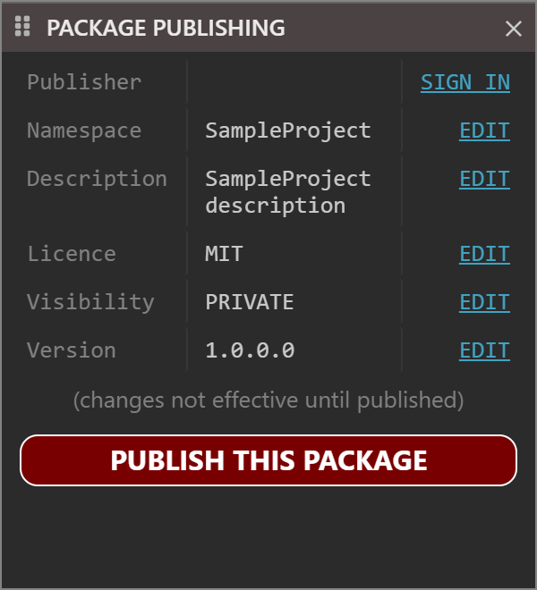
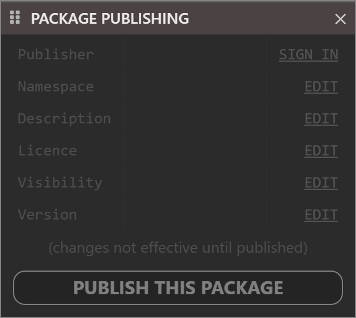
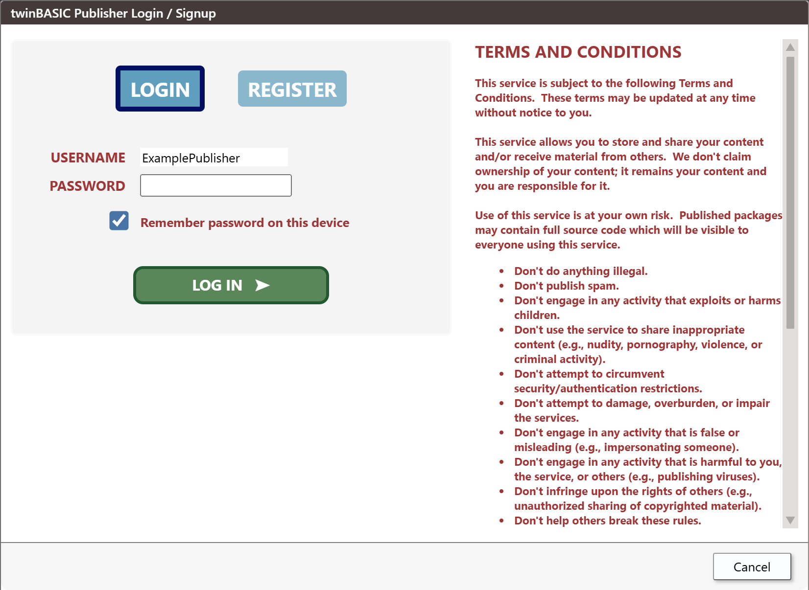
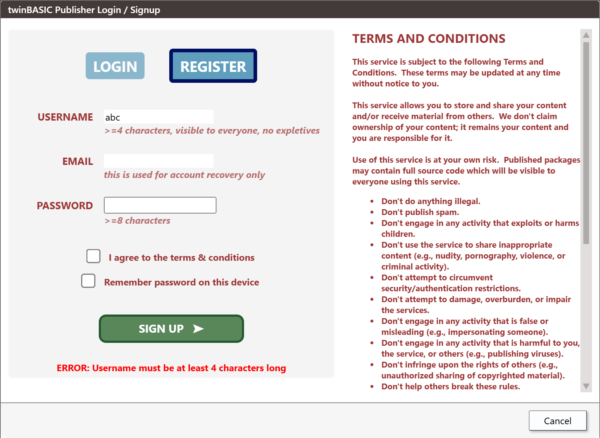
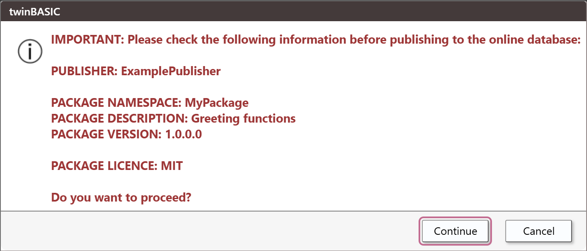
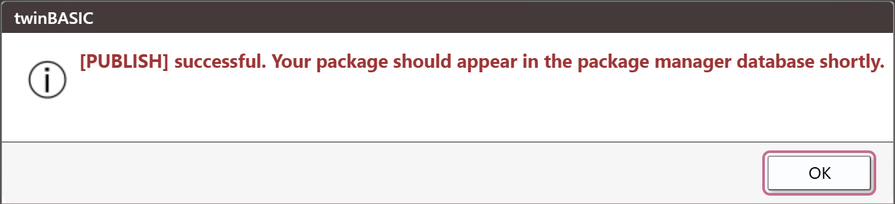

# Package Publishing

The **PACKAGE PUBLISHING** pane shows the details of a project that builds a package, takes you to the settings that hold them, and publishes the package to TWINSERV, the package database. This page describes the pane, the publisher account and what the publish button does.

A package that you build for your own use does not need the pane: **Build** writes a `.twinpack` file, as [Build output](Build-Output#what-each-project-type-produces) describes. [Creating a TWINPACK package](../../../Features/Packages/Creating-TWINPACK) is the tutorial, from the sample project to the finished package, and describes the contents of a package.

## The pane

**View → PACKAGE PUBLISHING** shows the pane. It is a panel like the others, so you can dock it, float it or close it. See [Panel Layouts](../Customising/Panel-Layouts).

{:width="300" height="330"}

The pane has six rows, each with a label and a value. Five of the rows come from the project's settings, and the link at the right of each opens the setting.

| Row | Shows | The setting |
|---|---|---|
| **Publisher** | Your publisher name, once you have signed in. The link is **SIGN IN**, or **SIGN OUT** after you have. | None. See [The publisher account](#the-publisher-account). |
| **Namespace** | The project's name. | [*Project Name*](../Project-Settings#project-name) |
| **Description** | The project's description. | [*Project Description*](../Project-Settings#project-description) |
| **Licence** | The package's licence. | [*Licence Type*](../Project-Settings#licence-type) |
| **Visibility** | **PRIVATE** or **PUBLIC**. A **PUBLIC** package can be downloaded by everyone. | [*Package Visibility*](../Project-Settings#package-visibility) |
| **Version** | The four numbers, such as `1.0.0.0`. | The four numbers of the [*VERSION Resource*](../Project-Settings#version-resource) |

Under the rows are a grey line, **(changes not effective until published)**, which is always there, and the button **PUBLISH THIS PACKAGE**.

### Only for a package project

The pane fills only for a project whose *Build Type* is **Package TWINPACK**. For any other project, and when no project is open, the pane stays where it is, dimmed and with empty values, and does not react to the mouse.

{:width="300" height="268"}

Changing the *Build Type* of a project in [Project Settings](../Project-Settings#build-type) switches the pane on or off, once the compiler has restarted.

### Editing a value

An **EDIT** link opens [Project Settings](../Project-Settings), with the filter box already holding the id of the setting: `project.name`, `project.description`, `project.licence`, `project.packageVisibility` or `project.version`. The filter for **Version** is a text filter, so it lists every setting whose id contains `project.version`: the four numbers, *Auto-Increment* and the version texts.

Change the value and press **Apply Changes**. The pane shows the new values once the compiler has them, and the console prints `[COMPILER] Project settings updated`. A change that needs the compiler to restart prints `[COMPILER] Project settings changes require compiler-restart`, and the IDE saves the project and restarts.

## The publisher account

TWINSERV accepts a package only from a publisher that has an account. The account belongs to the package server, not to the IDE: the IDE has no setting for the server, no other sign-in provider, and no way to reset a password or change the e-mail address.

**SIGN IN** opens a box titled **twinBASIC Publisher Login / Signup**. The terms and conditions are beside two forms, which two tabs choose, **LOGIN** and **REGISTER**. The box has one button, **Cancel**. It opens on **LOGIN**, with the password box focused, when the IDE knows a publisher name, and on **REGISTER** when it does not.

{:width="826" height="603"}

{:width="826" height="603"}

**To register**, fill in **USERNAME** (at least 4 characters, visible to everyone), **EMAIL** (used for account recovery only), **PASSWORD** (at least 8 characters), tick **I agree to the terms & conditions**, and press **SIGN UP**. The IDE checks these on your machine first, in this order, and shows the first fault as **ERROR:** under the form, with the field focused: **Username must be at least 4 characters long**, **invalid email address**, **Password must be at least 8 characters long**, **You must agree to the terms and conditions**. The server can still refuse the name (**Username already taken.**). When the account is made, a box says **Publisher account created successfully.  You will now be logged in.**

**To log in**, fill in **USERNAME** and **PASSWORD** and press **LOG IN**. A wrong name or password shows **Publisher login FAILED.  Username not found.** or **Publisher login FAILED.  Incorrect password.** When the server cannot be reached, the form says that the HTTPS request failed. After a login, the link in the pane reads **SIGN OUT** and the **Publisher** row shows your name. **SIGN OUT** forgets the login, and keeps the saved name.

The login is valid for the run of the IDE and no longer, and it can end sooner, when TWINSERV ends the session. The next publish then opens the sign-in box again. Each start of the IDE needs a new login.

### What the IDE saves

The IDE saves the publisher name. It saves the password only when **Remember password on this device** is ticked. The next time the box opens, it fills in the form.

The password is stored in the IDE's settings in the registry with a simple obfuscation, which is not encryption. Anyone who can read your registry can recover it. Leave the box unticked on a machine that others use.

> [!NOTE] BETA 1010
> A remembered password that contains `~` comes back wrong: the form is filled in with a different password, and the login fails. Do not tick **Remember password on this device** for such a password, and type it each time.

> [!NOTE] BETA 1010
> A saved publisher name that contains a single quote, such as `O'Brien`, is cut at the quote in the pre-filled form (**USERNAME** shows `O`). A remembered password with a quote is cut in the same way. Type the whole name and password into the boxes.

## Publishing

**PUBLISH THIS PACKAGE** uploads the package to TWINSERV. It builds the package in memory for the purpose: no `.twinpack` file is written, and no build is needed first.

1. **The login.** If you are not logged in, the sign-in box opens and the publish stops. After you log in, press **PUBLISH THIS PACKAGE** again; the publish does not resume.
2. **The project.** The compiler builds the package, and a project whose [*Project ID*](../Project-Settings#project-id) is all zeros is refused with **ERROR: Please first edit the Settings, giving the project a proper name and description**.
3. **The confirmation.** A box lists what is about to be published and asks **Do you want to proceed?**
4. **The upload.** **Continue** starts it.

The confirmation reads **IMPORTANT: Please check the following information before publishing to the online database:** and then lists **PUBLISHER**, **PACKAGE NAMESPACE**, **PACKAGE DESCRIPTION**, **PACKAGE VERSION** and **PACKAGE LICENCE**. For a package with the visibility **PUBLIC**, the box starts with **WARNING: publishing a PUBLIC package will allow everyone to download the package and see the sourcecode within it.** Its buttons are **Continue**, which is the default, and **Cancel**.

{:width="704" height="302"}

**Continue** prints `[PUBLISH] attempting to publish project '<name>' to the online database...` in the console. The result is not in the console: a box with **OK** shows it.

{:width="691" height="158"}

| Result | The box says |
|---|---|
| Uploaded | **[PUBLISH] successful.  Your package should appear in the package manager database shortly.** |
| The version is on TWINSERV already | **[PUBLISH] FAILED.  Package already uploaded with this exact version number.** Raise the version and publish again. |
| The ID is another publisher's | **[PUBLISH] FAILED.  Package already registered to another publisher (change your Project ID setting).** |
| The login has ended | The sign-in box opens again. |
| Anything else | **[PUBLISH] FAILED.  Server returned HTTPS code** and the number. |

> [!NOTE] BETA 1010
> After you press **OK** in a box that says **[PUBLISH] FAILED.  Server returned HTTPS code**, the IDE raises a script error (`t is not a function`) that only the IDE's developer tools show. Nothing else changes, and the failure is as the box said: check the number, then publish again.

The IDE has no command that removes or overwrites a published package. A version that has been uploaded stays on TWINSERV, and the next upload needs a higher version.

## See Also

- [Creating a TWINPACK package](../../../Features/Packages/Creating-TWINPACK) -- making a package, its files, and the two ways to finish it
- [Importing a package from TWINSERV](../../../Features/Packages/Importing-TWINSERV) -- using a published package in another project
- [Project Settings](../Project-Settings) -- *Build Type*, *Package Visibility* and the other settings of a package
- [Build output](Build-Output) -- the `.twinpack` file that **Build** writes
- [View menu](../Reference/Menu/View) -- the entry that shows the pane
