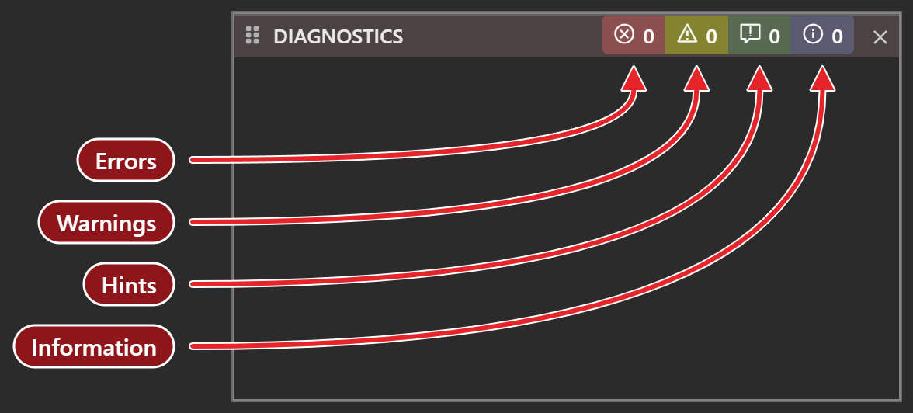
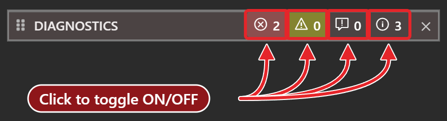
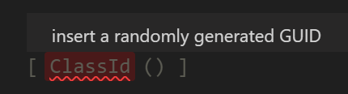

# Diagnostics

The **DIAGNOSTICS** panel lists every problem the compiler reports in the project: errors, warnings, hints and information messages. The panel is docked at the bottom of the default layout. **View → DIAGNOSTICS** shows it.

{:width="588" height="266"}

## The four kinds

| Kind | Colour |
|---|---|
| Error | Red |
| Warning | Yellow |
| Information | Blue |
| Hint | Green |

At the right of the title bar, four counters show how many problems of each kind the project has. The counters always count everything, whatever is shown in the list below.

Each counter is also a switch. Click it to show or hide the problems of that kind. Errors and warnings are shown at first. Hints and information are hidden. The pointer tooltip of a counter reads, for example, *Total Error Count -> click to toggle on/off*. The IDE keeps the four switches for each project, and brings them back when you reopen it.

{:width="446" height="121"}

The commands `tbProblems_ToggleShowErrors`, `tbProblems_ToggleShowWarnings`, `tbProblems_ToggleShowHints` and `tbProblems_ToggleShowInfos` flip the same switches. They have no keys by default.

## The list

The list has one group for each file that has a problem to show. The group's header is the file's name, and pointing at it shows the path. Click the arrow at the left of the header, or double-click the header, to collapse or expand the group.

Under a header, each row is one problem. A row shows an icon for its kind, the code and the message, and the position in square brackets as `[line,column]`. The code is `TB` and four digits, such as `TB0012`. When the compiler gives no code, the row shows `TB5000`. Pointing at a row shows its message in full.

<!-- SHOT code-diagnostics-rows: the DIAGNOSTICS panel of a project with one error, two warnings, a hint and an information message, Hints and Information switched on, grouped under two files, and one row selected showing the Jump to issue and Help buttons under it -->

### Go to a problem

Click a row to select it. Two buttons appear under the row:

**Jump to issue**
: Opens the file at the line and column of the problem, and puts the focus in the code.

**Help**
: Shows only the message *Online help content coming soon.*

A double-click on a row does the same as **Jump to issue**.

### Copy problems

Right-click in the list for a menu of five items. The menu is in English whatever the IDE language is.

**Copy**
: Copies the row under the pointer.

**Copy All**
: Copies the rows that are shown. A kind that is switched off is not copied.

**Copy All Errors**
: Copies the errors only.

**Collapse all**, **Expand all**
: Collapse or expand every group.

<!-- SHOT code-diagnostics-menu: the right-click menu of the DIAGNOSTICS panel open over a row, showing Copy, Copy All, Copy All Errors, Collapse all and Expand all -->

A copied row reads `{ERROR}` or `{WARNING}`, the path of the file, the position, and the code and message. **Copy All** and **Copy All Errors** begin with a line that names the IDE: `twinBASIC (` and the version, then `) compilation error report:`.

> [!NOTE]
> In twinBASIC BETA 1005, each copied message contains the HTML tag `TBnnnn` around the code, and **Copy All** labels hints and information messages `{WARNING}`. Remove the tags from the pasted text by hand.

## In the code

A problem also shows in other places:

- The editor underlines the part of the code the problem refers to with a wavy line. Hover over it to see the message, as `TBnnnn:` and the text.

  {:width="215" height="58"}

- The tab of the file is tinted, and so is its row in the Project Explorer. The tint follows the worst problem in the file.
- <kbd>Alt</kbd>+<kbd>F8</kbd> and <kbd>Shift</kbd>+<kbd>Alt</kbd>+<kbd>F8</kbd> move through the problems of the current file; see [Navigating](Navigating#move-by-procedure-and-by-problem).

## See Also

- [Navigating](Navigating) -- move from problem to problem in the editor
- [IntelliSense](IntelliSense) -- hover shows a problem's message
