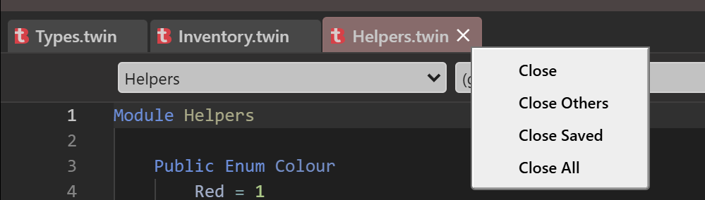
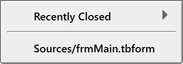
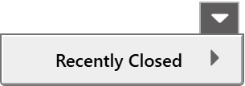
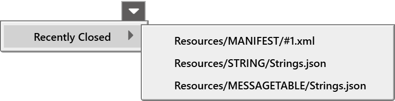
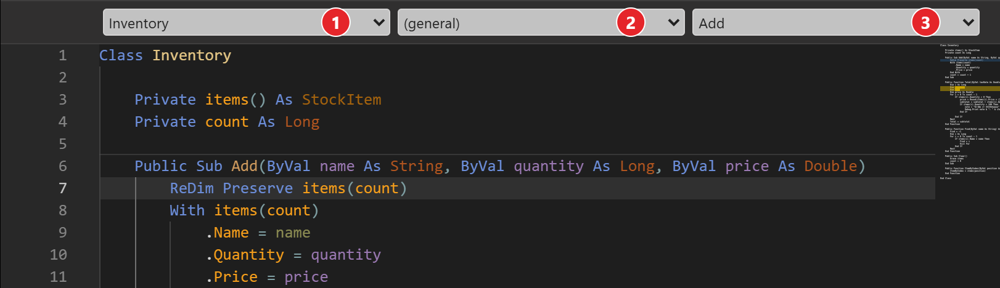
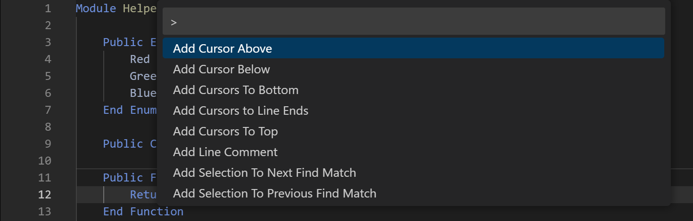

# Editor

The editor panel holds one tab for each open file, three combo boxes that move you around the file, and the code itself. This page describes the tabs, the combo boxes and the commands that change text. [IntelliSense](IntelliSense), [Navigating](Navigating) and [Finding](Finding) have their own pages.

The editor's fonts, the minimap, the indent guides, the line numbers and the other settings of how it looks are in [IDE Options](../Customising/IDE-Options). The **...** button in the header of the panel opens a menu of the same settings.

{:width="760" height="440"}

## Tabs

Each open file has a tab. The tab shows the file's icon, its name and a close button.

- A file with changes you have not saved shows a dot in place of the close button.
- A file that has errors or warnings has a tinted row in the Project Explorer, and a tinted tab.
- Pointing at a tab for about a second and a half shows the full path of the file.
- Drag a tab to move it. A mark on the left or the right half of the tab under the pointer shows where it will land.
- Click the middle mouse button on a tab to close it.

> [!NOTE] BETA 1010
> A tab is tinted only when the compiler reports its file while the tab is open. A tab opened after that report stays untinted until the compiler checks the file again, for example after the next edit to it. The Project Explorer row is tinted either way.

A tab in italics is a *preview tab*. When **File Explorer: Single-Click Preview** is on, a single click on a file in the Project Explorer opens it in a preview tab, and the next single click replaces it. A double-click, or any edit, makes the tab permanent. The **Find / Replace** panel also opens the files it visits in a preview tab. [IDE Options](../Customising/IDE-Options) describes the option.

{:width="465" height="135"}

### Close a tab

Choose the close button, press <kbd>Ctrl</kbd>+<kbd>W</kbd> or <kbd>Ctrl</kbd>+<kbd>F4</kbd>, or click the tab with the middle button. If the file has unsaved changes, a box asks **Do you want to save the changes you made to** the file, and adds that your changes will be lost if you do not save them. Its buttons are **Save**, **Discard Changes** and **Cancel**.

After you close the active tab, the editor selects the tab you used before it, not its neighbour.

Right-click a tab for a menu of four items:

**Close**
: Closes the tab you clicked.

**Close Others**
: Closes every tab except the one you clicked. It asks about each file that has unsaved changes, one after another. **Cancel** keeps that file only; the next file is still asked about.

**Close Saved**
: Closes every tab whose file has no unsaved changes, and asks nothing. The files with changes stay open.

**Close All**
: Closes every tab, and asks about each file that has unsaved changes.

{:width="499" height="142"}

The tab menu is in English whatever the [language of the IDE](../Customising/#the-language-of-the-ide) is.

### Reopen a closed tab

<kbd>Ctrl</kbd>+<kbd>Shift</kbd>+<kbd>T</kbd> reopens the file you closed last. Press it again for the one before. The IDE remembers every file you closed since it started, with no limit, and forgets them when it closes. A file you open in any other way leaves the list.

### Switch between tabs

<kbd>Ctrl</kbd>+<kbd>Tab</kbd> selects the next tab, and <kbd>Ctrl</kbd>+<kbd>Shift</kbd>+<kbd>Tab</kbd> the previous one. They follow the order of the tabs, from left to right, and go round from the last tab to the first. They do not follow the order in which you used the tabs.

### The Tabs List

The **Tabs List** button, at the right end of the tab strip, opens a menu under the button. It holds:

1. **Recently Closed**, with a submenu arrow. It appears only when a closed file can still be reopened. Its submenu lists the closed files, newest first.
2. A separator, when both parts exist.
3. Every open file, sorted by path, with the project's name left off. Choose one to select its tab.

When there are no open files and nothing recently closed, the menu holds **(empty)**.

While the menu is open, type to filter the open files. Each character you type is added to a filter, which matches any part of the path without regard to case, and the matching part is drawn in red. **Backspace** removes a character and <kbd>Esc</kbd> closes the menu. When nothing matches, the menu reads **(no matches for** and the text you typed**)**. The filter does not apply to **Recently Closed**.

{:width="187" height="66"}

With no open file, the menu holds only **Recently Closed**:

{:width="152" height="54"}

Its submenu lists the closed files:

{:width="404" height="104"}

The command `tbEditor_OpenTabsDropDown` opens the Tabs List too. It has no key by default.

### Tabs that do not fit

By default the tabs wrap onto more than one row. With **IDE: Single row of code panel tabs** on, the strip has two scroll buttons at its left and right ends. Hold one to scroll the strip, or turn the mouse wheel over the strip to scroll it sideways. When you select a tab, the strip scrolls it into view. The **Tabs List** button reaches every tab in either mode.

## The navigation combo boxes

Three combo boxes sit above the code, or below it, as **Show Code Editor Combo Selectors** in [IDE Options](../Customising/IDE-Options) decides. They show where the caret is, and they move it.

{:width="811" height="234"}

| Box | Shows | Its list |
|---|---|---|
| 1 | The component the caret is in: a module, a class, a form. | Every component in the file, sorted by name. |
| 2 | The object the caret is in, or **(general)**. | **(general)**, then the objects of the component, sorted. In a form they are its controls. In a class they are its `WithEvents` fields. A class and a form also have an entry for themselves, **Class** and **Form**. A module has only **(general)**. |
| 3 | The procedure the caret is in, or **(declaration)** when the caret is outside any procedure. | With **(general)** in box 2: the component's procedures, sorted, each with a description such as `[PropertyGet]`. With an object in box 2: that object's events. |

An event handler shows in box 3 as the event followed by the handler's name in brackets, such as `Changed [src_Changed]`.

The lists fill when you open them. Press <kbd>Ctrl</kbd>+<kbd>1</kbd>, <kbd>Ctrl</kbd>+<kbd>2</kbd> or <kbd>Ctrl</kbd>+<kbd>3</kbd> to move the focus to a box. After you choose an entry, the focus returns to the code.

![A class named Watcher, with the WithEvents fields src and other, and the caret inside the handler src_Changed. The combo boxes show Watcher, src and Changed [src_Changed]. The third box is open, listing the events of src: Changed [src_Changed] in bold and selected, and Reset.](Images/Combo_Lists.png){:width="811" height="306"}

What choosing an entry does:

- **Box 1:** moves the caret to the first line of the component and unfolds it.
- **Box 2:** goes to the first existing event handler of the object. If the object has none, the editor inserts the skeleton of its default event's handler.
- **Box 3:** goes to the procedure or handler you choose. In a list of events, an event that already has a handler is in bold, followed by the handler's name in brackets. Choosing an event that has no handler inserts a skeleton for it.

A skeleton is a blank line, the `Sub` line, an indented blank line with the caret on it, and `End Sub`. It goes before the `End Class` of the class. For a `WithEvents` variable `src` of a class with the event `Changed`, it is:

```tb
Private Sub src_Changed(ByVal n As Long)

End Sub
```

With **IDE: Use new Handles/Implements syntax** on, the `Sub` line ends with `Handles src.Changed`. For a control on a form, the skeleton names the control and the event, such as `Private Sub Text1_Change()`. The parameters come from the event.

The [History](Navigating#history) panel names each of its entries from these three values.

## Edit the text

The commands in this part work on the line the caret is on, or on every line of the selection. The **Edit** menu holds the common ones. [Edit menu](../Reference/Menu/Edit) lists them with their keys.

### Undo and redo

<kbd>Ctrl</kbd>+<kbd>Z</kbd> undoes and <kbd>Ctrl</kbd>+<kbd>Y</kbd> redoes. <kbd>Ctrl</kbd>+<kbd>Shift</kbd>+<kbd>Z</kbd> does nothing. Each press undoes or redoes one step.

### Comments

| Command | Key | What it does |
|---|---|---|
| Comment lines | <kbd>Ctrl</kbd>+<kbd>K</kbd> | Puts `' ` at the indent of each selected line. A line that is already a comment gets another. Blank lines are left alone. The **Comment Selection** button of the toolbar does the same. |
| Uncomment lines | <kbd>Ctrl</kbd>+<kbd>Shift</kbd>+<kbd>K</kbd> | Removes one `' ` or `'` from each selected line. It does nothing on a `Rem` line. The **Uncomment Selection** button does the same. |
| Toggle line comment | <kbd>Ctrl</kbd>+<kbd>/</kbd> | Comments every selected line if any of them is not a comment. If all are comments, it uncomments them. |
| Toggle block comment | <kbd>Shift</kbd>+<kbd>Alt</kbd>+<kbd>A</kbd> | Wraps the selection in `/* ... */`, from the start of its first line to the end of its last. The compiler accepts the result as a comment. |

### Indent and outdent

<kbd>Ctrl</kbd>+<kbd>]</kbd> indents the selected lines by one level, and <kbd>Ctrl</kbd>+<kbd>[</kbd> outdents them. The toolbar buttons are **Indent Block** and **Outdent Block**. <kbd>Tab</kbd> and <kbd>Shift</kbd>+<kbd>Tab</kbd> do the same, except that <kbd>Tab</kbd> accepts an entry while the [completion list](IntelliSense#the-completion-list) is open. The width of a level is **Tab Size** in [IDE Options](../Customising/IDE-Options).

### Lines

| Command | Key |
|---|---|
| Insert a line below | <kbd>Ctrl</kbd>+<kbd>Enter</kbd> |
| Insert a line above | <kbd>Ctrl</kbd>+<kbd>Shift</kbd>+<kbd>Enter</kbd> |
| Delete the line | <kbd>Ctrl</kbd>+<kbd>Shift</kbd>+<kbd>Delete</kbd> |
| Delete the word to the left | <kbd>Ctrl</kbd>+<kbd>Backspace</kbd> |
| Delete the word to the right | <kbd>Ctrl</kbd>+<kbd>Delete</kbd> |
| Move the lines up or down | <kbd>Alt</kbd>+<kbd>Up</kbd> or <kbd>Alt</kbd>+<kbd>Down</kbd> |
| Copy the lines up or down | <kbd>Shift</kbd>+<kbd>Alt</kbd>+<kbd>Up</kbd> or <kbd>Shift</kbd>+<kbd>Alt</kbd>+<kbd>Down</kbd> |
| Grow the selection | <kbd>Shift</kbd>+<kbd>Alt</kbd>+<kbd>Right</kbd> |
| Shrink the selection | <kbd>Shift</kbd>+<kbd>Alt</kbd>+<kbd>Left</kbd> |
| Select the whole line | <kbd>Ctrl</kbd>+<kbd>L</kbd> |

<kbd>Ctrl</kbd>+<kbd>L</kbd> also shows the **CALL STACK** panel, which takes the focus. A second press therefore does not extend the selection.

Four commands have no key and no menu item. Give them a key under [Keyboard shortcuts](../Customising/Keyboard-Shortcuts), or run them from the [command palette](#the-command-palette):

- `tbEditor_SortLinesAscending` and `tbEditor_SortLinesDescending` sort the selected lines.
- `tbEditor_ConvertIndentationToSpaces` and `tbEditor_ConvertIndentationToTabs` change the indentation of the file.

### Several cursors at once

Typing, deleting and most commands act at every cursor. One <kbd>Ctrl</kbd>+<kbd>Z</kbd> undoes the change at all of them.

| To | Do this |
|---|---|
| Add a cursor at a point | <kbd>Alt</kbd> and click |
| Add a cursor above or below | <kbd>Ctrl</kbd>+<kbd>Alt</kbd>+<kbd>Up</kbd> or <kbd>Ctrl</kbd>+<kbd>Alt</kbd>+<kbd>Down</kbd> |
| Add the next match of the word at the caret | <kbd>Ctrl</kbd>+<kbd>D</kbd> |
| Remove the cursor added last | <kbd>Ctrl</kbd>+<kbd>U</kbd> |
| Select every occurrence of the word or selection | <kbd>Ctrl</kbd>+<kbd>Shift</kbd>+<kbd>L</kbd> |
| Put a cursor at the end of each selected line | <kbd>Shift</kbd>+<kbd>Alt</kbd>+<kbd>I</kbd> |
| Select a column of text | <kbd>Shift</kbd>+<kbd>Alt</kbd> and drag |

<kbd>Ctrl</kbd>+<kbd>D</kbd> and <kbd>Ctrl</kbd>+<kbd>Shift</kbd>+<kbd>L</kbd> match whole words in the current file, including words inside strings and comments. <kbd>Ctrl</kbd>+<kbd>Shift</kbd>+<kbd>L</kbd> and **Select All Matches** (see [Finding](Finding#select-all-matches)) both give a cursor to each match.

> [!NOTE] BETA 1010
> <kbd>Esc</kbd> does not remove the extra cursors. Click in the text, or run any command that places the caret, to go back to one cursor.

### Change case

**Edit → Transform To Uppercase**, **Transform To Lowercase**, **Transform To Titlecase** and **Transform To Snakecase** change the case of the selection. They have no keys. Their names are in English whatever the IDE language is.

### Folding

The fold arrows in the margin fold and unfold a block. **Show Code Folding** in [IDE Options](../Customising/IDE-Options) decides when the arrows show. The compiler decides the ranges. They include each procedure and each `#Region ... #End Region` block.

| Command | Key |
|---|---|
| Fold the block at the caret | <kbd>Ctrl</kbd>+<kbd>{</kbd> |
| Unfold the block at the caret | <kbd>Ctrl</kbd>+<kbd>}</kbd> |
| Fold Procedures | <kbd>Ctrl</kbd>+<kbd>Alt</kbd>+<kbd>Left</kbd> |
| Unfold Procedures | <kbd>Ctrl</kbd>+<kbd>Alt</kbd>+<kbd>Right</kbd> |
| Fold All, Unfold All | none |

**Fold Procedures** folds every `Sub`, `Function` and `Property` in the file except the one the caret is in. A caret on a blank line between two procedures counts as being in the one above. **Fold All** folds every range, including the `Module` block that wraps a module file, so only its first line stays visible. The editor keeps the folded ranges when you close and reopen the project, as [IDE Options](../Customising/IDE-Options) describes for **Restore Editors State When Opening Project**.

### Word wrap and zoom

<kbd>Alt</kbd>+<kbd>Z</kbd> turns word wrap on and off for the editor. The setting is not saved: the next time the IDE starts, word wrap is off. `tbEditor_TurnWordWrapOn` and `tbEditor_TurnWordWrapOff` set it directly.

<kbd>Ctrl</kbd>+<kbd>+</kbd> makes the editor's font 1px bigger, with no upper limit, and <kbd>Ctrl</kbd>+<kbd>-</kbd> makes it 1px smaller, down to 8px. Both save the new size at once, as the **Code Editor Font Size** option. The **View** menu has the same two commands while the editor has the focus.

## Copy, cut and paste

The editor does its own clipboard work, and it re-indents what you paste.

- **Copy** and **Cut** replace each tab in the text with spaces, as many as **Tab Size**. They also store the column where the selection started.
- **Paste** puts the text where the caret is and re-indents it to the code around it. The first line takes the indent of the nearest code line above, plus one level if that line starts a block. A block that starts with `End`, `Next`, `Loop`, `Else`, `ElseIf`, `Wend` or `Case` goes one level out. Each other line keeps its indent relative to the first. A tab in text that comes from another program becomes spaces, and the text is then re-indented.
- A paste of a single line, such as `End If`, goes in as it is, at the caret.
- **Paste As Comment** (<kbd>Ctrl</kbd>+<kbd>Alt</kbd>+<kbd>V</kbd>) pastes the same way, and puts `' ` before each line that is not blank. It is on the **Edit** menu and on the right-click menu. A line that is already a comment gets a second `'`.
- **Plain** copy, cut and paste (<kbd>Ctrl</kbd>+<kbd>Shift</kbd>+<kbd>C</kbd>, <kbd>Ctrl</kbd>+<kbd>Shift</kbd>+<kbd>X</kbd> and <kbd>Ctrl</kbd>+<kbd>Shift</kbd>+<kbd>V</kbd>) skip the re-indenting.
- **Copy With Syntax Highlighting** (`tbEditor_ClipboardCopyWithSyntaxHighlighting`) puts the selection on the clipboard with its syntax colours. It has no key and no menu item. Run it from the command palette, or give it a key.

Paste on a blank line, or with the caret at the end of the indent. Pasting at the end of a line that already has text joins the first pasted line to that text, and the later lines can end up indented too far.

{:width="494" height="180"}

## What Enter does

<kbd>Enter</kbd> is a command of its own, not just a line break. If the [completion list](IntelliSense#the-completion-list) is open and an entry is selected, <kbd>Enter</kbd> accepts that entry instead.

- **It indents.** The new line gets the indent of the nearest code line above it. A line that continues the one before it with ` _` takes the indent of the statement's first line. After a `Case` or `Else` line, the new line is one level in.
- **It closes the block.** If the line you left starts a block that has no End statement yet, the editor types the End statement for you and leaves the caret on the empty line between, one level in. The pairs are:

| The block starts with | The editor types |
|---|---|
| `If ... Then` (block form) | `End If` |
| `For`, `For Each` | `Next` |
| `Do`, `Do While` | `Loop` |
| `While` | `Wend` |
| `Select Case` | `End Select` |
| `With` | `End With` |
| `#If ... Then` | `#End If` |
| `Sub`, `Function`, `Property` | `End Sub`, `End Function`, `End Property` |
| `Type`, `Enum` | `End Type`, `End Enum` |
| `Class`, `Module`, `Interface`, `CoClass` | `End Class`, `End Module`, `End Interface`, `End CoClass` |

- **It adds no End statement** for a one-line `If`, for `#Region`, and for the members of an interface. When the block already has its End statement, the editor adds none, and the new line has the same indent as the line you left, with no extra level.
- **It adds the brackets.** On a `Sub` or `Function` line with no parameter list, <kbd>Enter</kbd> adds `()`. `Function Bar As Long` becomes `Function Bar() As Long`.
- **It lines up a continuation.** After a line that ends in ` _`, the next line is indented to the start of the statement. After `Dim a As Long, _` it is indented four spaces further, and after `ReDim arr(1), _` six.
- **It removes spaces.** Spaces and tabs after the caret are deleted.

## Rename Symbol and Change All Occurrences

**Rename Symbol** is on the right-click menu and has the key <kbd>F2</kbd>. It opens a box over the word with its name selected.

> [!NOTE] BETA 1005
> Rename Symbol renames nothing. Typing a new name changes the box, but <kbd>Enter</kbd> and <kbd>Esc</kbd> do nothing, and the box stays open until you click in the code. To rename a name that is used in one file, use **Change All Occurrences**. For a name used in several files, use the [Find / Replace](Finding) panel with **Whole Word Only** and **Current Project**, and replace one match at a time, because **Replace All** does not work in project scope.

**Change All Occurrences**, on the right-click menu only, gives a cursor to every occurrence of the word under the caret in the file. Type the new name to replace them all. The match is on text, not on meaning: the word is also changed inside strings and comments. A longer name that contains the word, such as `totalPrice` for `total`, is not changed. One <kbd>Ctrl</kbd>+<kbd>Z</kbd> restores all of them. Other files are not touched.

## Format the code

**Edit → Format Document** and **Format Selection** re-indent the code. They have no keys; <kbd>Shift</kbd>+<kbd>Alt</kbd>+<kbd>F</kbd> does nothing.

The formatter changes only the indent of each line. It trims the line and sets the indent to four spaces for each level, whatever **Tab Size** is. It does not change the words, their case or the spacing inside the line. It adds a level after `Class`, `Module`, `Type`, `Enum`, `For`, `While`, `Do`, `With`, a block `If`, `#If`, `Sub`, `Function` and `Property`, and takes it away at the matching End. `ElseIf` and `Else` lines sit at the level of their `If`. A `Select Case` indents its `Case` lines one level and their bodies two. A continuation line is indented two levels deeper than its statement. The members of an interface get one level and no End.

> [!WARNING] BETA 1010
> **Format Selection** fails when the selection starts on a continuation line, which is a line after one that ends in ` _`. Nothing is formatted, and a box opens with the text *IDE startup failure*, followed by *JS Promise Rejection(1): Assignment to constant variable.* If the IDE was started by opening the project's `.twinproj` file, it then closes. With unsaved changes, it first asks whether to save them: choose **Save**, or **Cancel** to keep the IDE open. Save before you format, start the selection on the first line of the statement, or use **Format Document**.

## Auto Prettify

The Project Setting **Auto Prettify Source Code** corrects the case of words and the spacing as you write. It is on by default. The **...** menu of the editor has the same setting as **Auto Prettify Code**. It belongs to the project, not to you. [Project Settings](../Project-Settings#auto-prettify-source-code) describes it.

The compiler works out the corrections, and the editor applies them. A correction on the line the caret is on waits until the caret moves to another line. Then it applies:

- case: `dim yy as long` becomes `Dim yy As Long`;
- spacing: `total=total+1` becomes `total = total + 1`, and extra spaces go.

One correction does not wait. When you type a word in full and follow it with a space or a `.`, the completion list accepts it in its proper case: `dim ` becomes `Dim `, and `debug.print` becomes `debug.Print`. The rest of the line is corrected when you leave it.

> [!NOTE]
> While the completion list is open, <kbd>Down</kbd> and <kbd>Up</kbd> move in the list, so the caret does not leave the line and nothing is corrected. Press <kbd>Esc</kbd> to close the list, then <kbd>Down</kbd>.

A correction joins the typing before it in the undo history. One <kbd>Ctrl</kbd>+<kbd>Z</kbd> after `Dim ee As Long` removes the typed word and its correction together. With the setting off, the editor applies no corrections.

## The right-click menu

A right-click in the editor moves the caret to the point, unless you click inside the selection, which stays. It opens the editor's own menu at the pointer. Its labels are in English whatever the IDE language is. The groups, separated by lines, are:

1. **Go To Definition** (<kbd>F12</kbd>)
2. **Last Position** (<kbd>Ctrl</kbd>+<kbd>Shift</kbd>+<kbd>F2</kbd>), **Toggle Bookmark** (<kbd>Ctrl</kbd>+<kbd>B</kbd>), **Next Bookmark**, **Previous Bookmark** (<kbd>Ctrl</kbd>+<kbd>M</kbd>), **Clear Bookmarks (Document)** and **Clear Bookmarks (Project)**
3. **Rename Symbol** (<kbd>F2</kbd>) and **Change All Occurrences**
4. **Cut**, **Copy**, **Paste** and **Paste As Comment**
5. **Quick Find...** (<kbd>Alt</kbd>+<kbd>F</kbd>) and **Quick Replace...** (<kbd>Alt</kbd>+<kbd>H</kbd>)
6. **Monaco Command Palette** and **Code Editor Options**

**Code Editor Options** is a submenu with the items of the **...** menu in the header: **Show Code Folding**, **Render Whitespace**, **Font Size**, **Show Navigation Bar**, **Show Indent Guides**, **Show Line Numbers**, **Code Hints Always Visible**, **Sticky Scroll**, **Show MiniMap**, **Show Advanced Info On Hover**, **Show Single Row Of Tabs**, **Auto Prettify Code** and **Show CodeLens Run Procedure**. [IDE Options](../Customising/IDE-Options#the-code-editors-menu) describes them.

{:width="672" height="772"}

<kbd>Shift</kbd>+<kbd>F10</kbd> opens the same menu from the keyboard.

> [!NOTE] BETA 1010
> <kbd>Shift</kbd>+<kbd>F10</kbd> opens the menu at the top-left corner of the IDE window, not at the caret. Right-click in the editor to open it at the pointer.

## The command palette

**Monaco Command Palette**, on the right-click menu, opens a list of the editor's actions, with a box to type in. It has no key. The IDE's editor is built on Monaco, and the palette is Monaco's own. It lists 124 actions in alphabetical order, among them many that have no key and no menu item in the IDE. Type to narrow the list, and press <kbd>Enter</kbd> to run the action. <kbd>Esc</kbd> closes the palette and returns to the code.

These actions work from the palette:

- **Sort Lines Ascending**
- **Trim Trailing Whitespace**
- **Convert Indentation to Tabs** and **Convert Indentation to Spaces**
- **Go to Bracket**, which moves the caret to the bracket that matches the one at the caret
- **Fold Recursively**
- **Join Lines**; one <kbd>Ctrl</kbd>+<kbd>Z</kbd> undoes it

The palette also lists **Rename Symbol** (see [above](#rename-symbol-and-change-all-occurrences)), **Format Document** and **Show Hover**. It has no **Go to References**, **Peek Definition** or **Quick Fix**: the IDE offers no way to find all references, and the editor has no quick fixes.

The key beside an action in the palette is the key Monaco gives it. It is not always a key that works in the IDE. The IDE stops every key press with <kbd>Ctrl</kbd> held from reaching the editor, apart from the commands it binds itself. So a palette action that shows a key with <kbd>Ctrl</kbd> does not respond to that key. The Monaco keys <kbd>F1</kbd>, <kbd>F8</kbd>, <kbd>Shift</kbd>+<kbd>F8</kbd> and <kbd>Shift</kbd>+<kbd>Alt</kbd>+<kbd>F</kbd> do nothing. <kbd>F1</kbd> does not open the palette, so open it from the menu.

{:width="735" height="235"}

## Save often

The IDE keeps no backup of your edits. If the IDE or the PC stops before you save, the edits made since the last save are lost. Nothing is offered when you open the project again. Save with [**File → Save Project**](../Projects/Saving-and-Exporting#save-project) (<kbd>Ctrl</kbd>+<kbd>S</kbd>), and save often. The IDE saves the whole project at once. **Save Current Document**, on the same menu, is disabled.

What the IDE does keep, every five seconds, is the state of the project's editors: which files are open, the cursors and folds, the bookmarks and the History list. It is kept with the project and brought back when you reopen it. It holds none of your unsaved text.

Two things protect your work:

- Closing a project that has unsaved changes asks **You've made changes to this project. Save now?**
- A restart of the compiler starts from the project in memory, so unsaved edits survive it.

If the IDE reports that it timed out, or failed, while it synchronised, saved or verified the open documents, it tells you to make backups of your recently edited documents by hand. Copy the text of the files you changed into another file or program before you go on.

## See Also

- [Edit menu](../Reference/Menu/Edit) -- the menu of editing commands
- [IntelliSense](IntelliSense) -- the completion list, signature help and hover
- [Navigating](Navigating) -- Go To Definition, bookmarks and the side panels
- [Finding](Finding) -- the Find / Replace panel and Quick Find
- [IDE Options](../Customising/IDE-Options) -- the editor's settings
