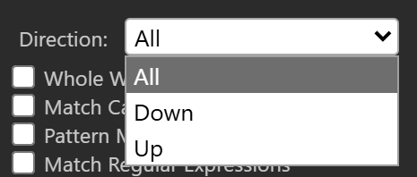
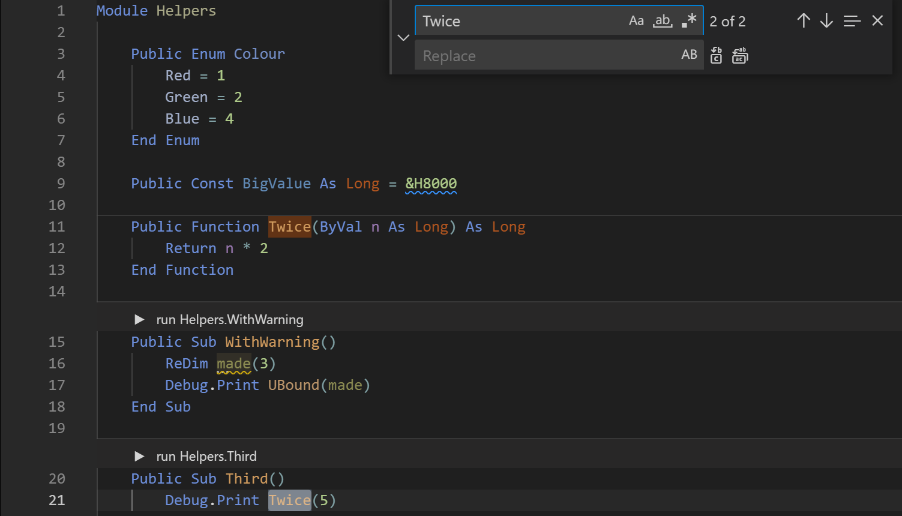

# Finding

The editor has two ways to search. The **Find / Replace** panel searches the procedure, the file or the whole project, and replaces text. The Quick Find widget searches the file you are in, in a small box over the code.

## The Find / Replace panel

Open the panel with one of these:

| To | Do this |
|---|---|
| Find | **Edit → Find...**, <kbd>Ctrl</kbd>+<kbd>F</kbd> |
| Find and replace | **Edit → Replace...**, <kbd>Ctrl</kbd>+<kbd>H</kbd> |
| Search the whole project | **Edit → Find In Project...**, <kbd>Ctrl</kbd>+<kbd>Shift</kbd>+<kbd>F</kbd>, or the **Find In Project...** button of the toolbar |
| Show the panel without searching | **View → FIND / REPLACE** |

<kbd>Ctrl</kbd>+<kbd>F</kbd> and <kbd>Ctrl</kbd>+<kbd>H</kbd> do the same thing: both open the panel, and the panel has no separate mode for replacing. They fill **Find What** with the word at the caret, or with the selection, clear **Replace With**, and put the focus in **Find What** with its text selected. A selection of several lines fills **Find What** with the first line, and ticks **Selected Text**.

The panel is in no built-in layout. The first time you show it, it floats. You can dock it like any other panel; see [Panel layouts](../Customising/Panel-Layouts).

{:width="600" height="209"}

The labels of the panel are in English whatever the IDE language is.

### The controls

**Find What**
: The text to find. <kbd>Enter</kbd> runs **Find Next**. Click the label to select the text in the box.

**Replace With**
: The text that replaces a match. <kbd>Enter</kbd> runs **Find Next**.

**Current Procedure**
: Searches the procedure the caret is in. It is available only while the caret is inside a procedure.

**Current Module**
: This scope is always greyed out. Use **Current File**.

**Current File**
: Searches the file you are editing. It is the scope the panel takes when you move the caret into a file and no scope is ticked.

**Current Project**
: Searches every file of the project. See [Search the whole project](#search-the-whole-project).

**Selected Text**
: Searches only the selection. It is available only while some text is selected.

**Direction**
: **All**, **Down** or **Up**. With **All**, a search that reaches the end of its scope goes round to the other end without asking.

**Whole Word Only**
: A match counts only when the characters before and after it are not letters or digits. An accented letter next to the match, such as *é*, also stops it counting.

**Match Case**
: Tells capital and small letters apart. Without it, a plain search ignores case. Ticking it clears **Match Regular Expressions**.

**Pattern Matching**
: Reads **Find What** as a pattern, like the `Like` operator. Ticking it clears **Match Regular Expressions**.

**Match Regular Expressions**
: Reads **Find What** as a regular expression. Ticking it clears **Match Case** and **Pattern Matching**.

**Inside Packages**
: Includes the packages the project references in a project search. It is available only with **Current Project**.

**Find Next**
: Finds the next match in the direction, and selects it in the editor.

**Replace**
: Replaces the selected match and finds the next one. The first press only finds a match; later presses replace.

**Replace All**
: Replaces every match in the scope. A project search refuses it; see [Search the whole project](#search-the-whole-project).

**Cancel**
: Closes the panel. It shows only while the panel floats.

{:width="233" height="99"}

The panel keeps the text of **Find What** and **Replace With** that you searched with, and the options. <kbd>Down</kbd> in the **Find What** box shows the newest search, and each further <kbd>Down</kbd> an older one. <kbd>Up</kbd> goes back to newer ones. The IDE keeps this history and the options for each project.

### Keys

| Key | What it does |
|---|---|
| <kbd>F3</kbd> | Find Next, from the editor or the panel. |
| <kbd>Shift</kbd>+<kbd>F3</kbd> | Find Previous. |
| <kbd>Esc</kbd> | Closes the panel when it floats, and puts the focus in the code. |

These keys work only while the focus is in the panel:

| Key | What it does |
|---|---|
| <kbd>Alt</kbd>+<kbd>N</kbd> | Find Next. |
| <kbd>Alt</kbd>+<kbd>R</kbd> | Replace. |
| <kbd>Alt</kbd>+<kbd>A</kbd> | Replace All. |
| <kbd>Alt</kbd>+<kbd>F</kbd>, <kbd>Alt</kbd>+<kbd>W</kbd> | Go to **Find What**, go to **Replace With**. |
| <kbd>Alt</kbd>+<kbd>P</kbd>, <kbd>Alt</kbd>+<kbd>C</kbd> | Choose **Current Procedure**, **Current Project**. |
| <kbd>Alt</kbd>+<kbd>D</kbd> | Go to **Direction**. |
| <kbd>Alt</kbd>+<kbd>O</kbd>, <kbd>Alt</kbd>+<kbd>S</kbd>, <kbd>Alt</kbd>+<kbd>U</kbd> | Tick **Whole Word Only**, **Match Case**, **Pattern Matching**. |

**Match Regular Expressions** and **Inside Packages** have no key.

### What a search says

A search that reaches the end of its scope with **Down** asks **End of search scope has been reached; do you want to continue from the beginning?** With **Up** it asks **Beginning of search scope has been reached; do you want to continue from the end?** The buttons are **Yes** and **No**.

A search with **All**, a project search, and **Replace All** end with **The specified region has been searched.** After a **Replace All**, a second box says how many replacements were made: **N replacements were made.**, or **1 replacement was made.** With no scope ticked, the panel says **Scope not selected**.

> [!NOTE] BETA 1010
> After a search of **Selected Text**, moving the caret leaves **Selected Text** ticked but greyed out, and **Current File** is no longer ticked. **Find Next** then says at once that the end of the search scope has been reached. Tick **Current File** again to search on.

## Match text

A plain search ignores case unless **Match Case** is ticked.

> [!WARNING] BETA 1010
> **Whole Word Only** never finds a match that starts at the very first character of the file. For example, searching for `Module` with **Whole Word Only** skips a `Module` on line 1, column 1. A **Replace All** with **Whole Word Only** leaves that word unchanged. Search without **Whole Word Only**, and check the first line yourself.

### Pattern matching

With **Pattern Matching**, **Find What** is a pattern like the one the `Like` operator reads:

| Pattern | Matches |
|---|---|
| `?` | Any one character. |
| `*` | Any run of characters, including none. |
| `#` | Any one digit. |
| `[abc]` | Any one of the characters in the brackets. |
| `[!abc]` | Any one character not in the brackets. |

For example, `Tw?ce` finds `Twice`, `[AV]rea` finds `Area`, and `Area(#, #)` finds a call with two single-digit numbers. `*` takes as much as it can, so `W*Optional` finds from the first `W` to the last `Optional` on the line.

### Regular expressions

With **Match Regular Expressions**, **Find What** is a JavaScript regular expression, written between slashes with optional flags after the second slash: `/pattern/flags`. The flags can be `g`, `i`, `m`, `s`, `u` and `y`. The panel adds `m` itself. For example, `/to+tal/i` finds `total` in any case.

If **Find What** is not in the `/pattern/flags` form, a box says **Invalid format. Expecting /pattern/flags**. If the pattern is not a valid expression, a box says **Invalid RegExp:**.

> [!WARNING] BETA 1010
> A regular expression that has a capital letter finds nothing unless it has the `i` flag. The search runs on the text of the file turned into small letters, and the pattern is left as written. `/End Sub/` finds nothing and reports **The specified region has been searched.**, while `/end sub/` and `/End Sub/i` find every `End Sub`. Write the pattern in small letters, or add the `i` flag.

> [!NOTE] BETA 1010
> A regular expression whose match spans a line break, such as `/^\s+end sub$/`, selects nothing. The selection is an empty one at the end of the line before the match, and **Find Next** stays there. Search for one line at a time.

> [!NOTE] BETA 1010
> The **Invalid RegExp:** box leaves out the reason. It shows the words and nothing after them.

## Search the whole project

**Find In Project** has no dialog and no list of results of its own. It opens the **Find / Replace** panel with **Current Project** ticked, and you go through the matches with **Find Next**.

{:width="649" height="349"}

A project search:

- starts in the file you are editing, goes on through the files after it in the order of the Project Explorer tree, and then through the files before it, ending back in the first part of the start file;
- looks in `.twin`, `.bas`, `.cls` and `.md` files, and skips every file whose name starts with a dot;
- does not look in the packages unless **Inside Packages** is ticked;
- does not look in forms (`.tbform` files);
- always goes down, whatever **Direction** says;
- opens each file that holds a match in a tab. The tab is a preview tab when **Single-Click Preview** is on.

**Replace All** does not work in a project search. The panel says **Sorry, Replace-All not yet supported in project-scope**. Use **Replace** and **Find Next** to go through the matches one at a time, or switch to **Current File** and repeat the replacement in each file.

## Quick Find

The Quick Find widget searches the file you are in, with a small box at the top right of the editor.

| To | Do this |
|---|---|
| Open Quick Find | **Edit → Quick Find...**, <kbd>Alt</kbd>+<kbd>F</kbd> |
| Open it with the replace row | **Edit → Quick Replace...**, <kbd>Alt</kbd>+<kbd>H</kbd> |
| Close it | <kbd>Esc</kbd>, which returns the focus to the code |
| Go to the next match | <kbd>Enter</kbd>, or <kbd>Alt</kbd>+<kbd>F3</kbd> |
| Go to the previous match | <kbd>Shift</kbd>+<kbd>Alt</kbd>+<kbd>F3</kbd> |
| Show an earlier search | <kbd>Up</kbd> |
| Show a later search | <kbd>Down</kbd> |

The widget opens with the selected text in its box, and with the count of the matches, such as *1 of 10*. Its toggles are **Match Case**, **Match Whole Word**, **Use Regular Expression** and **Find in Selection**, and the replace row has **Preserve Case**. <kbd>Shift</kbd>+<kbd>Enter</kbd> does nothing. The IDE does not remember the toggles between uses.

{:width="752" height="430"}

With a word selected, <kbd>Ctrl</kbd>+<kbd>F3</kbd> in the code goes to its next occurrence and shows the widget.

### Select all matches

**Edit → Select All Matches** (<kbd>Alt</kbd>+<kbd>A</kbd>) opens the widget, gives a cursor to every match of the text in it, and closes the widget. You can then type to change every match at once; see [several cursors](Editor#several-cursors-at-once). <kbd>Ctrl</kbd>+<kbd>Shift</kbd>+<kbd>L</kbd> does the same with the word at the caret, with no widget.

While the focus is in the Find / Replace panel, <kbd>Alt</kbd>+<kbd>A</kbd> is **Replace All** and <kbd>Alt</kbd>+<kbd>F</kbd> goes to **Find What**. In the editor they run Select All Matches and Quick Find.

## See Also

- [Edit menu](../Reference/Menu/Edit) -- the menu that holds the find commands
- [Editor](Editor) -- Change All Occurrences and the other editing commands
- [Navigating](Navigating) -- move by definition, bookmark or line
