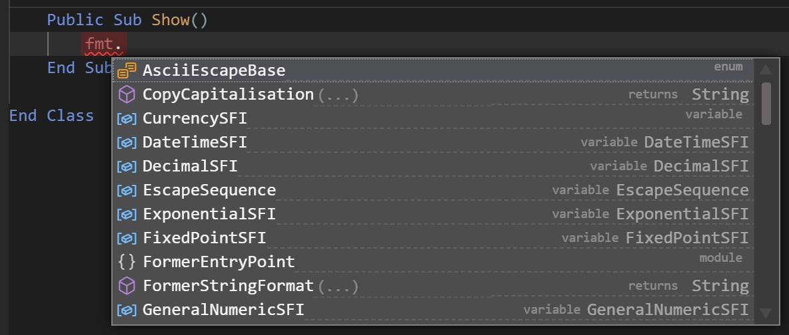
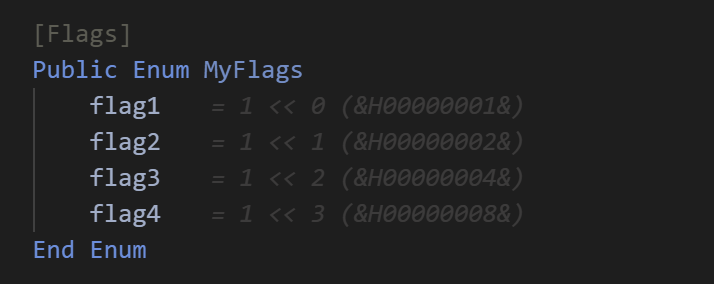
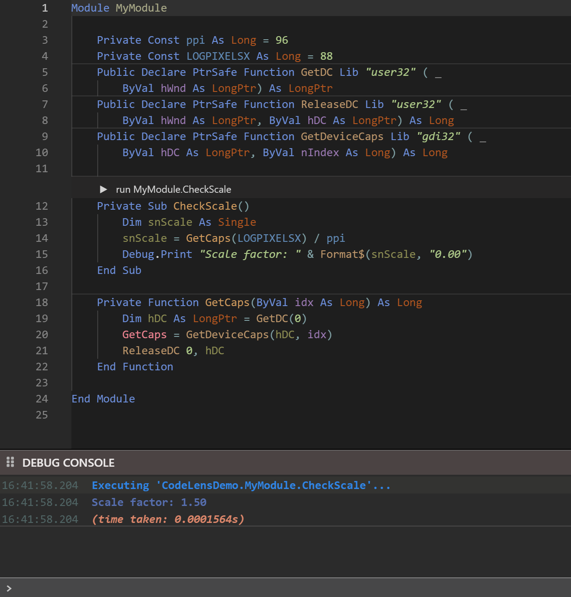

# IntelliSense

IntelliSense is the group of helpers that tell you what you can write next: the completion list, the signature-help box, the hover popup and the inline code hints. CodeLens, described at the end of this page, runs a procedure from the editor.

The compiler supplies all of them. The editor asks it as you type and shows the answer.

[IDE Options](../Customising/IDE-Options) holds the settings: the **IDE: Intellisense mode** option decides when the completion list opens by itself, and a few options switch the hover popup, the first line of documentation in signature help and the inline hints. [Intellisense modes](../Customising/IDE-Options#intellisense-modes) lists the three modes.

## The completion list

The completion list is a list of the names that fit at the caret. It opens under the caret, as you type or when you ask for it with <kbd>Ctrl</kbd>+<kbd>Space</kbd>. <kbd>Ctrl</kbd>+<kbd>Space</kbd> opens it in every mode. If only one name fits, the editor accepts it at once without showing the list.

{:width="592" height="252"}

The list holds the names that **start with** the word you have typed. The match ignores case and is on the start of the name only, so `rea` does not find `Area`. The names are sorted by the priority the compiler gives them, and then by name. Each row has:

- an icon for the kind of name: a method, function, property, field, variable, class, interface, module, enum, enum member, constant, user-defined type, event, keyword, library or reference;
- the name, with the part you typed highlighted;
- a short text on the right: for a function, `returns` and its type; for the other kinds, a word such as `field`, `variable`, `class`, `interface`, `module`, `property`, `enum`, `enum-value`, `constant`, `event`, `user defined type`, `library` or `reference`.

A row can show `...` for a moment in place of a type. The compiler sends the types a little after the names.

### Choose an entry

Press <kbd>Up</kbd> or <kbd>Down</kbd> to select a row. When the list opens, no row is selected.

| Key | With a row selected | With no row selected |
|---|---|---|
| <kbd>Tab</kbd> | Accepts the row. | Accepts the first row. If the word you typed is already complete, it inserts a tab. |
| <kbd>Enter</kbd> | Accepts the row, and adds no new line. | Does not accept: it starts a new line. |
| <kbd>Space</kbd> | Accepts the row. | Accepts the first row, without typing the space, when the first row starts with the word you have typed. If the word is complete, it types the space and fixes the word's case: `debug ` becomes `Debug `. |
| `,` `.` `+` `-` `&` `(` `)` `!` `*` `\` `/` `:` `=` | Accepts the row, and then types the character. | Types the character. |

What an accepted entry adds:

- A function or an event gets `()`, and the caret goes between the brackets. After a complete function name, <kbd>Space</kbd> does the same: `Area` becomes `Area()`.
- A library, such as `VBA`, gets a `.` at its end, and the list opens again for the names inside it.
- A name that starts with an underscore is inserted in square brackets, such as `[_Name]`.

<kbd>Esc</kbd>, <kbd>Left</kbd>, <kbd>Right</kbd> and <kbd>Backspace</kbd> close the list. <kbd>Left</kbd> also moves the caret, and <kbd>Backspace</kbd> also deletes. Scrolling the editor with the mouse wheel closes the list too.

> [!NOTE]
> In twinBASIC BETA 1005, typing `(` to accept a function from the list doubles the bracket: `Area` becomes `Area(()`. Accept the function with <kbd>Tab</kbd> or <kbd>Enter</kbd> instead. It gives `Area()` with the caret between the brackets, so type the arguments without the opening bracket.

The Debug Console has the same list in its entry box. See [Debug Console](../Project/DebugConsole).

## Signature help

Signature help is a box above the line that shows the parameters of the procedure you are calling. It opens when you type `(` after a procedure's name, after each `,`, and on a space after a procedure called without brackets, such as `MsgBox `. In the MANUAL mode only <kbd>Ctrl</kbd>+<kbd>Space</kbd> opens it.

The box shows the whole signature: `Function Area(ByVal width As Long, ByVal height As Long) As Long`. An optional parameter is in square brackets, with its default value. The parameter you are writing is highlighted. It is the first after the `(` and the next one after each `,`. When a procedure has several overloads, the box lists them one under the other, each with its own highlighted parameter. `InStr(` shows both forms of `InStr`.

<!-- SHOT code-signature-help: the signature-help box open above a line "x = InStr(", showing the two InStr overloads one under the other, each with its active parameter highlighted -->

Under the signature is the first line of the procedure's documentation. For a procedure of your own that has none, the box says that no further information is available, and suggests the `Description` attribute above the procedure. The option **IDE: Signature-Help Show First Line Of Docs** turns that line off, and then only the signature shows.

<kbd>F1</kbd> expands the box to the whole documentation, shown as formatted text. <kbd>F1</kbd> again collapses it. The fold icon at the left of the box does the same when you click it.

<!-- SHOT code-signature-help-expanded: the same box after F1 for a call to MsgBox, showing the full documentation (Syntax and Parameters) -->

<kbd>Esc</kbd>, <kbd>Up</kbd>, <kbd>Down</kbd> and <kbd>Backspace</kbd> close the box. Typing `)` over the closing bracket that the editor added with `(` leaves the box open, and so does <kbd>Enter</kbd>.

## Hover

Rest the pointer on a word for a second and a popup shows what the compiler knows about it. The popup stays open when you move the pointer onto it. **IDE: Show Information When Hovering** turns it off.

- For a function, the popup shows its declaration and the module that holds it. Without documentation it suggests the `Description` attribute.
- For a local variable, it shows `local variable` and the variable's `Dim` line.
- For a class, it shows the instance size, the members, the fields, the implemented interfaces and the events.
- For a keyword, a string and the functions of the VBA library, it shows nothing.

<!-- SHOT code-hover: the hover popup over a call to a procedure of the project, showing its declaration and the module that holds it -->

**IDE: Show Advanced Info On Hover** adds the offset of each member in the class's virtual table. [IDE Options](../Customising/IDE-Options) describes it, and [Modern IDE Features](../../../Features/Compiler-IDE/IDE-Features) lists the rest of what the popup shows.

Hovering over a wavy underline shows the compiler's message, as `TBnnnn:` followed by the text. See [Diagnostics](Diagnostics#in-the-code).

While a program is stopped in the debugger, the popup also evaluates the expression under the pointer.

The hover text is in English whatever the [language of the IDE](../Customising/#the-language-of-the-ide) is.

## Inline code hints

The compiler sends a short note for some lines, and the editor draws it after the end of the line, in italics. Most are the name of the block that an `End` line closes, such as `End Function` followed by an arrow and `Twice`. On an enum member that has no explicit value, the note is the value, such as `= 1 << 0`.

{:width="357" height="142"}

The notes are hidden. They show while you hold <kbd>Ctrl</kbd> with the focus in the code, and hide again when you let go. With **Always show IDE Inline Code Hints** on, they stay on screen. The command `tbEditor_ToggleShowCodeHints` switches them on and off without a key.

## CodeLens

A CodeLens bar above a procedure runs the procedure from the editor, without starting the whole program. The procedure has full access to your code: it can use constants, call other functions both intrinsic and user-defined, call APIs, and print to the Debug Console.

A bar appears above a procedure in a standard module when the procedure has no required parameters. That includes a `Public` or `Private` `Sub`, a `Function`, a `Property Get`, and a procedure whose only parameters are `Optional`. A procedure in a class, a form or a UserControl has no bar. The bar reads **run** with the module and procedure name, such as **▶ run MyModule.CheckScale**.

{:width="640" height="669"}

Click the bar to run the procedure. The DEBUG CONSOLE prints `Executing 'Project.Module.Procedure'...`, whatever the procedure prints, and the time it took. The focus does not go back to the code. If the project has a compile error, nothing runs, and the console says so: *(compile error: codegen error; check for compilation errors)*.

For example, this `Public Sub` in a module gets a bar:

```tb check_build
Public Sub RunTest()
    Debug.Print "Hello from CodeLens"
End Sub
```

The Project Setting **CodeLens - Show Run Procedure** turns the bars on and off for the project. It is on by default. [Project Settings](../Project-Settings#show-run-procedure) describes it. The editor's **...** menu has the same setting as **Show CodeLens Run Procedure**.

## See Also

- [IDE Options](../Customising/IDE-Options) -- the IntelliSense mode and the hover options
- [Editor](Editor) -- Enter, Auto Prettify and the editing commands
- [Diagnostics](Diagnostics) -- the problems the compiler reports
- [Debug Console](../Project/DebugConsole) -- where CodeLens output appears
