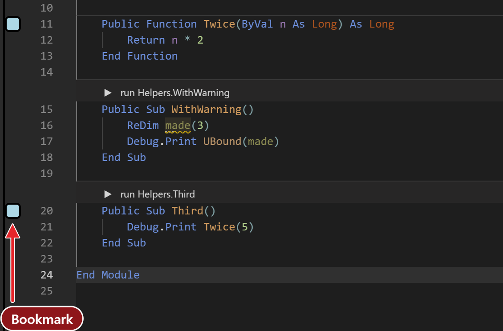
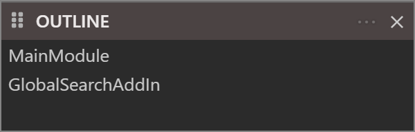
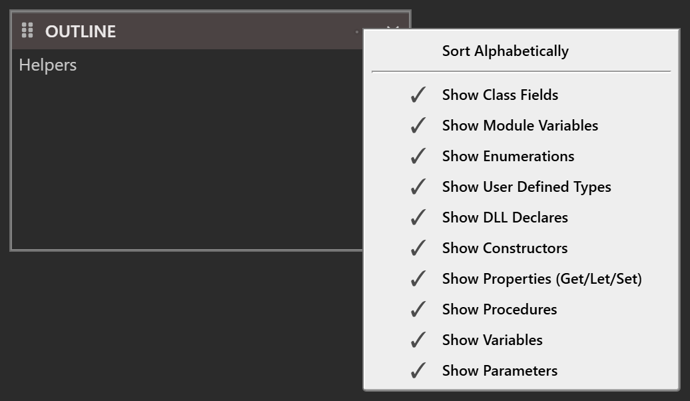
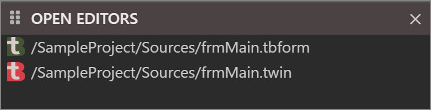
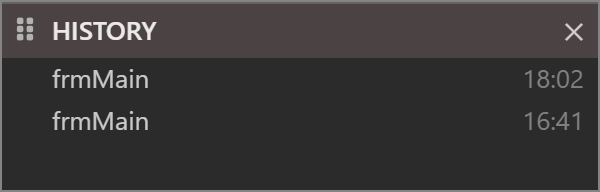

# Navigating

This page covers the commands that take the caret somewhere else in the code, and the three panels that list where you can go: Outline, Open Editors and History. The three combo boxes above the code are another way to move, described under [Editor](Editor#the-navigation-combo-boxes).

## Go To Definition

**Go To Definition** takes the caret to where the name under it is declared. Put the caret on the name and press <kbd>F12</kbd> or <kbd>Shift</kbd>+<kbd>F2</kbd>, or choose **Go To Definition** from the right-click menu or **Definition** from the **View** menu.

Where the caret lands:

| The name is | The caret goes to |
|---|---|
| A local variable | Its `Dim` line. |
| A procedure in another module | That file, on the line after the procedure's declaration. |
| A member of a class, reached through an object variable | The class's file, on the line after the member's declaration. |
| A class | The line after its `Class` line. |
| An enum member | Its line. |
| A control, in a form's code | The top of the form's code file, not the form designer. |
| A member of a package, or of the VBA library | A new tab with the package's source. The tab is read-only. |
| A keyword, or text in a string | Nowhere. |

> [!NOTE] BETA 1010
> <kbd>Ctrl</kbd>+<kbd>Up</kbd> and <kbd>Ctrl</kbd>+<kbd>Down</kbd>, and Go To Definition for most names, land on the line after the declaration, not on the declaration itself. Press <kbd>Up</kbd> once to reach it.

<kbd>Ctrl</kbd>+click does not follow a name, and the editor has no Peek Definition.

## Last Position

**Last Position** takes the caret back to where it was before. Press <kbd>Ctrl</kbd>+<kbd>Shift</kbd>+<kbd>F2</kbd>, choose **Last Position** from the **View** menu or the right-click menu, or press the "back" button of the mouse while the pointer is over the editor. It puts the caret at the start of the line.

The editor remembers 20 positions, and each use takes one off, newest first, so repeating the command walks back. A position is recorded:

- when you use **Go To Definition**, even if it found nothing;
- when you edit a line. Edits on the same line, or on the next line, extend the newest position instead of adding one.

Moving the caret alone records nothing. The positions are not saved with the project.

## Bookmarks

A bookmark marks a line so that you can return to it. A bookmarked line shows a light-blue box with a black border in the margin.

{:width="565" height="372"}

| Command | Key |
|---|---|
| Toggle Bookmark | <kbd>Ctrl</kbd>+<kbd>B</kbd> |
| Previous Bookmark | <kbd>Ctrl</kbd>+<kbd>M</kbd> |
| Next Bookmark | none |
| Clear Bookmarks (Document) | none |
| Clear Bookmarks (Project) | none |

The five commands are on the right-click menu of the editor. Next Bookmark has no default key, so give it one under [Keyboard shortcuts](../Customising/Keyboard-Shortcuts). The commands are `tbEditor_NextBookmark`, `tbEditor_ClearBookmarks` and `tbEditor_ClearBookmarksProject`.

**Previous Bookmark** and **Next Bookmark** go to the nearest bookmark above or below the caret, then on through the other files of the project in the order of the Project Explorer tree, and round to the start again. They open the file that holds the bookmark, and put the caret at the start of its line.

A bookmark moves with its line when you insert or delete lines above it. The project keeps its bookmarks when you close and reopen it.

## Go to a line

**Edit → Go To Line/Column...** opens a small box over the editor. Click the **Ln**, **Col** field in the status bar to open the same box. The box tells you how many lines the file has. Type a line number, or `line:column`, such as `12:5`, and press <kbd>Enter</kbd>. Text that is not a position, or a line number beyond the end, leaves the box as it was.

The command has no key. <kbd>Ctrl</kbd>+<kbd>G</kbd> is the key of the Debug Console.

## Move by procedure and by problem

| Command | Key | What it does |
|---|---|---|
| Previous procedure | <kbd>Ctrl</kbd>+<kbd>Up</kbd> | Moves the caret to the first line of the body of the previous procedure, and scrolls so that it is near the top. |
| Next procedure | <kbd>Ctrl</kbd>+<kbd>Down</kbd> | The same for the next procedure. |
| Next problem | <kbd>Alt</kbd>+<kbd>F8</kbd> | Opens a small view of the next problem in the current file, with a count such as *1 of 4 problems*. |
| Previous problem | <kbd>Shift</kbd>+<kbd>Alt</kbd>+<kbd>F8</kbd> | The same for the previous problem. |

The procedure commands stop at the first and the last procedure. The problem commands go through the problems of the current file in the order of their severity, errors first, and wrap round. They do not count hints.

<kbd>Ctrl</kbd>+<kbd>Alt</kbd>+<kbd>Left</kbd> and <kbd>Ctrl</kbd>+<kbd>Alt</kbd>+<kbd>Right</kbd> fold and unfold every procedure; see [Folding](Editor#folding).

## Outline

The **OUTLINE** panel lists the symbols of the file you are editing. It is empty when no file is open. Click a row to move the caret to that symbol. A row shows the symbol's name and the compiler's note about it.

{:width="300" height="96"}

> [!NOTE] BETA 1010
> The Outline lists only the top-level types of a file, such as the module or the classes. The procedures, fields and properties inside them are missing, rows have no expand arrow, and the filters of the **...** menu below change nothing you can see. To go to a procedure, use the [combo boxes](Editor#the-navigation-combo-boxes).

The **...** button in the header of the panel opens a menu of eleven items that you tick. The IDE keeps them for each project.

**Sort Alphabetically**
: Sorts the rows by name. It is off by default.

**Show Class Fields**, **Show Module Variables**, **Show Enumerations**, **Show User Defined Types**, **Show DLL Declares**, **Show Constructors**, **Show Properties (Get/Let/Set)**, **Show Procedures**, **Show Variables** and **Show Parameters**
: Each shows or hides the symbols of that kind. All are on by default.

{:width="518" height="301"}

The menu is in English whatever the IDE language is.

## Open Editors

The **OPEN EDITORS** panel lists the files that are open in the editor, one row for each tab. Each row shows the file's icon and its full path. The rows are sorted by path, not in the order of the tabs. Click a row to select that tab and put the focus in the code. The panel is empty when no project is open.

{:width="360" height="92"}

## History

The **HISTORY** panel lists the places where you edited, so that you can go back to them. The panel is empty when no project is open.

{:width="300" height="96"}

An entry has a name and a time such as `18:02` at its right. The name is built from the three combo boxes at the moment of the edit: the component, the object and the procedure, joined by dots, such as `Watcher.src.Changed`. Outside a procedure, the name is the component alone.

- Editing in a place that has no entry adds one at the bottom of the list.
- Editing in the place of the newest entry only updates its time and line.
- Editing in a place that has an older entry removes the older one, so each place is listed once and the newest edit is at the bottom.
- The list holds at most 10 entries. The oldest goes first.

Click an entry to open its file at the line, in column 1. An entry follows the edits above it, so it keeps pointing at the same line. An entry whose file no longer exists is removed. The IDE keeps the list with the project and brings it back when you reopen it.

Point at an entry to see its tooltip: the path of the file, the line as `[line: n]`, and the full date and time. For a form, which has no lines of code, the tooltip reads `[line: undefined]`.

![The pointer resting on the 18:02 frmMain entry, which raises a tooltip reading /SampleProject/Sources/frmMain.tbform [line: undefined] above a second line giving Fri Jan 09 2026 18:02:51 GMT+0000 (GMT+00:00).](../Images/History_2.png){:width="360" height="120"}

![The pointer on the 16:41 entry instead, its tooltip reading /SampleProject/Sources/frmMain.twin [line: 4] above Fri Jan 09 2026 16:41:58 GMT+0000 (GMT+00:00).](../Images/History_3.png){:width="360" height="120"}

The three panels are in no built-in layout, so each comes up floating the first time you show it from the **View** menu. See [Panel layouts](../Customising/Panel-Layouts).

## See Also

- [View menu](../Reference/Menu/View) -- the menu that shows the panels
- [Editor](Editor) -- the combo boxes, tabs and editing commands
- [Finding](Finding) -- search the file or the project
- [Diagnostics](Diagnostics) -- the list of problems
