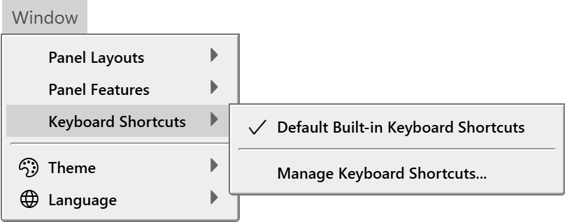
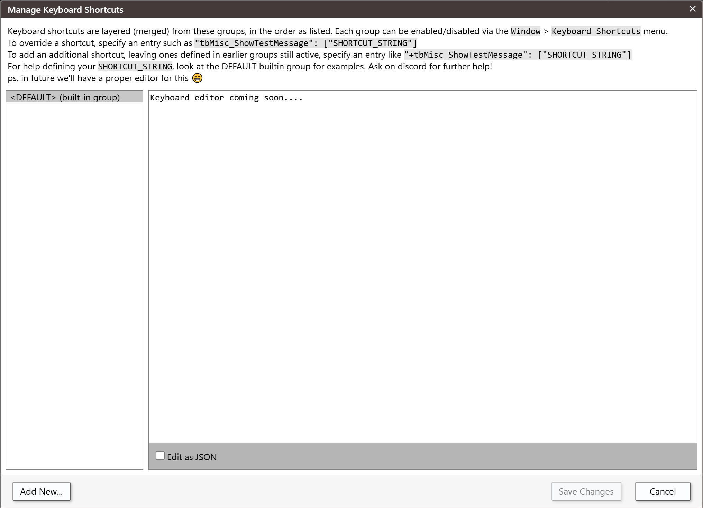

# Keyboard shortcuts

Every IDE command can have keys, and you can change them. You write your changes in *groups*, and the IDE layers the groups that are switched on on top of the built-in keys.

## How shortcuts are layered

The keys come from a stack of groups, merged in order:

1. The built-in group, **Default Built-in Keyboard Shortcuts**, is always first. It is always on and you cannot switch it off. It binds 228 commands with 265 keys.
2. After it come the groups you create, in the order you created them, but only the ones that are switched on.

A later group changes what the groups before it say. So you never switch between whole sets of shortcuts. You leave the built-in group on, and add a group that holds only your differences. A group can replace the keys of a command, add keys to it, or remove its keys.

To remove a default key, override the command in a group of your own with no keys. Clicking the built-in group does not remove it: the IDE answers that you cannot switch off the built-in shortcuts, and that you should create a group to override or disable single commands.

## Switch groups on and off

Point at **Window → Keyboard Shortcuts**. The submenu lists the built-in group, which is always ticked, then your groups as **Custom** *n*. *name*, then **Manage Keyboard Shortcuts...**.

{:width="404" height="159"}

A tick means the group is on. Click a group to switch it on or off. The change applies at once: menu items show their new keys. The IDE keeps the set of groups that are on.

The first ten groups have commands that switch them: `tbKeyboardShortcuts_ToggleActiveKeyboardShortcutGroupCustom1` to `...Custom10`. **Manage Keyboard Shortcuts...** has the command `tbKeyboardShortcuts_ShowManageKeyboardShortcuts`. None of these has a default key.

Menu items show their keys in the order <kbd>Ctrl</kbd>+<kbd>Shift</kbd>+<kbd>Alt</kbd>+key. The key names are in the language of the IDE.

## Manage keyboard shortcuts

Choose **Window → Keyboard Shortcuts → Manage Keyboard Shortcuts...** to create, edit and delete groups.

{:width="1016" height="736"}

The text across the top of the dialog describes the layering, and how to override a shortcut and how to add one. The list on the left holds `<DEFAULT> (built-in group)`, which is read-only, and then your groups. Each of yours has a close icon that deletes it. The pane on the right holds the selected group as JSON in a monospace text area.

The **Edit as JSON** box is ticked. If you clear it, the pane shows only the text *Keyboard editor coming soon....*, so keep it ticked.

{:width="1016" height="736"}

**Add New...**
: Asks for a name, then creates a group that holds one sample entry, `{"tbMisc_ShowTestMessage":["{KEYDOWN}{CTRL}0"]}`. <kbd>Ctrl</kbd>+<kbd>0</kbd> then opens a test dialog that reads *This is just a test modal dialog.* A name that starts with `<` is refused with a message that says *Custom panel name cannot begin with '<'*, although it means a group name.

**Save Changes**
: Greyed out until you change something. It saves the groups, switches on the groups you added, and applies the result.

**Cancel**
: Discards every change made in the dialog.

Text that is not valid JSON turns red. The IDE ignores a group whose text is not valid when it merges the groups.

> [!WARNING]
> In twinBASIC BETA 1005, a group whose name contains a vertical bar (`|`) can break the list of groups that are on. The IDE saves the list as the names, each between two bars, such as `|Mine||Other|`. A name with a bar inside it can match part of another name. For example, with groups named `A|B` and `B` both on, clicking `B` in the menu leaves it ticked, and clicking it again switches off both groups, and leaves a broken entry in the saved list. Nothing warns you. Do not use `|` in a group name.

## The text of a group

A group is a JSON object. Each key names a command, and each value is a list of key strings. The commands are named in the default group, which is listed on the [Window menu](../Reference/Menu/Window#keyboard-shortcuts) page and is the place to look up the name of a command.

| Entry | Meaning |
|---|---|
| `"command": ["..."]` | Replaces every key that earlier groups gave the command. |
| `"+command": ["..."]` | Adds keys, and keeps the ones the earlier groups gave. |
| `"command": []` | Gives the command no key. `[""]` does the same. |
| `"command('argument')": ["..."]` | Binds the key to the command called with the argument. |

An entry with an argument is always added to the keys of the command, with or without the `+`. The single quotes around the argument are optional. In the IDE, only `tbDebugConsole_ExecuteCode` takes an argument.

This group adds a second key for word wrap, keeps only <kbd>Ctrl</kbd>+<kbd>X</kbd> for **Cut**, and binds <kbd>Ctrl</kbd>+<kbd>Shift</kbd>+<kbd>J</kbd> to run an expression in the Debug Console:

```json
{
	"+tbEditor_ToggleWordWrap": ["{KEYDOWN}{CTRL}{SHIFT}Y"],
	"tbEditor_ClipboardCut": ["{KEYDOWN}{CTRL}X"],
	"tbDebugConsole_ExecuteCode('? 6*7')": ["{KEYDOWN}{CTRL}{SHIFT}J"]
}
```

The built-in group gives **Cut** two keys, <kbd>Ctrl</kbd>+<kbd>X</kbd> and <kbd>Shift</kbd>+<kbd>Delete</kbd>. The entry without a `+` replaces both with the one. <kbd>Alt</kbd>+<kbd>Z</kbd> still toggles word wrap, because the entry for it begins with `+`.

## Shortcut strings

A key string describes **one key press** with its modifiers. The IDE has no way to write a sequence of two key presses.

The IDE changes the string to upper case. It then reads these parts, in this order:

`{KEYDOWN}`
: The binding runs when the key goes down. A string without it, such as `CONTROL`, which the default group uses to hide the inline code hints, runs when the key is released.

`{KEYDOWNREPEAT}`
: The binding also runs again while the key is held down. It is always written beside `{KEYDOWN}`.

`{CTRL}`, `{ALT}` and `{SHIFT}`
: The modifier keys that must be held.

The key
: One key name, such as `A`, `F5` or `ARROWLEFT`.

For example, `{KEYDOWN}{KEYDOWNREPEAT}{CTRL}{SHIFT}ARROWLEFT` runs on <kbd>Ctrl</kbd>+<kbd>Shift</kbd>+<kbd>Left</kbd>, and again for as long as you hold the keys.

The key names are `A` to `Z`, `0` to `9`, `F1` to `F19`, `ARROWLEFT`, `ARROWUP`, `ARROWRIGHT`, `ARROWDOWN`, `ENTER`, `SPACE`, `BACKSPACE`, `DELETE`, `TAB`, `ESCAPE`, `HOME`, `END`, `PAGEUP`, `PAGEDOWN`, `INSERT`, `CAPSLOCK`, `CANCEL`, `CONTROL`, `SHIFT`, `ALT`, `OTHERKEY` and these punctuation keys: `[ ] / + - ! , . & ( ) * : = \ { } #`. A name that is not in the list gives no binding. A backslash is written `\\` in JSON.

A punctuation key written without `{SHIFT}` matches both the plain and the shifted form of the key.

A digit with `{SHIFT}` never matches a key press. With <kbd>Shift</kbd> held, the key arrives as its shifted symbol, and the IDE looks that up in place of the digit. `{CTRL}{SHIFT}0` is therefore a string that cannot be pressed.

The form `{ALLEXCEPT}KEY|KEY|...` binds every key in the table except the ones listed. Only the built-in command `tbIntellisense_ShowAfterKeyPress` uses it.

## When two commands share a key

Nothing warns you when a key is bound to more than one command. The IDE tries the commands in the order of its command table. A command runs only if its own context allows it, for example while a text editor has the focus. The IDE stops after the first command that has handled the key press completely.

For example, with `tbMisc_ShowTestMessage` and `tbTheme_SwitchToggle` both on <kbd>Ctrl</kbd>+<kbd>Shift</kbd>+<kbd>Y</kbd>, both run: the theme switches and the test dialog opens.

When a command fails, the Debug Console prints `command failed:` and the command's name in quotes.

## See Also

- [Window menu](../Reference/Menu/Window#keyboard-shortcuts) -- the **Keyboard Shortcuts** entry, and the list of the default shortcuts
- [Panel layouts](Panel-Layouts) -- the commands that switch layouts
- [Themes](Themes) -- the commands that switch themes
- [Customising the IDE](.) -- where the settings are kept
