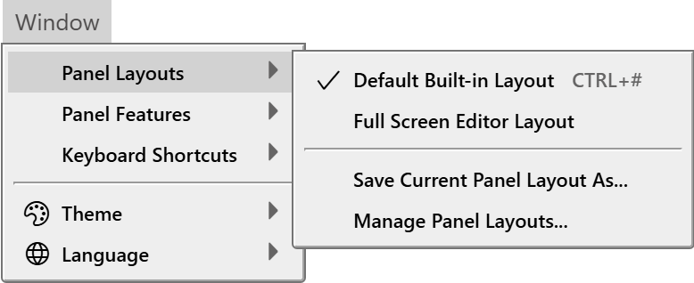
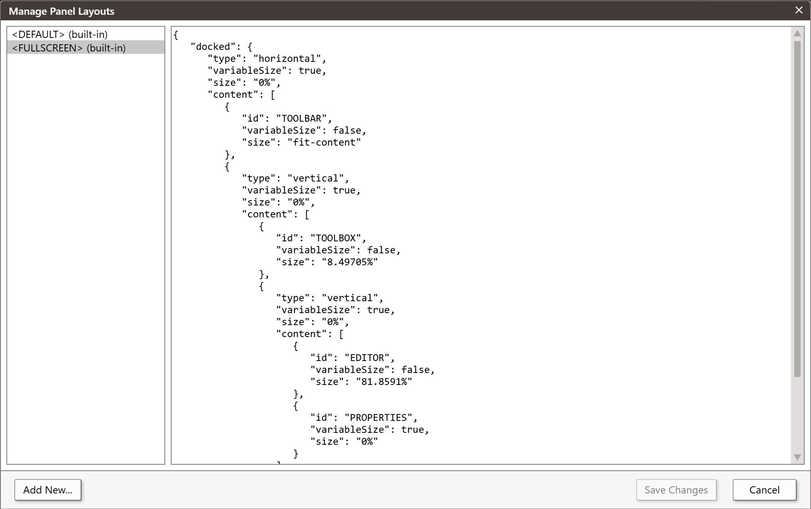
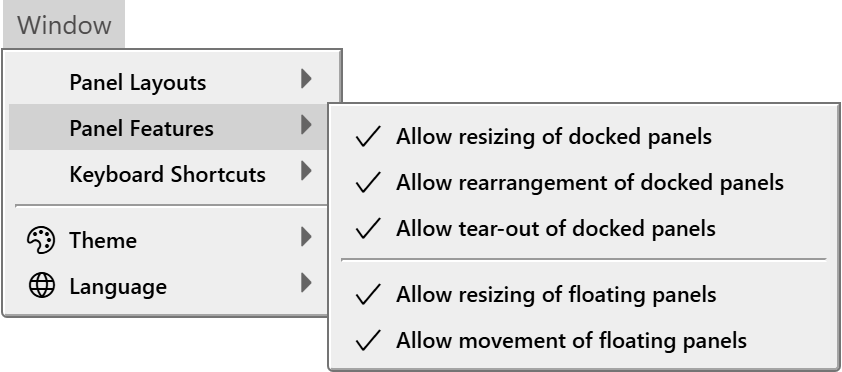

# Panel layouts

A panel layout is a saved arrangement of the IDE's panels. You can rearrange the panels freely, save the result under a name, and switch back to it later.

## What a layout keeps

A layout keeps two things:

- the **docked** panels: which panels are docked, where, and how much room each takes;
- the **floating** panels: the position and size of each one, in pixels. A floating panel that is hidden is not kept.

The IDE also keeps the arrangement you are using now, and brings it back the next time it starts. Every change you make to the panels updates it.

## Choose a layout

Point at **Window → Panel Layouts**. The submenu lists, in this order:

1. **Default Built-in Layout**, with the key <kbd>Ctrl</kbd>+<kbd>#</kbd>.
2. **Full Screen Editor Layout**, which has no key.
3. **Custom Layout (Unsaved)**, shown and ticked only while no named layout is in use.
4. One item for each layout you saved, labelled **Custom** *n*. *name*, in the order you created them.
5. **Save Current Panel Layout As...** and **Manage Panel Layouts...**.

{:width="389" height="159"}

A tick marks the layout in use. Choosing a layout applies it at once: the IDE closes every floating panel, builds the docked arrangement again and opens the floating panels the layout holds.

Any change to the panels, such as dragging a splitter or moving a panel, puts the arrangement outside every named layout. The tick moves to **Custom Layout (Unsaved)**. The arrangement is not lost: save it, or leave it as it is.

The first ten saved layouts have commands that switch to them: `tbPanels_SetActiveLayoutCustom1` to `tbPanels_SetActiveLayoutCustom10`. The built-in layouts have `tbPanels_SetActiveLayoutDefault` and `tbPanels_SetActiveLayoutFullScreen`. Only `tbPanels_SetActiveLayoutDefault` has a default key. You can give the others keys under [Keyboard shortcuts](Keyboard-Shortcuts).

### The built-in layouts

**Default Built-in Layout**
: The toolbar sits at the top. The Toolbox and the Editor are on the left of the middle. The Debug Console and Problems, and Call Stack and Variables, are on the right of the middle. The Project Explorer and Properties are in a column on the far side.

**Full Screen Editor Layout**
: Docks only the toolbar, the Toolbox, the Editor and Properties, and the Editor takes most of the room. The other panels are removed from the window. A panel you open with its show command comes back as a floating panel, and the layout in use becomes **Custom Layout (Unsaved)**.

You cannot change or delete a built-in layout.

## Save a layout

Choose **Window → Panel Layouts → Save Current Panel Layout As...**. A box titled *Save current IDE panel layout...* asks for a **Name**. Press <kbd>Enter</kbd> to save the arrangement under that name, and the new layout becomes the one in use. An empty name saves nothing.

A name may be any text. If a layout of that name exists, the new one replaces it without asking. Do not start a name with `<`: **Manage Panel Layouts** refuses such names, and a layout saved as `<DEFAULT>` can never be applied, because the IDE looks for the built-in layout of that name first.

## Manage layouts

Choose **Window → Panel Layouts → Manage Panel Layouts...** to add and delete layouts and to edit them as text.

{:width="1016" height="638"}

The list on the left holds `<DEFAULT> (built-in)` and `<FULLSCREEN> (built-in)`, which are read-only, and then your layouts. Each of yours has a close icon that removes it. The pane on the right shows the selected layout as text, which you can edit unless it is a built-in layout.

**Add New...**
: Asks for a name in a box that reads *&lt;new name&gt;*. <kbd>Enter</kbd> creates a layout that is a copy of the Default layout, and <kbd>Esc</kbd> cancels. A name that starts with `<` is refused with the message *Custom panel name cannot begin with '<'*.

**Save Changes**
: Greyed out until you change something. It saves the layouts and, if a named layout is in use, applies it again.

**Cancel**
: Discards every change made in the dialog.

### The text of a layout

A layout is one JSON object with two members, `docked` and `floating`.

`docked` is a tree. A group holds other groups and panels, laid out in a row or a column:

```json
{
	"type": "horizontal",
	"variableSize": true,
	"size": "0%",
	"content": [ ... ]
}
```

`type` is `horizontal` or `vertical`. `size` is a CSS flex-basis: a percentage such as `79.0109%`, or `fit-content`. `variableSize` is `true` or `false`; copy the value from a layout that works. `content` lists the members of the group.

A panel is a member with an `id` in place of `type` and `content`:

```json
{
	"id": "EDITOR",
	"variableSize": true,
	"size": "0%"
}
```

`floating` is a list of floating panels, each as `{"id": ..., "left": ..., "top": ..., "width": ..., "height": ...}`, in pixels. The built-in layouts have an empty list.

The panel ids are `TOOLBAR`, `TOOLBOX`, `EDITOR`, `DEBUG CONSOLE`, `PROBLEMS`, `CALL STACK`, `VARIABLES`, `PROJECT EXPLORER`, `PROPERTIES`, `FIND REPLACE`, `PACKAGE PUBLISHING`, `WEBPAGE1`, `MEMORY 1`, `IDE TRACE OUTPUT`, `OPEN EDITORS`, `HISTORY`, `OUTLINE` and `WATCHES`. A tool window that an add-in creates has an id that starts `ADDIN_`.

Text that is not valid JSON turns red. If you save it anyway, the layout holds nothing. When you choose it, the IDE shows the warning *WARNING: bad panel layout data in '&lt;name&gt;'.  Reverting to &lt;DEFAULT&gt; instead.* and applies the Default layout. A bad `floating` list shows *WARNING: bad floating panel layout data in '&lt;name&gt;'.*

{:width="1016" height="638"}

The two built-in layouts, as text:

<details>
<summary markdown=span>&lt;DEFAULT&gt; (built-in)</summary>

```json
{
	"docked": {
		"type": "horizontal",
		"variableSize": true,
		"size": "0%",
		"content": [
			{
				"id": "TOOLBAR",
				"variableSize": false,
				"size": "fit-content"
			},
			{
				"type": "vertical",
				"variableSize": true,
				"size": "0%",
				"content": [
					{
						"type": "horizontal",
						"variableSize": false,
						"size": "79.0109%",
						"content": [
							{
								"type": "vertical",
								"variableSize": false,
								"size": "73.8657%",
								"content": [
									{
										"id": "TOOLBOX",
										"variableSize": false,
										"size": "13.0192%"
									},
									{
										"id": "EDITOR",
										"variableSize": true,
										"size": "0%"
									}
								]
							},
							{
								"type": "vertical",
								"variableSize": true,
								"size": "0%",
								"content": [
									{
										"type": "vertical",
										"variableSize": false,
										"size": "67.9395%",
										"content": [
											{
												"id": "DEBUG CONSOLE",
												"variableSize": false,
												"size": "53.0193%"
											},
											{
												"id": "PROBLEMS",
												"variableSize": true,
												"size": "0%"
											}
										]
									},
									{
										"type": "vertical",
										"variableSize": true,
										"size": "0%",
										"content": [
											{
												"id": "CALL STACK",
												"variableSize": true,
												"size": "0%"
											},
											{
												"id": "VARIABLES",
												"variableSize": true,
												"size": "0%"
											}
										]
									}
								]
							}
						]
					},
					{
						"type": "horizontal",
						"variableSize": true,
						"size": "0%",
						"content": [
							{
								"id": "PROJECT EXPLORER",
								"variableSize": false,
								"size": "60.4237%"
							},
							{
								"id": "PROPERTIES",
								"variableSize": true,
								"size": "0%"
							}
						]
					}
				]
			}
		]
	},
	"floating": []
}
```

</details>

<details>
<summary markdown=span>&lt;FULLSCREEN&gt; (built-in)</summary>

```json
{
	"docked": {
		"type": "horizontal",
		"variableSize": true,
		"size": "0%",
		"content": [
			{
				"id": "TOOLBAR",
				"variableSize": false,
				"size": "fit-content"
			},
			{
				"type": "vertical",
				"variableSize": true,
				"size": "0%",
				"content": [
					{
						"id": "TOOLBOX",
						"variableSize": false,
						"size": "8.49705%"
					},
					{
						"type": "vertical",
						"variableSize": true,
						"size": "0%",
						"content": [
							{
								"id": "EDITOR",
								"variableSize": false,
								"size": "81.8591%"
							},
							{
								"id": "PROPERTIES",
								"variableSize": true,
								"size": "0%"
							}
						]
					}
				]
			}
		]
	},
	"floating": []
}
```

</details>

## Show, hide and focus a panel

Every panel has three commands: `tb<Panel>_ShowPanel`, `tb<Panel>_HidePanel` and `tb<Panel>_FocusPanel`, where `<Panel>` is the panel's name, as in `tbDebugConsole_ShowPanel`. Two have default keys: <kbd>Ctrl</kbd>+<kbd>G</kbd> focuses the Debug Console, and <kbd>Ctrl</kbd>+<kbd>L</kbd> focuses Call Stack. You can give the others keys under [Keyboard shortcuts](Keyboard-Shortcuts).

A panel that you show, and that is in no layout in use, comes up floating, 300 pixels wide and 500 high, at 100 pixels from the left and 100 from the top.

## Panel Features

Five switches under **Window → Panel Features** control what you can do to panels. A tick means the action is allowed, and all five are ticked at first.

{:width="421" height="186"}

**Allow resizing of docked panels**
: Clear it, and the splitters between docked panels disappear.

**Allow rearrangement of docked panels**
: Clear it, and the grip icon on each panel's header disappears. You can no longer drag a docked panel to another place.

**Allow tear-out of docked panels**
: Clear it, and dragging a docked panel out of the dock does nothing.

**Allow resizing of floating panels**
: Clear it, and the resize edges and corners of a floating panel disappear.

**Allow movement of floating panels**
: Clear it, and dragging a floating panel does nothing.

Choosing an item applies it at once. The IDE keeps the five switches.

## See Also

- [Window menu](../Reference/Menu/Window#panel-layouts) -- the **Panel Layouts** and **Panel Features** entries
- [Keyboard shortcuts](Keyboard-Shortcuts) -- give a layout a key
- [Customising the IDE](.) -- where the settings are kept
