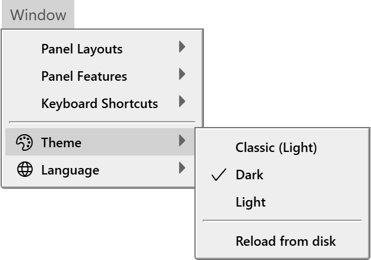

# Themes

A theme sets the colours, fonts and borders of the whole IDE, including the colours of the code. Three themes ship with the IDE, and you can add your own by writing a short text file.

## Choose a theme

Point at **Window → Theme**. The submenu lists the themes, and a tick marks the one in use.

{:width="312" height="219"}

You can also click the icon with the tooltip **Change IDE Theme** in the menu bar. It opens the same list.

The IDE ships with these themes:

**Dark**
: The default.

**Light**
: A light theme.

**Classic (Light)**
: The Light theme with the semantic highlighting of the code effectively turned off, so the code is plainer.

A theme you add is listed as its file name, followed by **Light** or **Dark** in brackets: **Red (Light)**. The word in brackets is the family of the theme that it inherits from.

The choice applies at once, and the IDE keeps it. No restart is needed. If the IDE has no saved choice, or cannot find the theme saved, it uses Dark.

Four commands switch themes, and you can give them keys under [Keyboard shortcuts](Keyboard-Shortcuts). None has a key by default:

- `tbTheme_SwitchToDarkMode`
- `tbTheme_SwitchToLightMode`
- `tbTheme_SwitchToLightClassicMode`
- `tbTheme_SwitchToggle`, which switches between Dark and Light. From any other theme, it switches to Dark.

## Write your own theme

A theme is a text file whose name ends in `.theme`. The theme's name is the file name without `.theme`. Names are compared without regard to case.

The IDE looks for theme files in two folders:

- the `themes` folder in the IDE's own folder, next to `twinBASIC.exe`, which holds the three shipped themes;
- `%APPDATA%\twinBASIC\themes`, which the IDE creates at start-up. This is the place for your own themes, because it survives deleting an old IDE folder.

The IDE reads the files only when it starts and when you choose **Window → Theme → Reload from disk**. A new file shows in the list after **Reload from disk**. If you edit the file of the theme in use, **Reload from disk** applies the edit at once.

If a theme of the same name is in both folders, both are listed, and choosing either one applies the file in the IDE's own folder.

Start from a small file that inherits from a shipped theme, and add only the properties you want to change. This file makes the Light theme's menu red and underlines class names. Save it as `Red.theme` in `%APPDATA%\twinBASIC\themes`, then choose **Reload from disk**:

```text
/* The Light theme, with a red menu and underlined classes. */
inherits:                       light;
MenuBackColor:                  red;
SymbolClassTextDecoration:      underline;
```

> [!WARNING] BETA 1007
> A file named `Dark.theme` or `Light.theme` in `%APPDATA%\twinBASIC\themes` breaks the inheritance of every custom theme. The IDE ignores the file's contents, but still counts it, and so it never links the themes to their parents. Every custom theme, and **Classic (Light)** with them, is listed as `(undefined)` in place of **Light** or **Dark**. Choosing one gives the dark base with only that theme's own properties changed, and **Reload from disk** no longer applies the edits you make. No error is shown. To change one of the shipped themes, give your file another name and inherit from the shipped theme: `inherits: dark;`.

> [!WARNING] BETA 1007
> Two themes that inherit from each other freeze the IDE. For example, `LoopA` has the line `inherits: LoopB;`, and `LoopB` has `inherits: LoopA;`. When the IDE starts, or when you choose **Reload from disk**, it stops responding for several seconds. Choosing one of the two themes afterwards changes nothing on screen, because the IDE fails before it applies the theme. Never let a chain of `inherits:` lines return to a theme in it. To recover, remove the loop from the files and restart the IDE.

### The format of a theme file

A theme file is plain text. It is like CSS but is not CSS: it is a list of `Name: value;` pairs.

- A comment starts with `/*` and ends with `*/`. The IDE removes comments first.
- Each property ends in a semicolon followed by a space, a tab or the end of the line.
- The name and the value are separated by a colon followed by a space or a tab. The value goes to the semicolon. Leading spaces and tabs in front of a name are ignored, so you can line the values up.
- A piece of text that does not split into a name and a value is dropped without a message. A property with no closing `;` runs into the next one, and both are lost. A property written `Name:value`, with no space after the colon, is lost too.
- A value may be empty (`Name: ;`).

A property becomes a CSS variable on the IDE's page, named `--theme` followed by the property's name: `MenuBackColor` sets `--themeMenuBackColor`. The value is used as the CSS value. Any CSS colour, length or filter works, and so does `!important`. A property named `TextDecoration` is matched to the CSS property `text-decoration`, for example.

One property is read by the IDE itself and not by CSS: `CodeBracketPairColorization: 1` colours matching pairs of brackets in the code. The shipped themes set it to 0.

The shipped files `Dark.theme` and `Light.theme` define the same properties, about 500 of them, and are the list of properties you can set. They start with a comment that tells you not to modify them, so copy a property's name from them and put it in your own file. The names group by their first word:

- `Symbol`, 188 properties: the colour, font style, font weight and text decoration of each kind of code.
- `Toolbox`, 33.
- `Panel` and `Status`, 25 each.
- `Designer`, 19.
- `Icon`, 16.
- `Dialog` and `Tab`, 15 each.
- `Code` and `Property`, 13 each.

Smaller groups follow, such as `Context`, `General`, `Diagnostics`, `Debug`, `Dock`, `FrontPage` and `Menu`. The names within each shipped file are in alphabetical order.

Each of the 47 kinds of code has four `Symbol` properties: its name between `Symbol` and `Color`, `FontStyle`, `FontWeight` or `TextDecoration`. `SymbolClassTextDecoration` in the example above is the text decoration of the kind *Class*.

<details>
<summary markdown=span>The 47 kinds of code</summary>

Attribute, BuiltInDataType, Class, Comment, ConditionalCompilationDirective, ConditionalCompilationExcludedCode, Constant, ContinuationCharacter, DeclareFunction, DeclareSub, Enum, EnumMember, Field, Function, GenericDataType, GenericValue, GlobalVariablePrivate, GlobalVariablePublic, Interface, Keyword, LateBoundFunction, Library, LineLabel, LineNumber, LiteralBoolean, LiteralDate, LiteralEmpty, LiteralNothing, LiteralNull, LiteralNumeric, LiteralString, Me, Module, MultiLineSeperator, NamedArgument, NamedOperator, Operator, ParamByRef, ParamByVal, PropertyGet, PropertyLet, PropertySet, ReturnValue, Sub, UDT, Variable, VariableUndeclared.

The names are spelled as the IDE spells them, including `MultiLineSeperator`.

</details>

### Inheritance

A line `inherits: <theme name>;` makes the theme start from the values of another theme, and then apply its own on top. The name is not case-sensitive, and spaces in it are removed. A chain works: a theme may inherit from a theme that itself inherits.

A theme with no `inherits:` line inherits from Dark, unless it is itself named Dark or Light. The family of the theme, Light or Dark, is the family of the theme at the end of its chain. It sets the IDE's base colours and the code editor's base theme.

If the theme named in `inherits:` does not exist, the theme is listed with `(undefined)` in place of the family. Choosing it gives the dark base, with only the properties the file defines changed. Every other property keeps the value it had in the theme that was in use before. After Light, the result is a white panel background under a dark code editor. Always name a theme that exists.

## See Also

- [Window menu](../Reference/Menu/Window#theme) -- the **Theme** entry
- [Customising the IDE](.) -- where the settings are kept
