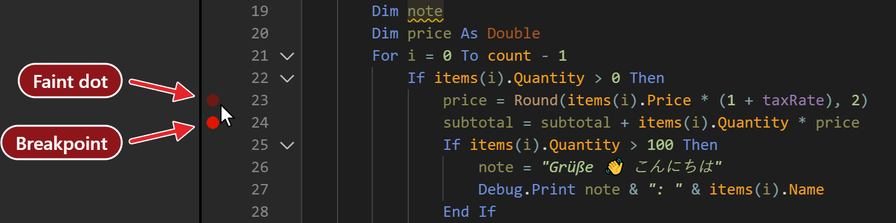

# Breakpoints and stepping

A breakpoint pauses the program on a line you choose. Once it is paused, the step commands run it one statement at a time, and Set Next Statement moves the point where it goes on. This page also describes the panel that opens when a run-time error stops the program.

## Breakpoints

### Set and clear a breakpoint

Click in the margin of the code editor beside a line, or put the caret in the line and press <kbd>F9</kbd> (**Debug → Toggle Breakpoint**). Either one sets the breakpoint at once, or clears it if the line has one. Nothing is asked, and no line is selected first. A breakpoint belongs to a code editor: a form designer has no margin, and <kbd>F9</kbd> does nothing there.

{:width="722" height="180"}

The margin shows four marks:

| Mark | Meaning |
|---|---|
| A red dot | A breakpoint. |
| A faint dot | The pointer is over the margin of this line, and a click would set a breakpoint. It shows on every line except the one with the arrow. |
| A yellow arrow | The program is paused on this line. |
| A yellow arrow over a red dot | The program is paused on a line that has a breakpoint. |

To clear every breakpoint of the project, choose **Debug → Clear All Breakpoints** (<kbd>Ctrl</kbd>+<kbd>Shift</kbd>+<kbd>F9</kbd>). It clears the breakpoints in every file, open or not. It asks for no confirmation.

On the line that has the arrow, a click without dragging toggles a breakpoint too. A press that lasts longer than a fifth of a second starts a drag of the arrow instead; see [Set Next Statement](#set-next-statement).

### What a breakpoint does

A breakpoint is a line number and nothing else. There are no conditions, no hit counts, no log points and no disabled breakpoints, and there is no list of breakpoints: the margin of an open file is the only place that shows them. There is also no Run to Cursor command. <kbd>F6</kbd> runs the procedure at the caret, which [Running](Running#run-or-preview) describes.

A breakpoint moves with the text. If you insert lines above it, the dot stays with its line, and the next run stops at the moved line.

The margin takes a breakpoint on any line, including a blank line, a comment and the `Module` line. The glyph stays, but a line that does nothing never stops the program. A `Sub` or `Function` line, a `Dim` with an initializer such as `Dim n As Long = 7`, a `Next` (at every pass) and an `End Sub` do stop it. A breakpoint in the `Click` procedure of a form stops the program when the button is clicked.

When a stop is in a file that is not open, the IDE opens the file. With **Single-Click Preview** on in [IDE Options](../Customising/IDE-Options), it opens as a preview tab.

### Where breakpoints are kept

The compiler keeps the breakpoints of each file. A breakpoint survives **Restart the compiler**, whether or not you saved the project, because the IDE sends its list to the new compiler. A breakpoint is not part of the source: **Export Project** writes no trace of one. Setting or clearing one marks the project as changed, so closing the project asks to save it.

The **Allow Breakpoints (Debuggable)** item of **Debug → Debugger Options** turns breakpoints off for the whole project. While it is off, you can still set breakpoints and the margin shows them, but none stops the program. Turn it on, and they stop it again from the next run. [Debuggable](../Project-Settings#debuggable) describes the project setting, and the [**Debuggable**](../../Core/Attributes#debuggable) attribute changes it for one module, class or procedure.

## What happens at a stop

A breakpoint, a step, a `Stop` statement, the **Break** command and a run-time error all stop the program in the same way. At the stop:

- The editor opens the file, if it is not open, and puts the caret at the line and column of the stop.
- The whole line gets a pale yellow background, and the yellow arrow appears in the margin. [Themes](../Customising/Themes) can change the background, which is the theme property `DebugLineBackColor`.
- The panels fill: [Call Stack, Variables and the watches](Inspecting), and the [Memory](Memory) pane if it is shown. The IDE evaluates every watch.
- The IDE shows its own window and asks for the keyboard focus.

{:width="1100" height="610"}

The arrow and the background belong to the top frame, the procedure that is running. When you click another row in the Call Stack, the background moves to that frame's line, in that frame's file, and no arrow is drawn in the margin of any editor. The Variables panel, the watches, the console and the hover then all use that frame.

The marks, and what the panels hold, are cleared the moment the program continues, steps or ends.

A `Stop` statement shows the arrow and the background, and no error panel. A `Debug.Assert` with a false condition shows the error panel, as [below](#when-a-run-time-error-stops-the-program) describes.

## Step commands

While the program is paused, three commands run it one step at a time. The panels empty while the program runs the step, and fill again at the next stop.

**Step Into** (<kbd>F8</kbd> or <kbd>F11</kbd>)
: Runs the next statement. When the statement calls a procedure of the project, the program stops on the `Sub` or `Function` line of that procedure.

**Step Over** (<kbd>Shift</kbd>+<kbd>F8</kbd> or <kbd>F10</kbd>)
: Runs the next statement as one step, including any procedure it calls. A `RaiseEvent` runs its handlers.

**Step Out** (<kbd>Ctrl</kbd>+<kbd>Shift</kbd>+<kbd>F8</kbd> or <kbd>Shift</kbd>+<kbd>F11</kbd>)
: Runs the rest of the current procedure, and stops in its caller on the line after the call; the note below describes a case in which it does not. Step Out from `Main` ends the run. The **Debug** menu has no Step Out item: use the toolbar button or the keys.

A procedure in another file opens in the editor when you step into it, as a preview tab when **Single-Click Preview** is on.

At the `End Sub` of a procedure whose local variables hold objects, a step goes into a frame named `{class_final_destruction}` and then into the `Class_Terminate` procedures of those objects. A step off the `End Sub` of the `Click` procedure of a form lets the program run on, and the form waits for input again.

> [!NOTE] BETA 1007
> Once the program has stopped at a breakpoint, no step stops in a caller of the procedure it stopped in. Step Out, <kbd>F8</kbd> at the `End Sub` and Step Over all run the caller on until the next breakpoint or the end of the program. Steps inside the procedure, and into the procedures it calls and back out to it, work. To stop in the caller, put a breakpoint there, or stop on the line of the call and step into the procedure.

## Set Next Statement

**Debug → Set Next Statement (Jump To Line)** (<kbd>Ctrl</kbd>+<kbd>F9</kbd>) makes the line that has the caret the next one to run. The arrow moves to it, and the lines in between do not run: a `Debug.Print` that the jump skips prints nothing. The jump can go to a later line or to an earlier one.

You can also drag the arrow. Press on it and hold for a fifth of a second. The pointer becomes a grabbing hand and the arrow shrinks. Move over the margin, where a faint arrow follows the pointer, and let go over the line you want. The result is the same as the command. A shorter press is a click, which toggles a breakpoint.

The jump works inside the paused procedure only. A blank line, a line of another procedure and a line of another file give no result: the arrow stays, and nothing is written to the console. The IDE sends the compiler the line number and no file name, so with the caret in another file than the paused one, the number is taken in the paused file.

## Break On All Errors and Debuggable

The two items of **Debug → Debugger Options** turn project settings on and off. Each writes its setting into the project's `Settings` file. A change to **Allow Breakpoints (Debuggable)** marks the project as changed, applies from the next run, and needs no restart of the compiler.

**Break On All Errors**
: Off by default. Then an error that is raised while `On Error Resume Next` or `On Error GoTo` is in effect goes to that handler, as usual. When it is on, the program stops at the failing line even there, with the same error panel as [an error that nothing handles](#when-a-run-time-error-stops-the-program). **Ignore (Resume Next)** then skips the line. Under `On Error Resume Next`, `Err.Number` still holds the error afterwards, so code that checks it sees the error. <kbd>F5</kbd> runs the failing line again, and the program stops on it again. Under `On Error GoTo`, the handler never runs. The project setting is [Break On All Errors](../Project-Settings#break-on-all-errors).

**Allow Breakpoints (Debuggable)**
: On by default; the item shows its tick when the setting is absent from the `Settings` file. See [Where breakpoints are kept](#where-breakpoints-are-kept) and [Debuggable](../Project-Settings#debuggable).

## When a run-time error stops the program
{: index="break mode" }

A run-time error that no `On Error` statement handles stops the program on the line that raised it. It stops the same way whether the program was started with **Run → Start** (<kbd>F5</kbd>), from the **▶ run** link above a procedure, or by a `[RunAfterBuild]` procedure. With **Break On All Errors** on, a handled error stops it too.

The examples below use this procedure. On the fourth pass through the loop, `idx` is 7, past the last index of `a`, which is 5:

```tb check_build
Public Sub FillTable()
    Dim a(5) As Long
    Dim i As Long
    Dim idx As Long
    Dim total As Long
    For i = 1 To 6
        idx = Choose(i, 1, 3, 5, 7, 2, 4)
        a(idx) = i * 10
        total = total + i
        Debug.Print "i = " & i & ", idx = " & idx & ", total = " & total
    Next i
    Debug.Print "loop finished, i = " & i & ", total = " & total
End Sub
```

### Where it stopped, and what the variables hold

The editor opens the module, highlights the whole failing line, `a(idx) = i * 10`, and puts a yellow arrow in the margin beside it. Under the line, an error panel shows:

- **Run-time error 9 (00000009)**: the error number, then the same number in hexadecimal;
- **DESCRIPTION:** and the error's description, here *Subscript out of range*;
- four buttons: **Try Again (Resume)**, **Ignore (Resume Next)**, **Stop** and **Search Online**.

{:width="1100" height="610"}

The number is the one `Err.Number` holds. When the error was raised with `Err.Raise` and a source, a **SOURCE:** row with the source text shows below the buttons. When the compiler gives no header, the panel is titled **ERROR OCCURRED**. Nothing about the error is written to the [Debug Console](Debug-Console). The panel's **×** only hides the panel.

A false `Debug.Assert` opens the same panel, with the header `Run-time error -353703420 (EAEAEA04)` and the description `Assertion FAILED`. <kbd>F5</kbd> there runs on past the assertion. A `Stop` statement opens no panel.

The other panes show the state of the program at the failing line:

- **[Call Stack](Inspecting#call-stack)** lists the chain of calls, the failing procedure first, each with its file and its `line:column`. Here that is `FillTable`, then the procedure that called it, if there is one. Clicking a row opens that file at that line, and **Variables** then shows that procedure's variables.
- **[Variables](Inspecting#variables)** shows the failing procedure's *Locals*, already expanded: `i` is 4, `idx` is 7 and `total` is 6. The array shows as `{array of 6 elements}` until it is expanded.
- Holding the mouse pointer over a variable in the editor shows its value; see [Hover](Inspecting#hover).

### Reading and changing values in the Debug Console

The input row at the bottom of the [Debug Console](Debug-Console) runs a line of code inside the stopped procedure:

- `? i` prints `4`, with a `(time taken: …)` line after it. `Debug.Print i` does the same.
- `i` on its own is refused, with `(compile error: Expression is neither used nor assigned)`.
- `idx = 5` gives `idx` a new value, and **Variables** shows it.

Running any line in the console removes the error panel. The failing line stays highlighted, and the keys below still work.

### The four buttons

- **Try Again (Resume)** runs the failing line again. Unless a value it uses has changed, the error happens again at once. <kbd>F5</kbd> does the same, and still works after the panel has gone.
- **Ignore (Resume Next)** skips the failing line and goes on from the statement after it. Here the loop runs to the end, and prints `i = 4, idx = 7, total = 10` for the pass that failed. No menu command or key does this. At the panel of a failed `Debug.Assert` it does nothing.
- **Stop** does not end the program at an error. See [Traps](#traps).
- **Search Online** opens a Google search in the default browser. The search text is `twinBASIC VB6`, the header and the description of the error.

> [!NOTE] BETA 1007
> **Search Online** puts the error text into the address as it is, without encoding it. An `&` in the description ends the search text at that point, so the search loses the rest, and a `"` ends the address. Copy the description from the panel and search for it in your browser instead.

### Stepping on through the rest of the loop

**Step Into** (<kbd>F8</kbd> / <kbd>F11</kbd>) and **Step Over** (<kbd>Shift</kbd>+<kbd>F8</kbd> / <kbd>F10</kbd>) do not move past the failing line. They run it again, and the error happens again at once. To go on one line at a time, first do one of these, then step:

- **Correct the value in the console.** After `idx = 5`, <kbd>F8</kbd> runs the failing line without an error, and stops on the next one, `total = total + i`.
- **Move past the line with Set Next Statement.** Click in the next line and press <kbd>Ctrl</kbd>+<kbd>F9</kbd>. The yellow arrow moves there without running the failing line, and the panel closes. <kbd>F8</kbd> then runs the line the arrow is on.

To run on to the end instead, correct the value and press <kbd>F5</kbd>, or press **Ignore (Resume Next)** while the panel is still there.

### Editing at the error panel

Edit and Continue is not supported at the error panel either: when you change the code, the console writes `[EDIT & CONTINUE] not yet supported.  Aborting.`. After you change the failing line, <kbd>F5</kbd> starts a new run that runs the changed line.

> [!WARNING] BETA 1007
> An edit at the error panel does not abort the program, although the console says `Aborting`. The rest of the failing procedure is skipped, and the code after its call runs: its output appears in the console, and the run then ends. At a breakpoint the same edit does abort the program. Do not edit the code while the error panel is showing. End the run first, as the **Stop** warning under [Traps](#traps) describes, and then edit.

### Traps

- **The panel disappears, and Ignore with it.** Running a line in the Debug Console, or clicking another procedure in the Call Stack, removes the panel. <kbd>F5</kbd> brings it back only by running the failing line again. Set Next Statement onto the next line, then <kbd>F5</kbd>, does what **Ignore (Resume Next)** would have done.

> [!NOTE] BETA 1007
> A step key pressed on the failing line leaves a step waiting. After <kbd>F8</kbd> on the failing line, **Ignore (Resume Next)** stops again on the next line instead of going on, and the next <kbd>F5</kbd> is used up as well. Press <kbd>F5</kbd> to go on, or use Set Next Statement as above instead of a step key.

> [!WARNING] BETA 1007
> **Stop** at an error ends only the procedure that failed. The procedure that called it goes on from its next line: if `Sub Main` called `FillTable`, the rest of `Sub Main` still runs. The panel's **Stop**, the toolbar's **Stop** and **Run → End** all do this. At a failed `Debug.Assert`, **Stop** ends only the check, and the test goes on past it as if the check had passed. To end the whole run, first move the arrow to a later line with <kbd>Ctrl</kbd>+<kbd>F9</kbd>, then press **Stop**. Away from an error --- at a breakpoint, after a step, or after Set Next Statement --- **Stop** ends the run.

## See Also

- [Running](Running) -- Start, Break and End, and what ends a run
- [Inspecting a paused program](Inspecting) -- the panels that fill at a stop
- [Debug menu](../Reference/Menu/Debug) -- the menu commands of this page
- [Testing with Assert](../../../Tutorials/Testing-with-Assert) -- a failed assertion stops the program as an error does
