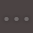
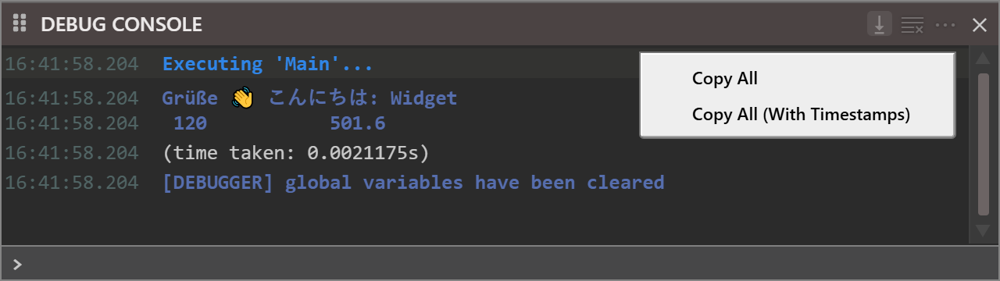

# Debug Console

The **DEBUG CONSOLE** panel is a scrolling log of what a run writes, and an input row that runs one line of code at a time.

{:width="914" height="326"}

The panel is docked at the bottom of the default layout. <kbd>Ctrl</kbd>+<kbd>G</kbd> shows it, and moves the keyboard focus to the input row.

## What the console shows

**Debug.Print**
: [**Debug.Print**](../../Modules/Debug#print) writes here. The console is monospaced, and the output of several expressions is spaced as **Debug.Print** spaces it. A built executable writes nothing with **Debug.Print**: the console is for a run in the IDE.

**Debug.TracePrint**
: [**Debug.TracePrint**](../../Modules/Debug#traceprint) writes here when the *Trace Output* project setting is `${DEBUG}`, and to a file when it is a path. With no trace settings at all, it writes nothing. See [The trace logger](#the-trace-logger).

**Debug.Cls**
: [**Debug.Cls**](../../Modules/Debug#cls) empties the console from code. It does the same as the **Clear Debug Console** button.

**Messages from the IDE**
: The IDE writes its own lines in the same list: `Executing 'Main'...` at the start of a run, `(time taken: …)` at its end, `aborted` for a run that you stop, `[DEBUGGER] …` lines, `[SHELL] process … started.` for a program that your program starts, `restarting from MEMORY [<path>]` when the compiler restarts, and lines tagged `[COMPILER]`, `[EXPORT]` and `[LINKER]` from other features. [Running](Running) describes the run lines.

A line that the compiler marks as a native exception is red. The first one in a session also makes the IDE turn on TRACE mode, and the console says so, and that the compiler is slower until TRACE mode is turned off from the Help menu.

Every line starts with the time at which it was written, as `HH:MM:SS.mmm`. The lines are not links: a line that names a file and a line does not take you there.

## The buttons

The header of the panel has three buttons.

### Auto Scroll

The {:width="16" height="16"} button keeps the newest output in view. While Auto Scroll is on, the console scrolls to each new line as it arrives: to the bottom, or to the top when **Invert Output Direction** is ticked. It is on each time the IDE starts, and the button is highlighted while it is on.

Scrolling away from the newest line turns Auto Scroll off, so earlier output stays in view while the program goes on writing. Scrolling back until the newest line shows turns it on again.

Clicking the button turns Auto Scroll off until it is clicked again. Scrolling back to the newest line then leaves it off.

### Clear Debug Console

The {:width="16" height="16"} button empties the console. It asks for no confirmation.

### Options

The {:width="16" height="16"} button opens a menu of two items, each with a tick when it is on.

**Invert Output Direction**
: Off by default. Puts the newest line at the top.

**Show Timestamps**
: On by default. It only hides the times: every line keeps its time, and **Copy All (With Timestamps)** still includes it.

The IDE saves both settings with the project.

## The input row

The row along the bottom of the console has a `>` at its left. It takes one line of code. <kbd>Enter</kbd> runs it. The console repeats the line, then shows its output and how long it took, as `(time taken: …)`. A line that is refused shows the compile error instead.

- **`?` and an expression** prints the value, the same way **Debug.Print** does, and `Debug.Print` itself works too. Several expressions separated by commas or semicolons are spaced as **Debug.Print** spaces them.
- **A statement** runs: `idx = 5` gives a variable a new value, and a procedure's name, such as `Module1.Main` or just `Main`, calls it.
- **An expression on its own** is refused: `i` gives `(compile error: Expression is neither used nor assigned)`.

{:width="560" height="236"}

What the line can see depends on the state of the program:

- **Paused.** The line runs inside the procedure selected in the [Call Stack](Inspecting#call-stack). It can read and change that procedure's local variables, and the [Variables](Inspecting#variables) panel shows the change. With the calling procedure selected instead, the failing procedure's variables are unknown: `? i` gives `(compile error: Unrecognized symbol 'i')`.
- **Idle.** The line can call the procedures and functions of the modules of the project: `? Twice(4)` prints `8`. It cannot see local variables, because none exist: `? n` gives `(compile error: Unrecognized symbol 'n')`.
- **Running, not paused.** The line is refused: `main thread is busy.  wait for it to finish, or prepend the expression with '~' to execute it in a new thread.`
- **The compiler is not running.** The line is refused with `ERROR: DEBUGGER IS NOT CONNECTED.`

At a run-time error, running a line in the console removes the error panel. [When a run-time error stops the program](Breakpoints-and-Stepping#when-a-run-time-error-stops-the-program) describes what to do then.

The input row is one line. There is no way to enter a multi-line construct.

### History

<kbd>Up</kbd> brings back earlier lines, the most recent first, and <kbd>Down</kbd> moves forward again. Down at the newest line does nothing: the box is not cleared. A line is added to the history only when it differs from the line before it, so entering the same line twice in a row stores it once. The IDE saves the history with the project and restores it when the project opens.

### Keys and completion

- <kbd>Ctrl</kbd>+<kbd>A</kbd> selects the whole text of the row.
- <kbd>F12</kbd> and <kbd>Shift</kbd>+<kbd>F2</kbd> go to the definition of the word at the caret.
- The row has the IntelliSense of the editor, in the mode that [IDE Options](../Customising/IDE-Options#intellisense-modes) sets, and <kbd>Ctrl</kbd>+<kbd>Space</kbd> opens the list. It has a line for signature help of its own.
- A [keyboard shortcut](../Customising/Keyboard-Shortcuts#the-text-of-a-group) can run a line of code in the console: `tbDebugConsole_ExecuteCode('? 6*7')` is the one command that takes an argument.

> [!NOTE]
> In twinBASIC BETA 1005, the input row offers no completion for a name typed after `?` and a space, and <kbd>Ctrl</kbd>+<kbd>Space</kbd> there opens no list. Type the name without the space, as `?total`, or start the line with the name.

> [!NOTE]
> In twinBASIC BETA 1005, a space typed while the completion list is open accepts the list's first entry, and the space is lost. Typing `Print total` gives `Printertotal`, because the list offers `Printer` but not the keyword `Print`; `Call Touch(total)` and `Set obj = items` are changed in the same way. The console refuses the changed line. Press <kbd>Escape</kbd> to close the list before you type the space: the text you typed stays.

> [!NOTE]
> In twinBASIC BETA 1005, `? p`, where `p` is a variable of a user-defined type, fails with `(compile error: codegen error; check for compilation errors)`, and the console prints a `[LINKER] compilation (codegen) error` line. The [Variables](Inspecting#variables) panel and a watch show the same variable, so read it there.

## Copy the output

Right-click anywhere in the panel for a menu of two items. The menu is in English whatever the language of the IDE is.

{:width="640" height="180"}

**Copy All**
: Puts every line of the console on the clipboard, one line to a row, without the times.

**Copy All (With Timestamps)**
: The same, with the time and a space before each line.

Both include the `(time taken: …)` lines, and neither depends on the **Show Timestamps** setting. There is no command to copy a selection.

## Commands and keys

Each button and toggle of the header has a command that a [keyboard group](../Customising/Keyboard-Shortcuts) can bind to a key. `tbDebugConsole_Clear` clears the console. `tbDebugConsole_ToggleAutoScroll` toggles Auto Scroll, and `tbDebugConsole_TurnAutoScrollOn` and `tbDebugConsole_TurnAutoScrollOff` set it. The same three forms exist for Invert Output Direction (`tbDebugConsole_TurnInvertOutputDirectionOn` and `…Off`) and for Show Timestamps (`tbDebugConsole_TurnShowTimestampsOn` and `…Off`). The two copy commands are `tbDebugConsole_ClipboardCopyAll` and `tbDebugConsole_ClipboardCopyAll_WithTimestamps`. None has a key by default.

## The trace logger

twinBASIC can write a log of what the program does, to this console or to a file. The logger works when the program runs in the IDE and in a compiled executable. Use [**Debug.TracePrint**](../../Modules/Debug#traceprint) to write your own messages into it:

```tb check_build
Public Sub ProcessOrder(ByVal orderId As Long)
    Debug.TracePrint "ProcessOrder called, orderId=" & CStr(orderId)
    ' ... processing ...
End Sub
```

Two project settings control the log. **Trace Flags** choose what the compiler records, with a box for each of eleven flags, and **Trace Output** chooses where the log goes: the path of a file, or `${DEBUG}` for this console only.

{:width="760" height="531"}

[Trace Flags](../Project-Settings#trace-flags) and [Trace Output](../Project-Settings#trace-output) describe each flag and the placeholders.

### Separate one run from the next

Calling **Debug.Cls** as a run begins separates that run's output from the previous one, which is the difference between reading a log and scrolling for where it started:

```tb check_build
Private Sub Form_Load()
    Debug.Cls
    Debug.Print "--- run starting ---"
End Sub
```

## See Also

- [Running](Running) -- the lines the IDE writes at the start and end of a run
- [Inspecting a paused program](Inspecting) -- the Variables, Watches and Call Stack panels, which the console shares a frame with
- [Debug.Print](../../Modules/Debug#print) -- the statement that writes here
- [Project Settings](../Project-Settings) -- Trace Flags and Trace Output
