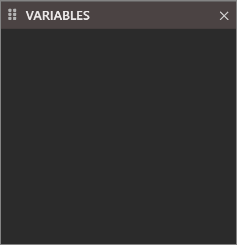
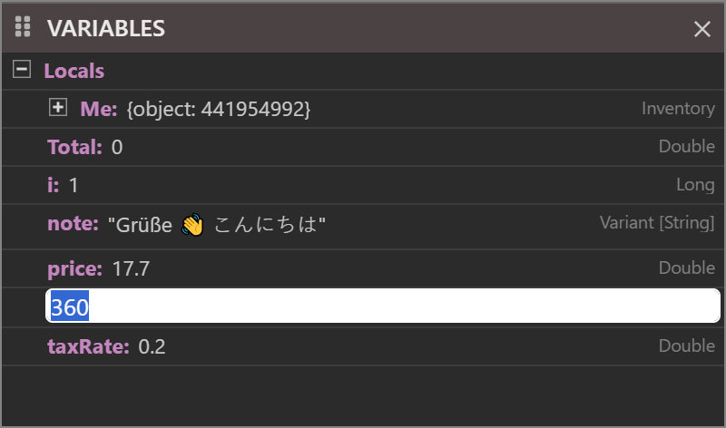
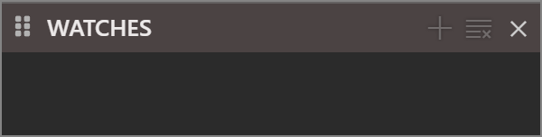
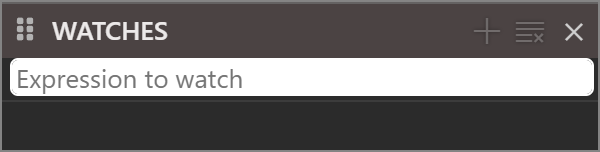
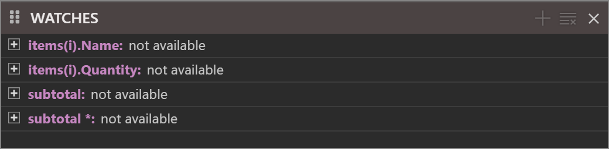
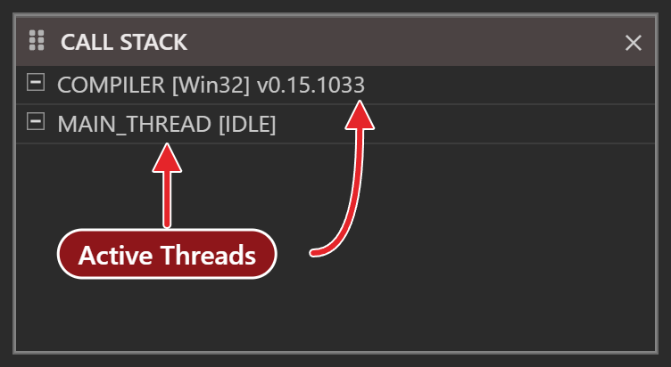
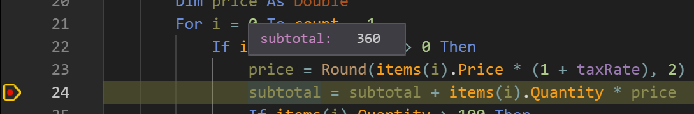
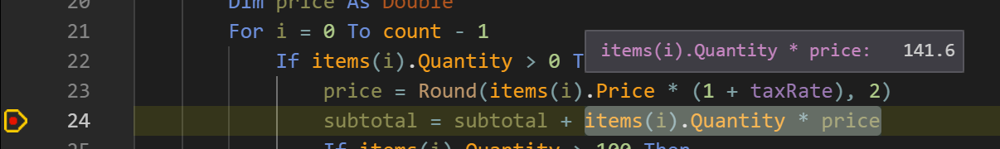

# Inspecting a paused program

When the program is paused, three panels show its state: **VARIABLES** holds the values in scope, **WATCHES** holds expressions that you chose, and **CALL STACK** holds the chain of calls that led to the stop. Pointing at a variable in the editor shows its value as well.

![The IDE paused in a function named Total, on the second pass of its loop. The yellow arrow over a red dot marks the paused line, which is highlighted. Under the editor, four panels: DEBUG CONSOLE with the line that announced the run and the line the first pass printed; CALL STACK with the main thread expanded to two frames, Total, marked with the arrow, and Main, which called it; VARIABLES with Locals expanded, each row with its name, value and type; and WATCHES with two expressions and their values.](Images/Paused_Panels.png){:width="1280" height="880"}

All three show the **active frame**. At a stop it is the top frame, the procedure that is running. Click a row of the Call Stack to make another frame the active one. The Variables panel, the watches, the Debug Console and the hover then all work in that frame.

The panels are empty when nothing is paused. Each one is cleared the moment the program continues, steps or ends.

## Variables

The **VARIABLES** panel is a tree. Each *scope* of the active frame is a folder at the top level. The folder is named **Locals** in a procedure of a module, and it holds the procedure's arguments and local variables. In a **Sub**, **Function** or **Property Get** of a class, and in an event procedure of a form, it holds `Me` as well. In a **Function** or a **Property Get**, of a module or of a class, it also holds a variable with the procedure's name, which holds the value that the procedure returns. Module-level variables are not listed there. Add a watch for one, or point at it in the editor.

{:width="240" height="248"}

Each variable is a row with three columns: its name, its value and its type. A value that has parts, such as an array, a user-defined type or an object, is a folder you can expand. The panel reads the parts when you first expand it. Folders come first in each list, and every group is sorted by name. The IDE remembers which folders you expanded and saves them with the project.

{:width="420" height="214"}

The value column shows these forms:

| Variable | Value shown | Type column |
|---|---|---|
| **Long** 7, **Double** 2.5, **Currency** 12.34, **Boolean** True | `7`, `2.5`, `12.34`, `True` | the type |
| **String** | `"hello"`, in quotes | **String** |
| **Date** | `#10/11/2026 12:30:00 PM#` | **Date** |
| **Variant** | the value, as above | `Variant [Long]`, the subtype in brackets |
| An array | `{array of 3 elements}`; its elements are `(1)`, `(2)` and so on, and `(0,0)` in a two-dimensional array | `Long()` |
| An empty dynamic array | `{dynamic array, no elements}`; it cannot be expanded | |
| A user-defined type | `{user defined type, 8 bytes}`; its fields are the children | |
| An object | `{object: <address>}`, the address in decimal; its public fields and its **Property Get** values are the children | |
| A **Collection** | the object form; the children include `Count`, `KeyCountHint` and `KeyCompareMode` | `_Collection` |
| An enumeration value | the member's name, such as `Green` | |

The panel runs the property procedures of an object to show their values, so a property that has side effects runs when the object is expanded.

### Change a value

Double-click a value to edit it. A text box replaces the value. <kbd>Enter</kbd>, or a click anywhere else, applies the text, and <kbd>Escape</kbd> leaves the value as it was. The row then shows the value the program holds, and the IDE evaluates the watches again. The program uses the new value from then on.

{:width="400" height="236"}

- A **Long**, a **String**, an enumeration member, a field of a user-defined type and an element of an array can all be edited. Type a string with its quotes. Type an enumeration member by name, such as `Red`.
- A value that the program refuses, such as `abc` for a **Long**, is ignored, with no message.
- A row that is a folder, an object, a user-defined type or an array, has no text box. Expand it and edit its parts.
- A line typed in the Debug Console, such as `s = "it's"`, changes a variable too, and the panel shows the change.

> [!WARNING] BETA 1005
> The edit box cuts a string at an apostrophe, and leaving the box changes the variable. With `s` holding `it's`, double-click `s`, and the box holds only `"it`. A click on another row, or <kbd>Enter</kbd>, with nothing typed, then makes `s` the empty string. <kbd>Escape</kbd> leaves it as it was. Do not edit a string that contains an apostrophe in the panel. Assign it in the [Debug Console](Debug-Console) instead.

> [!WARNING] BETA 1005
> A **Date** or **Double** row shows a wrong value for a while after you edit it. A **Date** edited to `#1/2/2020#` shows `#12:00:00 AM#`, and a **Double** edited to `7.25` shows `0`. The variable holds the value you typed. The row shows it correctly after the next line you run in the console, or at the next stop. To check the value now, run `? d` in the console, where `d` is the variable.

### What the tooltip shows

Hold the pointer over a row to see its tooltip: the name, as a dotted path from the top-level variable, then the **Type** and the **Value**. A pointer value has a line labelled **Pointer**. A **Copy Value To Clipboard** icon copies the value. The panel has no context menu and no search box.

![The VARIABLES panel with the row of subtotal highlighted under the pointer, and its tooltip below it: the name subtotal, then Type Variant [Double], Value 360 and Pointer with an address, and a copy icon at the lower right.](Images/Variables_Tooltip.png){:width="429" height="335"}

## Watches

A watch is an expression that the IDE evaluates at every stop. The **WATCHES** panel is not in the default layout, so open it from **View → WATCHES**, or add a watch, which opens it. [Saving a layout](../Customising/Panel-Layouts) keeps it open.

{:width="300" height="76"}

### Add and change a watch

To add a watch, use any of these:

- **Debug → Add Watch...** (<kbd>Shift</kbd>+<kbd>F9</kbd>). If the editor has a selection, the box starts with the selected text.
- The {:width="16" height="16"} button, titled **Add Watch...**.
- A double-click in the empty area of the panel.

Each opens a box that says *Expression to watch*. <kbd>Enter</kbd>, or a click elsewhere, adds the watch. <kbd>Escape</kbd> adds nothing, and an empty box adds nothing.

{:width="300" height="76"}

Double-click a watch to change its expression in place; an empty expression removes it. Select a watch and press <kbd>Delete</kbd> to remove it. The {:width="16" height="16"} button, or **Debug → Clear Watches**, removes every watch with no confirmation. Adding an expression that is already there changes nothing.

### What a watch shows

{:width="520" height="128"}

Each row holds the expression, its value and its type, in the same three columns as the Variables panel, and it can be expanded in the same way. The rows are sorted by expression, capitals first. Hold the pointer over a row for a tooltip with the expression, the type and the value.

- While the program is not paused, every value reads `not available`.
- An expression that fails shows the compiler's message in place of the value, such as `(compile error: Unexpected end of expression)`, and the type **ERROR**.
- The expression can be anything the Debug Console takes, including a call to a procedure. The call runs at every stop, and when you choose another frame, so a watch can change the state of the program.
- A watch on a variable of a user-defined type shows `{user defined type, 8 bytes}`, as the Variables panel does.

{:width="520" height="128"}

The watches are saved with the project and come back when you open it. They also survive **Restart the compiler**, which keeps the expanded state of each one.

## Call Stack

The **CALL STACK** panel (<kbd>Ctrl</kbd>+<kbd>L</kbd>) lists the chain of calls. It groups them by thread. Each thread is a row at the top level, named with the thread and its state, such as **MAIN_THREAD [IDLE]** and **COMPILER [Win32]** in the picture. The threads are listed whether or not anything is paused, so a panel with only these rows means that no call frames are on any stack.

{:width="376" height="206"}

The row of the program's thread reads **[EXECUTING]** while the program runs, and it still does while the program is paused. The IDE shows no break state there.

Expand a thread to see its frames, the most recent call first. A frame has three columns: the procedure, the file and `line:column`. The top frame has a yellow arrow. A frame in code of a package, such as `RaiseClickEvent` in `CommandButton.twin`, shows `-1:1` for its position.

{:width="1100" height="610"}

Click a frame to make it the active frame. The editor opens the frame's file at that line and highlights it, without the arrow, and the Variables panel, the watches, the console and the hover all work in that frame. The watches are evaluated again. The error panel is hidden. A click opens the file in a preview tab when **Single-Click Preview** is on in [IDE Options](../Customising/IDE-Options). A double-click always opens it in a normal tab.

The panel has no tooltips and no context menu. When you edit the code, the `line:column` of the frames follows the text.

The Call Stack shows the frames of the other threads of the program as well. A frame named `{class_final_destruction}` appears when a procedure ends and releases objects that its variables hold.

## Hover

While the program is paused, pointing at an expression in the editor evaluates it in the active frame, and the popup shows `expression:   value`. The popup appears about a second after the pointer stops.

{:width="544" height="90"}

The IDE builds the expression like this:

- If the pointer is inside a selection, the expression is the selected text. Select `x + y`, point at it, and the popup shows its value.
- Otherwise it is the word under the pointer, extended to the left over `.` and `!` and over an argument list in brackets, and to the right over an argument list that follows. Pointing at `Items` in `obj.Items(i).Name` evaluates the whole `obj.Items(i).Name`.

{:width="603" height="90"}

A user-defined type shows `{user defined type, 8 bytes}` and one line for each field. An object shows its address. A word that is not an expression, such as a keyword or a type name, shows `(compile error: Unrecognized symbol 'For')`. A name that is not in the active frame shows the same message.

Pointing at a function call or at a property runs it, so a function with side effects changes the state of the program.

> [!WARNING] BETA 1005
> Pointing at a call to a **Sub** runs the Sub, and the popup shows `t.Bump:   0`, a value that means nothing. The Sub, and any event handlers it raises, runs once for each hover. Do not point at the name of a procedure that changes the program's state while the program is paused. To read a variable that such a procedure uses, point at the variable.

When the program is not paused, the same pointing shows the compiler's usual hover text, which [IntelliSense](../Code/IntelliSense#hover) describes.

## The Memory pane

The raw bytes of the paused program are in the [Memory](Memory) pane. The expression box of the pane evaluates its text as a watch does.

## See Also

- [Breakpoints and stepping](Breakpoints-and-Stepping) -- how the program gets paused
- [Debug Console](Debug-Console) -- run a line of code in the active frame
- [Memory](Memory) -- the bytes behind a variable
