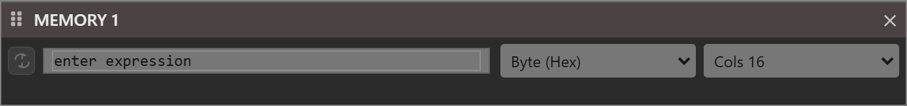

# Memory

{:width="696" height="82"}

The Memory pane displays the raw contents of process memory while the program is paused in the debugger, with addresses in the left column, the values in the middle and the same bytes as text on the right. It is useful for inspecting data structures at the byte level, and it can also change them.

**View → MEMORY 1** opens the pane. There is one Memory pane, and its title is always **MEMORY 1**. The pane is not in the default layout. It is one of the [panels used while the program is paused](../Debugging/#the-panels-that-show-a-paused-program).

A toolbar runs along the top of the pane:

- The button of two curved arrows on the left, **Auto-refresh whilst step debugging**, is a toggle. When it is on, the pane evaluates its expression again at every stop. See [When the pane updates](#when-the-pane-updates).
- The box marked **enter expression** takes the expression that gives the address to show. Press <kbd>Enter</kbd> to show it.
- The first list sets the display format --- **Byte (Hex)** above.
- The second list sets the number of values in each row --- **Cols 16** above.

While the program runs, and when it is not running at all, the pane is dimmed, ignores the mouse and hides its rows, as in the picture above. Once the program pauses --- at a breakpoint, a `Stop` statement, an error or a step --- the rows appear, starting at address 0 until an expression is entered.

## What to enter in the expression box

The debugger evaluates the expression in the box as it does a watch, so the box takes anything a watch takes: a variable, an element, a field, a function call such as [**VarPtr**](../../Modules/Information/VarPtr), [**StrPtr**](../../Modules/Information/StrPtr) or [**ObjPtr**](../../Modules/Information/ObjPtr), arithmetic, and literal addresses such as `&H0F423ACC`. The result then becomes an address:

- A **String**, or a **Variant** that holds one: the box's text is replaced with `StrPtr(`*expression*`)`, and the pane shows the string's characters.
- An **object**: the text is replaced with `ObjPtr(`*expression*`)`, and the pane shows the object.
- An **array**: the text is replaced with `VarPtr(`*expression*`)`, and the pane shows the array variable.
- Any other result is a number, and **the number itself is the address**. The name of a **Long** variable therefore shows the memory at the address the variable *holds*, not the memory of the variable. That is what a **LongPtr** holding an address needs. For a variable's own bytes, enter `VarPtr(`*name*`)`.

> [!NOTE]
> In twinBASIC BETA 1005, a result that is not a whole number --- the name of a **Double**, a **Boolean** or a variable of a user-defined type --- gives no address and does not turn the box red. The rows stay as they were, and the DEBUG CONSOLE prints an *IDE internal error* such as `Uncaught SyntaxError: Cannot convert 1.5 to a BigInt`. Enter `VarPtr(`*name*`)` for such a variable.

The pane starts its first row at that address exactly, and the cell at the address takes the keyboard focus. An expression that cannot be evaluated --- an unknown name, an empty box, anything entered while the program is not paused --- turns the box red and leaves the rows as they were.

> [!NOTE]
> In twinBASIC BETA 1005, a negative number is taken as an address too. With -8, the first row is labelled `&HFFFFFFF8` and the rows after it `&H00000008`, `&H00000018` and so on. None of them can be read.

The table shows what each kind of expression gives in a 32-bit program paused after these lines:

```tb
Dim n As Long, d As Double, s As String, v As Variant
Dim arr() As Long, udt As Rec, obj As Thing, p As LongPtr
n = 1234: d = 1.5: s = "ABCD": v = "Hi"
ReDim arr(0 To 3): arr(0) = &HA1: arr(1) = &HB2: arr(2) = &HC3: arr(3) = &HD4
udt.A = &H11223344: udt.B = 5: udt.C = 6   ' Type Rec: A As Long, B As Integer, C As Integer
Set obj = New Thing
p = VarPtr(n)
```

| Expression | The pane starts at | The bytes shown |
|---|---|---|
| `VarPtr(n)` | the variable `n` | `D2 04 00 00`, which is 1234 as a **Long** (least significant byte first), then the variables stored after `n` |
| `n` | address 1234, `&H000004D2`: the value of `n` | `??` in every cell, because the program has no memory there |
| `p` | the address `p` holds, the same as `VarPtr(n)` | `D2 04 00 00` |
| `VarPtr(d)` | the variable `d` | `00 00 00 00 00 00 F8 3F`, which is 1.5 as a **Double** |
| `s` (the box then reads `StrPtr(s)`) | the first character of `s` | `41 00 42 00 43 00 44 00 00 00`: A, B, C and D, two bytes each (UTF-16), then two zero bytes. The text column reads `A.B.C.D..` |
| `StrPtr(s) + 4` | the third character of `s` | `43 00 44 00 00 00` |
| `VarPtr(s)` | the variable `s` | the pointer to the characters: the number `StrPtr(s)` returns, in 4 bytes |
| `v` (the box then reads `StrPtr(v)`) | the string held in `v` | `48 00 69 00 00 00`, "Hi" |
| `VarPtr(v)` | the **Variant** itself | the type first, `08 00` for **vbString**, and the pointer to the string 8 bytes in |
| `arr` (the box then reads `VarPtr(arr)`) | the array variable | the pointer to the array's descriptor, not the elements |
| `VarPtr(arr(0))` | the first element | `A1 00 00 00 B2 00 00 00 C3 00 00 00 D4 00 00 00` |
| `arr(1)` | address `&H000000B2`: the element's value | `??` |
| `VarPtr(udt)` | the variable `udt` | the fields in order: `44 33 22 11` for **A**, `05 00` for **B**, `06 00` for **C** |
| `VarPtr(udt.B)` | the field **B**, 4 bytes into `udt` | `05 00 06 00` |
| `obj` (the box then reads `ObjPtr(obj)`) | the object | the object's memory, starting with the pointer to its table of methods |
| `VarPtr(obj)` | the variable `obj` | the pointer to the object: the number `ObjPtr(obj)` returns |
| `&H0F423ACC` | that address | whatever is there |

In a 64-bit program each pointer takes 8 bytes instead of 4.

Below, `s` holds "Hello twinBASIC". After `s` is entered, the box reads `StrPtr(s)`. Each character takes two bytes, the second of them `00`, and the last two zero bytes end the string:

{:width="696" height="120"}

`??` in the value cells, and `·` in the text column, mark memory the program cannot read.

> [!NOTE]
> In twinBASIC BETA 1005, `??` and `·` are also what a cell shows while its bytes are still being read, so unreadable memory looks the same as memory not read yet. Memory that keeps showing `??` cannot be read.

## Display formats and columns

The first list sets how the bytes are grouped and written:

| Format | Each value | `VarPtr(n)`, with `n` = 1234, starts with |
|---|---|---|
| **Byte (Hex)** | one byte, two hexadecimal digits | `D2` |
| **Byte (Decimal)** | one byte, unsigned, three digits | `210` |
| **Integer (Hex)** | two bytes, four hexadecimal digits | `04D2` |
| **Integer (Decimal)** | two bytes, signed, a sign and five digits | `+01234` |
| **Long (Hex)** | four bytes, eight hexadecimal digits | `000004D2` |
| **Long (Decimal)** | four bytes, signed, a sign and ten digits | `+0000001234` |

The formats of two and four bytes show each value as a number, so the hexadecimal formats write the bytes in the reverse of their order in memory: the bytes `D2 04` are the **Integer** `04D2`.

The second list, **Cols 8**, **Cols 12**, **Cols 16**, **Cols 24** or **Cols 32**, sets the number of values in a row. A row therefore covers more bytes in the larger formats: 16 in **Byte (Hex)** at **Cols 16**, 32 in an **Integer** format and 64 in a **Long** format. The address column steps by the same amount, and is written as `&H` and eight hexadecimal digits.

> [!WARNING]
> In twinBASIC BETA 1005, the address column of a 64-bit program shows only the low 32 bits of each address. The bytes shown are those at the whole address, but an address of `&H4232CFF438` is labelled `&H32CFF438`, which is another address. Do not copy an address from the column in a 64-bit program; print it with `Hex(VarPtr(`*name*`))` instead.

The text column on the right always shows every byte of the row, one character each. A byte from 32 to 126 shows as its ASCII character, and any other byte as a dot.

The mouse wheel moves the rows by one row at a time, and by eight with <kbd>Shift</kbd>. Double-click an address to select it for copying.

## Changing memory

Every value cell and every character of the text column can be edited, and an edit writes the program's memory at once. In **Byte (Hex)**, typing a hexadecimal digit replaces the digit at the caret and moves on, into the next cell at the end of one. In the text column, typing a character writes its code. The **Variables** pane and the watches are refreshed after each write.

- In the decimal formats, digits replace digits, and a value outside the format's range is limited to it. The signed formats take `+` and `-` for the sign.
- <kbd>Backspace</kbd> and <kbd>Delete</kbd> set a digit, or a character, to zero.
- The arrow keys, <kbd>Home</kbd> and <kbd>End</kbd> move the caret; moving past the first or last row moves the rows.
- <kbd>Escape</kbd> puts back what the cell showed. <kbd>Enter</kbd> and pasting do nothing.

For example, with `VarPtr(n)` entered, typing `FF` over the first cell makes `n` 1279 (`&H04FF`), and with `s` entered, typing `Q` over the first character in the text column makes `s` "QBCD".

> [!WARNING]
> The pane writes whatever is typed, wherever it is typed. A wrong byte in a string's length, an object's pointer or an array's descriptor can crash the program or corrupt its data.

## When the pane updates

The pane reads its memory again every time the program stops: at a breakpoint, a `Stop` statement, an error, and after each step. What it reads depends on **Auto-refresh whilst step debugging**:

- With the button **off**, the default, the pane reads the same address again. After a step that runs `n = 5678`, `VarPtr(n)` shows `2E 16 00 00`. With `p` in the box, the pane stays at the address `p` held when it was entered, even after `p` changes.
- With the button **on**, the pane evaluates the expression again at every stop and moves to the address it gives now. With `p` in the box, the pane follows `p`. Turning the button on also evaluates the expression at once.

The expression stays in the box when the program continues, at the next stop, and in the next run.

The box keeps a history of the expressions entered. With the box selected, <kbd>Down</kbd> shows the most recent one, and each press after that an earlier one; <kbd>Up</kbd> goes back toward the most recent. The history is saved with the project.
