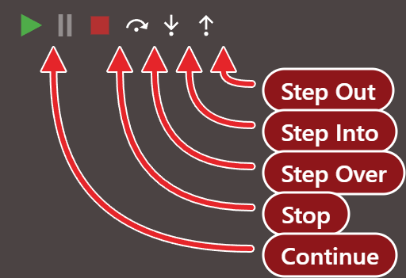
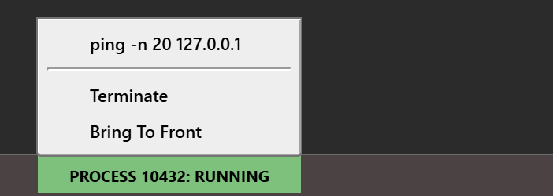

# Running

Start runs the project inside the compiler, Break pauses it, and End stops it. This page describes what Start runs, the second way to run code (<kbd>F6</kbd>), the boxes the status bar shows for programs your program starts, and everything that ends a run.

## Start, Break and End

Three commands control a run. Each is in the **Run** menu and has a button in the [toolbar](../Reference/Toolbar).

**Start** (<kbd>F5</kbd>)
: Starts the program when nothing runs, and continues it when it is paused. The menu calls it **Start**, and the toolbar button is titled **Start / Continue**. It does not ask to save the project, and it does not save it.

**Break** (<kbd>Ctrl</kbd>+<kbd>Break</kbd>)
: Pauses a running program. The toolbar button is titled **Break Into Code**.

**End**
: Stops the program, whether it is running or paused. It has no key. The toolbar button is titled **Stop**.

Which of them work depends on the [state of the program](../Debugging/#the-three-states-of-a-program):

- While the program is idle, only **Start** works.
- While it runs, **Break** and **End** work. **Start** is greyed out.
- While it is paused, **Start** (now continuing), **End**, the step buttons and **Set Next Statement** work. **Break** is greyed out.

The toolbar buttons and the menu items follow the same rules. [Breakpoints and stepping](Breakpoints-and-Stepping) describes the paused state.

{:width="256" height="175"}

At a run-time error, **End** ends only the procedure that failed; see [Traps](Breakpoints-and-Stepping#traps).

### Break

**Break** stops the program at the line it is executing. In a loop that has a statement of its own, that line is in your code, and the DEBUG CONSOLE works as at any other stop.

In a form that is waiting for input, and in a loop that holds only `DoEvents`, there is no line of yours to stop at. The IDE opens a file of the VB package, `IdleMessageLoopBreak.twin`, and stops in its procedure `IdleMessageLoopBreakpoint`. With a form waiting for input, a line typed in the console works there. Press <kbd>F5</kbd> and the program stops again in the same file. Press it once more to run on.

> [!WARNING] BETA 1005
> A program that is stopped by **Break** in a loop that holds only `DoEvents` ends with a native access violation as soon as the IDE evaluates anything. A line typed in the console does it, even `? 1`, and so does any watch, because the IDE evaluates every watch at every stop. The DEBUG CONSOLE prints `NATIVE EXCEPTION: ACCESS_VIOLATION`, and the IDE stays in the paused state, with the arrow on the VB package's line and **Stop** and the step commands enabled, although the program has ended. Do not use **Break** on a loop that holds only `DoEvents`. Put a statement in the loop and a [breakpoint](Breakpoints-and-Stepping#breakpoints) on it instead. If the IDE is already in that state, **Restart the compiler** in the toolbar puts it right.

## What Start runs

Start asks the compiler to run the project. The program runs inside the compiler's own process, not as an executable of its own, and it is the debug build of the project: [Compiler Options (DEBUG)](../Project-Settings#compiler-options-debug) says what the IDE can do with code that LLVM compiles.

What runs first is the project's [Startup Object](../Project-Settings#startup-object):

- **Sub Main**, the default for an EXE project. The console shows `Executing 'Main'...`, then the output of the program.
- **A form.** The console shows `Executing '[frmMain].StartupShow()'...`, where `frmMain` is the form's name, then the output of the form. The run lasts until every form has closed, and the console shows `[DEBUGGER] Waiting for remaining forms to close...` meanwhile.
- **(None)**, which an ActiveX DLL can have. **Start** is enabled, but it only writes `[DEBUGGER] No startup object set` to the console, and nothing runs.

**Sub Main** with no procedure called `Main` in the project writes `(compile error: Unrecognized symbol 'Main')` to the console, with no dialog. [Runtime Command Line Args](../Project-Settings#runtime-command-line-args) sets the text that **Command$** returns in the run.

Every run that ends writes `(time taken: <n>s)`, followed by `[DEBUGGER] global variables have been cleared`. A run that you stop at a pause writes `aborted` in place of the time.

### When the project does not compile

Start shows no dialog for a compile error, and it opens no panel. The [DIAGNOSTICS](../Code/Diagnostics) panel lists the errors. What the console and the editor show depends on where the error is.

- **In a procedure that `Main` calls.** The console shows `[LINKER] compilation (codegen) error detected in 'Startup.Main' at line #42`, where 42 is the line of the call. The editor opens `Main`'s module and stops at its `Sub` line with the error panel, titled **ERROR OCCURRED**. Nothing in `Main` has run.
- **In `Main` itself.** No panel opens. The console shows `[LINKER] compilation (codegen) error detected in '{temp_component}.{temp_procedure}' at line #1`, then `(compile error: codegen error; check for compilation errors)`, and the program is idle again.

> [!NOTE] BETA 1005
> The panel for a compile error gives the description `COMPILATION (CODEGEN) ERROR AT LINE #42.  PLEASE REPORT THIS ERROR TO https://git.io/JMh6S`, and the line it names is the line of the call, not the line of the error. A compile error in your code is not a defect to report. Read the real error in the DIAGNOSTICS panel and fix it.

## Run Or Preview

<kbd>F6</kbd> runs one procedure without starting the whole project, or previews a form. It has no menu item and no toolbar button. It works when a code editor or a form designer is active, and what it does depends on where the caret is.

- **In a procedure of a module.** The procedure runs, and the console shows `Executing '<Project>.<Module>.<Procedure>'...` first. A `Private` procedure runs too. It runs as a debug session: a [breakpoint](Breakpoints-and-Stepping#breakpoints) in a procedure it calls stops it, a `Stop` statement stops it, and <kbd>F5</kbd> then continues. The run ends with `(time taken: …)`. The Call Stack starts at the procedure, with no frame for `Main`.
- **In the code of a form.** The form is shown instead of a procedure being run. The console shows no `Executing` line, and the form's `Form_Load` runs.
- **In a form designer.** The form is previewed. The **PREVIEW** button of the designer's toolbar, titled *Launch the form in isolation to test its functionality*, does the same. A UserControl or a property page designer does not support a preview.

A preview is also a debug session. A breakpoint in `Form_Load` stops it, and a click on a button of the previewed form stops at a breakpoint in the button's `Click` procedure. Closing the window runs `Form_Unload` and `Form_Terminate` and writes `[DEBUGGER] done.` to the console. **End** during a preview of the form's code runs `Form_Terminate` but not `Form_Unload`.

<kbd>F6</kbd> refuses what it cannot run, and says so in the console, with nothing else happening:

- A procedure with a required argument: `(compile error: Too few arguments, expected 1 in call to 'Greet')`. When the procedure also has an **Optional** argument, the message reads `expected at least 1`.
- A method of a class: `(compile error: Unrecognized member 'Thing' on type '<Project>' [non-extensible object])`.
- A caret at module level, outside a procedure: `RunCodeUnderCursor: failed to identify the procedure at the cursor position.`
- With no editor active: `runCodeUnderCursor failed: no active text editor.`

> [!NOTE] BETA 1005
> <kbd>F6</kbd> also gives `failed to identify the procedure at the cursor position.` when the caret is on the procedure's `End Sub` or `End Function` line, or on another of its lines at or past the column where that `End` line ends. A comment at the end of the `End` line moves that limit to where the comment starts. Nothing runs. Put the caret nearer the start of a line of the procedure.

The CodeLens **▶ run** link above a procedure runs it by another route: [CodeLens](../Code/IntelliSense#codelens) describes it. [Testing with Assert](../../../Tutorials/Testing-with-Assert) uses both.

## Programs that your program starts

A program that your program starts with `Shell` shows in the status bar as a green box reading **PROCESS** *pid* **: RUNNING**, one box for each process. A run that you start with <kbd>F5</kbd> or <kbd>F6</kbd> makes no box of its own. The box appears when the console writes `[SHELL] process <pid> started.` and goes away when the process ends, with `[SHELL] process <pid> exited with code 0`.

{:width="351" height="125"}

Click a box to open its menu. The first line of the menu is the command line of the process. Under it are two commands:

**Terminate**
: Ends the process. The console writes `exited with code 1`.

**Bring To Front**
: Brings the window of the process to the front, and shows it if it was hidden. It writes nothing to the console.

A `Shell` that runs from a line you type in the console makes a box too, with no program running. **Restart the compiler** removes the boxes and ends the processes.

## What ends a run

- **End**, or **Stop** on the toolbar. The console writes `aborted`, and the objects held by the procedure's local variables are released, so their `Class_Terminate` procedures run. A form program closes its windows and runs `Form_Terminate`, but not `Form_Unload`.
- **The program ends by itself.** After its last statement, or at an `End` statement, the run ends. Closing the window of a form program does the same: `Form_Unload` and `Form_Terminate` run, and the IDE is idle again.
- **A step out of `Main`.** Step Out from `Main` ends the run.
- **Restart the compiler**, from the toolbar or **Tools → Restart the compiler**, and **closing the project.** Both end the compiler process at once. A program that is running or paused dies without running `Form_Unload`, `Class_Terminate` or any other of its code, and the IDE asks for no confirmation. [Restarting the compiler](#restarting-the-compiler) says what the IDE keeps.
- **Opening a form designer.** The IDE tells the compiler to end the program if it is busy. A form program that is waiting for input ends, with `form terminate` and no `Form_Unload`. A loop with no `DoEvents` keeps running, and so does a program that is paused.
- **Editing the code.** See the next section.

> [!NOTE] BETA 1005
> An `End` statement in a procedure that LLVM compiles ends the run, and then the console shows `restarting from MEMORY [<project>]`: the IDE restarts the compiler and compiles the project again. The IDE recovers by itself. Remove the `End` statement, or compile the procedure without LLVM, to avoid the restart.

## Editing while the program runs

Edit and Continue is not supported. The IDE does not make the editor read-only while a program runs or is paused, but any edit of the code ends the run:

- **While the program is paused**, an edit anywhere, including a line below the arrow, a line above it, another procedure and a line that does not compile, writes `[EDIT & CONTINUE] not yet supported.  Aborting.` to the console. The objects held by the local variables are released, then `aborted` and `[DEBUGGER] global variables have been cleared`. No dialog opens, and the tab of the file shows its unsaved dot. A breakpoint moves with the text, as it does in any edit.
- **While a form program runs**, an edit ends it too, with `(time taken: …)` and `form terminate` and no `Aborting` line.

The next <kbd>F5</kbd> starts a new run of the edited code. At the panel that a run-time error opens, an edit does not end the program as it should; see [Editing at the error panel](Breakpoints-and-Stepping#editing-at-the-error-panel).

## Restarting the compiler

**Restart the compiler** starts a new compiler process and loads the project into it from the IDE's memory, so unsaved edits survive. The console writes `restarting from MEMORY [<path>]`. The IDE clears the Call Stack, the Variables panel, the Memory panel and the list of running processes. It keeps the breakpoints, including those you set since you last saved, and the watches. After a restart, <kbd>F5</kbd> stops again at the same breakpoint, the watches have values again, and a watch that was expanded is still expanded.

Closing a project that has unsaved changes asks **You've made changes to this project.  Save now?** and offers **Save**, **Discard Changes** and **Cancel**. Setting or clearing a breakpoint counts as a change. A project with nothing changed closes with no prompt, and the console is cleared.

## See Also

- [Breakpoints and stepping](Breakpoints-and-Stepping) -- what happens when the program pauses
- [Run menu](../Reference/Menu/Run) -- the three commands of the menu
- [Project Settings](../Project-Settings) -- Startup Object, Runtime Command Line Args and Compiler Options (DEBUG)
