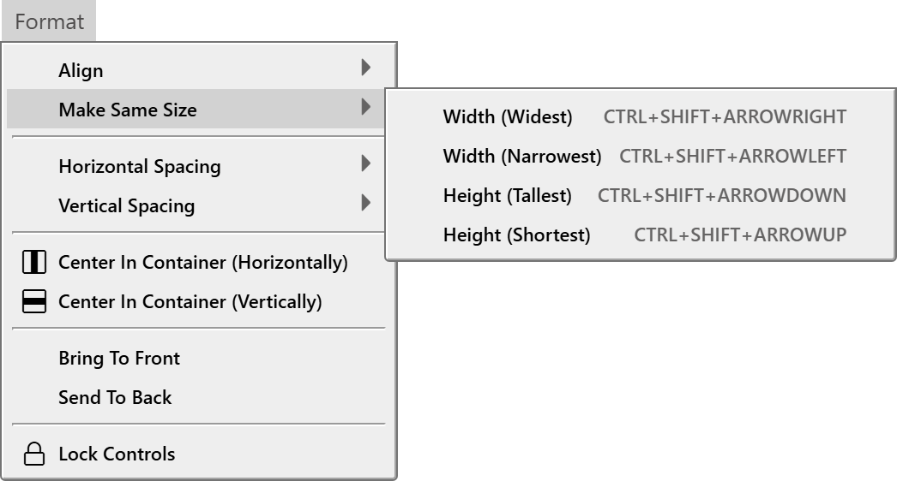
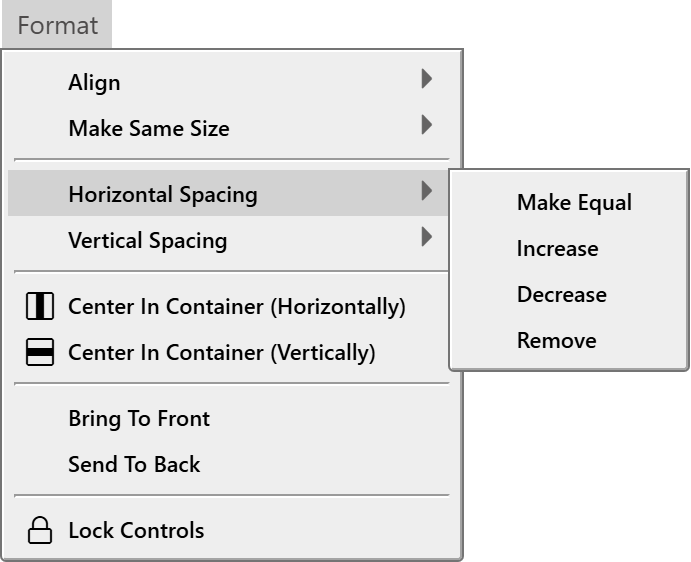

# Arranging controls

The **Format** menu lines up the controls you have selected: it aligns their edges, gives them the same width or height, spaces them evenly, centres them in their container and changes their order. This page describes what each command does to the controls. The [Format menu](../Reference/Menu/Format) page lists the commands.

{:width="232" height="281"}

The same commands are in the right-click menu of a selection, and most have a button in the toolbar. They act on the controls selected in the designer, so the whole menu is greyed out until a designer is open with a selection.

How many controls a command needs:

| Commands | Controls needed |
|---|---|
| **Align**, **Make Same Size**, **Horizontal Spacing** and **Vertical Spacing** | Two or more. |
| **Make Equal** in the two spacing menus | Three or more. |
| **Center In Container**, **Bring To Front**, **Send To Back**, **Lock Controls** | One or more. |
| **Align to grid** in the right-click menu | One or more. |

With a single control selected, the **Align** and **Make Same Size** submenus are greyed out and the **Center In Container**, order and lock commands are available. **Align → To Grid** in the menu bar needs two controls, so for one control use **Align to grid** in the right-click menu.

The align, spacing, centre, **Make Same Size** and **Align to grid** commands skip a locked control and a control whose **Dock** is not none. A locked control still counts when the command measures the selection. A line is handled by both of its ends.

None of the controls is the reference. The first control you clicked has no special role: the align commands measure the bounding box of the whole selection.

## Align

{:width="436" height="281"}

**Left**, **Right**, **Top** and **Bottom** move every control to an edge of the selection. They compare positions in form coordinates, so they work across containers.

| Command | Keys | Result |
|---|---|---|
| **Left** | <kbd>Alt</kbd>+<kbd>Left</kbd> | Every control gets the leftmost left edge of the selection. |
| **Right** | <kbd>Alt</kbd>+<kbd>Right</kbd> | Every control gets the rightmost right edge. |
| **Top** | <kbd>Alt</kbd>+<kbd>Up</kbd> | Every control gets the topmost top edge. |
| **Bottom** | <kbd>Alt</kbd>+<kbd>Down</kbd> | Every control gets the lowest bottom edge. |

**Center (Horizontal)** and **Center (Vertical)** have no keys. **To Grid** has none either. It rounds the **Left** and **Top** of each selected control down to the grid, and rounds the size down too: a control 24 pixels high becomes 20 with a 10-pixel grid. It acts at once, even when **Align Controls To Grid** is off.

> [!NOTE] BETA 1010
> **Center (Horizontal)** and **Center (Vertical)** do not centre the controls on the middle of the selection. They centre each control on the left edge, or the top edge, of the selection. Three controls 100 pixels wide at **Left** 10, 140 and 250 all end at **Left** -40, their middles on 10, and may end outside their container. To line up the middles of a group, align the edges and then type the **Left** or **Top** values in [PROPERTIES](Properties). **Center In Container** centres a group in its container correctly at a zoom of 100 %.

> [!NOTE] BETA 1010
> Each <kbd>Alt</kbd>+arrow also opens the IDE's menu bar when you release the keys. The controls are aligned all the same, and nothing is lost. If the menu bar is in the way, align with the **Format → Align** commands or the toolbar buttons instead.

## Make the controls the same size

{:width="523" height="281"}

**Make Same Size** gives every selected control the **Width** or the **Height** of one control of the selection.

| Command | Keys | Result |
|---|---|---|
| **Width (Widest)** | <kbd>Ctrl</kbd>+<kbd>Shift</kbd>+<kbd>Right</kbd> | Every control gets the width of the widest. |
| **Width (Narrowest)** | <kbd>Ctrl</kbd>+<kbd>Shift</kbd>+<kbd>Left</kbd> | Every control gets the width of the narrowest. |
| **Height (Tallest)** | <kbd>Ctrl</kbd>+<kbd>Shift</kbd>+<kbd>Down</kbd> | Every control gets the height of the tallest. |
| **Height (Shortest)** | <kbd>Ctrl</kbd>+<kbd>Shift</kbd>+<kbd>Up</kbd> | Every control gets the height of the shortest. |

A command changes nothing when the controls already have the same size.

> [!WARNING] BETA 1010
> **Make Same Size** changes the controls on the surface and marks the form changed, but it does not reach the saved form. If you press <kbd>Ctrl</kbd>+<kbd>S</kbd>, close the tab and open the form again, the controls have their old sizes. A later change, such as moving a control with an arrow key, saves the new sizes with it. After you use **Make Same Size**, make such a change before you save, or type the **Width** and **Height** values in [PROPERTIES](Properties) instead.

## Space the controls evenly

{:width="345" height="281"}

**Horizontal Spacing** works on the controls sorted by **Left**. **Vertical Spacing** does the same by **Top**, with the grid height and the bottom edge. In both, the first control stays where it is.

| Command | Result |
|---|---|
| **Make Equal** | Needs three controls. The first and the last stay. The controls between them are placed so that the gaps are equal. |
| **Increase** | The second control moves by one grid width, the third by two grid widths, and so on. The gaps grow by one grid width each. |
| **Decrease** | The same, in the opposite direction. |
| **Remove** | Each control is placed with its edge on the edge of the one before it, so the gap is 0. |

The step of **Increase** and **Decrease** is the **Grid Width**, or the **Grid Height** for a vertical command, even when **Align Controls To Grid** is off.

For example, take three controls 100 pixels wide with **Left** 10, 140 and 250, and a grid of 10:

| Command | New **Left** of the second and third |
|---|---|
| **Make Equal** | 130 and 250 |
| **Increase** | 150 and 270 |
| **Decrease** | 130 and 230 |
| **Remove** | 110 and 210 |

The spacing commands compare positions that count from each control's own parent. Controls in different containers therefore give odd results. For example, **Remove** on a text box in a frame and a button on the form places the button at the text box's right edge as counted from the frame's corner, not from the form's.

> [!WARNING] BETA 1010
> **Horizontal Spacing** and **Vertical Spacing** move the controls on the surface, but do not mark the form changed and do not make an undo step. <kbd>Ctrl</kbd>+<kbd>Z</kbd> does not undo them. If you close the tab, the IDE asks no question, and the form opens again with the old positions. The new positions are saved only when a later real change follows, for example moving a control with an arrow key, because that change saves the whole surface. After you use these commands, make such a change before you save, and check the positions in [PROPERTIES](Properties). To go back, type the old **Left** or **Top** values there.

## Center in the container

**Center In Container (Horizontally)** and **Center In Container (Vertically)** move the selection as a group, so that the group's bounding box is centred in the container the controls share. The controls keep their positions relative to one another. They work for one control or for many, and need all of them to have the same parent. If they do not, nothing moves and a notification says so.

> [!NOTE] BETA 1010
> **Center In Container** reads the width of the container as it is drawn, so at a zoom other than 100 % it moves the controls to the wrong place. At 50 %, a text box in a frame ended at **Left** -9.98 instead of 40, and the group on the form moved by -80 instead of 20. Set the zoom to 100 % before you use the command.

## Bring to front and send to back

**Bring To Front** and **Send To Back** change the order in which controls are drawn, which decides which one is on top. They work within one parent: each selected control becomes the last, or the first, of its parent's controls. They have no keys. The toolbar has a button for each.

## Lock controls

**Lock Controls** locks or unlocks the selected controls. [Lock controls](Designer#lock-controls) explains it.

## Undo

Each command makes one undo step, and <kbd>Ctrl</kbd>+<kbd>Z</kbd> or the **Undo** button undoes it, except the spacing commands, which make none.

## See Also

- [Format menu](../Reference/Menu/Format) -- the commands, with their keys
- [Working with controls](Controls) -- selecting and moving controls
- [Designer](Designer) -- the grid and the locks
