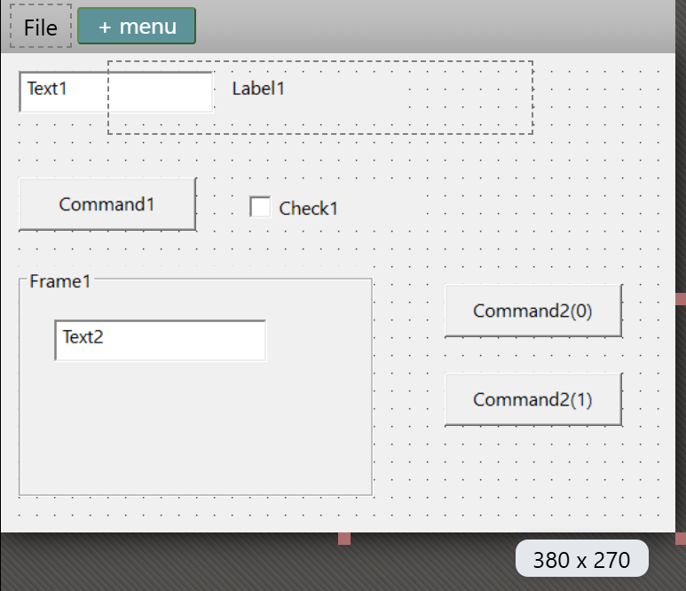
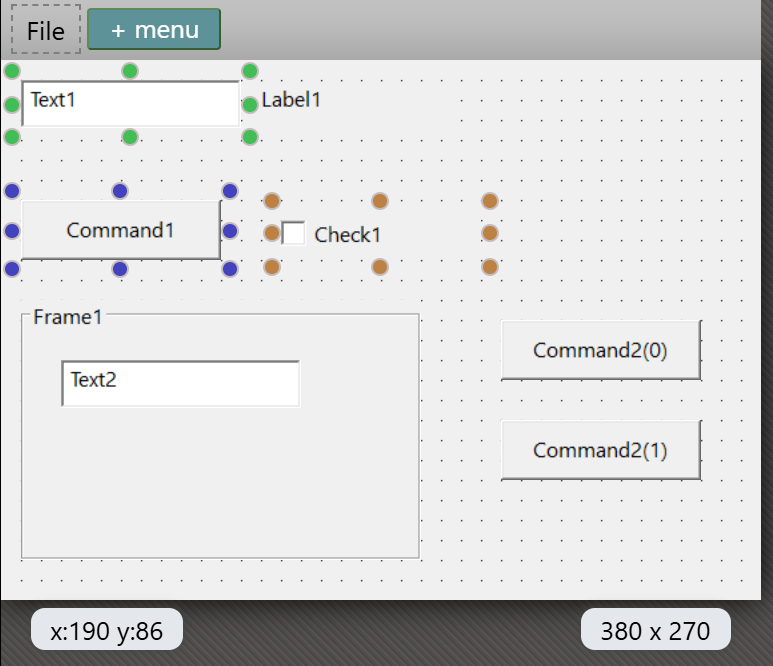
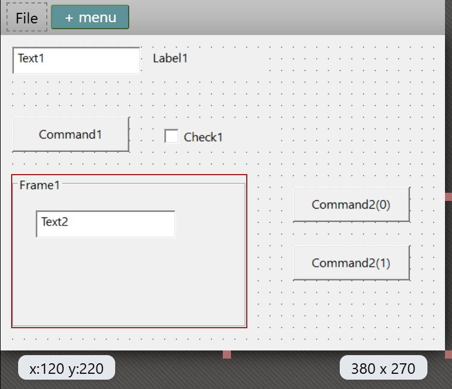

# Working with controls

This page describes how to put controls on a form and work with them: drawing, selecting, moving and sizing, the clipboard, containers, control arrays, editing a caption in place and opening an event handler. [Arranging controls](Arranging) describes the commands that line up a selection.

Most commands of the designer need the designer to have the focus. When the **PROPERTIES** pane has the focus, a key goes to the property box you are in, so <kbd>Delete</kbd>, the arrow keys, <kbd>Ctrl</kbd>+<kbd>A</kbd> and <kbd>Ctrl</kbd>+<kbd>C</kbd> do not touch the controls. A click on a menu item or a toolbar button works whichever pane has the focus.

## Draw a control

1. Click a tool in the [Toolbox](Toolbox). The pointer over the designer becomes a cross.
2. Click or drag on the form, or on a container.

A drag gives the control that rectangle. With **Align Controls To Grid** on, the corner snaps to the grid. A plain click, with no movement, gives the control 200 by 50 pixels at the point you clicked. A **Timer** drawn by a click is 27 by 27. A **Line** runs from the point where you press to the point where you release, and snaps to the grid only when **Align Controls To Grid** is on.

The new control is selected. It takes the form's font and the next free name: `Command1`, `Check1`, `Option1`, `Text1`, `Combo1`, `List1`, `HScroll1`, `VScroll1`, `Dir1`, `File1`, `Drive1`, `Picture1`, `CheckMark1` or `QRCode1`, and for other controls the class name and a number, such as `Label1`, `Frame1`, `Timer1`, `Shape1`, `Line1` or `Image1`. Its **Index** is -1, and its **TabIndex** is the highest on the form plus one.

The tool returns to the pointer after each control. <kbd>Esc</kbd> cancels a tool you selected. A double-click on a tool in the Toolbox places that control without drawing: 150 by 40 pixels, centred from left to right on the form.

Adding a **QRCode** control shows a message that the control is licensed under the MIT licence, with a link to `https://github.com/wqweto/VbQRCodegen`.

## Select controls

**Click** a control to select only it. <kbd>Shift</kbd>+click or <kbd>Ctrl</kbd>+click adds a control to the selection, or removes it when it is already selected. A click on an empty part of the form selects the form, and the PROPERTIES pane then shows the form's own properties. A right-click on a control that is not selected selects only that control.

**Drag a band** on the form, or inside a container, with the pointer tool to select several controls at once.

- The band selects every control it touches. A control inside a container is selected only when the band touches the container too. A line is selected when the band covers either end.
- <kbd>Alt</kbd>+drag selects only the controls that lie wholly inside the band.
- A band that selects nothing selects the form.
- <kbd>Shift</kbd> pressed on the background while a control is selected starts no band.

{:width="387" height="333"}

<kbd>Ctrl</kbd>+<kbd>A</kbd> selects every control on the form, including those inside containers. It does not select the form. The right-click menu has **Select All** too.

<kbd>Esc</kbd> does one of two things. With nothing selected, or the form selected, it returns to the pointer tool. With a control selected, it selects the control's parent, the container or the form. Pressing it again climbs one level more, so a text box in a frame goes to the frame, then to the form. There is no **Select Parent** menu item. A right-click menu that is open makes <kbd>Esc</kbd> be ignored once.

The object drop-down at the top of [PROPERTIES](Properties) lists the form and every control, and choosing one selects it. It reaches a control that is hidden, outside the visible part of the form or covered by another. Menu items that are not visible are selected in the [menu editor](Menu-Editor).

{:width="387" height="333"}

## Move a control

Drag a control to move it. All selected controls move together. A control inside a selected container moves once, with its container. A locked control does not move, and neither does a control whose **Dock** is not none. With **Align Controls To Grid** on, a position is rounded down to a multiple of the grid size, measured from the container's corner. A line moves by both ends.

A drag moves a control within its parent only. You cannot drag a control into a container or out of one, because **Left** and **Top** stay relative to the same parent. To move a control to another container, cut it, select the container or the form, and paste.

The arrow keys move the selection by one screen pixel, or by one grid cell when **Align Controls To Grid** is on. A key held down repeats, and the repeated moves are one undo step.

## Size a control

Drag a grabber of a selected control to resize it. With **Align Controls To Grid** on, the new size is rounded down to a multiple of the grid size. A docked control has fewer grabbers: **Dock** left keeps only the right one, top only the bottom, right only the left, bottom only the top, and fill none. A line has two, one for each end.

<kbd>Shift</kbd>+arrow makes the selection wider, narrower, taller or shorter, by the arrow keys' step.

You can also type **Left**, **Top**, **Width** and **Height** in [PROPERTIES](Properties#units-of-position-and-size), in the unit the form's scale mode names.

### Size the form

Three handles resize the form: the middle of the right edge, the middle of the bottom edge and the bottom-right corner. They set the form's **Width** and **Height**, and do not snap to the grid. The handles on the top and left edges and the other corners are drawn dimmer and do nothing.

On a CustomControls form, a control anchored to the left and top stays where it is when you drag a handle. On a Windows form the form designer does not stretch the controls. Their anchoring is the compiler's. See [Anchoring and docking](../../../Features/GUI-Components/Anchoring-Docking).

Each drag of a handle is one undo step.

## Copy, cut, paste and delete

| Action | Keys | What it does |
|---|---|---|
| Copy | <kbd>Ctrl</kbd>+<kbd>C</kbd>, <kbd>Ctrl</kbd>+<kbd>Insert</kbd> | Puts the selected controls on the system clipboard as JSON text. Pasted into a text editor, the clipboard shows that text. |
| Cut | <kbd>Ctrl</kbd>+<kbd>X</kbd>, <kbd>Shift</kbd>+<kbd>Delete</kbd> | Copies, then deletes. |
| Paste | <kbd>Ctrl</kbd>+<kbd>V</kbd> | Adds the controls on the clipboard. |
| Paste (same name, control array) | none | Pastes as a [control array](#control-arrays). Right-click menu only. |
| Duplicate (new name) | none | Copies and pastes in one step. Right-click menu only. |
| Duplicate (same name, control array) | none | Copies and pastes as a control array. Right-click menu only. |
| Delete | <kbd>Delete</kbd> | Deletes the selection and the controls inside any container in it. The right-click menu has no **Delete**. The code in the `.twin` file is not touched. |

The two **same name** items and **Paste** are greyed out in the right-click menu while the clipboard holds no controls. The two **same name** items are missing on a CustomControls form. If the IDE may not read the clipboard, **Paste** shows the notification *ERROR: unable to read clipboard contents*.

Where a paste goes:

- With exactly one container selected, a Frame for example, the controls go into it, at its top left corner.
- With nothing selected, so that the form is selected, they go to the form's top left corner.
- Otherwise they go into the same container as the first selected control, below the lowest selected control and 10 pixels from it.

If no control on the form has any of the pasted names, which is the case when you paste into another form, the controls keep their names and their **Index**. Otherwise every pasted control gets a fresh name, such as `Command3`, an **Index** of -1, and the next free **TabIndex**. Event handlers are not copied, only the controls. Pasting a single menu item goes into the [menu editor](Menu-Editor).

In a report only windowless controls can be pasted. See [Designing reports](../Reports/).

## Containers

A container is a control that holds other controls: a **Frame**, a **PictureBox**, a user control that allows it, and the CustomControls **WaynesFrame**. A control drawn inside a container belongs to it, and its **Left** and **Top** count from the container's corner.

While a tool is selected, moving the pointer over a container outlines the container in red. The next control goes inside it. Hold <kbd>Ctrl</kbd> while you click to draw the control on the form instead.

{:width="387" height="333"}

Moving a container moves its controls, and deleting it deletes them. A paste with a container selected goes inside it, and <kbd>Esc</kbd> on a control inside selects the container. **Center In Container** needs all selected controls to have the same parent. Otherwise it moves nothing and shows the notification *Selected controls are inside different containers*.

## Control arrays

Controls with the same name and different **Index** values form a control array. They share one set of event handlers, and each handler receives the **Index** as an argument. The designer lists a member as `Name(Index)`. **Index** is -1, shown blank, for a control that is not in an array. The legal range is -1 to 32767, and any other value you type becomes -1. A CustomControls form has no control arrays and no **Index** property.

There are three ways to make an array:

- Give a control the name of another control. A box asks *A control already exists with the name 'X'. Do you want to create a control array?* The first **YES** sets only the first control's **Index** to 0, and the same box comes again. The second **YES** renames the control to the next index. **NO** gives the control its old name back. If the name already belongs to an array, the renamed control joins it at once, with the next free index. A control type that has no **Index** property shows an error message instead.
- **Duplicate (same name, control array)** in the right-click menu.
- **Paste (same name, control array)** in the right-click menu.

The last two give the new controls the highest **Index** plus one, and turn a lone original with **Index** -1 into index 0. Choosing an event of a member in the [EVENTS tab](Properties#events) inserts a handler with an `Index As Integer` argument, such as `Private Sub Command2_GotFocus(Index As Integer)`.

> [!NOTE] BETA 1010
> The box that asks about the control array comes twice when you give a control the name of a single control. The first **YES** sets the other control's **Index** to 0 and leaves the renamed control's name unchanged, and the same box comes again. The second **YES** renames the control to `X(1)`. Answer **YES** both times. **NO** puts the old name back.

## Names and code

Renaming a control does not change the code. A handler such as `Text1_Change` stays as it is. Code that uses the old name, such as `Text1.Text = "hi"`, shows a *TB5079 Unrecognized symbol* problem in **DIAGNOSTICS** the next time the project compiles. A change of **Name** makes the compiler compile the project again. Deleting a control leaves its handlers in the code.

## In-place editing

With **Show in-place editing toolbar in the designer** on, which is the default, a small toolbar shows below a single selected control. It is hidden while you drag. What it holds depends on the control.

| Control | Tools |
|---|---|
| **Label**, **TextBox** | The pencil, **B**, **I** and **U** (highlighted when on), a font-size box from 1 to 100 points with **+** and **-** buttons, and left, centre and right alignment, which set **Alignment**. |
| **CommandButton**, **Frame**, **CheckBox**, **OptionButton** | The pencil and the font tools. |
| **Image** | The pencil, which opens a file dialog for **Picture**. |
| An ActiveX control | The pencil, which opens the control's Custom property page. |
| A **MultiFrame** | A **FramesCount** box. Lowering it shows *To reduce the frame count, select and delete the individual frames*. |
| Any other control with a **FontSize** | The font tools, without the pencil. |
| A control the compiler failed to draw | The error text. |

The pencil opens a text box over a Label, CommandButton, TextBox, Frame, CheckBox or OptionButton. It holds the **Caption**, or the **Text** of a TextBox. <kbd>Enter</kbd> commits, <kbd>Shift</kbd>+<kbd>Enter</kbd> adds a line, <kbd>Esc</kbd> cancels, and a click elsewhere commits. An empty box sets the **Caption** to an empty string. The form itself has no in-place toolbar.

The option in [IDE Options](../Customising/IDE-Options#form-designer-and-toolbox) turns the toolbar off for good. The command `tbFormDesigner_ToggleInPlaceEditingToolbar` hides or shows it for the session only.

## Open an event handler

Double-click a control, or the form, with the pointer tool. The code editor opens the control's default event handler, or the last event in the control's event list when the compiler names no default. If the handler exists, the editor goes to it. If not, the editor inserts an empty handler with the caret in its body. A menu item in the form's menu bar opens its `Click` handler the same way. A control with no events does nothing.

For example, a double-click on a **Label** inserts `Label1_Click`, on a **TextBox** goes to `Text1_Change`, and on the form goes to `Form_Load`, when those exist. The [EVENTS tab](Properties#events) and the [combo boxes of the editor](../Code/Editor#the-navigation-combo-boxes) open and insert handlers in the same way.

## The right-click menu

A right-click opens a menu on the form, on a control, or on a menu item in the [menu editor](Menu-Editor). Its entries show the keys of the commands.

{:width="522" height="563"}

**On the form**, the menu has **View Code**, **Paste**, **Paste (same name, control array)** (not on a CustomControls form), **Select All**, and **Lock all controls** and **Unlock all controls**. Only the one of the two lock items that applies shows: with every control locked, **Unlock all controls**, and with some locked, **Lock all controls**.

**On one or more controls**, the menu has these groups:

- **Cut**, **Copy**, **Paste**, **Paste (same name, control array)**, **Duplicate (new name)** and **Duplicate (same name, control array)**. The two **same name** items are not on a CustomControls form.
- **Align**, **Make Same Size**, **Horizontal Spacing** and **Vertical Spacing**, each a submenu. They are greyed out unless more than one control is selected. See [Arranging controls](Arranging).
- **Center In Container (Horizontally)** and **Center In Container (Vertically)**.
- **Bring To Front** and **Send To Back**.
- **Align to grid**, which snaps even one control to the grid.
- **Lock Controls** and **Unlock controls**.
- **ActiveX Properties...**, when a selected control is an ActiveX control, and, when exactly one selected control offers property pages, one item for each page. The label **ActiveX Properties...** is in English whatever the IDE language. The page names come from the control.

## Keys

| Key | What it does |
|---|---|
| <kbd>Ctrl</kbd>+<kbd>Z</kbd>, <kbd>Ctrl</kbd>+<kbd>Y</kbd> | Undo and redo. |
| <kbd>Ctrl</kbd>+<kbd>X</kbd>, <kbd>Shift</kbd>+<kbd>Delete</kbd> | Cut. |
| <kbd>Ctrl</kbd>+<kbd>C</kbd>, <kbd>Ctrl</kbd>+<kbd>Insert</kbd> | Copy. |
| <kbd>Ctrl</kbd>+<kbd>V</kbd> | Paste. |
| <kbd>Delete</kbd> | Delete the selected controls. |
| <kbd>Ctrl</kbd>+<kbd>A</kbd> | Select all the controls. |
| <kbd>Esc</kbd> | Return to the pointer tool, or select the parent. |
| <kbd>Left</kbd>, <kbd>Right</kbd>, <kbd>Up</kbd>, <kbd>Down</kbd> | Move the selection by one screen pixel, or one grid cell. |
| <kbd>Shift</kbd>+arrow | Resize the selection by the same step. |
| <kbd>Alt</kbd>+arrow | Align the selection to the left, right, top or bottom. |
| <kbd>Ctrl</kbd>+<kbd>Shift</kbd>+arrow | Make the selection the same width or height. |
| <kbd>Ctrl</kbd> held | Show the tab-index badges. |
| <kbd>Shift</kbd>+<kbd>F7</kbd> | Open the designer from the code. |
| <kbd>F6</kbd> | [Preview](Previewing) the form. |

<kbd>Ctrl</kbd>+arrow does nothing in the form designer. With the **TOOLBOX** focused, <kbd>Left</kbd> and <kbd>Up</kbd> select the previous tool and <kbd>Right</kbd> and <kbd>Down</kbd> the next. The commands for the Center items, Bring To Front, Send To Back, Lock, Duplicate, Zoom In and Zoom Out, and for searching and focusing the Toolbox and PROPERTIES, have no default key. [Keyboard shortcuts](../Customising/Keyboard-Shortcuts) gives them one.

## See Also

- [Designer](Designer) -- opening a form, the grid, zoom, locks and the tab order
- [Arranging controls](Arranging) -- the **Format** menu
- [Toolbox](Toolbox) -- the controls to draw
- [Properties](Properties) -- changing what you have drawn
- [Menu editor](Menu-Editor) -- the menus of a form
