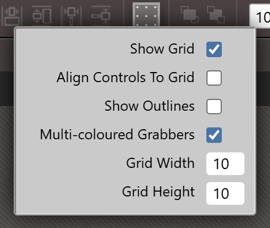
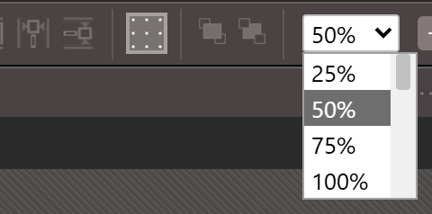
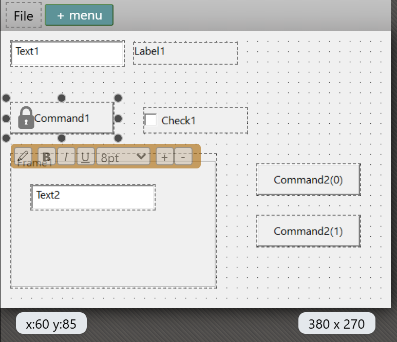
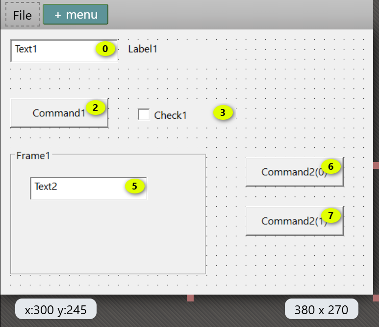

# Designer

A form is two files, a designer file and a code file. This page describes how to create a form, how to open its designer, how to move between design and code, and the parts of the designer window. It then describes the settings of the surface: grid, outlines, zoom, locks and tab order. [Working with controls](Controls) describes what you do on the surface.

## Add a form

The **Add** menu creates a form. It is in the right-click menu of the [Project Explorer](../Projects/Project-Explorer), and in the **Project** menu. [Adding files](../Projects/Adding-Files) describes the menu. The Windows items and the CustomControls item are always shown, whether the project refers to their package or not.

| Item | Creates | Package it needs |
|---|---|---|
| **Add Windows Form** | `MyForm.tbform` and `MyForm.twin` | WinNativeForms |
| **Add Windows MDI Form** | `MyForm.tbform` and `MyForm.twin`, for an MDI form | WinNativeForms |
| **Add Windows UserControl** | `MyUserControl.tbcontrol` and `MyUserControl.twin` | WinNativeForms |
| **Add Windows PropertyPage** | `MyPropertyPage.tbppage` and `MyPropertyPage.twin` | WinNativeForms |
| **Add Windows Report** | `MyReport.tbreport` and `MyReport.twin`. See [Designing reports](../Reports/). | WinNativeForms |
| **Add CustomControls Form** | `MyForm.tbform` and `MyForm.twin` | CustomControls |
| **Add** *name* **Form** | A form of a kind that a package supplies, one item for each kind. | That package |

The new files go into the folder that the Project Explorer has selected. The Project Explorer switches to its file view, and a name box opens in the tree. It holds the default name, `MyForm.tbform` for a form, with the name part selected. If the name is taken, the box offers `MyForm2`, `MyForm3` and so on.

{:width="267" height="304"}

<kbd>Enter</kbd> creates both files at once and opens the designer in a normal tab, not a preview tab. <kbd>Esc</kbd>, or an empty name, creates nothing. A name with a space is written in square brackets, such as `Class [My Form]`, both in the class and in the form's **Name** property. A Windows form, an MDI form and a report are bracketed for a punctuation mark too, such as the dot in `a.b`. A user control, a property page and a CustomControls form are bracketed for a space only.

> [!NOTE]
> In twinBASIC BETA 1005, the name box accepts a name that is not an identifier, such as `1bad`, and creates the files without a message. The class is then `Class 1bad`.

What the new files hold depends on the kind:

| Kind | Designer file | Code file |
|---|---|---|
| Windows form | A form 300 pixels wide and 300 high, with **StartUpPosition** `vbStartUpScreen`. | The attributes `[Description("")]`, `[FormDesignerId("...")]` and `[PredeclaredId]`, and `Class MyForm` with an empty `Sub New()`. |
| MDI form | As a form, without the start-up position. | As a form. |
| CustomControls form | A form 300 pixels wide and 300 high. | As a Windows form. |
| User control | A control 300 pixels wide and 300 high. | As a form, and also `[ClassId]`, `[InterfaceId]`, `[EventInterfaceId]` with new GUIDs, and `[COMControl]`. |
| Property page | As a user control. | As a user control, without `[COMControl]`. |
| Report | Five sections. | `Class MyReport` with `Sub New()` and an empty `Sub Report_Load()`. |

The designer file holds only these few properties at first. When you save, the file also holds every property the compiler reports for the form and its controls.

### The package prompts

If the project does not refer to the package an item needs, the item shows a box titled **twinBASIC** instead of creating a form. It reads *Package needed* and the package's name, and says that you must first add a reference to the package, and that the compiler restarts after you click the button.

{:width="539" height="194"}

{:width="544" height="194"}

The button, **Add WinNativeForms package** or **Add CustomControls package**, adds the reference and restarts the compiler. It creates no form. Choose the **Add** item again to create one. **Cancel** creates nothing.

## Open a designer

A designer opens for any of its four kinds of file when you open the file:

- Double-click it in the Project Explorer, or single-click when **File Explorer: Single-Click Preview** is on. See [IDE Options](../Customising/IDE-Options#project-explorer-tabs-and-start-up).
- Open it from **OPEN EDITORS**, or double-click a row in **DIAGNOSTICS** that names it.
- Create it with an **Add** item.

Opening a designer ends a form program that waits for input. See [Running](../Debugging/Running#what-ends-a-run).

A file that the designer cannot use opens in one of three ways:

- A form from a package, such as the designers in the VB package, is read-only. The IDE shows the notification *Can't open designer for a read-only document.*
- A file with a JSON error shows the notification *ERROR: bad JSON encountered when parsing tbform*.
- A file without a `FormDesignerId` opens normally. The designer makes a new id for the session and does not write it to the file.

> [!NOTE]
> In twinBASIC BETA 1005, a read-only designer file still gets a tab, which is empty and selected. Close it.

> [!NOTE]
> In twinBASIC BETA 1005, a form file with a JSON error opens an empty designer with no controls, and PROPERTIES is empty. An edit there is refused, and <kbd>Ctrl</kbd>+<kbd>S</kbd> leaves the file as it was, so nothing is lost. Correct the JSON in a text editor outside the IDE, and open the form again.

### The two files of a form

A form's designer file and its `.twin` file belong together. Renaming one in the Project Explorer asks *Rename* the partner *to* the new name *also?*, and **YES** renames both. **Delete Permanently** on one of the pair offers **Delete Both**, **Delete** the file's name, and **Cancel**, when the IDE asks before it deletes files. See [IDE Options](../Customising/IDE-Options#project-explorer-tabs-and-start-up) for **File Explorer: Ask Before Delete Files**.

### View a form as JSON

**View As JSON** in the Project Explorer's right-click menu shows the designer file as text. It is in the menu for `.tbform`, `.tbcontrol`, `.tbppage` and `.tbreport` files and for the files in a package, and it is greyed out when a designer file is selected together with other items. The text opens in a read-only tab titled `JSON: 'frmMain.tbform':`. A comment at its top gives the `URI:` of the file and the `SNAPSHOT:` time. The tab is a snapshot and does not follow later changes, but it includes the changes in the designer that you have not saved yet.

## Switch between design and code

Three commands open the code file from the designer:

- The toolbar button **Switch Between Form And Code**.
- **View → Code Editor**.
- **View Code** in the designer's [right-click menu](Controls#the-right-click-menu).

None of them has a key. The code file opens in a normal tab, or in a preview tab when **File Explorer: Single-Click Preview** is on.

From the code file, **View → Object Designer** and <kbd>Shift</kbd>+<kbd>F7</kbd> open the designer. The command looks for a `.tbform`, then a `.tbcontrol`, a `.tbppage` and a `.tbreport` with the same name. The toolbar button works from either side. <kbd>F7</kbd> and <kbd>Esc</kbd> do nothing in a designer.

Both switches find the partner file by replacing `.twin` or `.tbform` in the path. If the file has no partner, a notification says *Unable to switch form design mode: this document is not part of a form*.

> [!NOTE]
> In twinBASIC BETA 1005, a folder whose name contains `.twin`, such as `v1.twin.forms`, breaks the switch from the code to the designer, and the notification above appears. The switch from the designer to the code still works. Open the designer from the Project Explorer, or rename the folder.

## The parts of the window

The designer uses the IDE's toolbar for its buttons. A button is greyed out unless the context of its command holds. The [Toolbar](../Reference/Toolbar) page names them. A few need explaining:

- The **grid** button opens a small panel of options when the pointer enters it.
- The **zoom** box sets the size of the surface. See [Zoom](#zoom).
- **PREVIEW**, titled *Launch the form in isolation to test its functionality*, runs the form on its own. See [Previewing a form](Previewing).

{:width="1319" height="698"}

| Part | What it is |
|---|---|
| **Form Menu** bar | The strip above a form where its menus are designed. It has a **+ menu** button. See [Menu editor](Menu-Editor). |
| The surface | The form's client area, drawn from the compiler's picture of it. |
| Size handles | Three handles on the form's right edge, bottom edge and bottom-right corner resize the form. The five others, on the top and left edges and the other corners, are drawn dimmer and do nothing. See [Size the form](Controls#size-the-form). |
| Readouts | While you are not drawing, dragging or sizing a control, the pointer position (`x:` and `y:`) shows at the lower left of the surface and the form's size at the lower right, whatever is selected. While you draw, drag or size a control, its position and size show instead, and they disappear when you release the button. The readouts are always in pixels. |
| Grabbers | Eight small circles round a selected control. A docked control has fewer. A locked control shows a lock icon. |
| Tab-index badges | Yellow circles that show while you hold <kbd>Ctrl</kbd>. See [Tab order](#tab-order). |
| In-place toolbar | The small bar below a selected control. See [In-place editing](Controls#in-place-editing). |

![A form in the designer at 100 %, with a File menu and the + menu button in the bar above it. The form holds two text boxes, a label, two command buttons, a check box, a frame round one of the text boxes, and a control array of two buttons. The label is selected: eight round grabbers surround it, and a bar of editing buttons sits below it. Under the form, a box at the left shows the pointer position and one at the right the form's size, 380 x 270. Labels with arrows name the grabbers, the bar and the two boxes.](Images/Designer_Selected.png){:width="548" height="387"}

While the designer loads, an overlay lists the steps of the connection to the compiler, with a progress bar. A failure reads *error 802; connection closed*, *803 connection errored* or *804 connection abandoned*. **Ignore and continue** hides the overlay. The overlay shows for a fraction of a second on a normal start.

A touch screen works too. A one-finger drag with a tool selected draws a control, and a pinch with two fingers zooms.

## Grid and outlines

The grid options are in the panel that opens when the pointer enters the grid button.

**Show Grid**
: Default on. Draws the grid as dots on the surface.

**Align Controls To Grid**
: Default off. Snaps a control to the grid when you draw, drag or size it, and moves it by one grid cell for each arrow key press.

**Show Outlines**
: Default off. Draws a dashed outline round every control, useful for a control with no visible border.

**Multi-coloured Grabbers**
: On for a new form. A form file that lacks the setting opens with it off. With it on and several controls selected, the grabbers of each control have a different colour, so the controls can be told apart.

**Grid Width** and **Grid Height**
: Default 10 pixels each. The smallest value is 1.

{:width="227" height="191"}

These options belong to the form. They are saved in the form file, so another form can have another grid. Changing one is an undo step, marks the form changed and refreshes the designer from the compiler.

With **Align Controls To Grid** on, a position is rounded down to a multiple of the grid size, measured from the container's top left corner. **Format → Align → To Grid** snaps the selected controls to the grid at once, whatever the setting. The step of **Increase** and **Decrease** in the spacing commands is the grid width or height even when snapping is off. See [Arranging controls](Arranging).

Each toggle is also a command with no menu item and no key: `tbFormDesigner_ToggleGridIndicators` (the grid button), `ToggleAlignControlsToGrid`, `ToggleControlOutlines`, `ToggleMultiColouredGrabbers`, `ToggleLockAllControls`, `ToggleShowTabIndex` and `ToggleInPlaceEditingToolbar`, each with the `tbFormDesigner_` prefix. The grid indicators, the alignment to the grid, the outlines, the in-place toolbar and the tab-index overlay also have `TurnOn` and `TurnOff` forms, such as `TurnGridIndicatorsOn`. [Keyboard shortcuts](../Customising/Keyboard-Shortcuts) describes how to give any of them a key.

## Zoom

The zoom box in the toolbar offers 25 % to 400 % in steps of 25 %. The surface is scaled, and clicks and drags still act in form pixels: at 50 %, a drag of 30 by 12 screen pixels moves a control by 60 by 24 form pixels, and the readouts show form pixels. The zoom belongs to the designer and is not saved.

With a designer focused, the **View** menu shows **Zoom In** and **Zoom Out** in place of **Increase Font Size** and **Decrease Font Size**. They have no keys. Zoom has no mouse-wheel shortcut and no key of its own.

{:width="240" height="119"}

<!-- SHOT forms-zoom: a second picture, the same form at 50 % so the half-size surface shows -->

> [!NOTE]
> In twinBASIC BETA 1005, **Zoom Out** stops at 50 %, although the box offers 25 %. Choose 25 % in the box.

> [!WARNING]
> In twinBASIC BETA 1005, the arrow keys also move the selected controls while the zoom box has the focus. With a control selected, <kbd>Up</kbd> pressed twice there changes the zoom by two steps and moves the control up by two steps. The form is marked changed, each press is an undo step, and a save keeps the new position. Nothing on the screen says the control moved. Check the positions of the controls before you save.

## Lock controls

**Format → Lock Controls** locks each selected control that is unlocked and unlocks each one that is locked, so a mixed selection swaps. The right-click menu offers **Lock Controls** and **Unlock controls** for a selection, and **Lock all controls** and **Unlock all controls** on the form itself. Each of the two commands for all controls then selects every control.

A locked control is drawn grey, with a lock icon. You cannot move or size it with the mouse or the keys, and the commands that arrange controls skip it. You can still select, cut, delete and edit it in PROPERTIES. A locked control still counts in the bounding box that the align commands use.

The lock is stored under the control's name, so it follows a rename, and it covers every member of a control array.

{:width="386" height="333"}

> [!WARNING]
> In twinBASIC BETA 1005, locking or unlocking controls does not mark the form changed. If you lock a control and close the tab, the IDE asks no question, and the lock is gone when you open the form again. The lock is saved only with the next real change. After you lock a control, make another change to the form, such as moving a control, before you save.

## Tab order

Holding <kbd>Ctrl</kbd> while the designer has the focus shows a yellow circle at the top right of every control whose **TabStop** is **True**, holding the control's **TabIndex**. A control that takes no focus, such as a **Label** or a **Frame**, has no circle, and neither has a control on a CustomControls form. The circles disappear when you release the key. <kbd>Ctrl</kbd> is also the key that adds a control to the selection, so a <kbd>Ctrl</kbd>+click makes them flash.

There is no tab-order dialog and no tool that sets the order by clicking. You set **TabIndex** as a property in [PROPERTIES](Properties). A new control gets the highest **TabIndex** plus one.

{:width="386" height="333"}

## Save, undo and history

A designer tab shows the dot for unsaved changes as soon as the form changes. <kbd>Ctrl</kbd>+<kbd>S</kbd> writes the file, and closing the tab asks the usual question.

<kbd>Ctrl</kbd>+<kbd>Z</kbd> and <kbd>Ctrl</kbd>+<kbd>Y</kbd>, and the **Undo** and **Redo** buttons of the toolbar, step through the changes. <kbd>Ctrl</kbd>+<kbd>Shift</kbd>+<kbd>Z</kbd> is not bound. The designer keeps a copy of the whole form for every step, with no limit, until you close the tab.

- A drag, an arrow key press, a <kbd>Shift</kbd>+arrow press and each [Format](Arranging) command except the spacing commands are one step each. A key held down, repeating, is one step, however long you hold it.
- Undo does not cover the code in the `.twin` file.
- After a save, the steps stay, and <kbd>Ctrl</kbd>+<kbd>Z</kbd> still undoes. After you undo to the state you saved, the tab stays marked changed.

Every real change also writes an entry to the **HISTORY** panel, named for the form. Double-click it to open the form's designer. See [History](../Code/Navigating#history).

> [!NOTE]
> In twinBASIC BETA 1005, the tooltip of a form's entry in **HISTORY** ends with `[line: undefined]`, because a form change has no line. Nothing is lost.

> [!NOTE]
> In twinBASIC BETA 1005, a designer can be marked changed with no edit. Click a control, press <kbd>Esc</kbd> to select the form, and then click another control or only move the pointer over the form: the tab gets the dot, and closing asks to save. It does not happen every time. Every control is where it was, so saving or discarding gives the same form. <kbd>Ctrl</kbd>+<kbd>Z</kbd> then steps through two empty steps before it reaches your last real change.

## See Also

- [Working with controls](Controls) -- drawing, selecting, moving and sizing
- [Arranging controls](Arranging) -- the **Format** menu
- [Toolbox](Toolbox) -- the controls you can draw
- [Properties](Properties) -- the PROPERTIES pane
- [Previewing a form](Previewing) -- Preview, <kbd>F6</kbd> and RESYNC
- [Toolbar](../Reference/Toolbar) -- the buttons of the toolbar
