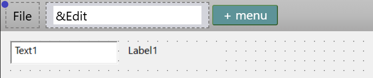

# Menu editor

The menu editor designs the menus of a form on the form itself: you add a menu and its items, type their captions, and move them with the mouse and the keys. The menu editor is not a window of its own. It is the **Form Menu** bar above the form in the designer.

The bar is on a Windows form, an MDI form and a user control. A CustomControls form and a report do not have it. No menu item or key opens the menu editor. The menus are [**Menu**](../../Packages/VB/Menu/) controls, and they belong to the form. The [Toolbox](Toolbox) does not list **Menu**.

{:width="381" height="80"}

## Add a menu

1. Click **+ menu** in the bar. A text box opens in the bar, holding the name of the new control, such as `Menu1`, with all of it selected.
2. Type the caption. <kbd>Enter</kbd> commits it, and <kbd>Esc</kbd> restores the old text. Clicking elsewhere commits it.

A new top-level menu goes to the end of the bar.

The control's **Name** follows the caption while you type it. The name is the caption with every character removed except the letters A to Z in either case, the digits 0 to 9 and the characters above U+00FF. So `Edit Stuff` gives `EditStuff`, and `&File` gives `File`. The accented letters of Latin-1 are dropped, so `&Édition` gives `dition`. An empty result gives `Menu`, and a name that is taken gets the next free number. The name follows the caption only while it still equals the name that the old caption suggested. After you edit the name in PROPERTIES, it stops following.

## Add and arrange items

Click a menu in the bar to open its drop-down, which lists the items. The **+** row at the end of the list adds an item. Click an item to select it. If it has items of its own, its list opens to its right.

- A caption of `-` makes a separator, drawn as a line.
- An `&` in a caption marks the accelerator letter. The editor shows the caption without the `&`, and `&&` shows a literal `&`. The underline is not drawn.
- The shortcut text of an item shows at the right of its row, taken from its **ShortcutId**.
- A tick shows an item whose **Checked** is True, and an arrow an item that has items of its own. A caption is grey with a light shadow when **Enabled** is False, and faded when **Visible** is False.

{:width="393" height="473"}

### The right-click menu of an item

Right-click a menu or an item to open its menu. The labels are in English whatever the IDE language.

| Item | Key | Works on |
|---|---|---|
| **Rename** | <kbd>F2</kbd> | A menu and an item. |
| **Cut**, **Copy** | | A menu and an item. |
| **Paste Before**, **Paste After**, **Paste Into** | | A menu and an item, live only while the clipboard holds one menu item. |
| **Move Left**, **Move Right** | <kbd>Ctrl</kbd>+<kbd>Left</kbd>, <kbd>Ctrl</kbd>+<kbd>Right</kbd> | A menu in the bar. |
| **Move Up**, **Move Down** | <kbd>Ctrl</kbd>+<kbd>Up</kbd>, <kbd>Ctrl</kbd>+<kbd>Down</kbd> | An item in a list. |
| **Toggle Checked** | <kbd>Space</kbd> | An item in a list. |
| **Toggle Enabled**, **Toggle Visible** | | A menu and an item. |
| **Insert Left**, **Insert Right** | | A menu in the bar. |
| **Insert Above**, **Insert Below** | | An item in a list. |
| **Insert Seperator Above**, **Insert Seperator Below** | | An item in a list. The menu spells them that way. |
| **Delete** | <kbd>Delete</kbd> | A menu and an item. |

The keys work while a menu item is selected and the designer has the focus. **Rename** opens the text box in place, with the caption selected, and the **Name** follows what you type. **Cut** removes the item and keeps it on the clipboard. **Paste Into** puts the cut item under the selected menu or item. **Copy** puts one item on the system clipboard as JSON, as a control is copied.

## Set other properties

Everything else about a menu item is a property in [PROPERTIES](Properties): **Name**, **Index**, **Caption**, **Picture**, **Enabled**, **Visible**, **HelpContextID**, **Checked**, **IconSizeX**, **IconSizeY**, **NegotiatePosition**, **ShortcutId**, **Tag** and **WindowList**. **ShortcutId** is a drop-down of 76 values, from `0 - vbShortcutNone` and `1 - vbShortcutCtrlA` on. The menus and the items are in the object drop-down of PROPERTIES as `File    Menu`. A rubber band does not select them.

A double-click on a menu item opens its `Click` handler, and inserts it if it is missing. A double-click on **File**, for example, inserts `Private Sub File_Click()`.

## Menus in a preview

A menu is part of the form. The window of a [preview](Previewing) shows the menus that you designed.

## See Also

- [Designer](Designer) -- the Form Menu bar in the designer window
- [Menu](../../Packages/VB/Menu/) -- the class that a menu item is
- [Properties](Properties) -- the properties of a menu item
