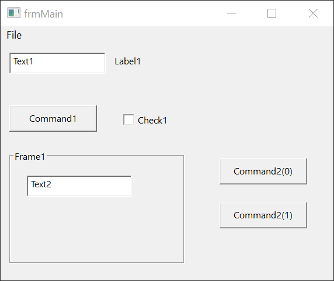

# Previewing a form

Preview runs one form on its own, so that you can try it without starting the whole project. This page describes Preview and the **RESYNC** button, which refreshes a designer from the compiler.

## Preview

Click **PREVIEW** in the toolbar, titled *Launch the form in isolation to test its functionality*, or press <kbd>F6</kbd> while the designer is active. The form opens in a window of its own.

- Preview shows the design as it is on the screen, whether you saved it or not.
- A menu that you designed in the [menu editor](Menu-Editor) shows in the window.
- Preview works for a form and for a report. For a user control or a property page, the button is greyed out and <kbd>F6</kbd> does nothing.
- <kbd>F6</kbd> in the form's code also previews the form.

{:width="381" height="320"}

<!-- SHOT forms-preview-window: the same window with the File menu made in the menu editor open -->

A preview is a debug session. `Form_Load` runs, a breakpoint in it stops the run, a click on a button runs its `Click` handler, and closing the window runs `Form_Unload` and `Form_Terminate` and writes `[DEBUGGER] done.` to the **DEBUG CONSOLE**. [Run Or Preview](../Debugging/Running#run-or-preview) describes what <kbd>F6</kbd> does in each place, and [Breakpoints and stepping](../Debugging/Breakpoints-and-Stepping) what you can do while it is stopped.

The preview of a report opens the report window, titled with the project's name. [Designing reports](../Reports/) describes it.

Preview is the only way to run one form. **Start** (<kbd>F5</kbd>) and **Run → Start** do not use the open designer. They run the program from its startup object, which [Project Settings](../Project-Settings#startup-object) names.

## RESYNC

The designer keeps its own picture of the form, and gets the controls' pictures from the compiler. A **RESYNC** button covers the designer when that picture may be out of date. Pressing it reads the whole form again from the compiler, and keeps the selection.

The button appears in these cases:

- The connection to the compiler closes or fails, for example when the compiler restarts.
- The display scaling of Windows changes. The IDE checks it every 5 seconds.
- The compiler sends a new [Toolbox](Toolbox) list while the designer's tab is hidden.
- A build starts, and the form contains a user control that belongs to the project.

In the last case the IDE presses the button itself at once. It also presses the button when you return to a designer tab that was waiting for a refresh. So you rarely see the button: the form you come back to is already up to date. That includes a form that uses a custom control whose class you changed in its code while the form's tab was open behind it. See [Property sheet and object serialization](../../../Tutorials/CustomControls/Properties).

In Safe Mode, the button says *Can't resync the form designer in Safe Mode*, with the title *Form Designer Resync Failed*.

Changing the grid or the outlines of the form makes the designer read the live form from the compiler again.

## See Also

- [Run Or Preview](../Debugging/Running#run-or-preview) -- what <kbd>F6</kbd> does in a procedure, in a form's code and in a designer
- [Designer](Designer) -- the designer window
- [Menu editor](Menu-Editor) -- the menus that show in a preview
