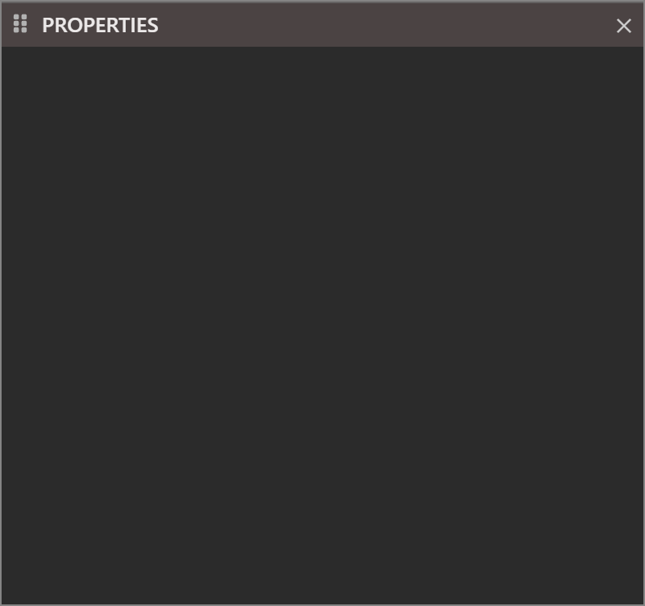

# Properties

The **PROPERTIES** pane shows the properties of the form or the control that is selected in the designer, and lets you change them. It has a second tab, **EVENTS**, that opens the event handlers of a control in the code. This page describes the pane, the editors it uses for each kind of property, and the units of positions and sizes.

{:width="400" height="376"}

Each open designer has a property sheet of its own, and the pane shows the one of the active designer. The pane is empty, as in the picture, while a code tab is active or no project is open. With a designer active and nothing selected, the pane shows the form's own properties.

<!-- SHOT forms-properties-control: PROPERTIES with Command1 selected in the frmMain fixture: the object drop-down at the top, the PROPERTIES and EVENTS tabs, a few category headers, and, with the Left box focused, the description line at the foot; labels with arrows for each part -->

From the top, the pane holds the object drop-down, the **PROPERTIES** and **EVENTS** tabs, the list of properties, and a description line at the foot. The magnifier in the title bar searches the list.

## Choose what to edit

The object drop-down lists the form, every control, and in a report every section. A control shows as its **Name**, or `Name(Index)` in a control array, then its class. After the first two entries the list is sorted by text. Choosing an entry selects it in the designer. The list reaches a control that is hidden, outside the visible part of the form or covered by another control.

Several selected controls show **[MULTI-SELECT]** in the drop-down. The list still holds every control and the form.

### Several controls at once

With several controls selected, the list merges their properties. A property that one of the controls lacks is still listed. A number whose value differs shows 0, and a **Boolean** whose value differs shows an in-between state. Typing a value sets it on every selected control. For example, selecting a **CommandButton** and a **TextBox** and typing a **Width** sets both. **Caption** is listed, because the button has it, and so is **Text**. The **EVENTS** tab is empty.

## Find a property

The list is grouped by category, not alphabetically, and there is no alphabetical view. The groups are **DESIGN**, **BINDINGS**, **DATA**, **APPEARANCE**, **DRAWING**, **BEHAVIOUR**, **MOUSE**, **WINDOW**, **HELP**, **KEYBOARD**, **SCALE**, **LAYOUT**, **GENERAL** and **DDE**. A property the IDE does not know goes into **GENERAL**. Within a group the order is not strictly alphabetical: **Name** comes first under **DESIGN**, and **Caption** or **Text** comes before **ToolTipText**. The **Index** property is not listed for a form, a user control, a property page or a report.

The magnifier opens a search box. The text is a list of parts of property names, separated by commas, and a property matches when its name contains any of them, in either case. The search looks at names, not at values.

A property that is not implemented yet shows an information icon, and its tooltip says *THIS PROPERTY IS NOT YET IMPLEMENTED.  THE VALUE WILL BE IGNORED.*

When the compiler cannot draw a control, a banner with a warning sign and the error text shows at the top of the list. If the CustomControls package is missing, the **DEBUG CONSOLE** says *twinBASIC error: it looks like you haven't added the CustomControls to this project.*

## The editors

A property has the editor that suits its type. A value is committed as the table says.

| Type of property | Editor | Committed |
|---|---|---|
| Text | A text box. Double-click the name to put the caret in the box. | When you press <kbd>Enter</kbd> or leave the box. |
| **Boolean** | A check box and the word `True` or `False`. Double-click the name or the value to switch it. | At once. |
| Numbers | A number box. An **Index** of -1 shows empty. | When you press <kbd>Enter</kbd> or leave the box. |
| Date | A text box that shows the date as text. The text you type is sent as you typed it. | When you press <kbd>Enter</kbd> or leave the box. |
| Enumeration | A drop-down. Double-click the name to step to the next value, going back to the first after the last. | At once. |
| Font name | A drop-down of the installed fonts. | At once. |
| Colour | A swatch and a text box. See [Colours](#colours). | When the picker closes, or when you leave the text box. |
| **Picture**, **Icon**, **MouseIcon** | The text `{N bytes}` and a **...** button that opens a file dialog. A red **X** clears a picture. | After you choose a file. |
| Text with several lines | The first line and a **...** button. It opens **Edit Value (multi-line)** with **OK** and **Cancel**. | When you choose **OK**. |
| **ImageList** | A drop-down of the **ImageList** controls on the form, and `(none)`. | At once. |
| **PropertyPages** | `{ N pages }` and a **...** button. It opens **Select Property Pages**, a list with check boxes and buttons that move a page up and down. | When you choose **OK**. |
| **(Custom)** | `{ PropertyPage }`. A click, or the **...** button, opens the control's own property page. | |
| **AboutBox** | `{ AboutBox }`. A click opens the box. | |
| Gradient fill | A gradient editor. | |
| Object or array | A row with a triangle that expands. The IDE remembers which rows are expanded for each form. An array has a **...** button for a box with one element on each line, a red minus on each element and a `(+)` row that adds an element. | |

If the compiler is busy when you open a property page, the IDE says *Backend compiler seems to be busy. Check there isn't a modal dialog box open behind the IDE window.*

> [!NOTE]
> In twinBASIC BETA 1005, <kbd>Ctrl</kbd>+<kbd>A</kbd> does nothing in a property box. It does not select the text, and the selection of the controls on the form is unchanged. Text that you type is added to the text already in the box.

### Colours

A colour property has a swatch. A click on the swatch, or a double-click on the property's name, opens a colour picker with buttons that confirm and cancel. The picker has no alpha channel. The IDE keeps the last seven colours you chose and offers them in the picker.

The text box beside the swatch holds the colour as `&H` and hexadecimal digits followed by `(BGR)`: blue, green and red, as Windows colours are. A system colour shows in the form `&H8000000F`. A value of -1 shows as `(not set)` for a property that allows it. The colour properties of the CustomControls controls hold alpha too, and their text reads `(ABGR)`.

<!-- SHOT forms-colour-picker: the BackColor row of Command1 with its swatch and the &H text box, the colour picker open over it with its confirm and cancel buttons and the recent colours -->

### The right-click menu of a value

Right-click a value to open a menu with:

- **Copy**, which puts the value on the clipboard as JSON, and **Paste**, which is live when the clipboard holds a value of a compatible type.
- **Copy** *value* **To...**, a submenu that lists every control on the form with a property of the same name and type, as `Control.Property`, or `{ no matches }`. Choosing an entry copies the value to that control.
- **SYSTEM COLORS**, for a colour property: a submenu of the thirty system colour constants, from **vbScrollBars** to **vbMenuBarFlat**.

There is no item that resets a property to its default, and nothing marks a property that still has its default.

<!-- SHOT forms-system-colours: the right-click menu of the BackColor value with Copy, Paste, Copy To... and the SYSTEM COLORS submenu open to the right -->

### What an edit also changes

Some properties change others when you set them:

- Setting **ScaleLeft**, **ScaleTop**, **ScaleWidth** or **ScaleHeight** sets **ScaleMode** to `vbUser`.
- Setting **WhatsThisButton** to True turns **MinButton** and **MaxButton** off and **ControlBox** on.
- Setting **MDIChild** to True sets **StartUpPosition** to the Windows default.
- Setting an **OptionButton**'s **Value** to True clears the others in its container.
- A **Name** that is taken asks whether to make a [control array](Controls#control-arrays).
- A **Windowless** user control cannot also be a container. The IDE says *ERROR: A Windowless control cannot also be a container*.
- A **FramesCount** smaller than the number of frames present is refused.

## The description line

The line at the foot shows a short description of the property, with an information icon, while the property's editor has the focus. It is empty when the focus is elsewhere. Pointing at a name or a value shows the same text as a tooltip. The compiler supplies the text for some properties only. For example, with **Left** focused, the line reads *Adjusts the left position of this control, in pixels, relative to the container*. **Top**, **Width**, **Height**, **Enabled**, **ToolTipText** and **TabIndex** have one too. **Caption**, **Style**, **BackColor** and **Index** have none.

## Events

The **EVENTS** tab lists the events of a control that you can handle. It works with exactly one control selected. With two controls or the form selected, the tab is empty.

Each row is an event. The value reads `Command1_Click() ...` when the code has a handler for it, and `...` when it has none. Click the value, click the **...**, or double-click the name, and the code editor opens the handler. If the handler does not exist, the editor inserts an empty one with the caret in its body, and the tab for the `.twin` file is marked changed. For a member of a control array, the handler takes an `Index As Integer` argument. The same handlers open when you [double-click a control](Controls#open-an-event-handler).

<!-- SHOT forms-events-tab: the EVENTS tab of Command1 with one event that has a handler (Click) and the rest without -->

## Units of position and size

The designer file stores **Left**, **Top**, **Width** and **Height** in pixels at 96 DPI, which the display's scaling does not change. The surface and its readouts are in pixels too. The pane shows these four properties, and **MinWidth**, **MaxWidth**, **X1**, **Y1**, **X2**, **Y2** and the margins and section heights of a report, in the unit that the **ScaleMode** of the control's parent names. A Windows form has `vbTwips` by default, and the pane shows a value 15 times the pixel value. The other units are points, characters, inches, millimetres, centimetres, HiMetric and the form's own units for `vbUser`.

For example, a button at **Left** 10 and **Top** 50 pixels, 100 pixels wide and 30 high, shows 150, 750, 1500 and 450. A form's own **Width** and **Height** are always in twips, so a form 300 pixels wide shows 4500. The pane writes no unit next to the number, and on a form in twips the tooltip of the four position properties says *in pixels*.

A value you type is taken in the same unit. Typing **Left** 450 on that form moves the button to 30 pixels. A font size, **Opacity**, **DrawWidth** and other properties that are not positions show as they are.

> [!NOTE]
> In twinBASIC BETA 1005, the pane shows **Left**, **Top**, **Width** and **Height** of a control on a CustomControls form multiplied by 15, as if the form were in twips, but takes the value you type as pixels. A button at **Left** 20 pixels shows 300. Typing 40 moves it to 40 pixels, and the box then shows 600. Do not type the value the pane shows. Type pixels, as the readouts on the surface show them.

## See Also

- [Working with controls](Controls) -- selecting and moving controls
- [Toolbox](Toolbox) -- the controls you can draw
- [Designer](Designer) -- the form and its grid
- [Controls](../../Controls) -- the properties of each control
- [Anchoring and docking](../../../Features/GUI-Components/Anchoring-Docking) -- the **Anchors** and **Dock** properties
