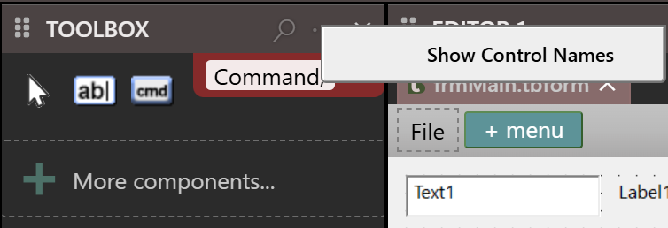
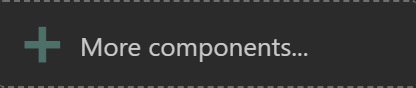

# Toolbox

The **TOOLBOX** pane lists the controls that you can draw on the active designer. You click a tool, and then click or drag on the form to draw the control. This page describes what the list holds, how to search it, and how to add ActiveX controls to it.

## What the list holds

The compiler supplies the list, and the IDE replaces it in every open designer when the project's references change. Each open designer has a Toolbox of its own, and the pane shows the one of the active designer. It is empty while a code tab is active.

A designer lists the controls that suit its kind of form:

- A **CustomControls form** lists the controls of the CustomControls package, such as **WaynesButton** and **WaynesGrid**. See [CustomControls](../../Packages/CustomControls/).
- Every other designer, that is a Windows form, an MDI form, a user control and a property page, lists the Windows controls.
- A report lists only seven tools. See [Designing reports](../Reports/).

The forms themselves are never tools, and neither is **Menu**. A menu is made in the [menu editor](Menu-Editor).

The first group has no title bar. It starts with **Pointer**, the tool for selecting, and then lists the standard controls in a fixed order: **PictureBox**, **Label**, **TextBox**, **Frame**, **CommandButton**, **CheckBox**, **OptionButton**, **ComboBox**, **ListBox**, **HScrollBar**, **VScrollBar**, **Timer**, **DriveListBox**, **DirListBox**, **FileListBox**, **Shape**, **Line**, **Image**, **CheckMark**, **QRCode**, **Data** and **OLE**. Any further controls of the package follow in alphabetical order, such as **MultiFrame**. Every other package that supplies controls gets a group of its own with a title bar, which names the package in capitals. The package **WinNativeCommonCtls** shows as **COMMON CONTROLS**. [Controls](../../Controls) describes the controls.

Each tool is an icon. A tool whose control runs in a separate process shows a small label, **32-bit** or **64-bit**, and a tooltip says that the control is hosted by a separate 32-bit EXE process at run time.

By default the Toolbox shows icons only. The **...** button in the title bar opens a menu with one item, **Show Control Names**, which is ticked while the names are shown. Choosing it saves the IDE option **IDE: Show toolbox icons only** at once. See [IDE Options](../Customising/IDE-Options#form-designer-and-toolbox).

{:width="216" height="791"}

## Use a tool

- Click a tool to select it. The pointer over the designer becomes a cross. Then [draw the control](Controls#draw-a-control).
- Double-click a tool to place the control at once, centred from left to right on the form.
- With the Toolbox focused, <kbd>Left</kbd> and <kbd>Up</kbd> select the previous tool, and <kbd>Right</kbd> and <kbd>Down</kbd> the next.

The tool returns to **Pointer** after each control.

## Search

The magnifier in the title bar opens a search box under it. Typing a printable character with a tool focused opens it too, holding that character. The list narrows as you type. The text is a list of parts of names, separated by commas, and a tool matches when its name contains any of them, in either case. `Command, Text` leaves **Pointer**, **TextBox**, **CommandButton** and **More components**. Groups with no match are hidden. The first group stays.

<kbd>Esc</kbd>, the close button of the box, or an empty box ends the search and shows the whole list.

{:width="377" height="129"}

> [!NOTE] BETA 1010
> A **floating** Toolbox lists every tool when a report is open, 24 controls and **More components**, where the docked Toolbox lists seven. A tool that a report does not allow is refused when you use it, so nothing is lost. Dock the Toolbox, or choose only the seven tools that a report allows.

## Add ActiveX controls and components

The Toolbox has no list of components to pick from and no way to remove a control. ActiveX controls reach it as **COM references** of the project:

1. Choose **More components...** at the end of the Toolbox. It is not shown for a report.
2. In the box, choose **GoTo COM References**. Project Settings opens on the **Available COM References** tab, filtered to the `project.references` setting.
3. Add the reference to the type library that holds the control, as [Project Settings](../Project-Settings#library-references) describes.

A selected ActiveX control has an **ActiveX Properties...** item in its [right-click menu](Controls#the-right-click-menu).

{:width="208" height="44"}

The box says *Components list coming soon!* and that, for now, you must add ordinary COM references to the appropriate ActiveX type library, after which the components appear in the form designer automatically. It has two buttons, **GoTo COM References** and **OK**, which closes it.

{:width="654" height="169"}

[Project Settings](../Project-Settings#library-references) describes the references and the **Available COM References** tab. Package controls such as **WebView2**, **CefBrowser** and the Common Controls appear in groups named for their package, when the project refers to the package and the form is a Windows form. [Packages](../../../Features/Packages/) describes how to add a package.

## See Also

- [Working with controls](Controls) -- drawing and arranging what you chose
- [Properties](Properties) -- the properties of a control
- [Controls](../../Controls) -- every control, one page each
- [Project Settings](../Project-Settings) -- the references
