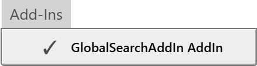
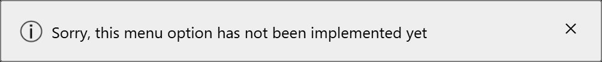
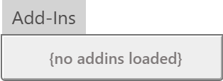

# Add-Ins Menu

The Add-Ins menu lists the add-ins that are loaded. [Add Ins](../../AddIns/) explains where an add-in goes and when it loads. The compiler loads the add-ins, so the list is empty until a project is open.

{:width="219" height="57"}

Each add-in has one item, under its own name, with a tick. A DLL that failed to load is listed too, as *Unknown Addin*. See [When an addin does not load](../../AddIns/#when-an-addin-does-not-load).

The menu cannot switch an add-in off. Choosing an item only shows a floating message, in the IDE's words:

{:width="502" height="52"}

To load a project without its add-ins, hold <kbd>Shift</kbd> while it loads. See [Add-ins that fail to load](../../Troubleshooting/Diagnostic-Tools#add-ins-that-fail-to-load).

With no add-in loaded, the menu holds one greyed-out line.

{:width="158" height="57"}
