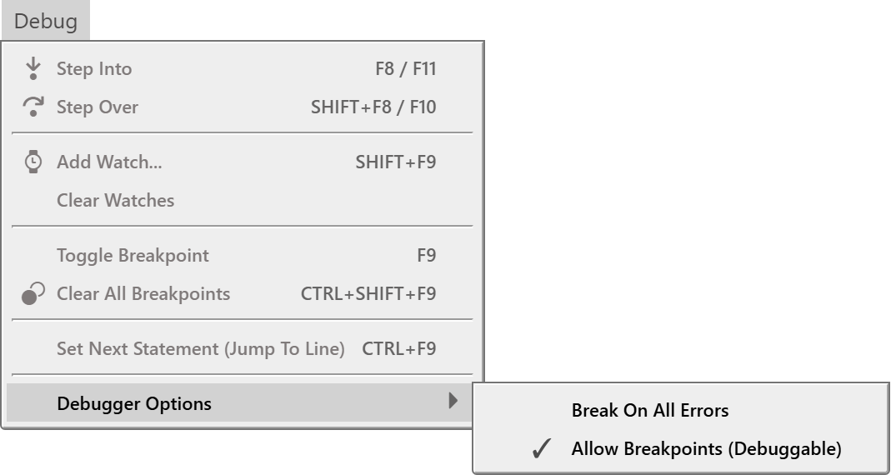
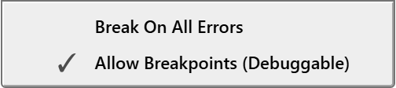

# Debug Menu

The Debug menu holds the commands for stepping through a paused program, for watches and for breakpoints. [Running and debugging](../../Debugging/) explains them.

{:width="291" height="258"}

<!-- SHOT debug-menu-paused: the Debug menu open while the Inventory sample project is paused in TotalPrice, with the editor focused: Step Into, Step Over, Add Watch..., Clear Watches, Toggle Breakpoint, Clear All Breakpoints and Set Next Statement (Jump To Line) all available -->

## Stepping

**Step Into** (<kbd>F8</kbd>, <kbd>F11</kbd>) and **Step Over** (<kbd>Shift</kbd>+<kbd>F8</kbd>, <kbd>F10</kbd>)
: Run the program one statement at a time. They work only while the program is paused. The menu shows the first key of each. There is no **Step Out** item: the toolbar button and the keys <kbd>Ctrl</kbd>+<kbd>Shift</kbd>+<kbd>F8</kbd> and <kbd>Shift</kbd>+<kbd>F11</kbd> do it. See [Step commands](../../Debugging/Breakpoints-and-Stepping#step-commands).

**Set Next Statement (Jump To Line)** (<kbd>Ctrl</kbd>+<kbd>F9</kbd>)
: Makes the line that has the caret the next one to run. It works only while the program is paused. See [Set Next Statement](../../Debugging/Breakpoints-and-Stepping#set-next-statement).

## Watches

**Add Watch...** (<kbd>Shift</kbd>+<kbd>F9</kbd>)
: Opens the **WATCHES** panel with a box for a new expression, filled with the selected text of the editor. It works whenever a project is open. See [Watches](../../Debugging/Inspecting#watches).

**Clear Watches**
: Removes every watch, with no confirmation. It has no key.

## Breakpoints

**Toggle Breakpoint** (<kbd>F9</kbd>)
: Sets or clears a breakpoint at the caret's line. It works when the focus is in a code editor. See [Breakpoints](../../Debugging/Breakpoints-and-Stepping#breakpoints).

**Clear All Breakpoints** (<kbd>Ctrl</kbd>+<kbd>Shift</kbd>+<kbd>F9</kbd>)
: Clears the breakpoints in every file of the project, open or not. It works whenever a project is open.

## Debugger Options

{:width="534" height="285"}

{:width="252" height="56"}

**Break On All Errors**
: Turns the project setting of the [same name](../../Project-Settings#break-on-all-errors) on and off. It is off by default. When it is on, the program stops at an error that an `On Error` statement would handle. See [Break On All Errors and Debuggable](../../Debugging/Breakpoints-and-Stepping#break-on-all-errors-and-debuggable).

**Allow Breakpoints (Debuggable)**
: Turns the project setting [Debuggable](../../Project-Settings#debuggable) on and off. It is on by default. While it is off, no breakpoint stops the program.
