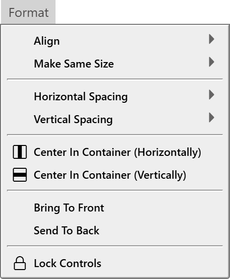
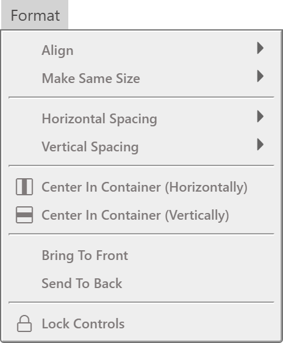

# Format Menu

The Format menu holds the commands that line up and order the controls selected in the form designer. [Arranging controls](../../Forms/Arranging) explains them.

{:width="232" height="281"}

Every command acts on the selection in a form designer, so every command is greyed out until a designer is open with a selection. The commands need different numbers of controls: **Align**, **Make Same Size** and the two spacing submenus need two or more, **Make Equal** three or more, and the other commands one or more. The same commands are in the designer's [right-click menu](../../Forms/Controls#the-right-click-menu).

> [!WARNING] BETA 1007
> The spacing commands and **Make Same Size** can leave the new positions or sizes out of the saved form. [Arranging controls](../../Forms/Arranging) says what to do instead.

{:width="232" height="281"}

## Align

**Left** (<kbd>Alt</kbd>+<kbd>Left</kbd>), **Right** (<kbd>Alt</kbd>+<kbd>Right</kbd>), **Top** (<kbd>Alt</kbd>+<kbd>Up</kbd>) and **Bottom** (<kbd>Alt</kbd>+<kbd>Down</kbd>)
: Move every selected control to the leftmost, rightmost, topmost or lowest edge of the selection. See [Align](../../Forms/Arranging#align).

**Center (Horizontal)** and **Center (Vertical)**
: Centre each control on the left edge, or the top edge, of the selection. They have no keys. See [Align](../../Forms/Arranging#align).

**To Grid**
: Rounds the position and the size of each selected control down to the grid, whether or not **Align Controls To Grid** is on. It has no key. The right-click menu has **Align to grid**, which works for one control.

## Make Same Size

**Width (Widest)** (<kbd>Ctrl</kbd>+<kbd>Shift</kbd>+<kbd>Right</kbd>), **Width (Narrowest)** (<kbd>Ctrl</kbd>+<kbd>Shift</kbd>+<kbd>Left</kbd>), **Height (Tallest)** (<kbd>Ctrl</kbd>+<kbd>Shift</kbd>+<kbd>Down</kbd>) and **Height (Shortest)** (<kbd>Ctrl</kbd>+<kbd>Shift</kbd>+<kbd>Up</kbd>)
: Give every selected control the width or the height of the widest, narrowest, tallest or shortest one. See [Make the controls the same size](../../Forms/Arranging#make-the-controls-the-same-size).

## Horizontal Spacing and Vertical Spacing

**Make Equal**
: Places the controls between the first and the last so that the gaps are equal. It needs three controls.

**Increase** and **Decrease**
: Widen or narrow every gap by one grid width. The vertical commands use the grid height.

**Remove**
: Places each control against the one before it, with no gap.

The eight spacing commands, four on each submenu, have no keys. See [Space the controls evenly](../../Forms/Arranging#space-the-controls-evenly).

## Center In Container

**Center In Container (Horizontally)** and **Center In Container (Vertically)**
: Move the selection as a group to the middle of the container the controls share. They have no keys. See [Center in the container](../../Forms/Arranging#center-in-the-container).

## Order and lock

**Bring To Front** and **Send To Back**
: Move the selected controls to the top or the bottom of the order in which their parent draws them. They have no keys. See [Bring to front and send to back](../../Forms/Arranging#bring-to-front-and-send-to-back).

**Lock Controls**
: Locks each selected control that is unlocked, and unlocks each one that is locked. It has no key. See [Lock controls](../../Forms/Designer#lock-controls).
