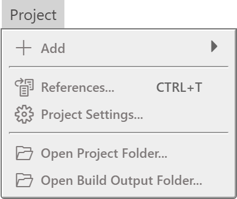

# Project Menu

The Project menu holds the commands that add to the project, change its references and settings, and open its folders. [Projects and files](../../Projects/) explains them.

{:width="200" height="169"}

Every command needs an open project, and is greyed out until one is.

## Add

**Add**
: Opens the submenu of things to add: a folder, forms and other designers, modules and classes, other files, imports and three resources. It lists the same items as the **Add** entry of the right-click menu of the Project Explorer. See [Adding files](../../Projects/Adding-Files).

## References and settings
{: index_also="add reference" }

**References...** (<kbd>Ctrl</kbd>+<kbd>T</kbd>)
: Opens [Project Settings](../../Project-Settings) with the filter `project.references`, so that only the **Library References** section shows. See [References and packages](../../Projects/References-and-Packages).

**Project Settings...**
: Opens the whole [Project Settings](../../Project-Settings) dialog. It has no key.

## Folders

**Open Project Folder...**
: Opens the folder of the project's `.twinproj` file in Windows Explorer. For a project that has no file yet, it shows the notification **Project is not yet saved.  Please save the project first.** It has no key.

**Open Build Output Folder...**
: Opens the folder of the file that the [Build Output Path](../../Project-Settings#build-output-path) names. It does not create the folder, and it gives the same notification when the project has no file or no build output path. It has no key.

See [Open a folder](../../Projects/Saving-and-Exporting#open-a-folder).
