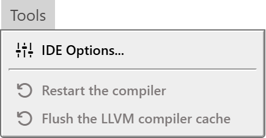

# Tools Menu

{:width="217" height="113"}

- **IDE Options...** --- opens the **IDE Options** dialog, which holds the IDE's 31 options. The command has no default key. [IDE Options](../../Customising/IDE-Options) describes the dialog, with its picture, and every option.
- **Restart the compiler** --- ends the compiler and starts a new one, which compiles the project again and loads the add-ins afresh.
- **Flush the LLVM compiler cache** --- clears the cache of code compiled with [LLVM](../../../../LLVM/Getting-Started), so that the next build compiles everything.
