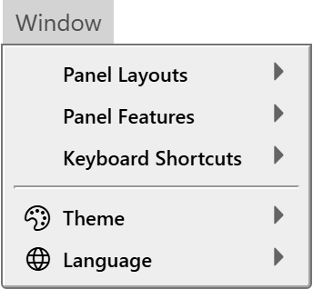

# Window Menu

The Window menu sets how the IDE is arranged and how it looks: its panel layouts, what can be done to panels, its keyboard shortcuts, its theme and its language. [Customising the IDE](../../Customising/) explains each entry.

{:width="172" height="159"}

## Panel Layouts

Switches the arrangement of the panels, and saves and manages arrangements. See [Panel layouts](../../Customising/Panel-Layouts).

- **Default Built-in Layout** --- <kbd>Ctrl</kbd>+<kbd>#</kbd>. Restores the arrangement the IDE starts with.
- **Full Screen Editor Layout** --- docks only the toolbar, the Toolbox, the Editor and Properties, and gives the Editor most of the room.
- **Custom Layout (Unsaved)** --- shown, and ticked, while none of the named layouts is in use.
- **Custom** *n*. *name* --- one item for each saved layout. A tick marks the layout in use.
- **Save Current Panel Layout As...** --- saves the current arrangement under a name.
- **Manage Panel Layouts...** --- adds layouts, deletes them and edits them as text.

### Manage Panel Layouts...

Opens a dialog that lists the built-in layouts, which are read-only, and the saved ones. See [Manage layouts](../../Customising/Panel-Layouts#manage-layouts).

## Panel Features

Five switches decide what can be done to panels. A tick means the action is allowed. See [Panel Features](../../Customising/Panel-Layouts#panel-features).

## Keyboard Shortcuts

Switches groups of keyboard shortcuts on and off. See [Keyboard shortcuts](../../Customising/Keyboard-Shortcuts).

- **Default Built-in Keyboard Shortcuts** --- always ticked. The group cannot be switched off.
- **Custom** *n*. *name* --- one item for each group that has been created. A tick means the group is on.
- **Manage Keyboard Shortcuts...** --- creates, edits and deletes groups.

### Manage Keyboard Shortcuts

Opens a dialog that lists the built-in group, which is read-only, and the groups that have been created, and shows each as JSON text. See [Manage keyboard shortcuts](../../Customising/Keyboard-Shortcuts#manage-keyboard-shortcuts) and [The text of a group](../../Customising/Keyboard-Shortcuts#the-text-of-a-group).

[Keyboard shortcuts](../Keyboard-Shortcuts) lists the built-in group in tables.

## Theme
{: index_also="dark mode" }

Lists the themes and switches between them. See [Themes](../../Customising/Themes).

- **Aurora (Dark)**, **Classic (Light)**, **Dark**, **High Contrast Dark (Dark)**, **High Contrast Light (Light)** and **Light** --- the six themes that ship with the IDE. A tick marks the theme in use.
- Any theme added as a `.theme` file is listed after these, as its file name and its family, such as **Red (Light)**.
- **Reload from disk** --- reads the theme files again, so that a new or edited file takes effect without restarting the IDE.

## Language

Lists the language packs and switches between them. The choice applies at once. The names are listed, with what changes and what stays in English, under [The language of the IDE](../../Customising/#the-language-of-the-ide).
