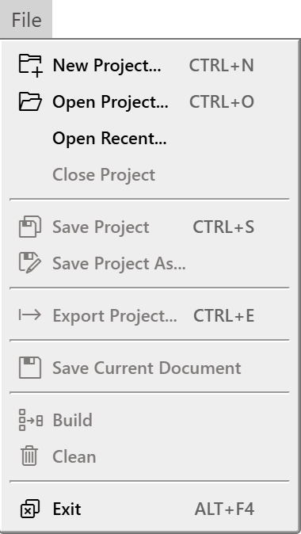
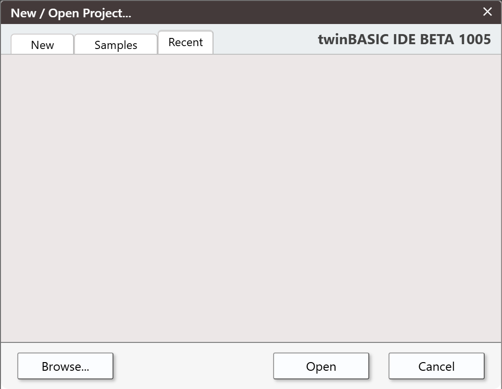

# New Project

{:width="970" height="728"}

{:width="190" height="337"}

Shortcut: <kbd>Ctrl</kbd>+<kbd>N</kbd>

The dialog lists its sections down the left, each with the number of entries it holds: **New**, **Samples**, **Recent**, and **Recent (VB6)**, which shows only when the machine has a VB6 history and lists the `.vbp` files VB6 opened recently. Double-click an entry, or select it and press <kbd>Enter</kbd> or **Open**, to open it; <kbd>Up</kbd> and <kbd>Down</kbd> move the selection. The search box at the top looks in every section at once: it lists the entries whose name or path holds every word typed, grouped by section, with the matching text marked, and <kbd>Esc</kbd> empties it. **Browse...** opens the Windows **Open** dialog, as **File → Open Project...** does.

## Options
{: index="standard exe; create an ActiveX DLL; create ActiveX DLL" index_also="create a DLL project; create dll project; create a dll; create dll" }

- Standard EXE
- ActiveX Control
- ActiveX DLL
- Standard DLL
- Standard EXE (+VBCCR)
- Standard EXE (Console App)
- Import from VBP...
- [Import from folder...](#import-from-folder)

Browse \| Open \| Cancel

## Import from folder

Opens a project from a folder of source files, such as the folder that **File → Export Project** writes. It shows a *Browse For Folder* dialog titled *Select folder of the existing twinBASIC project...*: choose the folder that holds the project's `Settings` file.

The project opens with no `.twinproj` file behind it: it is unsaved, and marked as changed. Because it has no file, the first **Save Project** (<kbd>Ctrl</kbd>+<kbd>S</kbd>) opens the *Save As* dialog to ask for one. The folder it is saved in becomes `${SourcePath}`, which the project's [*Export Path*](../Project-Settings#export-path) may use.

If the folder holds the compiler packages under `Packages`, as an export by the IDE does, delete their folders first: imported with them, the project gets a copy of them that the compiler does not use. See [Packing the export back into a project](../Projects/Saving-and-Exporting#packing-the-export-back-into-a-project). [Keeping a project in Git from the IDE](../../../Features/Packages/Import-Export-Tool#keeping-a-project-in-git-from-the-ide) uses this command to open a fresh clone.

## Samples

{:width="970" height="728"}

Each card shows its sample's name without its number. The cards are in the order of the numbers, by which the documentation names the samples (*Sample 6*, CustomControls). The numbering is the IDE's own: **1a** and **1b** sit between **1** and **2**.

- **0.** Reports (Experimental)
- **1.** HelloWorld
- **1a.** WebView2 Examples
- **1b.** Chromium Embedded Framework Examples
- **2.** GetIPAddresses
- **3.** MyCodeLibrary
- **4.** MyVBEAddin (NEW with ToolWindow)
- **5.** MyCOMAddin
- **6.** CustomControls
- **7.** Package
- **8.** FilePropertyViewer (CustomControls)
- **9.** ActiveX Control WebView2 + Monaco
- **10.** twinBASIC IDE Addin
- **11.** twinBASIC IDE Addin (Chart)
- **12.** twinBASIC IDE Addin (Monaco)
- **13.** twinBASIC IDE Addin (ListView)
- **14.** twinBASIC IDE Addin (VirtualListView)
- **15.** twinBASIC IDE Addin (GlobalSearch)
- **16.** twinBASIC IDE Addin (TODO Widgets demo)
- **17.** Static Library Example (SQLITE3)
- **18.** Static Library Example (libdeflate)
- **19.** MDI Forms
- **20.** TreeView + ListView + ImageList
- **21.** Windows Service Simple Example
- **22.** Windows Service Complex Example (inc Event Logging and IPC)
- **23.** OOP Inheritance Example (Animals)

## Recent

If no project has been opened, or every entry has been removed, the section reads **Nothing here yet.** and **Open** is greyed out.

{:width="970" height="728"}

Otherwise each recently opened project is a row that shows its path.

{:width="970" height="728"}

_Removed paths_

Click the X at a row's right edge to remove the project from the list.
