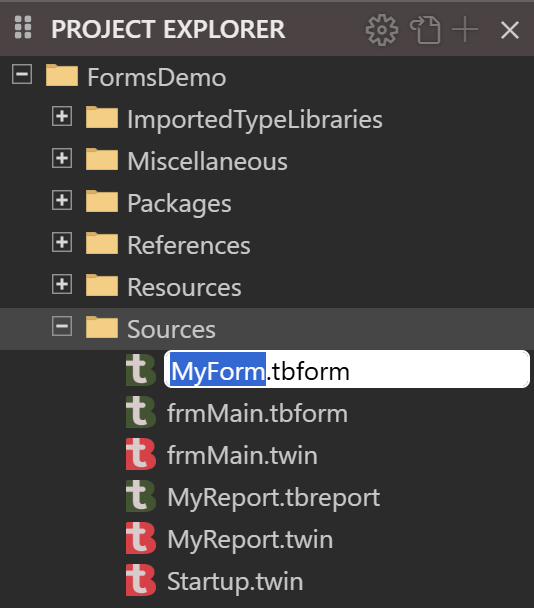
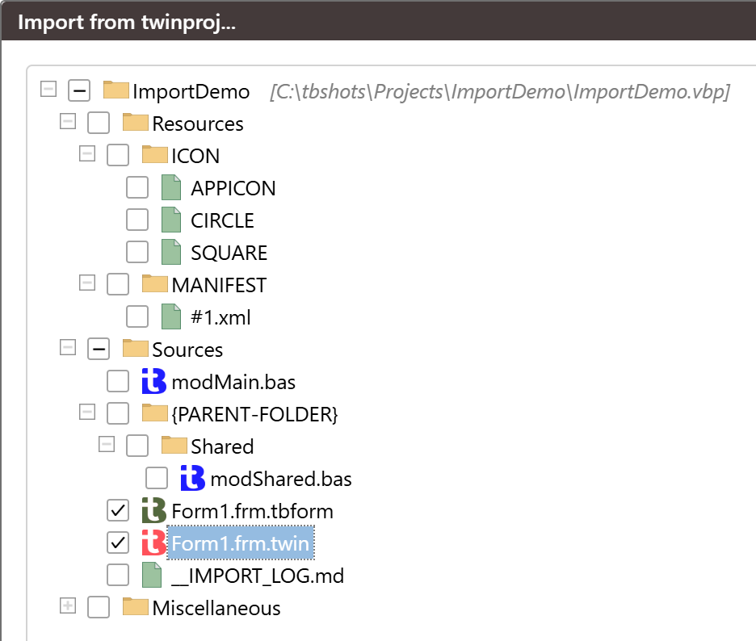
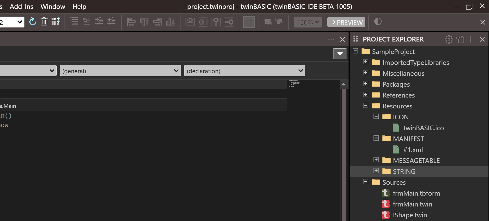
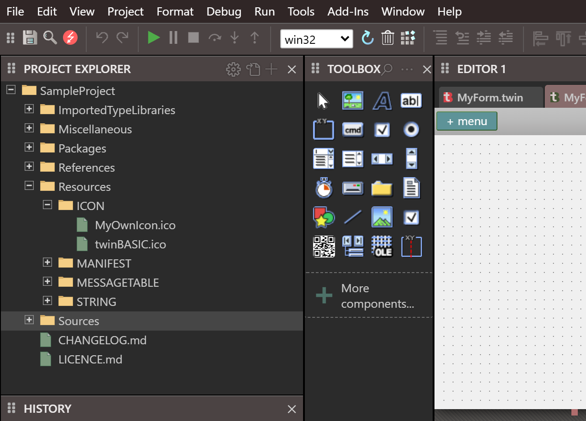
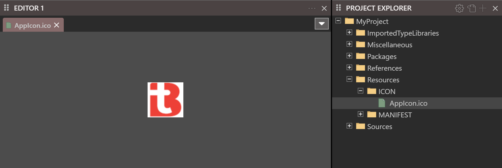
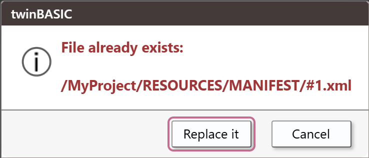
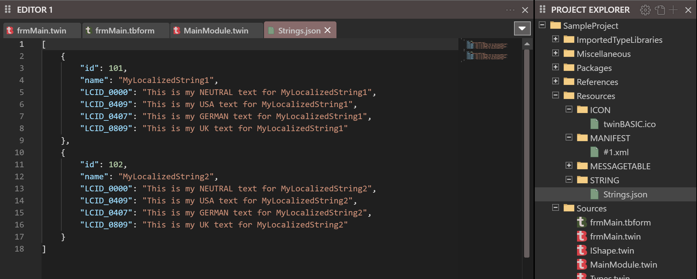

# Adding files

The **Add** menu makes new files and folders in the project, imports files from disk, and adds the three kinds of resource that the IDE has templates for. This page describes the menu, how a new file is named and placed, what each template holds, how **Import** works, and how resources are managed.

## The Add menu

The **Add** menu opens in three ways, and the three lists are the same.

- Right-click a row of the **PROJECT EXPLORER** and choose **Add**. The submenu opens when you point at the item.
- Choose the **Add...** button in the title bar of the panel.
- Choose **Project → Add**.

{:width="510" height="492"}

Choosing an item from the object view switches the panel to the file view first, because the new file appears in the tree.

| Item | Creates | The name box starts with |
|---|---|---|
| **Add Folder** | A folder. | `MyFolder` |
| **Add Windows Form**, **Add Windows MDI Form**, **Add Windows UserControl**, **Add Windows PropertyPage**, **Add Windows Report**, **Add CustomControls Form**, and **Add** *name* **Form** for each kind of form that a package supplies | A designer file and a `.twin` file with the same name. [Designer](../Forms/Designer#add-a-form) describes them, and [Designing reports](../Reports/) the report. | `MyForm`, `MyUserControl`, `MyPropertyPage` or `MyReport` |
| **Add Module (.TWIN supporting Unicode)** | `MyModule.twin`, a module in a file that can hold any Unicode text. | `MyModule` |
| **Add Class (.TWIN supporting Unicode)** | `MyClass.twin`, a class in a file that can hold any Unicode text. | `MyClass` |
| **Add Module (.BAS)** | `MyModule.bas`, a module in the VB6 file format. | `MyModule` |
| **Add Class (.CLS)** | `MyClass.cls`, a class in the VB6 file format. | `MyClass` |
| **Add Other File** | An empty file, with the name you type. | `MyFile`, with no extension |
| **Import...** | Files copied from disk. See [Import](#import). | |
| **Add Resource: Visual Styles Manifest**, **Add Resource: String Table**, **Add Resource: MESSAGETABLE** | A resource file. See [Resources](#resources). | None: no name box opens |

The items for the Windows forms and for the CustomControls form are always listed, whether or not the project refers to the package they need. If it does not, a box asks to add the package first. See [Package needed](References-and-Packages#package-needed).

## Name the new file

Choosing an item that makes a file opens a name box in the tree, in the row where the file will appear. It holds the default name with the name part selected, such as `MyModule.twin` with `MyModule` selected.

{:width="267" height="304"}

- Type a name and press <kbd>Enter</kbd> to create the file. <kbd>Esc</kbd>, or an empty box, creates nothing.
- You can type the extension or leave it out. A trailing `.twin`, `.bas` or `.cls` is cut off, and the extension of the item is used.
- If the default name is taken, the box offers `MyModule2.twin`, `MyModule3.twin` and so on. The count is for the folder the file goes into.
- The new file opens at once in a normal tab, not a preview tab.

A name is refused when it is empty, begins with a period, contains one of `\ / : * ? " < > |`, or is the name of a file or folder already in the folder. The box turns red while you type such a name, and <kbd>Enter</kbd> creates nothing and shows the notification **Cannot create: the new name entered is invalid.** The name is compared with its extension, so `Legacy.twin` can sit beside `Legacy.bas`.

A name that contains a space is written in square brackets in a `.twin` file, as `Module [My Module]`. In a `.bas` or `.cls` file it goes unchanged into the `Attribute VB_Name` line.

### Where the new file goes

The new file goes into the selected folder, or into the folder of the selected file. A folder that is collapsed opens. Two cases differ:

- A file of a code kind, which means a `.twin`, `.bas` or `.cls` file or a designer file, goes into `Sources` if the selection is not inside `Sources`. That includes a selection in `Resources`, and the project's own row.
- With nothing selected, a new file or folder goes into `Sources`.

**Add Folder** and **Add Other File** are not moved to `Sources`: a file made with **Add Other File** while a file in `Resources/CUSTOM` is selected is made in `Resources/CUSTOM`.

> [!NOTE] BETA 1005
> **Add Other File**, and **Paste**, in the `Packages` folder create nothing. The notification says *cannot create files inside the root resources folder*, which names the wrong folder. A file that was cut and then pasted there is deleted: see [Cut, copy and paste](Files-and-Folders#cut-copy-and-paste).

## What the new files hold

A `.twin` module or class holds a few lines:

```tb
Module MyModule

	' add your procedures here

End Module
```

```tb
Class MyClass

	' add your member fields and procedures here

End Class
```

A `.bas` module holds `Attribute VB_Name = "MyModule"` and a comment line. A `.cls` class holds the header of a VB6 class module, the properties `MultiUse`, `Persistable`, `DataBindingBehavior`, `DataSourceBehavior` and `MTSTransactionMode`, and `Attribute VB_Name = "MyClass"`, with the attributes `VB_GlobalNameSpace`, `VB_Creatable`, `VB_PredeclaredId` and `VB_Exposed`, then a comment line.

The `.twin` files are written as UTF-8 with Windows line endings. The `.bas` and `.cls` files are written in the ANSI code page of Windows, and so can hold only the characters of that code page. **Add Other File** creates an empty file.

## Import

**Import...** opens the Windows **Open** dialog. It accepts several files at once. What the IDE does with each file depends on its extension.

### Ordinary files

A file with any extension but the three below is copied into the project unchanged. It goes into the selected folder, or the folder of the selected file, or `Sources` if nothing is selected. The IDE does not ask when a file of the same name is there already: the new file replaces it.

> [!WARNING] BETA 1005
> Importing a file with the name of a file already in the project crashes the compiler, whether or not the file is open. The Debug Console prints `NATIVE EXCEPTION: ACCESS_VIOLATION`, and the IDE restarts the compiler. When the file is open in a tab, the project then holds the imported text, but the tab keeps the old text. If you edit the tab and press <kbd>Ctrl</kbd>+<kbd>S</kbd>, the old text with your edit is saved over the import. Close the tab of a file before you import a file with its name.

### Projects and packages

A file with the extension `.twinproj`, `.twinpack` or `.vbp` is not copied. The IDE reads it and opens the dialog **Import from twinproj...**, which lists what the file holds, as a tree with a check box on every entry. A VB6 project is listed with its files already converted: `Form1.frm.tbform` and `Form1.frm.twin` for a form. Tick both.

{:width="468" height="397"}

The tree shows the project's folders and files but not its `Packages`, `Settings`, `References` and `ImportedTypeLibraries` entries, and not the `.meta` file. Ticking a folder ticks everything in it. Ticking a file leaves its folders part-ticked. The **Import** button is hidden until something is ticked. Click the box of a row, or double-click the row, to tick it.

**Import** writes each ticked file at the same path in the current project, and makes the folders for it. A file already at that path is replaced with no question. If the import fails, a box says **Import failed. Please check the DEBUG CONSOLE for details of the errors that occurred.**

> [!WARNING] BETA 1005
> Importing a project's files replaces a file of the same path without a question, and closes the tab open on it first. Unsaved changes in that tab are lost, and so is the saved copy of the file, because the import also saves the project. Do not tick a file whose path is already in your project.

This is for taking files from another project. To open a whole VB6 project as a new twinBASIC project, use **File → Open Project...** on its `.vbp`, or the **Import from VBP...** and **Import from folder...** tiles of the [New Project](../Project/New) dialog. The [FAQ](../../../FAQ#vb6-import) describes the VB6 import. A package is added as a package in [Project Settings](References-and-Packages#available-packages), not here.

### The project is saved

When every file of the command is done, the IDE saves the project, as if you had pressed <kbd>Ctrl</kbd>+<kbd>S</kbd>. For a project with no file yet, the **Save As** dialog opens instead. Cancelling it leaves the file imported and the project unsaved.

> [!NOTE] BETA 1005
> An import saves the project, with the unsaved changes of every open editor, although you did not ask for a save. **Cancel** in the **Import from twinproj...** dialog does the same, and then the IDE restarts its compiler.
## Resources

A resource is a file that the build embeds in the program, such as an icon, a bitmap, a manifest or a table of strings. The resources are in the `Resources` folder, in a subfolder named for the resource's type. A new Standard EXE project has `Resources/ICON/twinBASIC.ico`. A project that uses Visual Styles also has a `MANIFEST` folder. The `STRING` and `MESSAGETABLE` folders appear when you add those resources.

{:width="940" height="426"}

The IDE has no resource editors. An icon, a bitmap, a cursor, another image or a PDF opens in a read-only [preview tab](Project-Explorer#what-a-click-opens), and every other resource opens as text. The version information of the program is not a file: it is the **VERSION Resource** section of [Project Settings](../Project-Settings#version-resource).

{:width="642" height="461"}

{:width="898" height="302"}

The compiler decides which folder names are resource types. The [FAQ](../../../FAQ#resources) lists them. To add a resource of another type, make a folder with its name under `Resources`: choose **Add Folder** with `Resources` selected. Then select the new folder and use **Import...**. A file that is imported over a resource of the same name replaces it.

The [FAQ](../../../FAQ#app-icon) describes how the program gets its icon, from the [Icon Form](../Project-Settings#icon-form) setting or from `Resources/ICON`.

### The three resource items

**Add Resource: Visual Styles Manifest**, **Add Resource: String Table** and **Add Resource: MESSAGETABLE** each write one file into `Resources`, make its folder if it is missing, and open it in a tab. They ignore what is selected, and they ask for no name. The files are written with Unix line endings.

If the file exists already, a box says **File already exists:** and gives the path. **Replace it** writes the template over the file and selects its tab. **Cancel** selects the tab of the existing file.

{:width="369" height="158"}

### Visual Styles Manifest
{: index="visual styles" }

An application manifest is an XML file that Windows reads when it starts the program. The one this command adds declares a dependency on version 6 of the Windows Common Controls, so that the program's buttons, lists and other controls are drawn in the current Windows visual style rather than the classic one. It is stored as resource `#1` in the project's `MANIFEST` resource folder, and the build embeds it in the program.

The file is `Resources/MANIFEST/#1.xml`.

```xml
<?xml version="1.0" encoding="UTF-8" standalone="yes"?>
<assembly xmlns="urn:schemas-microsoft-com:asm.v1" manifestVersion="1.0">
   <assemblyIdentity
      type="win32"
      processorArchitecture="*"
      name="My_twinBASIC_Application"
      version="1.0.0.0"
   />
   <description>Application description here</description>
   <dependency>
      <dependentAssembly>
         <assemblyIdentity
            type="win32"
            processorArchitecture="*"
            name="Microsoft.Windows.Common-Controls"
            version="6.0.0.0"
            publicKeyToken="6595b64144ccf1df"
            language="*"
         />
      </dependentAssembly>
   </dependency>
</assembly>
```

### String Table

A string table holds named strings, each with a text for every language. The IDE edits it as JSON. The file is `Resources/STRING/Strings.json`, and the template holds two example strings.

{:width="1040" height="417"}

```json
[
    {
        "id": 101,
        "name": "MyLocalizedString1",
        "LCID_0000": "This is my NEUTRAL text for MyLocalizedString1",
        "LCID_0409": "This is my USA text for MyLocalizedString1",
        "LCID_0407": "This is my GERMAN text for MyLocalizedString1",
        "LCID_0809": "This is my UK text for MyLocalizedString1"
    },
    {
        "id": 102,
        "name": "MyLocalizedString2",
        "LCID_0000": "This is my NEUTRAL text for MyLocalizedString2",
        "LCID_0409": "This is my USA text for MyLocalizedString2",
        "LCID_0407": "This is my GERMAN text for MyLocalizedString2",
        "LCID_0809": "This is my UK text for MyLocalizedString2"
    }
]
```

### MESSAGETABLE

A message table holds events and categories, each with an identifier, a name and a text. The file is `Resources/MESSAGETABLE/Strings.json`, and the template holds four events of a service and one category.

```json
{
    "events": 
    [
        {
            "id": -1073610751,
            "name": "service_started",
            "LCID_0000": "%1 service started"
        },
        {
            "id": -1073610750,
            "name": "service_startup_failed",
            "LCID_0000": "%1 service startup failed"
        },
        {
            "id": -1073610749,
            "name": "service_ended",
            "LCID_0000": "%1 service ended"
        },
        {
            "id": -1073610748,
            "name": "service_stopping",
            "LCID_0000": "%1 service stopping"
        }
    ],
    "categories": 
    [
        {
            "id": 1,
            "name": "status_changed",
            "LCID_0000": "Status Changed"
        }
    ]
}
```

## See Also

- [Project Explorer](Project-Explorer) -- the tree where the new files appear
- [Files and folders](Files-and-Folders) -- rename, move, copy and delete
- [References and packages](References-and-Packages) -- adding a library or a package to the project
- [Designer](../Forms/Designer#add-a-form) -- the form, user control and property page items
- [Project menu](../Reference/Menu/Project) -- the menu that has **Add**
