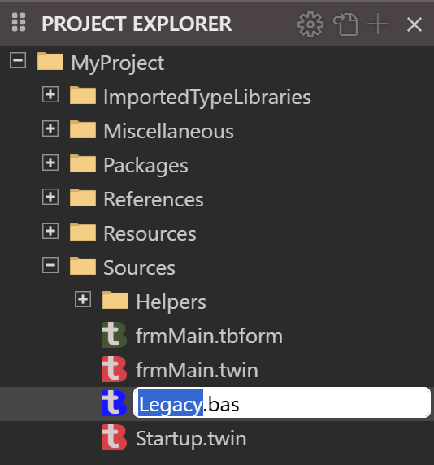
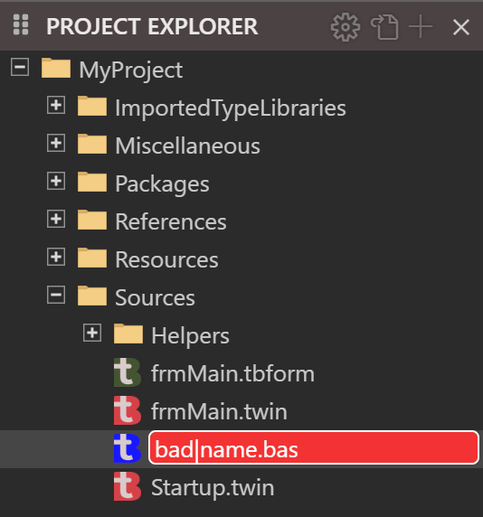
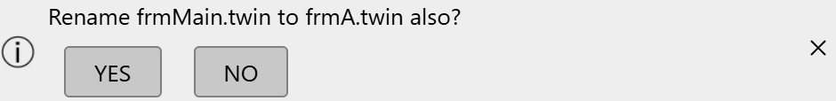
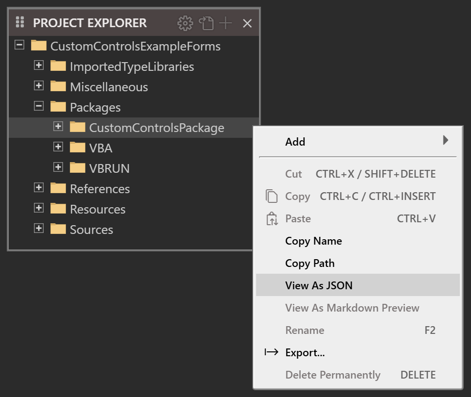
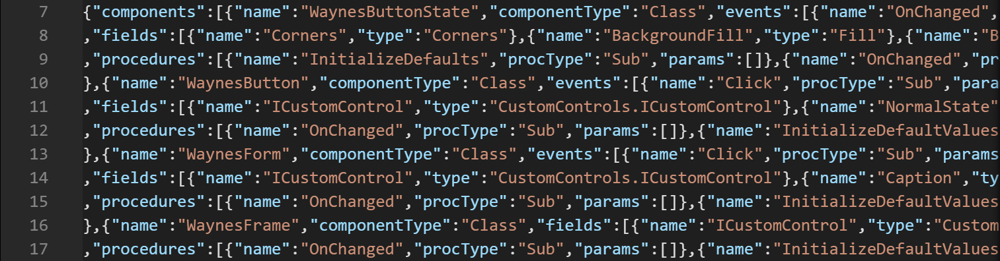

# Files and folders

The right-click menu of the **PROJECT EXPLORER** holds the commands that change the files of a project. This page describes the menu, and then each command in turn: renaming, moving, copying, exporting and deleting. [Adding files](Adding-Files) describes the **Add** item.

The commands that change files change the project in memory. Nothing reaches the `.twinproj` file until the project is [saved](Saving-and-Exporting#save-project), by you or, in a few cases, by the IDE itself (see [Other commands that save](Saving-and-Exporting#other-commands-that-save)). None of the commands can be undone.

## The right-click menu

A right click on a row opens the menu for the rows selected. A right click on a row that is not selected selects it first. A right click on the empty space below the tree opens the menu with nothing selected, and then only **Add** and **Export...** are available.

{:width="218" height="273"}

An item that does not apply is greyed out, not hidden. The keys work when the tree has the focus in the file view.

**Add**
: Opens a submenu of the things that can be added. See [Adding files](Adding-Files).

**Cut** (<kbd>Ctrl</kbd>+<kbd>X</kbd>, <kbd>Shift</kbd>+<kbd>Delete</kbd>), **Copy** (<kbd>Ctrl</kbd>+<kbd>C</kbd>, <kbd>Ctrl</kbd>+<kbd>Insert</kbd>) and **Paste** (<kbd>Ctrl</kbd>+<kbd>V</kbd>)
: Move or copy files inside the project. They work on files only. **Cut** is greyed out when a folder or a read-only row is selected, and **Paste** when the clipboard holds nothing the IDE put there. See [Cut, copy and paste](#cut-copy-and-paste).

**Copy Name** and **Copy Path**
: Put the names, or the IDE paths, of the selected rows on the clipboard as text. Several are joined with a semicolon. A path is written as `/<ProjectName>/Sources/Startup.twin`. It is the IDE's path, not a path on disk.

**View As JSON** and **View As Markdown Preview**
: Open a read-only copy of a file in a tab, as JSON text or as a rendered Markdown preview. See [View as JSON](#view-as-json-and-markdown-preview).

**Rename** (<kbd>F2</kbd>)
: Changes the name of a file, folder or the project. See [Rename](#rename).

**Export...**
: Writes the selected rows to a folder on disk. See [Export a file](#export-a-file).

**Delete Permanently** (<kbd>Delete</kbd>)
: Removes the selected rows from the project. See [Delete](#delete).

**Cut**, **Rename** and **Delete Permanently** are greyed out when any selected row is read-only, as the files of a package are. The menu has no item that duplicates a file, and none that opens a file's folder in Windows Explorer. **Project → Open Project Folder...** opens the folder of the `.twinproj` file.

## Rename

Select a row and press <kbd>F2</kbd>, or choose **Rename**. A text box replaces the name in the row, with the name selected up to the last period, or all of it for a name with none. Typing checks the name at every key, and the box turns red when the name is not allowed. <kbd>Enter</kbd>, or a click anywhere else, renames the file. <kbd>Esc</kbd> leaves the name as it was.

{:width="267" height="286"}

{:width="267" height="286"}

A name is refused, with a notification in the corner of the window, when it:

- is empty, or begins with a period, or ends with a period or a space;
- contains any of `\ / : * ? " < >` or `|`;
- is the same as the current name, or differs from it only in case;
- is the name of another entry in the same folder, in any case.

The notification reads **Cannot rename: the new name entered is invalid.** The seven special folders, `Settings`, `Sources`, `Resources`, `References`, `Packages`, `Miscellaneous` and `ImportedTypeLibraries`, cannot be renamed at all: the notification is **Cannot rename: permission denied.**

> [!NOTE] BETA 1005
> A rename that changes only the case of a name, or nothing, is refused with the same message as an invalid name, so `legacy.bas` cannot be changed to `Legacy.bas` in the tree.

If the file is open in a tab with changes you have not saved, the IDE refuses the rename and shows a box, **Rename/Move failed. Please close the following editors that are preventing the operation:**, with the paths of the files. The same box appears for a folder that holds such a file. Save the file, or close its tab, and rename again. A tab on a file with no unsaved changes does not stop the rename. The tab closes, and the IDE does not open it again under the new name. Bookmarks move with the file.

### A form and its code

A form's designer file and its `.twin` file belong together. After you rename one, the IDE shows a notification, **Rename** *the partner* **to** *the new name* **also?**, with **YES** and **NO** buttons. **YES** renames the partner as well. **NO** leaves it. The question comes whichever of the two you rename. It does not come when the base names of the two files already differ. The class named inside the `.twin` file does not change either way: edit it in the code.

{:width="470" height="57"}

### The project

The top row of the tree is the project. Renaming it changes the **Project Name** setting in the `Settings` file. The row, the title bar and the `.twinproj` file keep their names. A name that is not a valid project name gives **Cannot rename the project: the new name entered is invalid.**

> [!NOTE] BETA 1005
> Renaming the project also saves it, with the unsaved edits of the open editors, and the title bar's changed mark goes.

## Move a file or folder by dragging

Drag a row, or the selected rows, onto a folder. The folder under the pointer is highlighted while you drag. The rows move into the folder at once. The IDE does not ask, and the move cannot be undone. A drop on a file, or on the row itself, does nothing.

- A form's designer file moves without its `.twin` file, and the other way round, unless both are selected.
- A file with unsaved changes in an open tab is not moved. The box **Rename/Move failed** appears, as it does for a rename.
- The `Resources` folder accepts a dropped file, although **Paste** refuses to put one there.
- A file dragged in from Windows is not accepted.

> [!WARNING] BETA 1005
> Dragging a folder onto one of its own files, or onto one of its own subfolders, is accepted with no message. The tree then nests the folder inside itself, about fifty levels deep. The next <kbd>Ctrl</kbd>+<kbd>S</kbd> prints the green `[DONE]` line in the Debug Console, and then an error, and it writes a project file that the IDE cannot open: opening it stops at *Please wait... 25.0%*. Never drop a folder onto anything inside it. If you did, do not save. Close the project with **Discard Changes** in the question that follows, and open it again.

> [!NOTE] BETA 1005
> Nothing stops a drag of a special folder. Dragging `Sources` onto `Miscellaneous` moves it there with no message, and the next save keeps it there. Do not drag the special folders. A drop of a file on `Packages` does nothing.

## Cut, copy and paste

**Copy** and **Cut** put the paths of the selected files on the clipboard in a format only the IDE reads. **Paste** puts the files into the selected folder, or into the folder of the selected file. A file cannot be pasted into another program, and a file copied in Windows cannot be pasted into the project: use [Import](Adding-Files#import) for that. Plain text on the clipboard gives the notification **bad clipboard data**.

- A name that already exists in the folder gets a suffix: `Startup.twin` pastes as `Startup copy.twin`, then `Startup copy 2.twin`, and so on.
- **Cut** and **Paste** make a copy and delete the original. A cut file pasted into its own folder stays where it is.
- Only the selected files are pasted. To copy a form, select its designer file and its `.twin` file both.
- The menu greys out **Cut** for a read-only row, such as a file of a package. <kbd>Ctrl</kbd>+<kbd>X</kbd> on a `References` entry still puts a cut on the clipboard.
- The menu greys out **Cut** and **Copy** for a folder. <kbd>Ctrl</kbd>+<kbd>C</kbd> on a folder still puts its path on the clipboard.

> [!WARNING] BETA 1005
> A file that you cut and paste onto the `Resources` folder itself, or onto `Packages`, is deleted. The IDE shows the notification *cannot create files inside the root resources folder*, which does not say so. The file is gone from the whole tree, and the next save writes the project without it. Do not cut a file into either folder. If a file went, close the project with **Discard Changes** before you save, and the saved project still has it.

> [!NOTE] BETA 1005
> Pasting a file with no extension into a folder whose own name contains a period, such as `v1.2`, creates nothing and gives no message, when a file of that name is in the folder already. The IDE takes the file's extension from the last period of the whole path.

## Export a file

**Export...** writes the selected files and folders to a folder on disk, as ordinary files. It opens the Windows **Browse For Folder** dialog, headed **WARNING: This will overwrite any existing files!** and **Export 1 item to:** or, for more rows, **Export 2 items to:** and so on, and starting in the folder of the project. The files go into the folder you choose.

- A file is written under its own name. A file already there is overwritten, with no question.
- A folder is written with its subfolders. `Resources/ICON` is written as `ICON\AppIcon.ico`, for example.
- A designer file is written alone: its `.twin` file goes only if you select it too.

The Debug Console prints `[EXPORT]  DONE:` and the full path for each file. If the export fails, a box reads **ERROR: exportFile failed. Error code** and a number.

This command exports the rows you select. **File → Export Project** exports the whole project, and it empties its folder first; see [Export Project](Saving-and-Exporting#export-project).

## View as JSON and Markdown preview

**View As JSON** opens a file as text in a read-only tab, titled `JSON: 'frmMain.tbform':`. It is available for the four kinds of designer file, `.tbform`, `.tbcontrol`, `.tbppage` and `.tbreport`, and for the rows directly under `Packages`. It is greyed out for other files, and for a designer file selected together with other rows.

The first lines of the tab are a comment that gives the `URI:` of the file and the `SNAPSHOT:` time. The tab is a copy as it was when you chose the command, and it does not follow later changes. It does include the changes that are open in the designer and not yet saved. A second **View As JSON** on the same file opens a second tab of the same name.

{:width="485" height="409"}

{:width="756" height="198"}

**View As Markdown Preview** is available for a `.md` file. It opens the formatted text in a read-only tab titled `MD: 'Notes.md':`, which is a copy as it was when you chose the command.

## Delete

Select the rows, and press <kbd>Delete</kbd> or choose **Delete Permanently**. The IDE removes the rows from the project. Nothing goes to the Recycle Bin, because the files never existed on disk. The tabs open on a deleted file, or on a file in a deleted folder, are closed.

When **File Explorer: Ask Before Delete Files** is on, which is the default, a box asks first. [IDE Options](../Customising/IDE-Options#project-explorer-tabs-and-start-up) describes the option. The box depends on the selection, and each says that you will not be able to undo the operation.

- For one row: **Are you sure you want to delete** *the path*, with **Delete** and **Cancel**.
- For one row that has a partner, a designer file or its `.twin` file: the two paths, with **Delete Both**, **Delete** *the file's name*, and **Cancel**. The second button deletes only the file you selected.
- For several rows: **Are you sure you want to delete the selected items?**, with **Delete** and **Cancel**.

{:width="415" height="188"}

With the option off, the rows are deleted at once.

Some folders cannot be deleted. For `Sources`, `References`, `Miscellaneous`, `ImportedTypeLibraries` and the compiler packages under `Packages`, the box is shown, but nothing is deleted and no message follows.

> [!WARNING] BETA 1005
> A file with unsaved changes in an open tab is deleted without a word about the changes. The box is the plain one, the tab closes, and the changes go with the file. A folder that holds such a file is the same. Look for the dot on a tab before you delete its file. The saved copy stays in the `.twinproj` file until the next save, so closing the project with **Discard Changes** brings the file back.

> [!WARNING] BETA 1005
> Deleting the project's own row, the top row of the tree, deletes every file in the project. The box reads like a file's: *Are you sure you want to delete* the project's path. After you confirm, the tree is empty, and the only message is an *IDE internal error* line in the Debug Console. The next <kbd>Ctrl</kbd>+<kbd>S</kbd> prints the green `[DONE]` line and writes a project with no files over the project file. Never delete the top row. If you did, do not save: close the project with **Discard Changes** and open it again.

> [!NOTE] BETA 1005
> <kbd>Delete</kbd> with nothing selected shows the box **Are you sure you want to delete the selected items?**, and deletes nothing. Choose **Cancel**. Deleting an entry under `References` removes its row from the tree, but not the reference: it stays in the project's settings. Remove a reference in [Project Settings](References-and-Packages#the-enabled-libraries-list).

## See Also

- [Project Explorer](Project-Explorer) -- the tree, its views and what a click opens
- [Adding files](Adding-Files) -- new files, imports and resources
- [Saving and exporting](Saving-and-Exporting) -- writing the project to disk
- [Navigating](../Code/Navigating) -- **OPEN EDITORS** and **HISTORY**, for the files you have open
