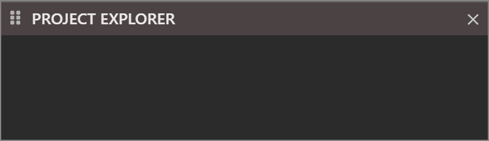
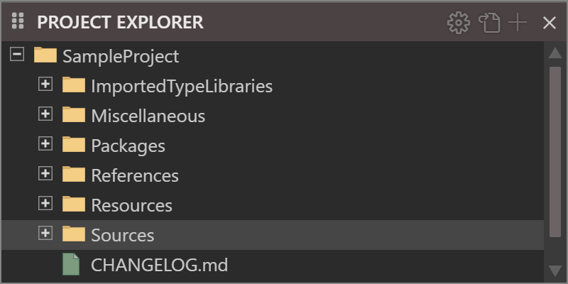
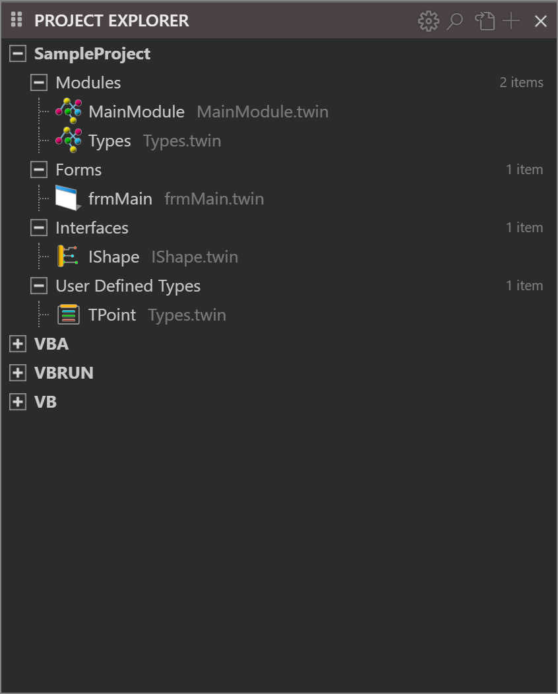

# Project Explorer

The **PROJECT EXPLORER** panel shows the files of the open project as a tree, or the objects of the project as a list. This page describes the panel, its two views and what a click on a file opens. [Files and folders](Files-and-Folders) describes the right-click menu and the commands that change files.

{:width="400" height="116"}

With no project open the panel is empty. When a project is open, the tree shows the project's name with its folders below it.

{:width="400" height="200"}

## The header buttons

Four buttons sit in the title bar once a project is open.

{:width="400" height="30"}

**Project Settings**
: Opens the [Project Settings](../Project-Settings) dialog. **Project → Project Settings...** does the same.

**Search**
: Opens the search bar of the [object view](#the-object-view). The button shows only in the object view.

**Toggle file view** (<kbd>Ctrl</kbd>+<kbd>R</kbd>)
: Switches between the file view and the object view.

**Add...**
: Opens the **Add** menu below the button. It lists the same items as the **Add** entry of the right-click menu, and [Adding files](Adding-Files) describes them.

A button whose command does not apply is hidden, not greyed out. Hovering over a button shows its key in its title.

## The two views

The **file view** is the tree of the project's files and folders. The **object view** is a flat list of the project's modules, classes, forms and other objects, grouped by kind, with the file name beside each one. The file view is the default.

<kbd>Ctrl</kbd>+<kbd>R</kbd> switches between them. It works whenever a project is open, whether the focus is in the panel or in the code editor. The IDE remembers the view you leave on, and opens the next session in it.

Choosing an item of the **Add** menu from the object view switches the panel to the file view first, because the new file appears in the tree. Leaving the object view closes its search bar.

## The file view

Names are compared without regard to case: a folder cannot hold `Form1.twin` and `form1.twin`. An entry whose name begins with a period, such as the `.meta` file that holds the project's [saved state](Saving-and-Exporting#what-the-ide-remembers-about-a-project), is not drawn. The tree has no option to show hidden entries, and an empty folder shows the text **(empty)**.

### The folders

The tree draws six of the project's folders. `Settings`, the seventh, is a file that the tree does not draw; open it with the **Project Settings** button.

- **Sources** holds the project's code and its designer files. A new file of a code kind goes into `Sources` unless a folder under `Sources` is selected. See [Adding files](Adding-Files#where-the-new-file-goes).
- **Resources** holds the files the build embeds in the program. See [Resources](Adding-Files#resources).
- **References** has one entry for each library the project refers to. See [References and packages](References-and-Packages#the-references-folder).
- **Packages** has a folder for each package the project embeds, and for the compiler packages `VB`, `VBA` and `VBRUN`. A package's files are read-only.
- **ImportedTypeLibraries** holds the type libraries that were imported from a file. See [Import from file](References-and-Packages#import-from-file).
- **Miscellaneous** is empty in a new project.

The folders `Settings`, `Sources`, `Resources`, `References`, `Packages`, `Miscellaneous` and `ImportedTypeLibraries` cannot be renamed. The project's own name, at the top of the tree, can; [Files and folders](Files-and-Folders#rename) says how.

### Icons and colours

The icon of a file shows its kind. A `.twin` file has a red icon, a `.bas` file a blue one and a `.cls` file an orange one. The four kinds of designer file, `.tbform`, `.tbcontrol`, `.tbppage` and `.tbreport`, have a green one. The entries under `References`, the `Settings` file and the other files each have an icon of their own, and a folder has the folder icon.

A file in which the compiler found an error has a light red row. Every folder above the file takes the colour as well, up to the project row, so a red folder says that something below it has an error. A file with only a warning has a yellow row. [Diagnostics](../Code/Diagnostics) lists the problems.

<!-- SHOT projects-tree-tints: the tree of a project whose Sources/Helpers folder holds one module with an error and Sources holds one with a warning; Helpers expanded, a new empty folder expanded under it showing (empty); the red and yellow rows visible -->

Pointing at a row for about a second and a half shows its IDE path, such as `/MyProject/Sources/Startup.twin`.

### Select rows

A click selects one row. <kbd>Ctrl</kbd>+click adds a row to the selection, or removes it, and <kbd>Shift</kbd>+click selects the range from the last row you clicked. <kbd>Ctrl</kbd>+<kbd>A</kbd> selects every row shown. A right click on a row that is not selected selects it first.

A click on the name of a folder selects it and opens or closes it. The commands that make something new, such as **Add**, put it into the selected folder, or into the folder of the selected file.

### Keys in the tree

These keys work while the tree has the focus.

| Key | What it does |
|---|---|
| <kbd>Up</kbd>, <kbd>Down</kbd> | Move the selection by one row. With <kbd>Shift</kbd> they extend it. |
| <kbd>Left</kbd> | Closes an open folder. On a closed folder or a file, selects the folder above it. |
| <kbd>Right</kbd> | Opens a closed folder. On an open folder, selects an entry inside it. |
| <kbd>Enter</kbd> | On a file, opens it in a normal tab and moves the focus to the editor. On a folder, does nothing. |
| <kbd>Esc</kbd> | Clears the selection. |
| <kbd>Ctrl</kbd>+<kbd>A</kbd> | Selects every row shown. |
| <kbd>F2</kbd>, <kbd>Delete</kbd>, <kbd>Ctrl</kbd>+<kbd>X</kbd>, <kbd>Ctrl</kbd>+<kbd>C</kbd>, <kbd>Ctrl</kbd>+<kbd>V</kbd> | Rename, delete, cut, copy and paste. See [Files and folders](Files-and-Folders). |

The tree scrolls to keep the selected row in view. <kbd>Page Up</kbd>, <kbd>Page Down</kbd>, <kbd>Home</kbd> and <kbd>End</kbd> do not move the selection.

> [!NOTE] BETA 1005
> Several keys of the tree do not work as they should.
>
> - <kbd>Space</kbd> does not open or close a folder. Click the folder's plus or minus box.
> - Typing the start of a name does not filter the tree, although the IDE has code for it. To find a file, open the folders, or switch to the [object view](#the-object-view) and search for the object by name. To find text, use [Find In Project](../Code/Finding#search-the-whole-project).
> - <kbd>Right</kbd> on an open folder selects the first entry in the order the compiler lists them. That is not always the first row drawn.
> - <kbd>Ctrl</kbd>+<kbd>A</kbd> selects the rows correctly, but the IDE's script also raises an error.
> - <kbd>Down</kbd> on the last row selects the project's `Settings` entry, which the tree does not draw, so no row is highlighted. <kbd>Enter</kbd> there raises an error and opens nothing.

### What a click opens

Whether a click opens a file depends on the option **File Explorer: Single-Click Preview**, which is off by default. With the option off, one click selects a row, and a double-click or <kbd>Enter</kbd> opens the file in a normal tab. With the option on, one click opens the file in a *preview tab*. [IDE Options](../Customising/IDE-Options#project-explorer-tabs-and-start-up) describes the option, and [Editor](../Code/Editor#tabs) describes preview tabs. A double-click on a folder opens or closes it.

What opens depends on the kind of file.

| File | What opens |
|---|---|
| `.twin`, `.bas`, `.cls` | The code editor. See [Writing code](../Code/). |
| `.tbform`, `.tbcontrol`, `.tbppage`, `.tbreport` | The designer. See [Designing forms](../Forms/Designer#open-a-designer). |
| `.ico`, `.cur`, `.png`, `.gif`, `.jpg`, `.jpeg`, `.svg`, `.bmp`, `.pdf` | A read-only preview tab that shows the file. The tab is never marked as changed. A PDF opens, but the tab shows an empty box. |
| A file with no extension in `Resources/ICON`, `Resources/BITMAP` or `Resources/CURSOR` | The same preview, as an icon, a bitmap or a cursor. |
| A Markdown file in a package | A Markdown preview. |
| An entry under `References` | The code editor, with the declarations that the compiler generates for the library. |
| Anything else, including `.json`, `.xml`, `.txt`, `.md`, and a file with no extension elsewhere | A text editor. |

The text editor colours `.js`, `.ts`, `.html`, `.htm`, `.css`, `.json`, `.xml`, `.ini` and `.md` files by their extension, and shows any other file as plain text. It has no navigation boxes and no **OUTLINE**. A binary file opens in it too, as replacement characters, and you can type into it.

The IDE has no resource editors. Icons, bitmaps and cursors are shown as pictures, and the manifest and the string table open as text. The version information is not a file: it is a section of [Project Settings](../Project-Settings#version-resource).

## The object view

The object view lists what the language server finds in the project, not the files. At the top is the project, and below it the groups, such as **Modules**, **Classes**, **Forms**, **Interfaces** and **User Defined Types**. A group that the project has no objects for is not listed, and a group shows its number of items, such as *3 items*. After the project's own objects come the packages the project refers to, such as **VBA**, **VBRUN** and **VB**, each with its own groups.

{:width="423" height="526"}

Each object has an icon for its kind and, in grey beside its name, the file it is in. The project and its groups are open when you first switch to the view, and the IDE saves which ones you closed with the project.

- **Double-click an object** opens its form in the designer if it has one. Otherwise it opens the code at the object's declaration, and moves the focus to the editor.
- **Double-click a group**, or select it and press <kbd>Enter</kbd>, opens or closes it. <kbd>Left</kbd> and <kbd>Right</kbd> close and open the selected group. <kbd>Enter</kbd> on an object does nothing.
- <kbd>Up</kbd> and <kbd>Down</kbd> move the selection.

### Search the objects

The **Search** button, or the first letter you type with a row selected, opens a search bar over the list. The list shows only the objects whose name contains the text, without regard to case. While a filter is set, the packages and their groups are drawn open, and each group keeps its full count. <kbd>Esc</kbd>, or the bar's close button, closes the bar and brings back the whole list.

<!-- SHOT projects-object-search: the object view with the search bar open over the list, holding "Util" (typed after selecting a row), the filtered list below it -->

> [!NOTE] BETA 1005
> The object view has some defects.
>
> - A right click on a row opens no menu, so the menu's **View Object**, **View Code**, **Add**, **Rename** and **Delete** cannot be reached. To rename or delete an object's file, press <kbd>Ctrl</kbd>+<kbd>R</kbd> to return to the file view.
> - <kbd>Shift</kbd>+double-click on a form opens its designer, like a plain double-click, and not its code. To open the code, switch to the file view and open the form's `.twin` file.
> - When the search bar opens because you typed a letter, it holds `>` before the letter. The `>` does not change what is matched.

## See Also

- [Files and folders](Files-and-Folders) -- the right-click menu, and renaming, moving and deleting
- [Adding files](Adding-Files) -- the **Add** menu
- [Navigating](../Code/Navigating) -- Go To Definition, **OUTLINE** and **OPEN EDITORS**
- [View menu](../Reference/Menu/View) -- the command that shows the panel
- [IDE Options](../Customising/IDE-Options#project-explorer-tabs-and-start-up) -- the options of the Project Explorer
