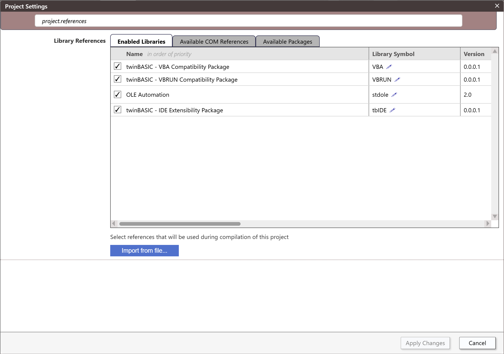
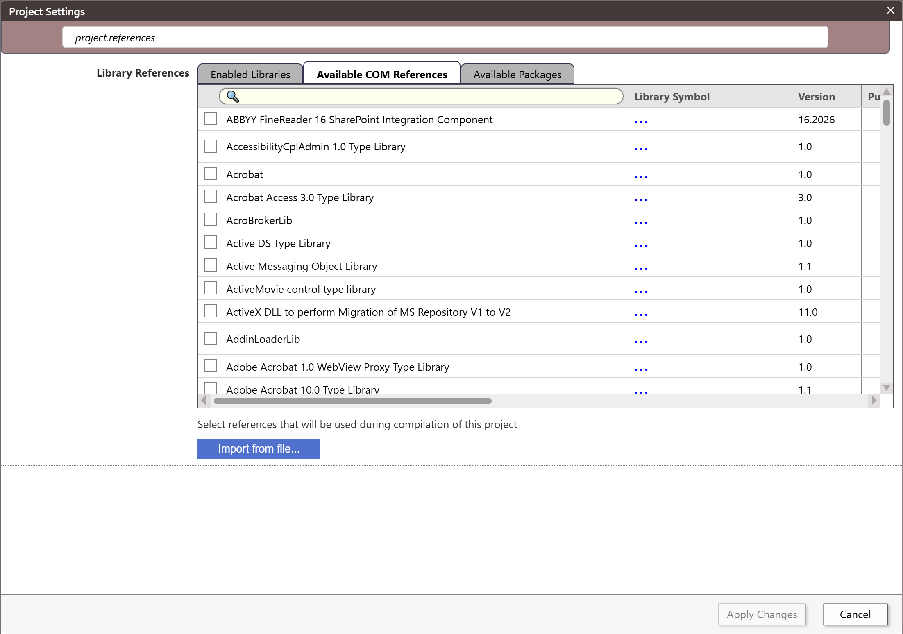
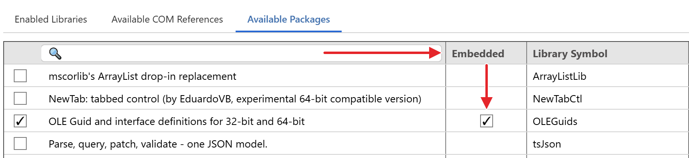
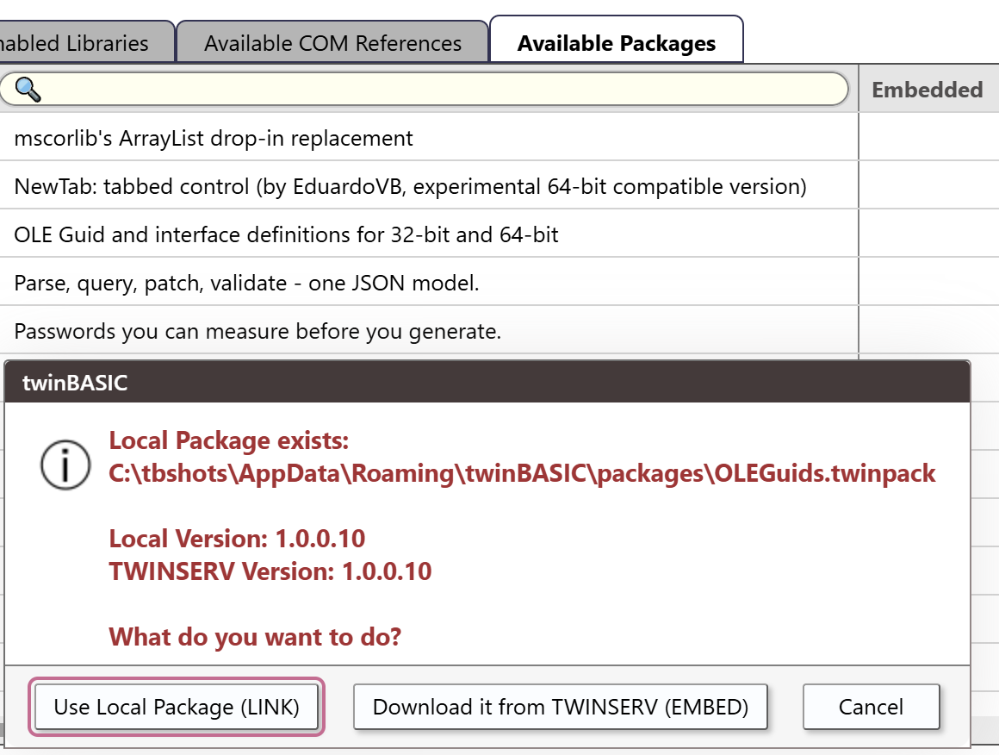

# References and packages

A project uses code from libraries. A library is a type library registered on the machine, or a twinBASIC package. This page describes the part of the **Project Settings** dialog that manages them: the lists, the ticks, the questions it asks, and the way a library is kept in the project. The language side of packages, such as how to build and publish one, is in [Package Management](../../../Features/Packages/).

## Open the lists

The lists are the **Library References** section of [Project Settings](../Project-Settings#library-references). In the project's `Settings` file the setting is `project.references`.

- **Project → References...** (<kbd>Ctrl</kbd>+<kbd>T</kbd>) opens the dialog with its filter box holding `project.references`, so that only this section shows.
- The gear in the **PROJECT EXPLORER** title bar, and **Project → Project Settings...**, open the whole dialog. Type `project.references` in the filter box to reach the section.
- The **GoTo COM References** button of the box that [**More components...**](../Forms/Toolbox#add-activex-controls-and-components) opens in the Toolbox shows the dialog on the **Available COM References** tab.
- A reference that cannot be loaded opens it by itself, about a second after the project has loaded. See [A reference that fails](#a-reference-that-fails).

## The three tabs

Three buttons above the lists choose which one shows.

| Tab | Lists |
|---|---|
| **Enabled Libraries** | The libraries the project uses, in order of priority. |
| **Available COM References** | Every type library that the compiler finds on the machine. The list is read again each time you choose the tab. A search box over the names filters it by name or path. |
| **Available Packages** | The packages on the TWINSERV package server, the packages in your local packages folder, and the packages the project embeds. The IDE asks the server each time you choose the tab. |

To use a library, tick it in one of the two lists of available libraries. To stop using one, untick it in any list. **Apply Changes** puts the change into effect.

## The Enabled Libraries list

{:width="1102" height="774"}

The list begins with two rows that cannot be moved: the **VBA** and **VBRUN** compatibility packages, marked `[COMPILER PACKAGE]`. Unticking one does not remove it. It switches the package off for the project, with the settings `project.disablePackageVBA` and `project.disablePackageVBRUN`. The packages that ship with the IDE show `[BUILT-IN]` as their publisher and the version of the IDE.

Each row has these columns:

- the tick, the name and two arrows;
- **Library Symbol**, **Version**, **Publisher**, **Path**, **LibraryID**, **Locale**, **Licence** and **Date**;
- **Use ActiveX Controls**, which is ticked unless you clear it;
- **ActiveX Fusion Mode** and **Fusion: Async Events**, which show only when the IDE's Fusion mode is on. See [Fusion](../../../Features/Fusion).

A **Path** column shows a `win32:` line and a `win64:` line when the two differ.

A package that the project embeds is marked `[EMBEDDED-PACKAGE]`, and a package that is kept outside the project is marked `[LINKED-PACKAGE]`. See [Linked Packages](../../../Features/Packages/Linked).

Unticking a row removes the reference. For a package that is kept under `Packages`, it also deletes the package's folder from the project. [Updating a Package](../../../Features/Packages/Updating) describes what to do to replace a package.

### Priority

The list is in order of priority. A row shows two arrows while the pointer is over it, grey until the pointer is on one, which turns it pink. They move the row up, which gives it a higher priority, or down, which gives it a lower one. An arrow that cannot move the row is greyed out. The two compiler packages stay at the top.

### The library symbol

A library's *symbol* is the name its components are qualified with in code. It is read from the library, and shows `...` until the IDE has it. The pencil beside the symbol has the tooltip **Click here to customize the library symbol used in this project**, and opens a text box. A symbol that you type is stored as an override, with no spaces: <kbd>Enter</kbd> keeps it and <kbd>Esc</kbd> returns to the original. The row then shows the original struck through, and the override beside it. [Library Symbols](../../../Features/Packages/Library-Symbols) describes what a symbol does.

### A reference that fails

A reference that the compiler cannot load shows **ERROR unable to load this reference** and a **FIX** link. About a second after the project loads, the dialog opens by itself to show it. It opened again after an **Apply Changes** that restarted the compiler. **FIX** does nothing but say that the feature is not implemented yet, and that you should remove the reference and add it again from **Available COM References**. A library listed twice shows **ERROR duplicate reference** on both rows.

{:width="1102" height="369"}

## Available COM References

{:width="1102" height="774"}

Tick a library to add it to the project. The reference is added to `project.references` with `autoCtlExt` set to true. A change makes **Apply Changes** available.

## Available Packages

The tab lists the public packages of TWINSERV. After you sign in, it lists your private packages too. A yellow tip under the list, **TIP: LOGIN to see any PRIVATE packages you've made**, opens the sign-in form, with tabs to log in and to register, and the box **Remember password on this device**. After you sign in, choose the tab again to refresh the list.

{:width="1162" height="529"}

Tick a package to add it. The **Embedded** column marks a package whose copy is part of the project. Clearing its tick makes the package *linked*: the project refers to it by its identifier, and the file is in `%APPDATA%\twinBASIC\packages`. [Linked Packages](../../../Features/Packages/Linked) describes the two ways, and [Importing a Package from TWINSERV](../../../Features/Packages/Importing-TWINSERV) the steps.

{:width="830" height="181"}

The IDE asks you a question in three cases.

- **You tick a package that is in your local packages folder and on TWINSERV.** A box shows the two versions, and offers **Use Local Package (LINK)**, **Download it from TWINSERV (EMBED)** and **Cancel**. With only one source, the IDE uses it without asking.
- **You clear the Embedded tick of an embedded package.** If a copy of the package is already in the local folder, a box shows both versions and offers **Use Existing Local Package**, **Overwrite Local Package (export it from this project)** and **Cancel**. If there is none, the IDE writes the package to the local folder, as `<symbol>.twinpack`, and removes the copy from the project.
- **You tick the Embedded column of a linked package.** The box offers **Import Local Version**, **Import TWINSERV version** and **Cancel**, when both exist.

{:width="580" height="438"}

Replacing an embedded package by a newer build, and the case of a linked package that is missing from the machine, are described in [Updating a Package](../../../Features/Packages/Updating) and [Linked Packages](../../../Features/Packages/Linked#opening-a-project-with-missing-linked-package).

## Import from file

The **Import from file...** button under the lists opens the Windows **Open** dialog. What it imports depends on the tab.

- On **Available COM References**, and on **Enabled Libraries**, it asks for a type library. The IDE copies the file into the project as `ImportedTypeLibraries/<file name>`, and adds it to the references at once, ticked.
- On **Available Packages**, it asks for a `.twinpack` file. The package is added to the **Available Packages** list. [Importing a Package from a TWINPACK File](../../../Features/Packages/Importing-TWINPACK) gives the steps.

> [!NOTE] BETA 1010
> A package imported with **Import from file...** is listed but not ticked, so the project does not use it. Tick it yourself after the import.

> [!NOTE] BETA 1005
> **Import from file...** puts a copy of the package under the project's `Packages` folder. Closing the dialog with **Cancel** leaves the copy there, and the project is not marked as changed.

> [!NOTE] BETA 1005
> A type library added with **Import from file...** is drawn on the **Enabled Libraries** list as `[LINKED-PACKAGE]`, and on **Available COM References** it is listed twice, once from the project and once from the registered library, both ticked. Clearing the tick of either row removes the reference.

## Package needed

Choosing an **Add** item for a Windows form without the **WinNativeForms** package in the project, or for a CustomControls form without the **CustomControls** package, shows a box, **Package needed**, and the name of the package. It says that the package must be added first, and that the compiler restarts. The button **Add WinNativeForms package**, or **Add CustomControls package**, adds the reference to the `Settings` file and restarts the compiler. It creates nothing: choose the **Add** item again. **Cancel** changes nothing. [The package prompts](../Forms/Designer#the-package-prompts) shows the boxes.

The reference is listed under the package's own name, `WinNativeForms` or `CustomControlsPackage`, until the compiler has answered, and then under the name of the library, such as `twinBASIC - VB Compatibility Package (Forms)`.

> [!NOTE] BETA 1005
> In a project that has a file, the button also saves the project, although the box speaks only of restarting the compiler. A project with no file yet is not saved, and restarts from memory.

## Apply Changes and closing the dialog

The dialog has a filter box, **Apply Changes** and **Cancel**. **Apply Changes** is greyed out until you change something. It writes the `Settings` file and prints `[COMPILER] Project settings updated` to the Debug Console. When the change needs it, the compiler is restarted, and the project is saved first: the console prints `Project settings changes require compiler-restart`, `saving to disk [DONE]` and `restarting from FILE`.

**Cancel** closes the dialog at once and drops every change, whichever it is, without asking. <kbd>Esc</kbd> does the same when the focus is in the filter box. The close button in the title bar asks first, in a box, **WARNING: you made changes but haven't saved them. Close without saving?**, with **Yes, close** and **No, keep editing**.

{:width="1102" height="774"}

> [!WARNING] BETA 1005
> The close button of the title bar does not ask when the only change is to the references. The dialog closes, the change is dropped, and nothing says so. The code that compares the settings leaves out the compiler warnings as well. Press **Apply Changes** before you close the dialog.

## The References folder

The `References` folder of the Project Explorer has one entry for each library the project uses. The entry is named with the library's symbol and its identifier. It is not a file of the project, and it is not in the saved `.twinproj`. A double-click opens it in the code editor, as the declarations that the compiler generates for the library, with a comment that names the library's original file.

**Cut**, **Rename** and **Delete Permanently** are greyed out on the right-click menu for these entries.

> [!NOTE] BETA 1005
> The <kbd>Delete</kbd> key removes a `References` entry from the tree, although its menu item is greyed out. The reference itself stays in the project. To remove a reference, untick it in the **Enabled Libraries** list.

## Where the project keeps them

- The references are in the `project.references` list of the `Settings` file, with the symbol overrides.
- An embedded package is a folder under `Packages`. A package's files are read-only in the Project Explorer.
- A type library imported from a file is a file in `ImportedTypeLibraries`.
- A linked package is a file in `%APPDATA%\twinBASIC\packages`. The project refers to it by the package's identifier.

## See Also

- [Project Settings](../Project-Settings#library-references) -- the setting, and the rest of the dialog
- [Package Management](../../../Features/Packages/) -- creating, importing, linking and updating packages
- [Library Symbols](../../../Features/Packages/Library-Symbols) -- the name a library's components are qualified with
- [Adding files](Adding-Files) -- the other items of the **Add** menu
- [Project menu](../Reference/Menu/Project) -- **References...** and **Project Settings...**
