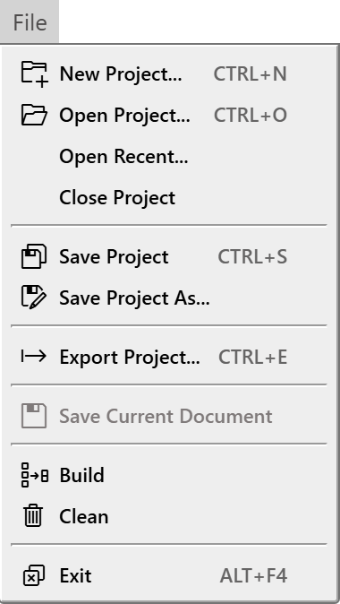
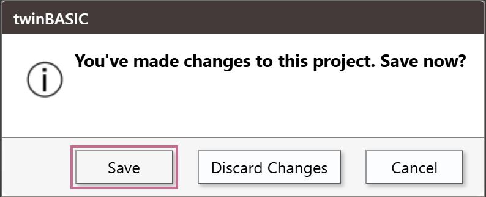
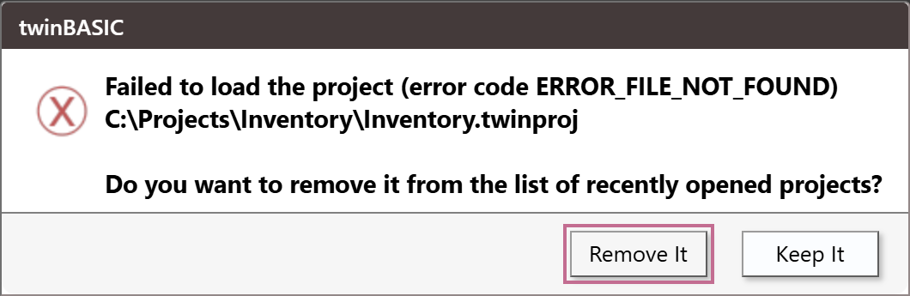
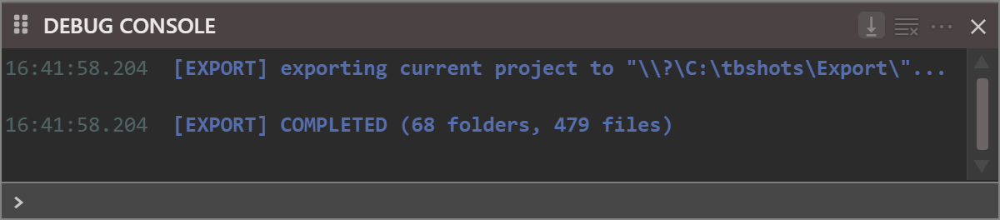

# Saving and exporting

The project lives in memory until you save it. This page describes how the IDE saves it, what marks it as changed, what happens when you close it or open another, and **Export Project**, which writes it out as ordinary files.

## Save Project
{: #save-project }

**File → Save Project** (<kbd>Ctrl</kbd>+<kbd>S</kbd>), and the toolbar button **Save All Changes**, write the whole project to its `.twinproj` file. First every open editor saves its text, the code editors and the designers alike. Then the compiler writes the file. The Debug Console prints `[PROJECT] twinBASIC project saving to disk [DONE]` in green when it has finished.

{:width="190" height="337"}

The command works on a project that has no changes, and writes the file again. For a project with no file yet, it opens the **Save As** dialog first. See [A project with no file](#a-project-with-no-file).

There is no save for a single file: **File → Save Current Document** is always greyed out, and has no key. The IDE has no automatic save and no automatic backup. [Save often](../Code/Editor#save-often) says what the IDE keeps for you and what it does not.

### The changed mark

A project with changes that are not saved shows a dot before its name in the title bar: `• project.twinproj - twinBASIC`. The title is the project's file name, then the name and version of the IDE. Saving removes the dot.

{:width="703" height="25"}

These make a project changed:

- creating, renaming, moving, deleting or importing a file or folder;
- an edit in any editor or designer that is not saved;
- setting or clearing a breakpoint.

### When a save fails

The IDE gives the compiler 10 seconds to save the open documents. If it does not answer, a box says that the IDE timed out while trying to save them, and advises you to make backups of your documents by hand. The compiler then has 20 seconds to write the project file. If it does not answer, a box says that the IDE timed out while trying to save the project, and that the compiler restarts and you should try again. Choose **OK** to restart it.

If the compiler can write no file, an alert says **save project failed**, with a result code and the Windows error, such as `ERROR_ACCESS_DENIED` or `ERROR_DISK_FULL`, and asks you to check that the path is writable. The project stays open, changed, with its dot. Nothing is lost.

The compiler can also ask the IDE for another path: a box, **Failed to save the project.  Check the project file path and adjust if necessary.**, holds the project's path in a text box, and offers **Try Again**, which saves to the path in the box and keeps it as the project's path, and **Cancel**.

### Other commands that save

Some commands save the project besides **Save Project**: **Save Project As** saves after it chooses the path, and **Apply Changes** in [Project Settings](References-and-Packages#apply-changes-and-closing-the-dialog) saves when the compiler restarts. With the setting [Export After Save](../Project-Settings#export-after-save), a save runs **Export Project** first.

> [!NOTE] BETA 1010
> Several actions save the project although you did not ask. They are [**Import...**](Adding-Files#the-project-is-saved) of ordinary files; the **Import** and **Cancel** buttons of the **Import from twinproj...** dialog; [renaming the project](Files-and-Folders#the-project); and the button of a [Package needed](References-and-Packages#package-needed) box in a project that has a file. Importing ordinary files, **Cancel** in the import dialog and renaming the project write the unsaved changes of the open editors into the file as well.

## Save Project As

**File → Save Project As...** opens the Windows **Save As** dialog, with the project's name proposed. The project's file becomes the one you choose, and the IDE saves the project there. The old file stays as it was. The new path goes to the top of the [recent list](#recent-projects), and the title bar shows the new name. The folder of the new file becomes `${SourcePath}`, for the settings that use it. The command has no key.

## A project with no file

A project made from a template or a sample, from **Import from folder...**, or from a VB6 project has no file until it is saved. The title bar says `Unsaved.twinproj`. **Save Project** asks for a file name first, with the **Save As** dialog, and then saves. An import that saves the project asks for a file name in the same way.

**Open Project Folder...** and **Open Build Output Folder...** of the **Project** menu show the notification **Project is not yet saved.  Please save the project first.** for such a project. **Build** and **Clean** ask you to save first; see [A project with no file](../Building/Build-and-Clean#a-project-with-no-file).

## What the IDE remembers about a project

The IDE keeps the state of a project apart from its files: the editors that are open, with their view state, which folders of the Project Explorer are open, the watches, the bookmarks, the history of the Debug Console, of **FIND / REPLACE** and of the Memory panes, and the settings of some panels. It saves this state every five seconds. The open editors come back when you open the project again only if **Restore Editors State When Opening Project** is on. The watches and the history of the Debug Console come back whatever the option says.

The state is kept in the registry, in a value for each project path, under `ProjectState` beside the IDE's settings. See [where the IDE keeps its settings](../Customising/#where-the-ide-keeps-its-settings). <kbd>Ctrl</kbd>+<kbd>S</kbd> does not write it into the `.twinproj`. By the IDE's code, **Save Project As** also stores a copy in the new file, as the hidden file `.meta`, which the Project Explorer does not draw.

## Close Project and Exit

**File → Close Project** closes the project. If it has changes that are not saved, a box asks **You've made changes to this project.  Save now?**, with three buttons.

{:width="397" height="162"}

- **Save** saves the project, with the **Save As** dialog first if it has no file, and then closes it.
- **Discard Changes** closes it and leaves the file on disk as it was.
- **Cancel** keeps the project open.

**File → Exit** (<kbd>Alt</kbd>+<kbd>F4</kbd>), and the close button of the window, ask the same question. If the save fails, the alert described above appears and the project stays open. Closing ends the compiler process of the project. **Close Project** has no key.

## Open a project

- **File → New Project...** (<kbd>Ctrl</kbd>+<kbd>N</kbd>) and **File → Open Recent...** open the **New / Open Project** dialog, which has the sections **New**, **Samples** and **Recent**. **Open Recent...** starts on the **Recent** section. A **Recent (VB6)** section shows too when the machine has a VB6 history. [New Project](../Project/New) describes the dialog.
- **File → Open Project...** (<kbd>Ctrl</kbd>+<kbd>O</kbd>) opens the Windows **Open** dialog. A `.vbp` file is imported as a VB6 project; the result is unsaved. The import keeps the `Attribute` lines of the VB6 files as they are, and the [FAQ](../../../FAQ#vb6-import) says what becomes of each file and each line. A project opened with **Import from folder...** is unsaved as well.

The project that is open is closed before the new one loads, and the question above comes at that point. In the **New / Open Project** dialog, it comes when you press **Open**, not before.

### Recent projects

The **Recent** tab lists the full paths of the projects you opened last, the newest first. A double-click, or **Open**, opens one and moves it to the top. The **X** at the end of a row, titled **Remove from this list**, removes the entry at once, with no question. **Save Project As** adds the new path to the top. The list holds 21 entries and is kept in the registry with the IDE's settings.

A project whose file is gone shows the box **Failed to load the project (error code ERROR_FILE_NOT_FOUND)**, with the path and the question **Do you want to remove it from the list of recently opened projects?** The **New / Open Project** dialog has closed by then. The buttons are **Remove It** and **Keep It**. **Keep It** moves the entry to the top. Either way the IDE is left with no project open, because the previous one was closed first. A damaged file opens a native Windows message box instead.

{:width="530" height="173"}

## Open a folder

**Project → Open Project Folder...** opens the folder of the `.twinproj` file in Windows Explorer. **Project → Open Build Output Folder...** opens the folder of the file that the [Build Output Path](../Project-Settings#build-output-path) names. The command does not create the folder. With no build output path set, it gives the same notification as for a project with no file. [Open Build Output Folder](../Building/Build-Output#open-build-output-folder) says when it still gives it after the project is saved.

## Export Project

Writes the open project out to a folder as separate files, instead of the single `.twinproj` file. The folder gets the project's `Settings` file, its `Sources`, `Resources` and other folders, and a `Packages` folder with the full source of every package the project references. For a small project that uses the **VB** package, the export held 477 files: two of the project's own, and 475 under `Packages`. <kbd>Ctrl</kbd>+<kbd>E</kbd> runs the same command.

**Before it writes anything, the command deletes everything already in the target folder.** It does not ask first, and the deleted files do not go to the Recycle Bin. Files that have nothing to do with the project are deleted too: hidden files, a `.git` folder, anything else there.

> [!WARNING]
> Point **Export Project** only at a folder that holds nothing but an earlier export of the same project. Never point it at a folder that holds anything else, at the top folder of a Git repository, or at the folder that holds the `.twinproj` file.

To write only some of the files, use [**Export...**](Files-and-Folders#export-a-file) on the right-click menu of the Project Explorer.

### Where it writes

- **With [*Export Path*](../Project-Settings#export-path) set**, the command exports there straight away, with no dialog.
- **With no *Export Path***, it opens a *Browse For Folder* dialog, which starts in the folder that holds the `.twinproj`. The IDE appends the project's name and a backslash to the path the dialog returns, with no separator before the name, and the export goes into that folder. It is that folder that is emptied.

With [*Export After Save*](../Project-Settings#export-after-save) set, every save runs the export again before it writes the project, into *Export Path*, and empties that folder again.

> [!NOTE] BETA 1010
> When the `Settings` file has an *Export Path* but no `project.exportPathIsV2` entry, the project's name is joined to the path with no separator: `${SourcePath}\exp2` exports into `exp2ProjTry\` for a project named `ProjTry`.

### When a file cannot be deleted

A read-only file stops the export part-way. Everything before it in alphabetical order is already deleted by then, everything after it is left, and nothing is written. No message appears. The only record is in the [Debug Console](../Debugging/Debug-Console):

```text
[EXPORT]  DELETE FAILED: \\?\C:\Work\MyApp\notes.txt
[EXPORT]  ERROR: unable to clean the output folder
[EXPORT] export failed.
```

Git makes the files in `.git\objects` read-only. When the target is the top folder of a repository, the command deletes `.git\config`, `HEAD`, `index`, `hooks` and `info`, then stops at the first object file. Git no longer recognises what is left as a repository.

A target that cannot be made at all, such as a folder on a drive that does not exist, gives the same two `ERROR` lines and no box.

### Exporting into the project's own folder

When the target is the folder that holds the `.twinproj`, the command deletes the `.twinproj` file too. The project then exists only in the open IDE, until **Save Project** (<kbd>Ctrl</kbd>+<kbd>S</kbd>) writes the file back. For this reason the Project Settings dialog refuses `${SourcePath}` on its own as the *Export Path*, but it accepts the same folder written out in full.

### Packing the export back into a project

The `Packages` folder holds the compiler packages as well. For a project with the default references they are **VB**, **VBA**, **VBRUN** and the package behind the **App** object, in folders named `VB`, `VBA`, `VBRUN` and `AppGlobalClassProject`. Every other compiler package the project references gets a folder too, named after the package's own project, which is not always the name the reference uses: the WebView2 sample references `WebView2Package` and `WindowsControlsPackage`, and its export has folders named `WebView2Package` and `VB`, because `WindowsControlsPackage` is the VB package. The project's `Settings` file marks each compiler package's reference `"isCompilerPackage": true`; nothing inside the package's own folder does.

A `.twinproj` file that the IDE saved does not hold the compiler packages, and the `export` command of the tB executable does not write them. A package the project embeds is different: one added from TWINSERV or from a TWINPACK file is embedded by default (see [Linked Packages](../../../Features/Packages/Linked)), is part of the saved `.twinproj`, and has a folder under `Packages` too.

**Delete the compiler packages' folders before packing the export back into a project.** The IDE's own way to pack it is **Import from folder...** in the [New Project](../Project/New#import-from-folder) dialog, which opens the project unsaved; the first save asks for a file name. The [import/export script](../../../Features/Packages/Import-Export-Tool#usage)'s `import` packs it as well. Both pack every folder under `Packages` into the project, so the compiler packages become a copy inside it. Rebuilt by **Import from folder** with them, the project was 4,222,833 bytes, against 4,207 bytes without them and 2,956 bytes for the project as the IDE saved it. Both rebuilt projects open with no errors, and the script's project is the same 4.2 MB.

The compiler does not use that copy. A function added to the copy of **VBA**, in `Packages\VBA\Sources\Math.twin`, is an unrecognized symbol (TB5079) to the code that calls it. But every later export writes the copy back into `Packages`: the added function is there again after each save, and the Debug Console reports `[EXPORT] COMPLETED (139 folders, 954 files)`, where the original project's export reported `(72 folders, 479 files)`. So after an IDE update, the export still holds the package source of the IDE that first exported the project, while the project compiles against the packages of the IDE in use.

The tB executable's `import` cannot pack a folder while any folder remains under `Packages\`. It stops at the first one, writes nothing, and exits with code `999` --- see [Where the two differ](../../../Features/Packages/Import-Export-Tool#where-the-two-differ). With the compiler packages' folders deleted, it packs the export of a project that embeds no package. [Keeping a project in Git from the IDE](../../../Features/Packages/Import-Export-Tool#keeping-a-project-in-git-from-the-ide) keeps them out of the repository from the start.

### What the Debug Console shows

Each export writes a first line, `[EXPORT] exporting current project to "…"`, and a last line: `[EXPORT] COMPLETED (72 folders, 478 files)`, or the failure lines above. With [*Export Verbose*](../Project-Settings#export-verbose) set, it also writes a line for each file and folder it deletes, `[EXPORT]  DELETED: …`, and for each file it writes, `[EXPORT]  DONE: …`. If the compiler answers the IDE's request with an error code, a box reads **ERROR: exportProject failed.** and the code.

> [!NOTE] BETA 1010
> Each `DONE` line shows `&#92;` for every backslash of its path: `[EXPORT]  DONE: &#92;Sources&#92;Startup.twin` for the file `Sources\Startup.twin` of the export folder. The files are written correctly, and the other `[EXPORT]` lines show their backslashes.

{:width="600" height="132"}

The `export` command of the tB executable and of the import/export script deletes nothing. See [What both programs do](../../../Features/Packages/Import-Export-Tool#what-both-programs-do).

## See Also

- [Project Explorer](Project-Explorer) -- the tree of the project's files
- [Files and folders](Files-and-Folders) -- the commands that change files, and **Export...** for a few files
- [Project Settings](../Project-Settings#export) -- Export Path, Export After Save and Export Verbose
- [New Project](../Project/New) -- the dialog that opens or imports a project
- [File menu](../Reference/Menu/File) -- the commands of the menu
- [Import/Export Tool](../../../Features/Packages/Import-Export-Tool) -- keeping a project in Git as plain-text files
