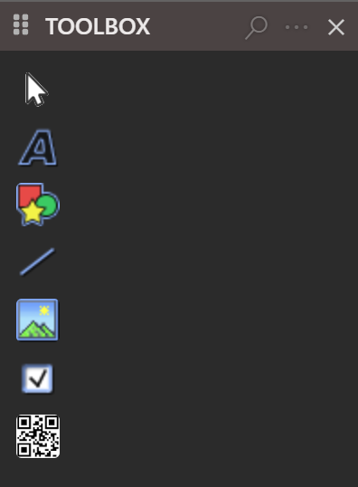

# Designing reports

The report designer lays out a report in bands, one for each part of the page, and lets you place labels, shapes, lines, pictures and QR codes in them. It is the [form designer](../Forms/Designer) in another mode, so selecting, moving, the grid, zoom, undo and the right-click menu work as they do for a form. This page describes what is different. How a report is filled with data and shown from code is in the [Report class](../../Packages/VB/Report/).

## Add a report

**Add Windows Report** creates the report. It is in the **Add** menu, and needs the WinNativeForms package. The command makes `MyReport.tbreport` and `MyReport.twin` and opens the designer, as [Add a form](../Forms/Designer#add-a-form) describes for a form. The class in the code file has an empty `Sub Report_Load()`.

## The bands

A new report has five sections, from top to bottom:

| Section | Height | Height in PROPERTIES | Also |
|---|---|---|---|
| **Report Header** | 25 pixels | 375 | |
| **Page Header** | 100 pixels | 1500 | |
| **Report Detail** | 25 pixels | 375 | **KeepTogether** is True |
| **Page Footer** | 50 pixels | 750 | |
| **Report Footer** | 25 pixels | 375 | **KeepTogether** is True |

{:width="1319" height="698"}

Each section is a bar that shows the section's name, with a working area under it. The area is as wide as the report, and the page margins show as padding. A ruler in centimetres runs across the top, with a tick every quarter of a centimetre, and each section has a ruler at its left.

The bar only selects the section. A click on it, or on an empty part of the section, shows the section's properties in [PROPERTIES](../Forms/Properties), and the object drop-down lists the section as its name followed by `ConstrolsSection`, spelled that way. A second click changes nothing. A band does not collapse.

The sections have these properties, beside **Height**: **IdeCaption**, **SectionType**, **BackStyle**, **BackColor**, **BackColorAlternate**, **BorderBottomHeight**, **BorderBottomColor**, **ForcePageBreak** and **KeepTogether**. Heights show in twips, 15 to a pixel. Setting a back colour also sets **BackStyle** to opaque.

To change a section's height, drag the blue bar at its bottom edge. The change sets the section's **Height**.

## The page

Click the corner where the rulers meet to select the report itself. Its properties include the page settings: **ReportWidth**, **ReportHeight** and the margins. A new report has margins of 10 mm, 37.795 pixels, on each side, a **ReportWidth** of 717.567 pixels and a **ReportHeight** of 1047.053 pixels. PROPERTIES shows them in twips, so **ReportWidth** reads 10763.5.

The designer lists no page-size control. Set the page by typing **ReportWidth** and **ReportHeight** in PROPERTIES, or drag the bars that run the height of the report:

- **PAGE WIDTH** sets **ReportWidth**. Dragging it 30 pixels to the right makes the report 30 pixels wider.
- **LEFT MARGIN** sets the left margin. The right edge of the report stays where it is.
- **RIGHT MARGIN** sets the right margin. Dragging it to the right makes the margin smaller and **ReportWidth** larger by the same distance.

Each of the three bars shows only while the pointer is over it.

{:width="947" height="450"}

## Controls in a report

A report holds windowless controls only. Its Toolbox lists seven tools: **Pointer**, **Label**, **Shape**, **Line**, **Image**, **CheckMark** and **QRCode**. It shows no group title bars and no **More components**.

{:width="198" height="269"}

A control belongs to the section where you draw it. A double-click on a tool places the control in the current section, and a control that you paste goes into the section that is shown. Drawing or pasting any other control gives the notification *Can't add* the control's type *to a report. Only windowless controls allowed.*, and adds nothing.

> [!NOTE]
> In twinBASIC BETA 1005, a floating Toolbox lists all 24 controls and **More components** when a report is open. A control that a report does not allow is refused when you use it, so nothing is lost. Dock the Toolbox, or use only the seven tools above.

A report has no **Form Menu** bar and no control arrays, and its controls have no **Index** property. The other designer features work: selection, moving and sizing, the grid, copy and paste, locks, undo, zoom, the right-click menu and the [Format](../Forms/Arranging) commands.

## Preview a report

**PREVIEW** and <kbd>F6</kbd> open the report in a window titled with the project's name, with the design as it is on the screen. See [Previewing a form](../Forms/Previewing). The window and its toolbar are described in the [Report class](../../Packages/VB/Report/#built-in-preview-toolbar).

## See Also

- [Designer](../Forms/Designer) -- opening a designer, the grid, zoom and locks
- [Toolbox](../Forms/Toolbox) -- the list of tools
- [Properties](../Forms/Properties) -- the PROPERTIES pane and its units
- [Report class](../../Packages/VB/Report/) -- showing and printing a report from code
