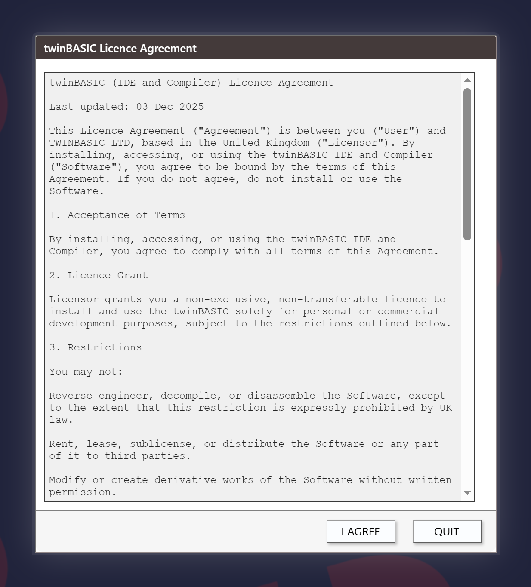
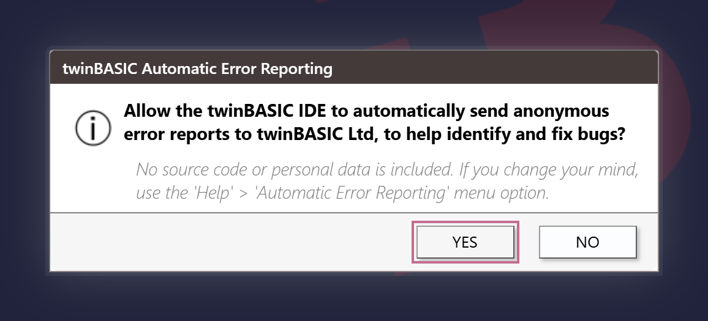
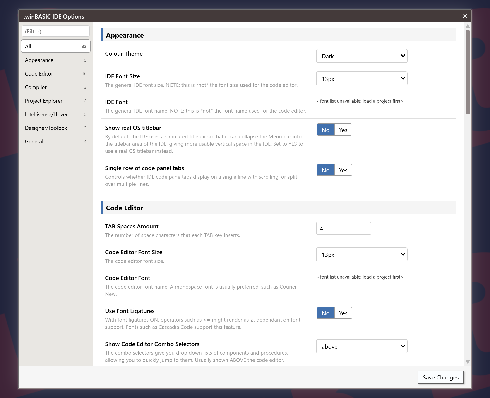
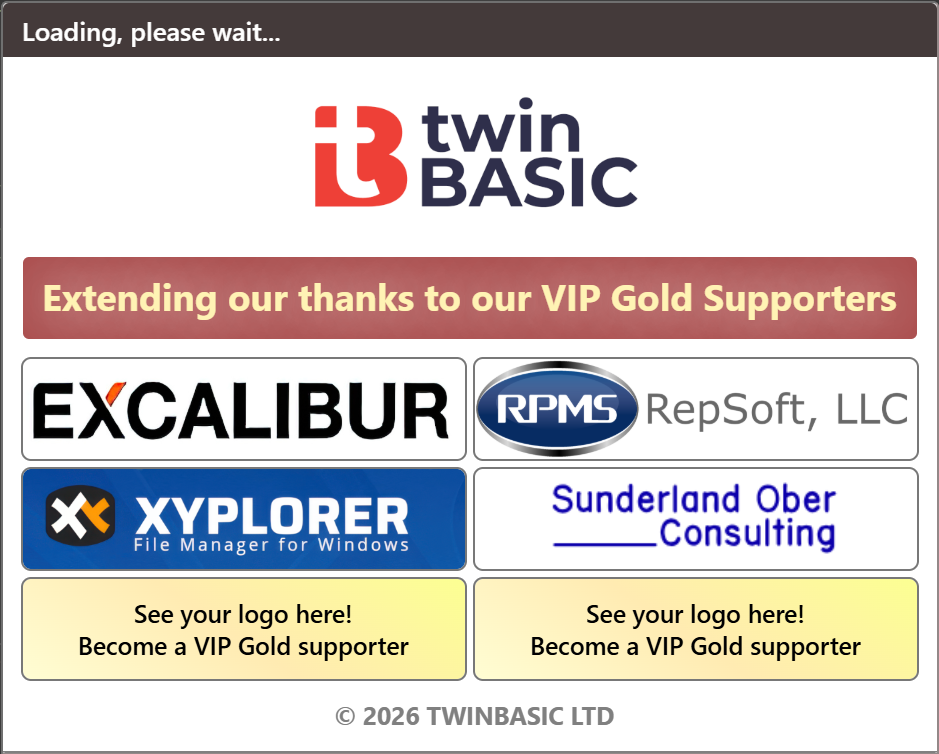
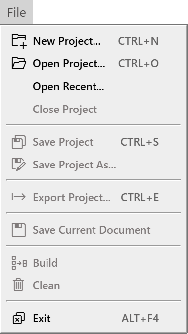
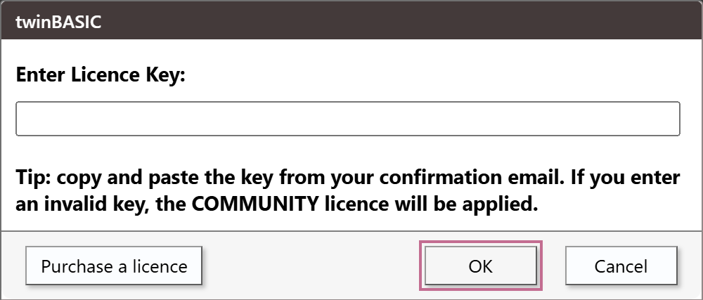

# First launch

The IDE asks up to three questions before it shows anything else, each only until you have answered it once. After them it shows a splash and the **New / Open Project** dialog. This page describes them in order, then the empty IDE, the licence and the edition, and says what the IDE does not ask for.

## What the first start shows

While the IDE reads its saved settings, it shows a banner picture. On a first start, these appear in front of it, in this order:

1. The [licence agreement](#the-licence-agreement), until you have accepted it once.
2. The [error reporting question](#the-error-reporting-question), until you have answered it once.
3. The [**IDE Options** dialog](#the-first-run-ide-options), on the very first start only, when the IDE has no saved options.
4. The [splash](#the-splash), then the [**New / Open Project**](New-Project) dialog. This pair is all that every later start shows, when no project is named on the command line.

The IDE shows nothing else: no sign-in, no tip of the day and no list of what is new.

## The licence agreement

The dialog is titled **twinBASIC Licence Agreement**. It holds the agreement between you and TWINBASIC LTD as a scrolling text in English. It has two buttons, **I AGREE** and **QUIT**. **I AGREE** records the date of your agreement and goes on. **QUIT**, <kbd>Esc</kbd>, which is bound to **QUIT**, and closing the IDE's window all end the IDE. The dialog has no close box of its own.

{:width="617" height="683"}

**Help → Licence Agreement...** shows the same text at any time, with one **Close** button, and under the text the line the IDE stored when you agreed: `AGREED_` and the date. A build whose agreement text changes asks the question again.

## The error reporting question

The dialog is titled **twinBASIC Automatic Error Reporting**. It asks whether the IDE may send anonymous error reports to twinBASIC Ltd, and says that no source code or personal data is included. Its buttons are **YES** and **NO**. <kbd>Esc</kbd> is **NO**, and the dialog has no close box.

{:width="578" height="263"}

The question turns reporting off the moment it opens. **YES** turns it on. **NO**, <kbd>Esc</kbd> and closing the IDE while the question is open all leave it off. **Help → Automatic IDE Error Reporting...** asks the same question again, so opening it switches reporting off until you press **YES**, whatever the setting was before.

When reporting is on, the IDE sends a report each time its own code fails with an error. A report is one HTTPS request to `https://twinbasic.com/notify`. It holds the IDE's version, the text of the licence box in the status bar, the time, the text of the IDE's error, and, if a program is paused in the debugger at that moment, the name of the top procedure on the call stack. Compile errors are not reported.

## The first-run IDE Options

On the very first start the **IDE Options** dialog opens by itself, over the banner. It has a **Save Changes** button and no **Close** button. Two parts of it cannot work yet, because no compiler runs: its **Change Licence...** button is hidden, and the font lists are empty, with a grey line, ``, in their place. Choose the options you want, or none, and press **Save Changes**; the start continues.

{:width="1082" height="880"}

<kbd>Esc</kbd> and the dialog's close box also end it, and the IDE goes on with the default options. The IDE has already saved the defaults when the dialog opens, so the next start is not a first start. [IDE Options](../Customising/IDE-Options) describes every option.

## The splash

Every start with no project to open shows the splash. Its title bar reads **Loading, please wait...**, and it closes by itself after two and a half seconds. The **New / Open Project** dialog takes its place.

{:width="470" height="377"}

Below the logo, a banner thanks the VIP Gold Supporters. A grid of six boxes follows: four hold the logos of supporters, and two read **See your logo here!** and invite you to become one. A twinBASIC Ltd copyright line closes the window. The splash shows no version number and no build date. They are in **Help → About twinBASIC...**, which repeats the logos.

A logo that has a web address opens it in your browser when you click it. A logo without one shows the notification *Sorry, this VIP Gold supporter has not yet provided a website URL*. The logos answer while the splash is up. The splash is modal, so nothing else in the IDE answers meanwhile.

No option, setting or command-line switch turns the splash off or shortens it. The IDE skips it only when it starts on a project: a double-click on a `.twinproj` file, or a project path on the command line. See [Opening projects](Opening-Projects#the-command-line). It shows the splash after a command line it cannot read, too; see the same section.

## The empty IDE

With no project loaded, every panel is empty, and no compiler is connected. The status bar at the bottom of the window says so.

{:width="661" height="27"}

The services badge reads **tB Services: UNAVAILABLE**, and the licence badge reads **tB Licence: NOT READY**. Both change when a project has loaded and the compiler has answered. [Status Bar](../Reference/StatusBar) describes the badges and their other states.

Without a project, most of the **File** menu is greyed out. **New Project...**, **Open Project...**, **Open Recent...** and **Exit** work, and so do the licence commands of the **Help** menu.

{:width="190" height="337"}

## The licence and the edition

The licence box is the second badge of the status bar. When a project has loaded and the compiler has answered, the box names the edition:

| The box reads | Meaning |
|---|---|
| **PERSONAL EDITION** | A Personal licence. |
| **PROFESSIONAL EDITION** | A Professional licence. |
| **ULTIMATE EDITION** | An Ultimate licence. |
| **COMMUNITY EDITION** | Any other answer, which includes no key and an invalid key. The badge is a warning, not a tick. |

The box's tooltip repeats its text. Clicking the box opens [**Enter Licence Key**](#enter-licence-key), but only once a project is loaded. The edition belongs to the compiler's answer, not to the IDE, so it stays **tB Licence: NOT READY** until a project loads.

When the compiler reports that a licence has expired or has been revoked, a box titled **Licence Problem!** says so, and gives the address `sales@twinbasic.com` to write to. The licence box keeps its earlier text.

A Personal licence does not build from the command line. With `--buildAndExit32` or `--buildAndExit64`, the IDE shows the box *Sorry, twinBASIC Personal Edition does not support command line builds. Upgrade to Professional Edition to access this feature.*

### Enter Licence Key

The dialog is titled *twinBASIC*, and the line above its text box reads **Enter Licence Key:**. It has three ways in:

- **Help → Enter Licence Key...**, which works with no project;
- the **Change Licence...** button of [IDE Options](../Customising/IDE-Options), which shows only while a project is loaded;
- a click on the licence box, while a project is loaded.

The dialog advises you to copy and paste the key from your confirmation email, and warns that an invalid key applies the COMMUNITY licence. Its buttons are **Purchase a licence**, **OK** and **Cancel**. <kbd>Enter</kbd> in the text box does what **OK** does.

{:width="500" height="214"}

A key has 32 characters once the IDE has trimmed it. What happens next depends on whether a project is loaded:

- **With no project**, a key of another length gives the box *Licence key invalid.* and changes nothing. A key of 32 characters is held. One second later a box says *Thanks.  The licence key will verified and applied when you load a project.*, and the IDE sends the key to the compiler when the first project has loaded.
- **With a project**, the IDE sends the key to the compiler at once. A key of another length is replaced by 32 zeros, which is the Community key.

The IDE then shows the compiler's answer in a box: *Licence key applied successfully.  Thanks for your support.* or *Invalid licence key.  Please try again.* It shows the box only when the answer differs from the key the IDE has saved. The IDE saves the key as plain text in the registry value `LicenceKey`; see [where the IDE keeps its settings](../Customising/#where-the-ide-keeps-its-settings).

### Purchase A Licence

**Help → Purchase A Licence...** and the **Purchase a licence** button of the Enter Licence Key dialog open the same address, `https://twinbasic.com/preorder.html`.

## No account

The IDE asks for no account and no sign-in at any start. The only sign-in in the IDE is the one for publishing a package, which is described under [Package Publishing](../Building/Package-Publishing).

## See Also

- [New Project](New-Project) -- the dialog that follows the splash
- [Opening projects](Opening-Projects) -- starting the IDE on a project, and the file association
- [Customising the IDE](../Customising/) -- the IDE Options, and where the IDE keeps its settings
- [Help menu](../Reference/Menu/Help) -- the licence and error reporting commands
- [Status Bar](../Reference/StatusBar) -- the services and licence badges
