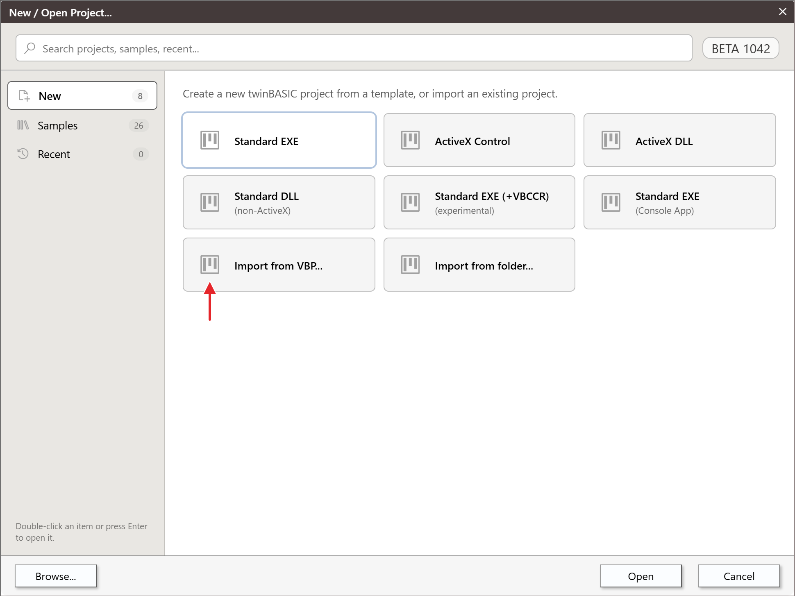
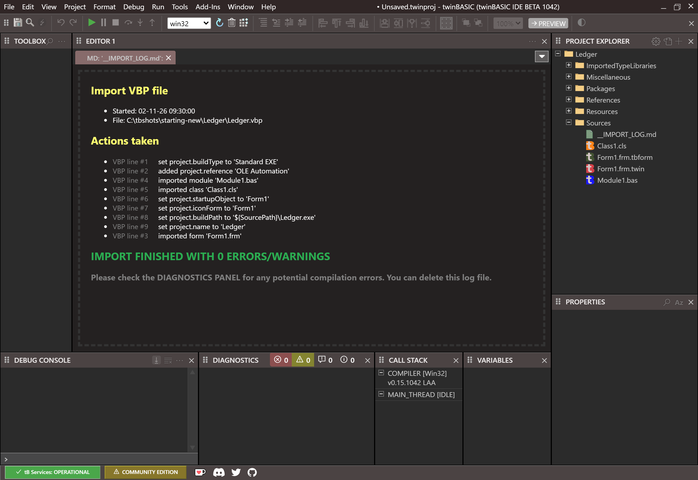
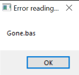
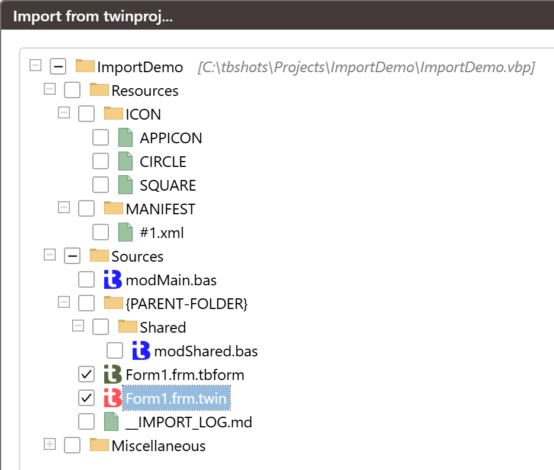

# Importing a VB6 project

The IDE turns a VB6 project file, a `.vbp`, into a new twinBASIC project. The compiler does the conversion: it reads the `.vbp` and the files it names, and gives the IDE the settings and the files of a twinBASIC project. This page describes the routes, what the importer converts and what it leaves, the log it writes, and what to do next. The FAQ entries [What does '100% backwards compatible' mean](../../../FAQ#backwards-compatibility) and [So some of my projects won't work?](../../../FAQ#when-it-does-not-work) say what to expect of VB6 code.

## The routes

| Route | What it does |
|---|---|
| **New → Import from VBP...** in the [New / Open Project](New-Project) dialog, then **Open** or a double-click | Closes the open project, opens a Windows picker for the `.vbp`, then imports it. See the [note on the import cards](New-Project#import-from-folder). |
| **File → Open Project...** (<kbd>Ctrl</kbd>+<kbd>O</kbd>), or **Browse...** in the dialog, with a `.vbp` chosen | The same import. A name that ends `.vbp` goes to the importer. |
| The **Recent (VB6)** section of the dialog | Loads the `.vbp` by another route, described [below](#the-other-two-routes). |
| A `.vbp` on the command line | The same as **Recent (VB6)**. |
| **Project → Add → Import...** with a `.vbp` | Is not a new project. It copies files of the VB6 project into the open project. See [Single files and the Import tree](#single-files-and-the-import-tree). |

{:width="970" height="728"}

The card **Import from folder...** is not a route for a VB6 project. It opens the folder of a twinBASIC project. See [New Project](New-Project#import-from-folder).

### The first two routes

The IDE sets the build configuration to **win32**, sets DEP off and large-address-aware on, and shows a progress indicator while the compiler converts the project. Then the **New Project Options** box opens, with the rows of an import:

- **Project Name**, from the `.vbp`'s `Name`.
- **Option Explicit ON**, ticked. The importer itself leaves the setting off, but the box starts ticked, so a default import ends with it on. A project that relies on undeclared variables then shows errors; see [After the import](#after-the-import).
- **Unicode Common Control Notifications**, ticked.
- **Visual Styles**, when the project has no manifest, and **DPI Awareness**, for a Standard EXE. The DPI choice starts at `NONE`.
- **Register to HKEY_LOCAL_MACHINE**, ticked, for an ActiveX DLL or ActiveX Control. An IDE that is not running as administrator then shows a warning about the machine-wide registry once after **Continue**. See [ActiveX registration](../Building/ActiveX-Registration#the-warning-at-the-machine-wide-registry).

There is no **Include Common Controls** row. [New Project Options](New-Project#new-project-options) describes all the rows.

**Continue** opens the project. It is unsaved and marked as changed, it is named from the box, and the title bar reads `Unsaved.twinproj`. Nothing is written to disk until you save it: **File → Save Project** opens the **Save As** box. A failed import shows the box *ERROR: LoadProject failed.  Error code ...* and nothing else.

### The other two routes

A `.vbp` loaded from **Recent (VB6)** or the command line shows no **New Project Options** box. It gets the importer's own settings. **Option Explicit** is off, and the project has no visual-styles manifest. The project is not marked as changed, so its title bar has no dot. The build configuration box is left as it is. **File → Save Project** still opens **Save As**, closing asks nothing, and the `.vbp` file is not touched.

Use the first two routes when you want the box's choices.

## What the importer converts

### Project settings

| In the `.vbp` | In the new project |
|---|---|
| `Name` | the project name and the application title |
| `Type=Exe`, `Type=OleDll`, `Type=Control` | a Standard EXE, an ActiveX DLL or an ActiveX Control |
| `Startup` | the [*Startup Object*](../Project-Settings#startup-object): `Sub Main` or a form. An ActiveX DLL or Control gets `(None)`. |
| `IconForm` | the [*Icon Form*](../Project-Settings#icon-form) |
| `LinkSwitches` with `/SUBSYSTEM:CONSOLE` | [*Is Console Application*](../Project-Settings#is-console-application) set to **Yes**. The switch must be in capitals. It may stand alone, under `[VBCompiler]`, or among other switches in quotes. In lower case, or as `/SUBSYSTEM:WINDOWS`, it sets nothing, and no other linker switch is carried over. |
| `Title`, `Description`, `MajorVer`, `MinorVer`, `RevisionVer`, `VersionCompanyName`, `VersionFileDescription`, `VersionLegalCopyright`, `VersionProductName` | the matching version settings |
| `AutoIncrementVer=1` | the version's auto-increment, set to *Revision* |
| `Reference=` | a reference to the type library, with its path |
| `Object=`, such as `MSCOMCTL.OCX` | a COM reference to the control file, and support for ActiveX controls turned on |

See [Project Settings](../Project-Settings) for these settings. The importer also adds the WinNativeForms package as a reference, turns *Use Unicode Standard Library* on, and sets the *Build Output Path* to a file in the project's folder, such as `${SourcePath}\Project1.exe`, not to the `Build` folder of the templates.

A reference to a type library the machine does not have fails to load, and [Project Settings opens by itself](Opening-Projects#what-happens-as-a-project-loads) on **Library References**. The version in the list can differ from the one the line names: a line for MSComctlLib that says 2.0 shows 2.1. To use the controls of an OCX, register it first; see the [FAQ](../../../FAQ#vb6-ocx).

### Files

- **A `.bas` or `.cls` file is copied unchanged**, with its `Attribute` lines.
- **A `.frm`, `.ctl` or `.pag` file becomes two files.** The designer file is `Form1.frm.tbform`, `Ctl1.ctl.tbcontrol` or `Pag1.pag.tbppage`. The code is in `Form1.frm.twin`, `Ctl1.ctl.twin` or `Pag1.pag.twin`, as a `Class` with the file's code. An MDI form is converted the same way, and the startup object is the MDI form.
- **A UserControl's list of property pages**, which VB6 keeps in the `.ctx` file, goes into its `.tbcontrol` file.
- **A `.frx` file is read with its form.** A picture or icon of the form's controls is kept as bytes inside the `.tbform`, and the project gets no `Resources` entry for it. A `.frx` record that VB6 itself cannot read loses its picture without a message.

How the `Attribute` lines are kept, and which of them have an effect in a built ActiveX DLL, is in the [FAQ](../../../FAQ#vb6-import).

### Resources

A `.res` file named by `ResFile32=` is imported as the project's resources, and the log says *imported resource file*. Its manifest becomes `Resources\MANIFEST\#1.xml`. A string table becomes `Resources\STRING\Strings.json`. A resource of a numeric type keeps its type and its id: `RT_RCDATA` with id 201 is `Resources\RCDATA\#201`, and a name stays a name. The [FAQ](../../../FAQ#resources) lists the resource folders.

<!-- test: bug res-string-type-empty-name -->
> [!WARNING] BETA 1042
> A resource whose type is a name, such as `CUSTOM` or `MYDATA`, is imported with an empty name. The folder `Resources\<type>` holds one blank row, however many resources of that type the `.res` file holds, and the log still reports `0 ERRORS/WARNINGS`. A saved project keeps the bytes of each resource under an empty name, and the IDE shows the row as empty. A build then ends with `NATIVE EXCEPTION: ACCESS_VIOLATION` and makes no executable. Resources whose type is a number are right, `RT_RCDATA` included. Take the resources of a named type out of the `.res` file before the import, and add them to the project afterwards, as [Resources](../Projects/Adding-Files#resources) describes.

## What the importer leaves

- **The code.** The importer does not change it. A `.bas` or `.cls` file is copied as it is, and the `.twin` file of a form holds the form's code as VB6 wrote it. twinBASIC compiles it as VB code.
- **The `Attribute` lines.** They stay as VB6 wrote them, and none becomes a twinBASIC attribute.
- **The linker switches** other than `/SUBSYSTEM:CONSOLE` in capitals.
- **A `.frm` chosen alone** with **Project → Add → Import...**, with no `.vbp`. It is copied unconverted.
- **The controls of an OCX.** The importer adds the reference, and the OCX has to be registered on the machine.

## The import log

The project gets a file `Sources\__IMPORT_LOG.md`. It lists what the importer did, one line for each file and setting. A few lines, as they read:

```text
added project.reference 'OLE Automation'
imported module 'Module1.bas'
imported class 'Class1.cls'
imported usercontrol 'UserControl1.ctl'
imported propertypage 'PropertyPage1.pag'
imported resource file 'Project1.res'
imported form 'Form1.frm'
```

The lines for the settings come first, and the forms are logged last, whatever their line in the `.vbp`. The log ends with `IMPORT FINISHED WITH n ERRORS/WARNINGS` and the advice *Please check the DIAGNOSTICS PANEL*. After the import, the one tab that is open is a preview of this file.

{:width="1280" height="880"}

## A file that is missing

If the `.vbp` names a module, form, class, user control or resource file that is not there, the compiler opens a native Windows box. Its title is *Error reading file.*, its text is the name of the file, and it has one **OK**. Meanwhile the IDE shows *Migrating VBP to twinproj format...* and <kbd>Esc</kbd> does nothing, so the IDE seems to hang. If the box is not in front, look for it in the taskbar. After **OK** the import goes on. The log then holds a line such as `importing module 'Gone.bas' FAILED; unable to open or read the file`, or `import resource file 'Gone.res' FAILED`, and ends with `IMPORT FINISHED WITH 1 ERRORS/WARNINGS`.

{:width="134" height="127"}

## After the import

1. **Save the project.** It has no file yet: **File → Save Project** opens **Save As**. See [A project with no file](../Projects/Saving-and-Exporting#a-project-with-no-file).
2. **Read the DIAGNOSTICS panel.** The errors are usually *Unrecognized symbol* (TB5079) for variables that were never declared, because **Option Explicit ON** was left ticked. Either untick the row in the box, or set [*Option Explicit On*](../Project-Settings#option-explicit-on) to **No** in Project Settings. The warning TB0002 can be set to **IGNORE**. The [FAQ](../../../FAQ#unrecognized-variables) shows both.
3. **Run it.** **Start** (<kbd>F5</kbd>) runs the project in the compiler. See [Running](../Debugging/Running).

## Single files and the Import tree

**Project → Add → Import...** imports files into the open project, not a new project. See [Import](../Projects/Adding-Files#import). Three cases:

- **A `.bas` or `.cls` file** is copied as it is.
- **A `.frm` chosen alone** is copied unconverted, as `Sources\Form1.frm`, with its text. Its `.frx` is not copied. No box opens, and the project is saved.
- **A `.vbp`** opens the **Import from twinproj...** tree, with the files already converted. The first row shows the project's name and path; below it come the **Resources**, **Sources** and **Miscellaneous** branches. Tick both files of a form, `Form1.frm.tbform` and `Form1.frm.twin`. A user control and a property page have two files each, in the same way, and the log is a file too. **Import** copies the ticked files into the open project.

{:width="469" height="401"}

## See Also

- [New Project](New-Project) -- the dialog and the **New Project Options** box
- [Opening projects](Opening-Projects) -- the other ways to open a project
- [Adding files](../Projects/Adding-Files) -- **Import...** and resources
- [Project Settings](../Project-Settings) -- the settings the importer fills
- [Project Types](../../../Features/Project-Configuration/Project-Types) -- the kinds of project twinBASIC builds
- [FAQ: How do I import my VB6 project](../../../FAQ#vb6-import) -- the `Attribute` lines
