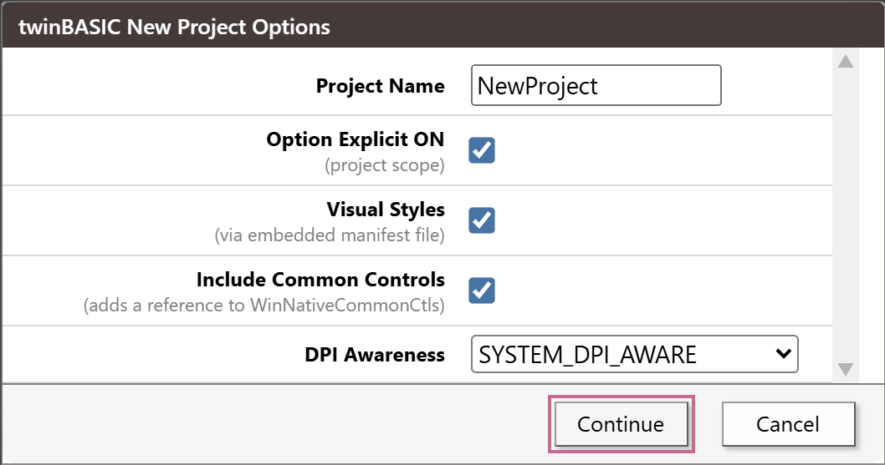
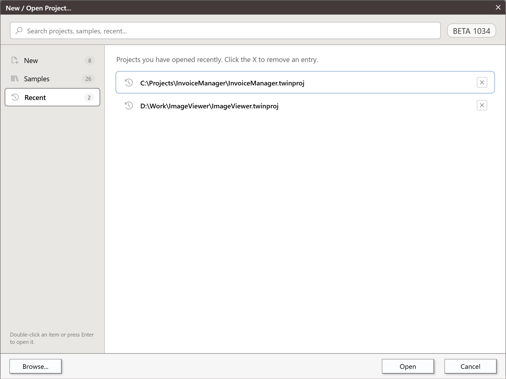
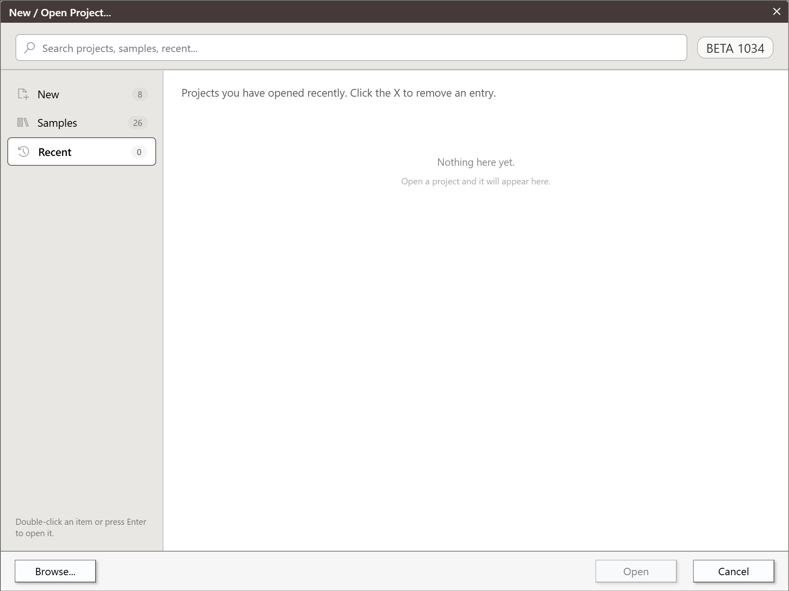

# New Project

The **New / Open Project** dialog makes a project from a template or a sample, imports an existing one, or opens a project you used recently. **File → New Project...** (<kbd>Ctrl</kbd>+<kbd>N</kbd>) opens it, and so does the start of the IDE when no project is named. This page describes the dialog, what each template makes, the **New Project Options** box that follows, and what the new project is.

{:width="970" height="728"}

## Opening the dialog

| How | Opens on |
|---|---|
| The start of the IDE, after the [splash](First-Launch#the-splash) | **New**, or **Recent** when [**Focus The 'Recent' Tab On IDE Startup**](../Customising/IDE-Options#project-explorer-tabs-and-start-up) is on; then the section the dialog was last closed on |
| **File → New Project...** (<kbd>Ctrl</kbd>+<kbd>N</kbd>) | **New** |
| **File → Open Recent...** | **Recent** |

With a project open, the two **File** commands show the dialog over it. Nothing closes until you press **Open** or double-click an item. **File → Open Project...** (<kbd>Ctrl</kbd>+<kbd>O</kbd>) and the dialog's **Browse...** button do not use this dialog's lists: they open the Windows **Open** box. [Opening projects](Opening-Projects) describes them.

### The section is remembered

Every way of closing the dialog --- **Open**, **Cancel**, the close box of the title bar, **Browse...** and <kbd>Esc</kbd> --- saves the section it was on, and so does a click on another section. At the start of the IDE, the dialog first shows the section that **Focus The 'Recent' Tab On IDE Startup** names, and then moves to the saved section. The option therefore decides only before the dialog has been closed for the first time. After that, the saved section wins.

**New Project...** and **Open Recent...** show **New** and **Recent** whatever is saved, and each saves the section it is closed on. A dialog opened from the menu and closed on **Recent** makes the next start open on **Recent**.

If the saved section is **Recent (VB6)** and the machine no longer has a VB6 project to list, the dialog opens on an empty section that reads **Nothing here yet.**, with no section selected in the rail and **Open** greyed out. Click another section.

## The parts of the dialog

- **The title bar** reads **New / Open Project...**. You can drag it, and its close box does what **Cancel** does.
- **The search box**, across the top, has the focus when the dialog opens. At its right, a badge shows the IDE's version.
- **The rail**, down the left, lists the sections **New**, **Samples**, **Recent** and **Recent (VB6)**. Each shows the number of entries it holds; **Recent** shows an ellipsis until its list is read. **Recent (VB6)** is in the rail only when VB6's own list of recent projects holds a `.vbp` file. A hint under the rail reads *Double-click an item or press Enter to open it.*
- **The section**, beside the rail, starts with a line that says what it holds. **New** and **Samples** show **cards**: a name in bold and, for some, a grey line under it. **Recent** and **Recent (VB6)** show **rows**. A section with nothing in it reads **Nothing here yet.**, and while a list is being read it reads **Loading...**.
- **The buttons** are **Browse...**, **Open** and **Cancel**. **Open** is greyed out while nothing is selected, and does nothing then. No button is the default one.

One click on a card or a row selects it, with an outline. A double-click opens it. The first item of the section is selected when the section is drawn, so **Open** has an item to act on unless the section is empty. A selected item that is still in the list after the section is drawn again stays selected.

The text after the first `#` of a name is its **sub-text**, set on a second line. The card `Standard EXE#(Console App)` shows **Standard EXE** over *(Console App)*. Cards and rows follow the same rule. A sample's name starts with its number, and the card does not show it: `Sample 6.    CustomControls` shows as **CustomControls**. [Samples](Samples) lists the numbers, by which the documentation names the samples.

The lists of **New** and **Samples** are read once, when the IDE starts. A folder that you add to the IDE's `projects` folder while the IDE runs shows only after the next start. **Recent** and **Recent (VB6)** are read each time the dialog opens, and not again after you remove an entry.

## Search

The search box looks in every section at once. A word matches an item when it is in the item's name or its path, in either case. Several words must all match. A section's own name is not searched.

- The path of a template is its folder in the IDE's `projects` folder, such as `$\_Standard EXE`. The path of a sample is `$\Sample 10.    twinBASIC IDE Addin`, with its number, so `sample 10` finds a sample by the number its card does not show. The two import cards have the paths `$` and `$$`, so `vbp` finds **Import from VBP...**.
- The results replace the section, and the rail keeps its selection. They are rows, grouped under a small heading for each section that has a match: **New**, **Samples**, **Recent** and, when it is listed, **Recent (VB6)**. The matching text is marked. When two words match in the same line, only the last one is marked. A row of a template or a sample shows the item's path on a further line, and no row has an **X**.
- With no match, the dialog reads **No results found.** and **Open** is greyed out.
- Clearing the box brings the section back. A click on a section in the rail clears the box.

<!-- SHOT starting-search-results: the search box with "standard" typed in the dialog opened on New: results grouped under New (and Samples if any), the matches marked, the path lines under the rows -->

## Keys

- In the search box, <kbd>Enter</kbd> opens the selected item. When nothing is selected, it opens the first one listed. With no results, it does nothing.
- <kbd>Esc</kbd> empties the search box when it holds text, and takes the focus out of the box. A second <kbd>Esc</kbd> presses **Cancel**. With the box empty, <kbd>Esc</kbd> presses **Cancel** at once.
- With the focus outside the search box, <kbd>Up</kbd> and <kbd>Down</kbd> move the selection through the items in the order they are drawn, and wrap round at both ends. In a grid of cards, <kbd>Down</kbd> is the next card. <kbd>Enter</kbd> opens the selected item.
- <kbd>Tab</kbd> from the search box moves the focus to the first card of **New** or **Samples**. Focusing a card does not select it. <kbd>Space</kbd> on a focused card selects it.
- With a card focused, <kbd>Tab</kbd>, <kbd>Left</kbd> and <kbd>Right</kbd> do not move the focus. They move a highlight through **Browse...**, **Open** and **Cancel**.

<!-- test: bug new-project-keyboard-dead-ends -->
> [!NOTE] BETA 1034
> <kbd>Up</kbd> and <kbd>Down</kbd> do nothing while the search box has the focus, which it has when the dialog opens, and no key reaches the sections of the rail. In **Recent**, the search box is the only element that can take the focus: <kbd>Tab</kbd> moves it to the page behind the dialog, a second <kbd>Tab</kbd> to a panel behind that, and then <kbd>Esc</kbd>, <kbd>Enter</kbd> and the arrow keys do nothing until you click. To use the arrow keys in **New** or **Samples**, press <kbd>Tab</kbd> once, or click blank space in the dialog. Choose a section with the mouse, and in **Recent** double-click the row.

<!-- test: bug new-project-enter-acts-twice -->
> [!NOTE] BETA 1034
> After <kbd>Tab</kbd> has moved the highlight to a button, <kbd>Enter</kbd> presses that button and also opens the selected item. **Open** opens the item twice. **Browse...** opens the Windows box and the item. **Cancel** closes the dialog and then opens the selected item: a saved project with no unsaved change is closed with no question, and **New Project Options** opens for the selected card. <kbd>Enter</kbd> on a card that has the focus opens the selected card, not the focused one. Select the card you want with a click or the arrow keys, and press the buttons with the mouse. To cancel from the keyboard, press <kbd>Esc</kbd>.

## What each template makes
{: index="standard exe; create an ActiveX DLL; create ActiveX DLL" index_also="create a DLL project; create dll project; create a dll; create dll" }

The cards of **New** are the template folders of the IDE's `projects` folder, in this order: **Standard EXE** first, the others in alphabetical order, then the two import cards. Each template is one project file. Choosing it makes a new project in memory from that file.

| Card | Project type | Files it makes | References | Startup |
|---|---|---|---|---|
| **Standard EXE** | Standard EXE | `Form1.tbform` and `Form1.twin` (an empty `Form1` class), and the icon `Resources\ICON\twinBASIC.ico` | WinNativeForms, OLE Automation | `Form1` |
| **ActiveX Control** | ActiveX Control | `myActiveXControl.tbcontrol` and `myActiveXControl.twin` (a class with one property and the `ReadProperties` and `WriteProperties` events), and the bitmap `Resources\BITMAP\twinBASIC.bmp` | OLE Automation, Microsoft Add-In Designer, VB, Microsoft Visual Basic for Applications Extensibility 5.3 | none |
| **ActiveX DLL** | ActiveX DLL | `MyClass.twin` (an empty class) | OLE Automation, WinNativeForms | none |
| **Standard DLL** (*non-ActiveX*) | Standard DLL | `MainModule.twin`, with a `[DllExport]` function `MyCoolFunction` and comments on calling it from VB6 or VBA | OLE Automation, the App global object | none |
| **Standard EXE (+VBCCR)** (*experimental*) | Standard EXE | As **Standard EXE**, with a visual-styles manifest | VB, OLE Automation, VBCCR18 | `Form1` |
| **Standard EXE** (*Console App*) | Standard EXE, a console application | `Console.twin` (a `Console` class with `Cls`, `WriteLine` and `ReadLine`), `MainModule.twin` (a `Sub Main` that asks for a name), and the icon | OLE Automation, the App global object | `Sub Main` |

The **VBCCR18** package is embedded in the project of the **+VBCCR** template, so the template file is 4.6 MB.

Every template names the project `NewProject` (the ActiveX Control one, `myActiveXControlProject`), turns **Option Explicit** on for the project, and sets the [*Build Output Path*](../Project-Settings#build-output-path) to `${SourcePath}\Build\${ProjectName}_${Architecture}.${FileExtension}`.

The last two cards, **Import from VBP...** and **Import from folder...**, make no project from a template. See [Importing a VB6 project](Importing-VB6) and [Import from folder](#import-from-folder).

### Custom templates

A folder of the IDE's `projects` folder whose name does not start with `Sample ` is a card of **New**, if it holds a file named `projectName.twinproj`. A leading underscore is not shown, so `_My Template` is the card **My Template**. A `#` splits the name into a name and a sub-text, so `_My#Template (sub)` is **My** over *Template (sub)*. The new cards sort after **Standard EXE**, with the other templates. A folder that starts with `Sample ` and a number, such as `Sample 1c.    Mine`, is a card of **Samples** instead, and sorts by its number. A custom card opens through [New Project Options](#new-project-options), like the others.

To make a template, save a project, copy its file into a new folder of `projects`, and name it `projectName.twinproj`. The IDE reads the folder at the start, and the folder belongs to one IDE folder on disk, so copy it into the `projects` folder of a newer IDE as well.

## New Project Options

Choosing a template, a sample or an imported `.vbp` opens a small box, **twinBASIC New Project Options**, before the project is made. It has the buttons **Continue** and **Cancel**, and **Continue** is the default. The **Project Name** box is selected when the box opens. The rows that show depend on the project.

{:width="529" height="279"}

| Row | Shown for | Default | What **Continue** does |
|---|---|---|---|
| **Project Name** | every project | the name the template sets, such as `NewProject`; for a sample, its own project name; for a `.vbp`, the project's `Name` | Sets the project's name. For anything but a `.vbp`, it also sets the description and the application title to the same text. |
| **Option Explicit ON** *(project scope)* | every project | ticked | Turns [**Option Explicit On**](../Project-Settings#option-explicit-on) on for every file of the project. |
| **Visual Styles** *(via embedded manifest file)* | a Standard EXE that has no manifest yet | ticked | Adds the visual-styles manifest as a resource. |
| **Register to HKEY_LOCAL_MACHINE** *(OFF will register to HKEY_CURRENT_USER)* | an ActiveX DLL or ActiveX Control | unticked for the templates, ticked for an import | Sets [*Register DLLs to HKLM*](../Project-Settings#register-dlls-to-hklm). |
| **Include Common Controls** *(adds a reference to WinNativeCommonCtls)* | a project that references WinNativeForms and not WinNativeCommonCtls, and is not a `.vbp` import | ticked | Adds the reference to the WinNativeCommonCtls package. |
| **DPI Awareness** | a Standard EXE | `SYSTEM_DPI_AWARE`; `NONE` for an import | Sets [*Force Dpi Awareness At Startup*](../Project-Settings#dpi-awareness) to `NONE`, `SYSTEM_DPI_AWARE` or `PER_MONITOR_DPI_AWARE`. |
| **Unicode Common Control Notifications** *(affects manual WM_NOTIFY handling)* | a `.vbp` import | ticked | Sets [*Unicode Control Notifications*](../Project-Settings#unicode-control-notifications). |

The **Project Name** box takes letters, digits and the underscore, and ignores every other key you type. A leading underscore is removed.

<!-- test: bug project-name-paste-unfiltered -->
> [!NOTE] BETA 1034
> The box filters the keys you type, not its text. A name that you paste keeps its spaces, dots and other characters, and becomes the project's name, its description and its application title. With `My Project.x` pasted, the project's root folder has that name, and the build writes `Build\My Project.x_win32.exe`. Type the name, or paste only letters, digits and underscores.

A few more things about the rows:

- **Option Explicit ON** starts ticked for an import too, although the importer itself turns the setting off. A VB6 project that relies on undeclared variables then shows [TB5079 errors](../../../FAQ#unrecognized-variables). Untick the row to keep the VB6 behaviour.
- **Visual Styles** is not offered for a project that has a manifest already: the **Standard EXE (+VBCCR)** template, Sample 20, and a `.vbp` whose `.res` file holds a manifest. It is never offered for an ActiveX project.
- With **Register to HKEY_LOCAL_MACHINE** ticked, an IDE that is not running as administrator shows a warning box when the project's *Register DLL after build* is on. See [The warning at the machine-wide registry](../Building/ActiveX-Registration#the-warning-at-the-machine-wide-registry).
- **Include Common Controls** shows for a sample that references WinNativeForms and not yet WinNativeCommonCtls: Samples 0, 1, 1a, 2, 3, 4, 5, 9, 17, 19, 21 and 22. Samples 1b and 20 have the reference already, and the other samples do not reference WinNativeForms.
- **Continue** also turns [*Large Address Aware (LAA)*](../Project-Settings#large-address-aware-laa) on.

**Cancel** closes the box, the progress indicator and the project. Nothing is opened, and the IDE is left with no project, because the one that was open was closed before the box appeared.

<!-- SHOT starting-options-vbp: New Project Options as a .vbp import shows it: Project Name, Option Explicit ON, Unicode Common Control Notifications, DPI Awareness NONE, and no Include Common Controls row -->

<!-- SHOT starting-options-activex: New Project Options for the ActiveX DLL template, with the Register to HKEY_LOCAL_MACHINE row unticked -->

<!-- SHOT starting-options-sample: New Project Options for Sample 1, HelloWorld: the project name HelloWorldProject, Option Explicit ON, Visual Styles, Include Common Controls and DPI Awareness -->

## What a new project is

A project made from a card is new and **unsaved**. It exists in memory, and no file on disk holds it yet.

- The title bar reads `Unsaved.twinproj - twinBASIC`, then the IDE's version in brackets. A dot in front of the name marks a project with unsaved changes. A project made from a template or a sample is not marked as changed, so you can close it at once without a question. A project made from an import is marked as changed.
- **File → Save Project** (<kbd>Ctrl</kbd>+<kbd>S</kbd>) opens the Windows **Save As** dialog first, with the project's name proposed. **Save Project As...** does the same at any time. The project goes into **Recent** when you save it. See [A project with no file](../Projects/Saving-and-Exporting#a-project-with-no-file).
- The build configuration box keeps the value it has. A `.vbp` import sets it to **win32**.

<!-- SHOT starting-title-unsaved: the IDE's title bar for a new Standard EXE project, `Unsaved.twinproj`, and again after one edit, with the dot in front -->

What opens depends on the template, and on the IDE Option [**Restore Editors State When Opening Project**](../Customising/IDE-Options#project-explorer-tabs-and-start-up). The option is on by default. Each template carries a list of the files to open and the folders to expand. With the option off, no editor opens, and the folders expand as the template says.

| Template | Opens |
|---|---|
| **Standard EXE**, **Standard EXE (+VBCCR)** | `Form1.twin` and the designer of `Form1`, which is in front |
| **ActiveX Control** | `myActiveXControl.twin` and `myActiveXControl.tbcontrol`, with the code in front |
| **ActiveX DLL** | `MyClass.twin` |
| **Standard DLL**, **Standard EXE** (*Console App*) | `MainModule.twin` |

The [Hello World tutorial](../../../Tutorials/Hello-World) starts from this state: **Standard EXE**, **Continue**, and `Form1` in the designer.

<!-- SHOT starting-new-project: a project just made from Standard EXE: the Form1 designer in front, the Project Explorer expanded, the status bar OPERATIONAL with COMMUNITY EDITION -->

## Recent

**Recent** lists the projects you opened last, the newest first. Each row shows the project's full path, and an **X** button at its right edge, titled **Remove from this list**. The **X** removes the entry at once, with no question, and the list is not read again after it.

{:width="970" height="728"}

The IDE adds a project to the list when it starts to load the project, and when you save a project under a name. A project that is opened again moves to the top and is listed once. The list holds 21 entries, and the oldest falls off the end. A project made from a template, a sample or an import is not listed until you save it. A project that cannot be opened stays on the list until you remove it; see [When a project will not open](Opening-Projects#when-a-project-will-not-open).

With nothing in the list, the section reads **Nothing here yet.**, and **Open** is greyed out.

{:width="970" height="728"}

A path that holds a `#` is shown cut in two, as a name with a sub-text: `C:\dev\C#\app.twinproj` shows `C:\dev\C` with `\app.twinproj` under it. The row opens the full path.

### Recent (VB6)

**Recent (VB6)** lists the `.vbp` files that VB6 itself opened recently. The IDE reads VB6's list of recent files, in the registry key `HKEY_CURRENT_USER\Software\Microsoft\Visual Basic\6.0\RecentFiles`, and never writes it. Only entries that end in `.vbp`, in either case, are listed. When the key holds none, the section and its rail item are not shown. The rows have no **X**.

**Open** on a row loads the `.vbp` by the route described under [Importing a VB6 project](Importing-VB6#the-routes), which shows no **New Project Options** box.

<!-- SHOT starting-recent-vb6: the dialog opened on Recent (VB6) with two made-up .vbp paths listed, the rail showing the section with a count of 2 -->

## Samples

The **Samples** section holds the 26 sample projects that ship with the IDE. A sample opens as a new, unsaved project through [New Project Options](#new-project-options), like a template. [Samples](Samples) says what each one is.

## Import from folder

Opens a project from a folder of source files, such as the folder that **File → Export Project** writes. It shows a *Browse For Folder* dialog titled *Select folder of the existing twinBASIC project...*: choose the folder that holds the project's `Settings` file. The card does not take a VB6 project's folder. A `.vbp` goes through **Import from VBP...**.

The project opens with no `.twinproj` file behind it: it is unsaved, and marked as changed. Because it has no file, the first **Save Project** (<kbd>Ctrl</kbd>+<kbd>S</kbd>) opens the *Save As* dialog to ask for one. The folder it is saved in becomes `${SourcePath}`, which the project's [*Export Path*](../Project-Settings#export-path) may use.

If the folder holds the compiler packages under `Packages`, as an export by the IDE does, delete their folders first: imported with them, the project gets a copy of them that the compiler does not use. See [Packing the export back into a project](../Projects/Saving-and-Exporting#packing-the-export-back-into-a-project). [Keeping a project in Git from the IDE](../../../Features/Packages/Import-Export-Tool#keeping-a-project-in-git-from-the-ide) uses this command to open a fresh clone.

<!-- test: bug import-card-closes-project-first -->
> [!NOTE] BETA 1034
> **Import from VBP...** and **Import from folder...** close the open project before the Windows picker opens. If you cancel the picker, the IDE is left with no project and no dialog. The project's file is as it was, and its path is in **Recent**. A project with unsaved changes is asked about first, and **Cancel** in that question keeps the project. **File → Open Project...** and **Browse...** close the project only after you have chosen a file, so cancelling them loses nothing. Open a `.vbp` with **File → Open Project...**, which imports it as the card does. For a folder there is no such command: save the project first, and open it again from **Recent** if you cancel.

## See Also

- [Opening projects](Opening-Projects) -- the other ways to open a project, and what happens as it loads
- [Importing a VB6 project](Importing-VB6) -- the **Import from VBP...** card and the other routes for a `.vbp`
- [Samples](Samples) -- the sample projects
- [First launch](First-Launch) -- the splash, which the dialog follows
- [Saving and exporting](../Projects/Saving-and-Exporting) -- saving a new project, and **Recent**
- [IDE Options](../Customising/IDE-Options) -- the options for the start-up dialog
- [File menu](../Reference/Menu/File) -- **New Project...**, **Open Project...** and **Open Recent...**
