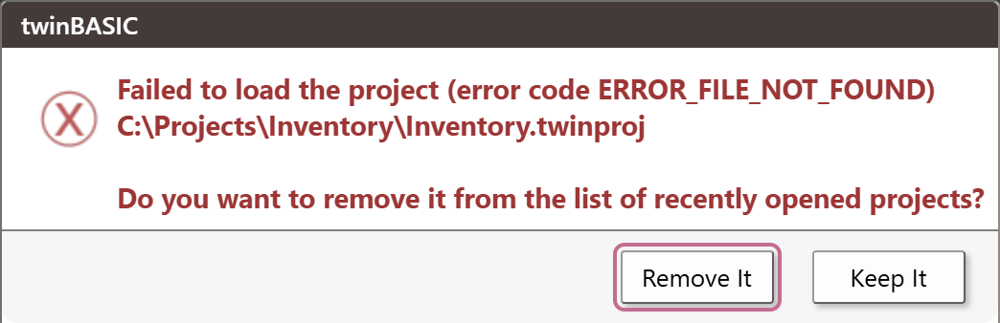

# Opening projects

A saved project is one `.twinproj` file. This page describes the ways to open it, what the IDE does as the project loads, what it remembers about each project, and what you see when a project will not open.

## The ways to open a project

| Way | What it does |
|---|---|
| A double-click on a `.twinproj` file in Windows Explorer | Starts the IDE on the project. There is no splash and no **New / Open Project** dialog. See [The file association](#the-file-association). |
| `twinBASIC.exe <path>` | The same. See [The command line](#the-command-line). |
| **File → Open Project...** (<kbd>Ctrl</kbd>+<kbd>O</kbd>), or **Browse...** in the [New / Open Project](New-Project) dialog | Opens the Windows **Open** box. A name that ends `.vbp` is imported as a VB6 project; any other name is loaded as a twinBASIC project. |
| The **Recent** section of the dialog, or **File → Open Recent...** | Loads the project at the row's path. |
| The **Recent (VB6)** section | Loads the `.vbp` by a route of its own. See [Importing a VB6 project](Importing-VB6#the-routes). |
| A card of **New** or **Samples** | Makes a new, unsaved project from a template or a sample. See [New Project](New-Project). |
| The **Import from VBP...** and **Import from folder...** cards | Open a native picker, then import. See [Import from folder](New-Project#import-from-folder). |
| **Project → Add → Import...** | Is not an open. It copies files of another project into the open one. See [Import](../Projects/Adding-Files#import). |

A `.twin` file, or a folder, is not a project: the IDE answers with the [failure box](#when-a-project-will-not-open).

## The command line

The IDE takes one project on its command line, and opens it at once. The arguments are split at spaces, and a double quote groups words. **A path with a space in it must be quoted.** An unquoted path makes two words, and the IDE then shows the alert *Bad command line syntax.* and starts as with no project: the splash, then the dialog.

A word that starts with `--` is a switch, and the IDE ignores any it does not know. `--no-update-recent-files` keeps the project out of **Recent**. `--buildAndExit32` and `--buildAndExit64` are described under [Compiling from the command line](../../../Features/Packages/Import-Export-Tool#compiling-from-the-command-line). A project whose name ends `.vbp` is imported as a VB6 project, by the route described under [Importing a VB6 project](Importing-VB6#the-routes).

## One project at a time

The IDE holds one project. To open another, from any of the ways above, it closes the open one first:

- It cancels every open dialog.
- If the project has unsaved changes, it asks **You've made changes to this project.  Save now?** The buttons are **Save**, **Discard Changes** and **Cancel**. **Save** opens **Save As** first for a project with no file; cancelling that box leaves everything as it was. **Cancel** keeps the project. [Close Project and Exit](../Projects/Saving-and-Exporting#close-project-and-exit) shows the box.
- It ends the project's compiler, then loads the new project.

**File → Close Project**, **File → Exit** (<kbd>Alt</kbd>+<kbd>F4</kbd>) and the close box of the IDE's window ask the same question.

To have two projects open, start the IDE a second time. Running `twinBASIC.exe` again, or double-clicking a second `.twinproj` file while an IDE is running, starts a new process with a window of its own. The first IDE and its project stay as they were.

## The file association

Windows opens a `.twinproj` file in the IDE through an association that the IDE writes itself. It is per user, under `HKEY_CURRENT_USER\Software\Classes`, and not for the whole machine:

- `.twinproj` belongs to the file type `twinBASIC.ProjectFile`, with the display name *twinBASIC Project*. Its icon is the IDE's own.
- The type's **open** command is `"<IDE folder>\twinBASIC.exe" "%1"`. The path is quoted, so a folder with spaces in its name works.
- Explorer's **New** menu offers a twinBASIC project. The entry copies the **Standard EXE** template file of the IDE folder.

Each start of the IDE writes the `.twinproj` entry and the **New** menu entry again. The **open** command is written when its path differs from the IDE that is running. An IDE started from a folder that the association does not name therefore points the association at itself, whether or not it opens a project. A double-click on a project file then opens the IDE that ran last.

## What happens as a project loads

1. **The build configuration box is set.** The IDE sets the box to the choice it remembers for the project's path, **win32** or **win64**, before the project loads. A path it has never seen leaves the box as it is. [Build configuration](../Building/Build-Configuration#where-the-choice-is-kept) describes it.
2. **The progress indicator shows.** The IDE adds the path to [**Recent**](New-Project#recent), at the start of the load, and asks the compiler to load the project. When the project has loaded, it connects to the compiler, clears the *changed* mark and starts the compiler's services. The status bar changes to **tB Services: OPERATIONAL**, and the licence box shows the edition.
3. **The project may load a second time.** See [The DEP and large-address reload](#the-dep-and-large-address-reload).
4. **The IDE restores the project's state:** the open editors, the expanded folders and the other things listed under [What the IDE remembers](#what-the-ide-remembers-of-a-project).
5. **A reference that cannot load opens Project Settings.** About two seconds after the load, the IDE opens [**Project Settings**](../Project-Settings#library-references) by itself, on **Library References**, with the rows that did not load flagged. It shows no message and writes nothing to the Debug Console.
6. **The IDE checks the packages and loads the add-ins.** With the option [**Check referenced packages are up-to-date**](../Customising/IDE-Options#project-explorer-tabs-and-start-up) on, the Debug Console lists each package with a tick or a cross. The IDE then loads the [add-ins](../AddIns/).

**Hold <kbd>Shift</kbd> while a project loads** to stop the add-ins loading. The package check does not run either. The Debug Console says `[IDE] SHIFT KEY DETECTED: DISABLED LOADING OF ADDINS`, once.

### The DEP and large-address reload

The IDE starts a compiler with DEP off and the large-address flag on. A project whose [*Large Address Aware (LAA)*](../Project-Settings#large-address-aware-laa) or [*Data Execution Prevention Aware (DEP)*](../Project-Settings#data-execution-prevention-aware-dep) setting does not match makes the IDE close the project and load it again, with the flags it asks for. You see only the progress indicator start again. There is no message and no line in the Debug Console. The flags then follow the project.

A project from the **Standard EXE** template sets neither flag, so a saved default project opened first in an IDE loads twice. A new project made from a card does not: **Continue** turns *Large Address Aware* on, which matches.

<!-- test: bug open-takes-earlier-settings -->
> [!WARNING] BETA 1034
> After the IDE has loaded a project twice for its flags, and you have then pressed **Continue** in **New Project Options**, the next project you open can take the whole *Settings* of the project before it, with no message. Its sources stay its own. This happens to a saved `.twinproj`, to a `.vbp` opened from **Recent (VB6)**, and to **Import from folder...**, but not to a `.vbp` chosen through the **Import from VBP...** card.
>
> For example, open a saved project with *Large Address Aware* off, import any `.vbp` with **Import from VBP...** and press **Continue**, then open another project and choose **Discard Changes** for the import. A template does the same in place of the import, if you first open a saved project with *Large Address Aware* on.
>
> The opened project is not marked as changed, and the title bar shows its own file name, but the top of the Project Explorer tree shows the earlier project's name. **File → Save Project** (<kbd>Ctrl</kbd>+<kbd>S</kbd>) then writes the earlier project's name, application title, project ID, startup object, build path and references into the file, and the file's own settings are lost. If the top of the tree shows a name that is not your project's, do not save: close the project without saving, which leaves the file as it was, and open it again.

<!-- test: bug laa-mismatch-after-new-project -->
> [!NOTE] BETA 1034
> In an IDE that has not yet loaded a project twice, a saved project with *Large Address Aware* off fails to open if it is the first project opened after a **Continue** in **New Project Options** and a **File → Close Project**. The box reads *Failed to load the project (error code MISMATCHED LAA OR DEP AWARENESS)*. The file is not changed. Choose **Keep It**, and open the project again: the second open works.

## What the IDE remembers of a project

The IDE saves the state of the open project every five seconds, apart from its files: the expanded folders, the open editors with their state, the Debug Console's typed history, the expanded nodes of the Variables panel, the watches, the options of the Outline, debug and problems panels, the history panels, the position and size of the tool windows, the bookmarks, the options and history of Find / Replace and Find In Project, and the history of the Memory panes. For a project that has a file, the IDE keeps it in the registry, with a value for each path. A project with no file has none. [Saving and exporting](../Projects/Saving-and-Exporting#what-the-ide-remembers-about-a-project) says more.

**Save Project As...** also writes the state into a hidden `.meta` entry inside the project, so that it travels with the `.twinproj` file. When the project opens, the registry's copy wins, and the `.meta` entry is used when the registry has none, for example on another PC. The [IDE Option](../Customising/IDE-Options#project-explorer-tabs-and-start-up) **Restore Editors State When Opening Project** decides whether the open editors come back. The templates and the samples carry a `.meta` entry too, which is why a new project opens with files already in tabs.

The build configuration box is remembered for each project path as well. A project that was never saved has no path, so its choice lasts for the session.

## When a project will not open

When the IDE cannot load a project, it closes it and shows a box:

**Failed to load the project (error code ...)**, then the project's path, and the question **Do you want to remove it from the list of recently opened projects?** The buttons are **Remove It**, which is the default, and **Keep It**.

{:width="530" height="173"}

The code names the cause:

| Code | Opening |
|---|---|
| `ERROR_FILE_NOT_FOUND` | a missing file, or a folder |
| `ERROR_BAD_FILE_FORMAT` | a `.twin` file, an empty file, a text file, or a project file whose first bytes are wrong |
| `MISMATCHED LAA OR DEP AWARENESS` | a project whose settings still disagree with the compiler after the reload; see the [note above](#the-dep-and-large-address-reload) |

Any other failure shows `ERROR_GENERIC`, or `ERROR_UNKNOWN` with a number. The box leaves no project open, and writes nothing to the Debug Console. The path was added to **Recent** when the load began, so the question is accurate. **Remove It** takes the path off the list, and **Keep It** leaves it there.

### A damaged project

A file whose first bytes are right and whose body is damaged gets no failure box. The compiler shows a native Windows box instead, titled *bad file format*. It reads *WARNING: failed to deserialize file system.  Some files might be lost or truncated.* and has one **OK**. The IDE's window shows *Please wait...* until you answer it, and the box shows twice when the project also reloads for its flags.

<!-- SHOT starting-damaged-box: the native bad file format box over the IDE showing Please wait..., from opening a damaged copy of a throwaway project -->

The project then opens with what the compiler could read. It is not marked as changed, and its title is the file's name. What is kept depends on where the damage is:

- **Damage that breaks the structure inside the `Sources` tree loses every source.** A folder that fails to read is dropped whole, so a damaged project never keeps some of its sources and loses others. Damage in the file's header, before its `Settings` entry has been read, also loses every source, and the project is named `RECOVERED_PROJECT` and has default settings.
- **Damage after the `Sources` tree keeps every source.** Damage in the `Resources` part, which follows, loses the icon.
- **Damage inside the text of one source**, with the structure intact, raises no box at all. The project opens with that text damaged.
- **With the `Settings` entry read**, the project keeps its own name and settings, even when its sources are gone.

<!-- test: bug recovered-project-save-overwrites -->
> [!WARNING] BETA 1034
> A project that opens after the *bad file format* box is not marked as changed, and the next save writes only what was recovered over the damaged file, with no question and no backup. **File → Save Project** (<kbd>Ctrl</kbd>+<kbd>S</kbd>), **Project → Add → Import...** and **Apply Changes** in Project Settings, when the change restarts the compiler, all save it. Save a damaged project only with **File → Save Project As...** under a new name: the new file holds what was recovered, and the damaged file stays as it was. Closing without saving leaves it as it was too. Copy the damaged file before you open it.

<!-- test: bug damaged-settings-box-loop -->
> [!NOTE] BETA 1034
> A `.twinproj` file damaged inside its `Settings` entry shows the *bad file format* box again after every **OK**, without end. The IDE's window stays on *Please wait...*, with no project and no close box, and the file is not changed. End the IDE, for example in the Task Manager, and restore the file from a copy.

## See Also

- [New Project](New-Project) -- the dialog, and the **Recent** sections
- [Importing a VB6 project](Importing-VB6) -- the routes for a `.vbp`
- [Saving and exporting](../Projects/Saving-and-Exporting) -- save, **Save As**, close and the recent list
- [Build configuration](../Building/Build-Configuration) -- the box that each project remembers
- [Project Settings](../Project-Settings) -- *Large Address Aware (LAA)*, *Data Execution Prevention Aware (DEP)* and the other settings of a project
