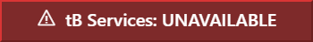
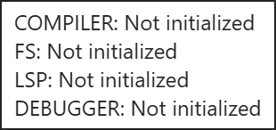
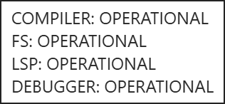
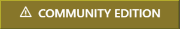
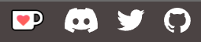

# Status Bar

{:width="661" height="27"}

With no project open, no compiler is connected: the services badge reads **UNAVAILABLE** and the licence badge reads **tB Licence: NOT READY**. Both change once a project has loaded and the compiler has answered.

The Status Bar runs along the bottom of the IDE window. From left to right it holds the [services badge](#services), the [licence badge](#licence), the [links](#links) to community resources, a [**PROCESS** box](#other-boxes) for each program that your program started, the [progress bar](#other-boxes), the [command name](#status), the [memory box](#other-boxes) and the [line and column box](#other-boxes). The progress bar, the memory box and the line and column box show only in some states.

## Services

{:width="175" height="24"}

{:width="155" height="73"}

{:width="175" height="25"}

{:width="175" height="24"}

{:width="158" height="73"}

The badge's tooltip has one line for each of the four connections between the IDE and the compiler: **COMPILER**, **FS** (the project's files), **LSP** (the editor's language features, over the [Language Server Protocol](https://microsoft.github.io/language-server-protocol/)) and **DEBUGGER**. Each line gives that connection's state:

- **Not initialized** --- the connection has not been made, because no project has loaded since the IDE started;
- **Connecting** or **Disconnecting** --- the connection is being opened or closed;
- **OPERATIONAL** --- the connection is open;
- **Disconnected** --- the connection has closed, as it has after **Close Project**;
- **Error occured** --- the connection failed. The IDE spells it this way.

The badge reads **OPERATIONAL** when all four are open, **LIMITED** when one to three are open, as they are for a moment while a compiler starts, and **UNAVAILABLE** when none is. A running program does not change it. The badge cannot be clicked. [Compiler services](../Troubleshooting/Compiler-Services#the-services-badge) says what to do when it does not return to OPERATIONAL, and what a crash looks like.

## Licence

The licence badge reads **tB Licence: NOT READY** until the compiler answers. After that it reads the edition alone, without the prefix:

| The badge reads | Look | Meaning |
|---|---|---|
| **PERSONAL EDITION** | green, with a tick | A Personal licence. |
| **PROFESSIONAL EDITION** | green, with a tick | A Professional licence. |
| **ULTIMATE EDITION** | green, with a tick | An Ultimate licence. |
| **COMMUNITY EDITION** | orange or olive, with a warning triangle | No key, an invalid key, or any other answer. |

{:width="151" height="25"}

Pointing at the badge shows the edition again. Clicking it opens the **Enter Licence Key** dialog, once a project is loaded; **Help → Enter Licence Key...** opens the same dialog at any time, and **Help → Purchase A Licence...** opens [the pre-order page](https://twinbasic.com/preorder.html). [First launch](../Starting/First-Launch#the-licence-and-the-edition) describes the dialog and the editions.

When the compiler reports that a licence has expired or has been revoked, the badge keeps its text, and a box titled **Licence Problem!** says so. [The licence](../Troubleshooting/Missing-Files#the-licence) lists what else can go wrong.

## Links

{:width="128" height="27"}

A click on an icon opens a page in your default browser. Nothing opens inside the IDE.

- Ko-fi: https://ko-fi.com/twinbasic
- Discord: https://discord.gg/UaW9GgKKuE
- Twitter: https://twitter.com/waynephillipsea
- GitHub: https://github.com/twinbasic/twinbasic --- the repository's front page, not the form for a new issue

The same four are items of the [Help menu](Menu/Help). See [Reporting a problem](../Troubleshooting/#reporting-a-problem).

## Other boxes

- **PROCESS** boxes --- one green box, `PROCESS <pid>: RUNNING`, for each program that your program started. See [Programs that your program starts](../Debugging/Running#programs-that-your-program-starts).
- **The progress bar** --- a bar with the compiler's own text on it. It shows only while the compiler reports progress, for example while LLVM compiles.
- **The memory box** --- `<n>MB in use  |  <n> ui objects  |  <n> gdi objects`, the figures of the running program. It shows only when the IDE Option **IDE: Show memory and resource usage** is on and a project is loaded. See [IDE Options](../Customising/IDE-Options).
- **The line and column box** --- `Ln <n>, Col <n>`, shown only while a code editor is the active tab. A click opens the editor's own box for going to a line. It is hidden for a form designer, an image's preview and a Settings editor.

The four counters of errors, warnings, hints and infos are not in the status bar. They are in the header of the [DIAGNOSTICS panel](../Code/Diagnostics).

## Status

The region left of the memory box names the command a click would trigger --- the command under the mouse cursor. It gives the IDE's internal command identifier rather than the menu caption, so pointing at **Close Project** on the File menu shows **tbProject_Close**, as in the screenshot at the top of this page.

The name goes when the pointer leaves the icon or the menu item. It stays only when the item goes away under the pointer: a menu that closes on a click or on <kbd>Esc</kbd> leaves the name of the last item it showed, until the pointer enters another item that has a command.

These are the same identifiers the keyboard shortcut map is keyed by --- see [Window](Menu/Window) for the full list and the keys bound to each one.

## See Also

- [When something goes wrong](../Troubleshooting/) -- the badges' failures, and what to do
- [Compiler services](../Troubleshooting/Compiler-Services) -- the services badge, restarts and Safe Mode
- [Customising the IDE](../Customising/) -- the IDE Options and where the IDE keeps its settings
