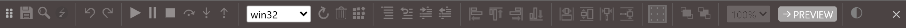
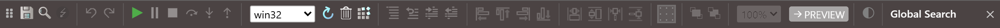
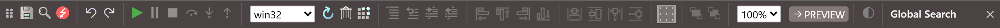
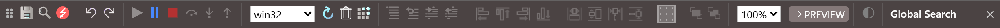

# Toolbar

The toolbar is the row of buttons under the menu bar. Most buttons run a command that a menu holds too, and a button's tooltip gives its name and its key. A button is greyed out while its command cannot run, so the row changes with what you are doing.

With no project open, every button is greyed out.

{:width="1128" height="35"}

With a project open, the buttons for saving, finding, starting and building are available.

{:width="1228" height="35"}

With a form open in the designer, **Switch Between Form And Code** turns red, and the zoom box shows the form's zoom. The buttons that arrange controls wait for a selection.

{:width="1228" height="35"}

While a program runs, **Start / Continue** is greyed out, and **Break Into Code** and **Stop** are available.

{:width="1228" height="35"}

## Saving and finding

**Save All Changes** (<kbd>Ctrl</kbd>+<kbd>S</kbd>)
: Saves the whole project, as **File → Save Project** does. See [Save Project](../Projects/Saving-and-Exporting#save-project).

**Find In Project...** (<kbd>Ctrl</kbd>+<kbd>Shift</kbd>+<kbd>F</kbd>)
: Opens the **FIND / REPLACE** panel with **Current Project** ticked. See [Search the whole project](../Code/Finding#search-the-whole-project).

**Switch Between Form And Code**
: Opens the code file from the designer, and the designer from the code file. It has no key. See [Switch between design and code](../Forms/Designer#switch-between-design-and-code).

**Undo** and **Redo**
: Step back and forward through the changes to the file or the form. See [Undo and redo](../Code/Editor#undo-and-redo).

## Running and stepping

**Start / Continue** (<kbd>F5</kbd>), **Break Into Code** (<kbd>Ctrl</kbd>+<kbd>Break</kbd>) and **Stop**
: Start the program or continue it, pause it, and end it. See [Start, Break and End](../Debugging/Running#start-break-and-end).

**Step Over** (<kbd>Shift</kbd>+<kbd>F8</kbd>, <kbd>F10</kbd>), **Step Into** (<kbd>F8</kbd>, <kbd>F11</kbd>) and **Step Out** (<kbd>Ctrl</kbd>+<kbd>Shift</kbd>+<kbd>F8</kbd>, <kbd>Shift</kbd>+<kbd>F11</kbd>)
: Run a paused program one statement at a time. **Step Out** is on no menu. See [Step commands](../Debugging/Breakpoints-and-Stepping#step-commands).

## Building

**Choose a build configuration**
: The box that chooses 32-bit or 64-bit. See [Build configuration](#build-configuration), below.

**Restart the compiler**
: Ends the compiler and starts a new one. With <kbd>Alt</kbd> held, it also restarts the process that caches LLVM code. See [Restart the compiler](../Building/Build-Configuration#restart-the-compiler).

**Clean (deregister & delete build)**
: Deregisters the previously built DLL, if there is one, and deletes the previous build file. See [Clean](../Building/Build-and-Clean#clean).

**Build**
: Compiles the project into a file. See [Build](../Building/Build-and-Clean#build).

## Editing code

**Comment Selection** (<kbd>Ctrl</kbd>+<kbd>K</kbd>) and **Uncomment Selection** (<kbd>Ctrl</kbd>+<kbd>Shift</kbd>+<kbd>K</kbd>)
: Put `' ` in front of each selected line, or take it away. See [Edit the text](../Code/Editor#edit-the-text).

**Indent Block** (<kbd>Ctrl</kbd>+<kbd>]</kbd>) and **Outdent Block** (<kbd>Ctrl</kbd>+<kbd>[</kbd>)
: Move the selected lines one level in or out. See [Indent and outdent](../Code/Editor#indent-and-outdent).

## Arranging controls

These buttons act on the form designer. The [Format menu](Menu/Format) holds most of the same commands, and [Arranging controls](../Forms/Arranging) explains them.

**Align controls to the LEFT**, **TOP**, **RIGHT** and **BOTTOM** (<kbd>Alt</kbd>+<kbd>Left</kbd>, <kbd>Alt</kbd>+<kbd>Up</kbd>, <kbd>Alt</kbd>+<kbd>Right</kbd> and <kbd>Alt</kbd>+<kbd>Down</kbd>)
: Move every selected control to that edge of the selection. See [Align](../Forms/Arranging#align).

**Resize controls to the WIDEST**, **TALLEST**, **NARROWEST** and **SHORTEST** (<kbd>Ctrl</kbd>+<kbd>Shift</kbd>+<kbd>Right</kbd>, <kbd>Ctrl</kbd>+<kbd>Shift</kbd>+<kbd>Down</kbd>, <kbd>Ctrl</kbd>+<kbd>Shift</kbd>+<kbd>Left</kbd> and <kbd>Ctrl</kbd>+<kbd>Shift</kbd>+<kbd>Up</kbd>)
: Give every selected control the size of the widest, tallest, narrowest or shortest one. See [Make the controls the same size](../Forms/Arranging#make-the-controls-the-same-size).

**Toggle the grid indicators ON/OFF**
: Shows or hides the form's grid. Pointing at the button opens the grid options. See [Grid and outlines](../Forms/Designer#grid-and-outlines).

**Bring the selected control to the FRONT of the z-order** and **Send the selected control to the BACK of the z-order**
: Change the order in which controls are drawn. See [Bring to front and send to back](../Forms/Arranging#bring-to-front-and-send-to-back).

**Form designer zoom ratio**
: The box that scales the form designer. See [Zoom](../Forms/Designer#zoom).

**PREVIEW**
: Titled **Launch the form in isolation to test its functionality**, it runs the form on its own, in a window of its own. See [Previewing a form](../Forms/Previewing).

## Other buttons

**Change IDE Theme**
: Opens the list of themes. See [Themes](../Customising/Themes).

**Global Search**
: Opens the window of the [Global Search](../AddIns/GlobalSearch) add-in, which adds this button. Other add-ins can add buttons of their own here.

## Customising the toolbar
{: index="customize toolbar; customise toolbar; add toolbar button" }

The toolbar's buttons cannot be customised: no command or option adds, removes or moves a button. Only an add-in can add one, with [**AddButton**](../../Packages/tbIDE/Toolbar#addbutton).

The toolbar itself is a panel. The **Close this panel** button at its right-hand end hides it, and it stays hidden until **View → TOOLBAR** brings it back as a floating panel. The grip icon at its left-hand end moves it, as it moves any docked panel, and **Window → Panel Layouts → Default Built-in Layout** puts it back under the menu bar. See [Panel layouts](../Customising/Panel-Layouts).

## Build configuration

The build configuration box chooses whether the project is compiled as 32-bit or 64-bit code:

- **win32** builds a 32-bit executable or DLL.
- **win64** builds a 64-bit one. [64-bit Office](../../../Features/Project-Configuration/Project-Types#calling-a-standard-dll-from-vba-or-excel), for example, can load only a 64-bit DLL.

<kbd>Ctrl</kbd>+<kbd>F1</kbd> switches to **win64**, and <kbd>Ctrl</kbd>+<kbd>F2</kbd> switches to **win32**. The keys are the default bindings of the IDE commands `tbBuild_SwitchToWin64` and `tbBuild_SwitchToWin32`, and [Manage Keyboard Shortcuts](Menu/Window#manage-keyboard-shortcuts) can change them.

The IDE remembers the choice for each project, and sets the box back to it when the project is opened again. It keeps the choice in its own settings, under the path of the `.twinproj` file, not in the project. A project with no remembered choice uses whatever the box shows, and a newly started IDE shows **win32**.

Every change restarts the compiler as a program of the chosen architecture, with no question, and a program that is running or paused is ended. The box also sets the `Win64` compiler constant --- 1 in **win64**, 0 in **win32** --- and so decides which branch of an `#If Win64` block the editor treats as active and which it greys out. [Compiler Constants](../../../Reference/Compiler-Constants#appearance) shows the same code in both modes.

The default [Build Output Path](../Project-Settings#build-output-path) puts `win32` or `win64` in the file name, so the two builds do not overwrite each other.

The box has a third entry, **safeMode**. It opens the project's files without starting the compiler services, and the IDE switches to it by itself when the compiler keeps crashing. [Build configuration](../Building/Build-Configuration) describes the three entries, what a change does and what safe mode does.
