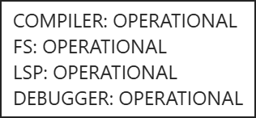
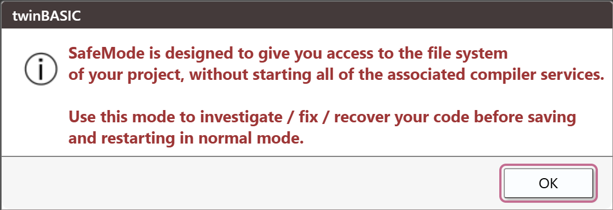

# Compiler services

The IDE does not compile anything. When a project loads, it starts a compiler process and opens four connections to it, each named on the status bar: **COMPILER** (the control channel: load, save, build, restart), **FS** (the project's files), **LSP** (the editor's language features: completion, hover, the DIAGNOSTICS rows) and **DEBUGGER** (running, pausing, the console and the debugging panels). This page describes how the status bar shows those connections, what a crash of the compiler looks like, what **Restart the compiler** does, and the states the IDE falls into when the compiler cannot be used.

## The services badge

The first box of the [status bar](../Reference/StatusBar) shows how many of the four connections are open.

| Open connections | The badge reads | Look |
|---|---|---|
| 4 | **tB Services: OPERATIONAL** | green, with a tick |
| 1 to 3 | **tB Services: LIMITED** | orange or olive, with a warning triangle |
| 0 | **tB Services: UNAVAILABLE** | red, with a warning triangle |

{:width="175" height="24"}

Pointing at the badge shows one line for each connection, in the order **COMPILER**, **FS**, **LSP**, **DEBUGGER**. Each line gives the state of the connection:

| The line reads | The connection is |
|---|---|
| **Not initialized** | not made yet, because no project has loaded since the IDE started |
| **Connecting** | being opened |
| **OPERATIONAL** | open |
| **Disconnecting** | being closed |
| **Disconnected** | closed. This is what the lines read after **Close Project**, and for a moment while a compiler ends |
| **Error occured** | broken, or it could not be made. The IDE spells it so |

{:width="158" height="73"}

The words OPERATIONAL, LIMITED and UNAVAILABLE come from the IDE's language pack, and the rest are in English whatever the language.

When a compiler starts, the badge goes through UNAVAILABLE and LIMITED to OPERATIONAL in about one to two seconds. The **COMPILER** connection opens first, and then **FS**, **LSP** and **DEBUGGER**, in that order. A badge that stays on UNAVAILABLE or LIMITED, with the lines to tell which connection is missing, is the sign that something is wrong. A program that is running, paused or stopped does not change the badge.

The badge cannot be clicked.

<!-- SHOT trouble-services-limited: the badge on LIMITED with the tooltip open, FS OPERATIONAL, LSP and DEBUGGER not yet, to show which line is missing -->

## A crash

When the compiler process ends without being asked to, whether it crashed or was killed, the IDE notices that all four connections have closed. It does not show a box or a message. The badge goes to UNAVAILABLE, the four lines read **Disconnected**, and the IDE starts a new compiler at once. The only trace is one line in the **DEBUG CONSOLE**:

```text
restarting from MEMORY [<the project's path>]
```

The line reads `restarting from FILE` instead when the IDE holds no copy of the project in memory. About one to two seconds after the crash, the badge is OPERATIONAL again.

If a program was running or paused, it has ended, and the console shows no `aborted` line of its own: it goes from the program's last output straight to `restarting from MEMORY`. The Call Stack, the Variables panel, the list of **PROCESS** boxes and the Memory panel are empty. Your unsaved edits are still there; see [What a restart keeps and loses](#what-a-restart-keeps-and-loses).

A crash of the compiler is not the same as a native exception in your program. A native exception prints a red `NATIVE EXCEPTION` line, ends the program, and leaves the compiler running, so the badge does not move. See [Native exceptions](Diagnostic-Tools#native-exceptions).

## Restart the compiler

**Restart the compiler** ends the compiler process and starts a new one, which loads the project from the IDE's memory. It is the repair for most states on this page.

The IDE asks no question before it restarts the compiler, whichever way you cause it:

| What you do | Notes |
|---|---|
| Press the toolbar button **Restart the compiler** | It has no key. With <kbd>Alt</kbd> held, it also ends the process that caches LLVM code, and then restarts. |
| **Tools → Restart the compiler** | Greyed out with no project open. |
| **Tools → Flush the LLVM compiler cache** | Ends the cache process, then restarts. |
| **Help → Compiler services TRACE mode** | Switches the mode and restarts. See [TRACE mode](Diagnostic-Tools#trace-mode). |
| Change the build configuration box, between **win32**, **win64** and **safeMode** | See [Build configuration](../Building/Build-Configuration). |
| Change an IDE Option that needs it | [IDE Options](../Customising/IDE-Options) marks these. |
| Change a Project Settings value that needs it | The console writes `[COMPILER] Project settings changes require compiler-restart`, the IDE saves the project without asking, and the compiler restarts after the save. A setting that does not need it writes `[COMPILER] Project settings updated`. |
| Rename a project, or add a package that forms need | See [Projects and files](../Projects/). |
| Choose **OK** in the box *The IDE timed out while trying to save the project.* | See [When the compiler does not answer](#when-the-compiler-does-not-answer). |
| A crash | Automatic. |

The IDE ends the old compiler by force, and does not ask it to close. A box titled **Please wait...**, with a percentage bar, covers the IDE until the new compiler has the project. It lasts about a second for a small project, and about eleven seconds after a switch of the build configuration box.

<!-- SHOT trouble-please-wait: the Please wait... box with its percentage bar, during a restart from the toolbar -->

The licence is asked again after a restart, so the licence box reads **tB Licence: NOT READY** for a moment and then the edition.

### What a restart keeps and loses
{: #what-a-restart-keeps-and-loses }

The IDE replays everything you did in this session into the new compiler, so the new compiler holds the project as the IDE shows it.

| Kept | Notes |
|---|---|
| Unsaved edits, and the changed mark in the title bar | The IDE sends the text of the open editors, and replays each file you created, moved, deleted or wrote. |
| Open editor tabs, the tab that is selected, the caret | The restart does not close tabs. |
| Breakpoints | Including those you set since the last save. |
| Watches, bookmarks, the history of the Debug Console, of **FIND / REPLACE** and of the **HISTORY** panel, the Outline filters | The watches show **not available** until the next run. |
| Open form designers | The IDE presses **RESYNC** itself when the project has loaded. |
| The project, its path, the IDE Options, the layouts | Untouched. |

| Lost | Notes |
|---|---|
| A running or paused program | It dies at once. `Form_Unload` and `Class_Terminate` do not run. |
| The contents of the Call Stack, Variables and Memory panels | They fill again at the next stop. |
| The **PROCESS** boxes, and the processes that your program started | The restart ends them. |
| The contents of the DIAGNOSTICS panel | They come back when the compiler has compiled the project again. |
| The add-ins' toolbar buttons, menu items and key bindings | The IDE removes them and loads the add-ins again when the project has loaded. A docked add-in window stays where it is and reads **(currently unavailable)** until its add-in fills it again. A detached window gets a message to close. The add-in's own `Class_Terminate` does not run. |

<!-- test: bug restart-reverses-file-order -->
> [!NOTE] BETA 1034
> Each restart reverses the order of the project's files inside the compiler, and so does each switch of the build configuration box. **Save** writes that order into the project's file. The code of a built executable follows it, so two builds of an unchanged project can place their code differently. A second restart puts the order back. To compare two builds, make them with no restart, switch or save between them.

A restart of a project with a linked package whose file is gone behaves differently; see [A linked package's missing file](#a-linked-packages-missing-file).

The text of the DEBUG CONSOLE is not cleared by a restart. Only closing the project clears it.

## The crash loop

If the compiler keeps ending, restarting it again and again does nothing useful. The IDE counts its automatic restarts. When it has made a fourth within 60 seconds, it switches to Safe Mode, and the floating message box says:

> Compiler crash loop detected.  Restarting in SAFE mode.

The build configuration box then reads **safeMode**. A **Please wait...** box follows for a moment, and then the Safe Mode box opens. All of this takes about half a second.

The count starts with one entry whenever a project opens, whenever you press **Restart the compiler**, and whenever you change the build configuration box. So **three crashes within 60 seconds of opening a project, of a restart or of a switch of the build box** are enough; after a longer calm, four are needed. Pressing the button over and over does not cause the loop by itself.

<!-- SHOT trouble-crash-loop: the floating message "Compiler crash loop detected.  Restarting in SAFE mode." above the status bar with the Safe Mode box in front, both showing together -->

The floating message stays for a minute. Safe Mode gives you access to the project's files, so that you can copy them out or fix them.

## Safe Mode

Safe Mode is the third entry of the build configuration box, **safeMode**. The IDE chooses it by itself in a crash loop, and you can choose it. The compiler still starts, but it does not compile. The IDE still makes the four connections.

When the project has loaded in Safe Mode, a box opens with these words:

{:width="556" height="192"}

> SafeMode is designed to give you access to the file system of your project, without starting all of the associated compiler services. Use this mode to investigate / fix / recover your code before saving and restarting in normal mode.

It has one **OK** button and does not close by itself. Another dialog that opens closes it.

**The badge reads OPERATIONAL in Safe Mode, with four lines that read OPERATIONAL, although the language services do not work.** It is the one state in which OPERATIONAL does not mean that. Here is what works and what does not:

| Works | Does not |
|---|---|
| Opening and editing the project's files | **Build** and **Clean** look available and do nothing: no line, no box. |
| <kbd>Ctrl</kbd>+<kbd>S</kbd> and **Save All Changes**, which write the project | **Start** does not run the program (see the note below). |
| Unsaved edits, which survive the switch into Safe Mode and out of it | Hover shows nothing, and completion lists nothing. |
| **Export Project** and **Restart the compiler** | The form designer's **RESYNC** answers **Can't resync the form designer in Safe Mode**. |
| The rows that DIAGNOSTICS held before | The DIAGNOSTICS counters read 0 while the rows stay. |

To leave Safe Mode, choose **win32** or **win64** in the build configuration box. That restarts the compiler, and the counters come back when the project has compiled again. The choice of **safeMode** is not remembered for the project. [Build configuration](../Building/Build-Configuration#safe-mode) describes the box.

<!-- test: bug safe-mode-start-never-runs -->
> [!NOTE] BETA 1034
> **Start** in Safe Mode never runs the program and never ends. The console prints `Executing 'Main'...` and `WARNING: execution delayed; waiting for background compilation to finish`, then nothing more; the IDE stays in the running state and **Stop** does nothing. Restart the compiler, or choose **win32** or **win64** in the build configuration box, to end it. To run the program, leave Safe Mode first.

<!-- SHOT trouble-safe-mode-bar: the status bar and the toolbar with the box on safeMode, after OK, to show the green OPERATIONAL badge beside it -->

## When the compiler does not answer

The IDE has no watch on the compiler and no state for a compiler that is not responding. Its only protection is a time limit around some operations. Each time-out opens a box with one **OK** button.

| When | Waits | The box says |
|---|---|---|
| Sending the open documents to a new compiler | 10 s | *The IDE timed out while trying to synchronize the currently open documents.*, then that the load will try to continue and that you should make backups of recently edited documents by hand |
| Replaying your file operations into a new compiler | 10 s, for each operation | *The IDE timed out while trying to reload the project from memory.*, and the same advice |
| Saving the open documents | 10 s | *The IDE timed out while trying to save the currently open documents.*, and the same advice |
| Writing the project | 20 s | *The IDE timed out while trying to save the project.*, and that the background compiler process will now restart automatically and you should then try to save again |
| Any of the first three, when a document raises an error | at once | *&lt;n&gt; errors occured when trying to synchronize changes of the open documents in the IDE with the compiler process.* (or *to save changes of the open documents in the IDE.*), the same advice, and *Check the DEBUG CONSOLE for details.* The console names each document, as `[ERROR] synchronizing open document <tab>` |

The first three boxes let the operation go on. **OK** in the fourth restarts the compiler. When you see any of these, copy the text of the files you changed into another program before you do anything else.

Two shorter messages mean the same thing. A designer or Properties action while a request is outstanding says **Backend compiler seems to be busy.  Check there isn't a modal dialog box open behind the IDE window.** A debugger command with no DEBUGGER connection writes `ERROR: DEBUGGER IS NOT CONNECTED.` in red to the console.

## A linked package's missing file
{: #a-linked-packages-missing-file }

A project can reference a [linked package](../../../Features/Packages/Linked), a package file that stays in `%APPDATA%\twinBASIC\packages`. If that file is gone, the project still opens. The References part of Project Settings opens by itself, and the package's row reads **ERROR unable to load this reference**. DIAGNOSTICS counts the names the package would have given.

**Restart the compiler** with the file gone shows a native Windows box about a second after you press the button. It is titled **shutdown** and reads `Run-time error '-2147467259'` and `Unspecified error`, with one **OK**. Behind it the badge reads LIMITED, and **Please wait...** reads 5.0%.

<!-- test: bug missing-linked-package-restart-box -->
> [!NOTE] BETA 1034
> The box that a restart shows when a linked package's file is missing names neither the package nor the file, and the restart takes about 80 seconds after **OK**. If you leave the box open, the badge reads UNAVAILABLE after about 80 seconds and **Please wait...** stays at 0.0%. Choose **OK** and wait: the compiler comes back with the project loaded and your unsaved edits kept. Put the package's file back, or remove the reference, before the next restart.

While you wait, you can still get at the text of the editors: close the IDE's window, which removes **Please wait...**, and choose **Cancel** in the question about the unsaved changes. The IDE is usable again and you can copy the text out. Saving does not work in that state; the time-out boxes above come after 10 and 20 seconds, and the file is not changed.

## A connection that cannot be made
{: #a-connection-that-cannot-be-made }

If the IDE starts a compiler and cannot connect to it, the **COMPILER** line of the badge's tooltip reads **Error occured**, and the badge reads UNAVAILABLE.

<!-- test: bug compiler-connection-retry-loop -->
> [!NOTE] BETA 1034
> A compiler whose **COMPILER** connection cannot be made is started again every 5 seconds, and each start writes `restarting from FILE` to the console. The crash loop never counts these restarts, so the IDE does not switch to Safe Mode and does not say anything. Close the IDE's window and start it again. If the project does not load the second time either, report the problem.

## See Also

- [Build configuration](../Building/Build-Configuration) -- the box, its three entries, and where the choice is kept
- [Running](../Debugging/Running#restarting-the-compiler) -- what a restart does to a running program
- [Diagnostic tools](Diagnostic-Tools) -- the console lines, TRACE mode and DevTools
- [Saving](Saving) -- a save that fails, and the edits that nothing recovers
- [Status Bar](../Reference/StatusBar) -- the other boxes
