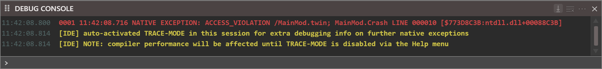
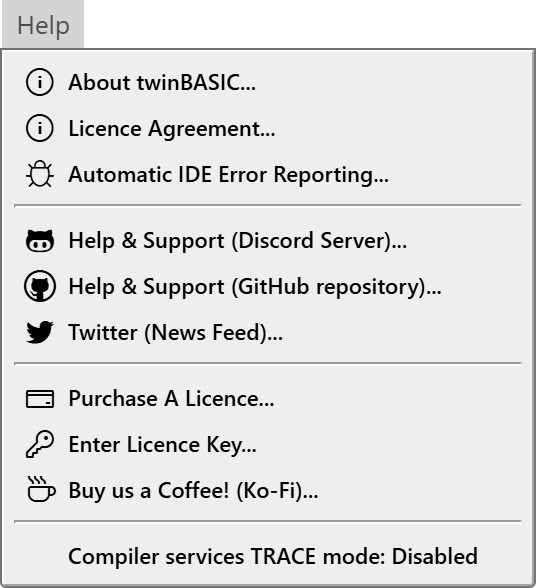
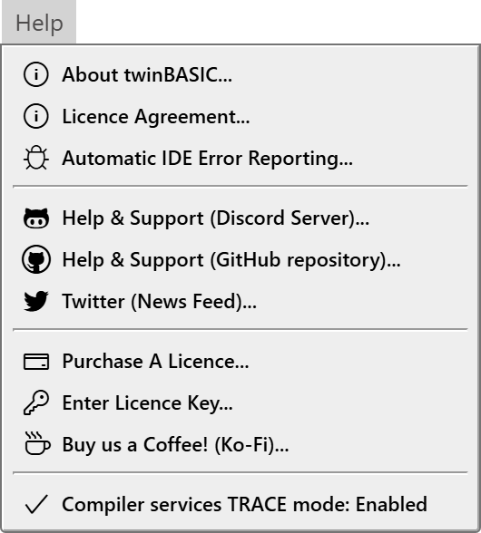
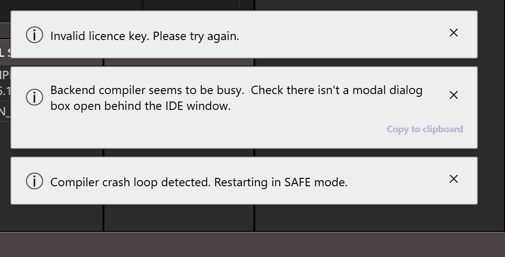

# Diagnostic tools

The IDE writes no log file. What it has to say about a failure goes to the **DEBUG CONSOLE**, to the floating message boxes above the status bar, or to a dialog. This page lists those, the lines that mean that something went wrong, TRACE mode, DevTools, and what automatic error reporting sends.

## The lines that mean something went wrong

The [Debug Console](../Debugging/Debug-Console) holds program output and the IDE's own lines. It lives in memory: **Clear Debug Console**, closing a project and `Debug.Cls` empty it, and nothing writes it to a file. Its right-click menu has **Copy All** and **Copy All (With Timestamps)**. These lines are the IDE's:

| The line | It means |
|---|---|
| `restarting from MEMORY [<path>]`, `restarting from FILE` | The compiler was restarted, by you or by a crash. See [A crash](Compiler-Services#a-crash). |
| `[IDE] auto-activated TRACE-MODE in this session ...` (yellow) | A native exception turned TRACE mode on. See [TRACE mode](#trace-mode). |
| `GDI HANDLE LIMIT EXCEEDED (<n>)`, followed by a warning in capitals that the debugger's stability is compromised | The running program holds too many GDI handles, and the line tells you to restart the compiler. It appears once for each compiler. |
| `[ERROR] synchronizing open document <tab>`, `[ERROR] saving open document <tab>` | A time-out box named the failure; this line names the document. See [When the compiler does not answer](Compiler-Services#when-the-compiler-does-not-answer). |
| `[COMPILER] Project settings changes require compiler-restart` | A change to the project's settings is saved and the compiler restarts. |
| `[BUILD] failed due to licence error.  Please try again.` | See [The licence](Missing-Files#the-licence). |
| `[PACKAGES] ... failed ...`, `[PACKAGES] version checks failed ...` | See [The package server](Missing-Files#the-package-server). |
| `[IDE] SHIFT KEY DETECTED: DISABLED LOADING OF ADDINS` | You held <kbd>Shift</kbd> while the project loaded. See [Add-ins that fail to load](#add-ins-that-fail-to-load). |
| `IDE internal error: ...` | See [IDE internal errors](#ide-internal-errors). |
| `command failed: "<id>"` | See [A command that fails](#a-command-that-fails). |
| `ERROR: DEBUGGER IS NOT CONNECTED.` (red) | A command needed the **DEBUGGER** connection and it is not open. See [The services badge](Compiler-Services#the-services-badge). |
| `IDE: failed to restore project state from host data.` | The project's remembered state could not be read. The project itself is not touched. See [Saving](Saving#a-projects-state-and-where-it-lives). |
| `Failed to create imported file '<name>'`, `Failed to read import file '<name>'` | An import could not write or read the file it names. |

The compiler writes lines of its own beside these: `[LINKER] ...`, `[SHELL] ...`, `[DEBUGGER] ...` and `NATIVE EXCEPTION ...`.

## Native exceptions

A *native exception* is a crash inside the compiler process, for example an access violation in a call to a Windows function made with a bad address. It ends the program, not the compiler. The console shows one red line, with a running number, the time, and where it happened:

```text
0001 11:42:08.716 NATIVE EXCEPTION: ACCESS_VIOLATION /MainMod.twin; MainMod.Crash LINE 000010 [$773D8C3B:ntdll.dll+00088C3B]
```

The program ends with no panel and no box. The compiler stays up, so the badge does not move, and the next run needs no restart. The line names the module and the procedure. The first native exception while TRACE mode is off also writes two yellow lines that begin `[IDE]`; see [TRACE mode](#trace-mode). When [error reporting](#automatic-error-reporting) is on, the IDE sends this line to twinBASIC Ltd.

{:width="1060" height="124"}

## TRACE mode

TRACE mode makes the compiler write more about what it is doing when something fails. It is a diagnostic for the developers of twinBASIC. It is not the same as the project's **Trace Flags** and **Trace Output** settings, which switch the logger of your own program; see [The trace logger](../Debugging/Debug-Console#the-trace-logger).

**Help → Compiler services TRACE mode: Disabled** (the item reads **Enabled**, with a tick, when the mode is on) switches the mode and restarts the compiler, because the compiler reads the setting only when it starts. The item has no key. The mode is not saved, so the IDE starts with it off. The compiler is slower while it is on.

A plain program prints the same lines with the mode on. What it adds is a dump after a native exception, one line for each thread of the compiler, such as:

```text
thread 000A: CompilerOrganizationParsingEnd
>>> thread 0008: RuntimeExpressionEvaluationExecutionStart, Crash
```

The running number of the exception lines starts again with each compiler.

The first native exception of a session switches the mode on by itself. The console then writes, in yellow:

```text
[IDE] auto-activated TRACE-MODE in this session for extra debugging info on further native exceptions
[IDE] NOTE: compiler performance will be affected until TRACE-MODE is disabled via the Help menu
```

<!-- test: bug trace-auto-activate-needs-restart -->
> [!NOTE] BETA 1034
> After a native exception turns TRACE mode on by itself, the **Help** item reads **Enabled**, but the compiler writes the dump only after its next restart; a second native exception in the same compiler prints the single line as before. Press **Restart the compiler** to get the dump for the next exception.

{:width="269" height="294"}

{:width="265" height="294"}

## DevTools

DevTools is the browser's inspector for the IDE's own page, with its Console, Elements and Network. The IDE gives it no menu item, no toolbar button and no key. The command is `tbIdeDevTools_Show`, and you reach it by binding a key in a [shortcut group](../Customising/Keyboard-Shortcuts#manage-keyboard-shortcuts): choose **Window → Keyboard Shortcuts → Manage Keyboard Shortcuts...**, add a group, and write

```json
{"tbIdeDevTools_Show": ["{KEYDOWN}{CTRL}{SHIFT}F12"]}
```

The key opens a window titled `DevTools - localhost:...`. Use it to read the full stack of an [IDE internal error](#ide-internal-errors).

<!-- test: bug devtools-stops-compiler-restart -->
> [!NOTE] BETA 1034
> While DevTools is open, a restart of the compiler (by the button, by a crash or by a change of the build configuration box) stops the page at a `debugger;` statement in the IDE's own code. The compiler has been ended, the badge reads UNAVAILABLE with four **Disconnected** lines, and nothing moves. Press **Resume** in DevTools, or close DevTools, and the restart goes on.

## Floating message boxes

The IDE says that something went wrong, and that nothing is blocked, in a message box that floats above the status bar. Up to three show, stacked at the right, one line each, the newest at the bottom. A fourth makes the oldest go. Each closes by itself after about a minute.

- **Click** a box, and its whole text shows. A **Copy to clipboard** button appears; it puts the text on the clipboard and leaves the box open.
- The **X** of a box closes it.

{:width="542" height="276"}

The messages that mean a failure include **Compiler crash loop detected.  Restarting in SAFE mode.**, **Invalid licence key.  Please try again.**, **Licence key invalid.** and `ERROR: LoadProject failed.  Error code ERROR_...`, which a project import raises.

A box that blocks the IDE is a dialog. The one dialog that offers **Copy to clipboard** is the one that reports `webSocketJson: bad json received`, a message from the compiler that the IDE could not read.

## A command that fails
{: #a-command-that-fails }

A command that has a key can fail. The console then writes:

```text
command failed: "<command id>"
```

and nothing else. The id is the name that the status bar shows when the pointer is over the command, such as `tbProject_Close`. [Keyboard shortcuts](../Customising/Keyboard-Shortcuts) lists them.

## Add-ins that fail to load

An add-in that cannot load writes a line to the console, prefixed by the name of its file, and nothing else. No box opens and the project opens without it:

```text
[broken.dll] Failed to load addin.  LoadLibrary() failed.
[noentry.dll] Failed to load addin.  Entry point not found.  Addin may have been compiled for a newer version of the twinBASIC IDE.
```

A third line, `Failed to load addin.  Entry point 'tbCreateCompilerAddin' call failed.`, means the add-in's start-up function raised an error. [Add-Ins](../AddIns/) describes how add-ins are built and loaded.

To open a project without its add-ins, hold <kbd>Shift</kbd> while the project loads. This also works at a restart of the compiler. The console writes `[IDE] SHIFT KEY DETECTED: DISABLED LOADING OF ADDINS`, and the load skips the add-ins, the check of the referenced packages and the automatic **RESYNC** of the form designers. Use it when an add-in stops the IDE.

## IDE internal errors

A fault in the IDE's own code writes this line in red to the console:

```text
IDE internal error: <message>, <line>, <column>, <error>
```

The IDE goes on. Copy the line when you report it, and read the full stack in [DevTools](#devtools) if you can.

A fault of one kind ends the IDE. It is a promise that the page's code did not handle. When the IDE was started with a project on its command line, for example by a double-click on a `.twinproj` file, it shows an alert and then closes its window:

> IDE startup failure (BETA twinBASIC IDE BETA 1034):
>
> JS Promise Rejection(1): *the message and the stack*

The first line repeats the word *BETA*, and the build number is the IDE's own. The IDE asks **Save now?** before it closes if the project has changes. When the IDE was started with no project, the same text goes to the console and the IDE stays open. Save often, and report the text.

## Automatic error reporting

[First launch](../Starting/First-Launch#the-error-reporting-question) describes the question that decides whether the IDE sends reports. When you have agreed, the IDE sends one HTTPS request to `https://twinbasic.com/notify` for each of these:

- a native exception in the compiler, with the console line;
- an error in the IDE's own page, with the `IDE internal error:` text;
- a promise that the page's code did not handle, after the start page has shown.

The request holds the IDE's version, the text of the licence box in the status bar, the time, the message, and the first row of the Call Stack (for example `MAIN_THREAD [IDLE]`, or `<none>`). It holds no source file. Compile errors are not reported. The IDE writes nothing about a report, and the reply is not shown.

**Help → Automatic IDE Error Reporting...** asks the question again. Opening it switches reporting off until you choose **YES**, even if you agreed before and open it only to read it. **NO** and <kbd>Esc</kbd> leave it off.

## The compiler's own messages

Two messages come from the compiler and not from the IDE.

- `COMPILATION (CODEGEN) ERROR AT LINE #<n>.  PLEASE REPORT THIS ERROR TO https://git.io/JMh6S` is the description of the run-time error panel for a syntax error in a procedure that **Main** calls. A compile error in your code is not a defect to report. [When the project does not compile](../Debugging/Running#when-the-project-does-not-compile) says which messages go with which errors.
- `COMPILATION ERROR DETECTED.  CHECK THE DIAGNOSTICS AT LINE #<n>` is the description for an error such as an unknown name. Read the DIAGNOSTICS panel.

## See Also

- [Debug Console](../Debugging/Debug-Console) -- the console, its buttons and the trace logger
- [Compiler services](Compiler-Services) -- crashes, restarts and Safe Mode
- [Breakpoints and stepping](../Debugging/Breakpoints-and-Stepping) -- the run-time error panel
- [Keyboard shortcuts](../Customising/Keyboard-Shortcuts) -- binding a key to a command
